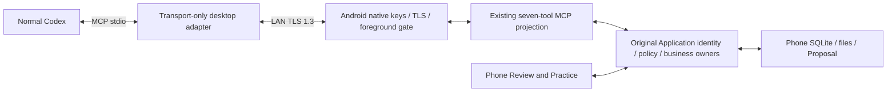

# Android device access v0

Status: **Approved design; source-only foundation; runtime admission closed.**
The user approved this design and its first foundation implementation on
2026-10-28. This grants no real connection, credential operation, model call,
business exposure or Android product acceptance. The implementation boundary in
section 12 is narrower than the complete target contract below.

## 1. Scope and authority

One normally used Codex client reaches one explicitly selected Android Shiroha
installation over a foreground LAN connection. Results belong to that phone's
database, not a Windows database awaiting synchronization. The App remains the
sole business writer. Windows limited development use stays in maintenance; its
credential, pairing, relay and admission paths are unchanged. Windows G0/HALT and
the unresolved #327 cancellation limitation are not relaxed.

The [external boundary](external-agent-boundary.md) owns identity, grants and
egress; [MCP](mcp-vnext-contract.md) owns the seven tools;
[GeneratedQuestion](generated-question-proposals.md) owns admission, Proposal,
Review, direct-policy transactions and reconciliation. [Application
capabilities](application-capabilities.md), [B0](../../architecture/b0-shiroha-backup-restore.md)
and [ARCHITECTURE](../../../ARCHITECTURE.md) retain their ownership.

Excluded: background receipt, foreground services, WorkManager, keepalive,
durable request queues, bidirectional synchronization, cloud question storage,
hosted ChatGPT, new study/analytics/exam/StudyPlan tools, image/table submissions,
OCR activation, arbitrary file paths and external COMMIT/DESTRUCTIVE.

## 2. Selected connection and responsibilities

The only selected transport is LAN TLS 1.3 with mutual credential possession
proof. No server, domain, public port forwarding or recurring relay expense is
required. A working local network is required; AP isolation is an explicit
connection failure. A phone hotspot is a candidate network requiring device
evidence. No automatic ADB/VPN/plaintext fallback exists.

USB/ADB forwarding was considered but requires debugging authority and a cable;
a VPN overlay was considered but adds clients, accounts, control-plane and
possibly relay dependencies. Neither is built alongside this transport.



The desktop adapter is a self-contained .NET console executable. It owns only
fixed-device configuration, its credential, framing and communication. It has no
MCP business implementation, database, repository, grant decision or write queue.
The Android App hosts the existing Dart MCP projection. Native code owns TLS,
Keystore, protected association storage and platform observations, never business
SQLite or Application authorization.

The design floor is Android API 29 and Windows 11 with TLS 1.3 available. This is
not a verified support set or an App-wide minimum-version change. Older devices
retain local features. A supported artifact/OS/client combination requires the
section 11 evidence; compile success alone establishes none.

Bind one explicitly selected private IPv4 address, never a wildcard, cellular or
VPN interface. No network scan/mDNS is introduced. The phone displays its current
address; the adapter remembers it only as a routing hint. Address changes update
that hint only after verifying the original device. A fixed IP is optional.

TLS terminates in the desktop adapter and Android native layer. Both endpoints
and Codex necessarily handle plaintext in memory. There is no additional relay,
but ordinary Codex may send tool content to its model service. The UI must not
claim that all content stays within the LAN or can be recalled after release.

The App-side Android port must explicitly enter the original
FirstPartyStageApproval/P10 approval path. The current generic App port's
pre-approved-STAGE path is not automatically equivalent. Connection close must
not call an App-wide shutdown as if both owners had the same lifetime.

## 3. Device identity and pairing

| Value | Authority / purpose |
|---|---|
| Display name | Editable local label, never authentication |
| deviceId | SHA-256 of the installation public-key SPKI, verified through TLS |
| installationId | Local generated installation identifier, distinct from database localOwner |
| Profile | Original Application-generated phone-local identity and Grant |
| Client credential | Desktop adapter's independent key, not proof of a program brand |
| Association | Protected binding of credential to phone Profile, not current authorization |
| Address | Routing hint only |
| Session/Context | Original transient Application objects, never wire-created |

First connection has one bounded local pairing panel, not a configuration wizard:

1. The phone user opens a pairing window for at most 120 seconds.
2. The phone displays the address, deviceId and full certificate SHA-256.
3. The user transfers this public information to the local desktop pairing
   helper, outside model tool arguments. It is not obtained from untrusted
   discovery as an automatic trust decision.
4. The helper checks the phone's pinned certificate and possession before a
   pairing-only exchange, and displays its own client certificate fingerprint.
5. The phone displays the actual client's full fingerprint. The user compares
   both local displays and explicitly confirms the exact computer.
6. The original Application pairing owner, fresh P15 challenge and original live
   channel authorize association CAS and P0 completion. No business frame is
   accepted, parsed or queued on the pairing channel.
7. Pairing ends disabled. The first access action separately displays scope and
   default review policy before enabling.

Fingerprints alone prove no possession. Self-signed certificate validation on an
enrollment connection is not trust, a Session or a Grant. The local confirmation
and P15 proof are required. No accepting/default production verifier is allowed.

Daily enable reads the current exact association only after explicit local
action, obtains fresh same-channel evidence and uses the original P15/P0
existing-credential confirmation. No repeated fingerprint comparison is required
for an intact pairing. Verified proof and its original channel settlement
precede finite Enable; only then may a fresh business connection be admitted.
Opening a page or reading saved state does not hydrate authentication.
Preparation is bounded to 120 seconds; the actual P15 proof keeps its existing
maximum 30-second window.

An enable period is at most eight hours from the explicit action, shortened by
credential validity, foreground loss, revoke or other limits. Repeating enable
does not renew it. The design permits one selected active desktop association;
same-name devices never auto-select or fail over. The adapter keeps the original
device and Profile even when an address now belongs to another phone.

Missing/corrupt credentials, reinstall or expired certificates fail closed.
Re-pair/recovery requires explicit local action; no pin replacement, revived
revoked Profile or reassignment of old history is automatic.

### Daily enable and desktop startup order

For an intact pairing, the phone's explicit access action enters PREPARING and
admits only the selected association's bounded enable-proof exchange. The local
desktop connection helper initiates that exchange after the phone action; it
reuses the pinned device/Profile and existing credential, outside model tool
arguments. This local connect action does not repeat enrollment or authorize
business. The helper is not a background polling service or a second writer.

The original phone P15/P0 owner verifies the proof on its original live channel,
then joins that channel's settlement before finite Enable. The helper must also
settle its original connection. Only after the phone reports enabled may the
normal Codex client start/restart its business adapter. The business connection
performs fresh TLS, HELLO(business), current-association and access checks before
business READY and MCP negotiation; it cannot reuse the proof channel or Session.

```mermaid
sequenceDiagram
  actor User
  participant Phone as Android access owner
  participant Helper as Local desktop connection helper
  participant Codex
  participant Adapter as Business stdio adapter
  User->>Phone: Enable access for the selected existing Profile
  Note over Phone: PREPARING; bounded proof-only admission
  User->>Helper: Connect to the existing pinned phone/Profile
  Helper->>Phone: Fresh TLS and HELLO(enable-proof); original P15 proof
  Note over Helper,Phone: Verify same-channel proof; settle original proof connection
  Note over Phone: Original owner enables finite access
  User->>Codex: Start or restart the configured MCP server
  Codex->>Adapter: Launch business adapter
  Adapter->>Phone: Fresh TLS and HELLO(business)
  Phone-->>Adapter: READY only after current authentication and access checks
  Adapter->>Phone: Existing MCP negotiation
```

A business attempt before Enable receives the existing safe unavailable/access
refusal and ends; it is not held until the user enables access and cannot occupy
the proof slot. A proof attempt without the matching current PREPARING action
also refuses. After that failed startup, follow section 8's explicit client
restart path. Neither side waits for an already-dead peer or creates a retry
loop. Lost focus, cancellation or expiry during preparation invalidates this
attempt and still joins late acquisition/settlement; it never enables access.
This is target interaction ordering, not a claim that section 12 already supplies
the helper workflow, live proof messages or business entrypoint.

## 4. Saved-policy applicability

External boundary section 14 now explicitly specifies this additional consumer.
New Android access defaults to review; direct defaults off and requires an
explicit local choice. All-content covers this phone's current Shiroha data
instance, including subsequently added banks/File Library files, not OS files,
other devices or Windows data. Current existence, Project membership, category,
recipient, permission, revision, Context and final-release checks still apply.

Legacy missing preference rows retain exact scope and confirm behavior.
Upgrade, page open, pairing and new-device connection never broaden them.
Saved review/direct policy uses the original FirstPartyStageApproval owner and
does not require an open settings view. Legacy confirm retains its bounded
original decision view; closing a pending view invalidates that decision.

Only a new key under the current direct policy may be published and committed
inside the original single transaction. The existing typed, quality, evidence,
duplicate, target, Training, Receipt and terminal checks all remain. Old drafts,
existing keys, mode switches, reconnect and restart never cause a late commit.
Failure does not automatically change mode, generate a key or retry as a draft.

Four independent conditions must remain separate in code and UI:

| Condition | Persistence | Sufficient by itself? |
|---|---|---|
| Saved Grant / generation preference | Existing SQLite v35 | No |
| Current finite access enabled | Memory only | No |
| Exact connection authenticated | Memory only | No |
| Current invocation and release authorized | Revalidated per call | Only for that operation |

Policy changes withdraw old access synchronously before original revision CAS.
Failure leaves access off. A late save cannot restore a cancelled enable action.
STAGED / formalCommit=NOT_REPORTED acknowledges publication only, including a
new direct batch; original-key lifecycle query determines the saved result.

## 5. Foreground and lifecycle

Business admission requires all of: Flutter resumed, native Activity resumed,
window focus, interactive screen, unlocked Keyguard, unchanged selected network,
and current finite enable/association/policy epoch. Unknown or contradictory
observations deny. Native first closes input/output admission, then informs
Dart; stale observation generations never restore old connections.

States: OFF, PREPARING, READY, SUSPENDED, DRAINING, RECOVERY_REQUIRED.
SUSPENDED preserves the unexpired enable intent only; its old connection is
closed and cannot resume. A new authenticated connection may use the remaining
time without renewal. DRAINING has no admission and keeps custody until actual
settlement. Failed/unknown cleanup prevents replacement. Recovering foreground
eligibility does not revive the closed LAN connection or desktop MCP session;
section 8 owns their distinct restart responsibilities and evidence requirements.

| Event | New work / output | In-flight and authority | Return path |
|---|---|---|---|
| First open/process restart | Deny | OFF; old authority absent | Explicit enable |
| Explicit enable | Proof controls only | PREPARING; original bounded operation | Fresh proof and Enable |
| Leave pending setup view | Deny | Cancel original operation; join late acquisition | Explicit new action |
| Navigate after READY | Allowed under current checks | Settings is not owner | No new action |
| Dialog/notification shade/focus loss | Deny unreleased output and new work | SUSPENDED, cancel/close connection | Fresh connection, same remaining period |
| Focused split screen | Allowed if every condition holds | Current authority | Normal |
| Unfocused split screen/PiP | Deny | SUSPENDED | Regain focus and authenticate |
| onStop/hidden/paused/detached | Deny | Revoke finite enable; DRAINING | Explicit enable |
| Lock/non-interactive screen | Deny even before Flutter update | Revoke and drain | Unlock does not enable |
| Network/interface/address change | Deny | Revoke old access and connection | Update hint, explicit enable |
| Single connection loss, same network | Deny on that channel | Cancel that channel; finite enable may remain | Fresh auth, no replay |
| Switch off | Deny synchronously | Withdraw before asynchronous drain | Explicit enable |
| Revoke | Deny synchronously | Original Grant/association CAS and drain | Explicit recovery/re-pair if applicable |
| Expiry | Deny | No renewal; drain to OFF | Explicit enable |
| B0/recomposition | Deny | Drain before database close/swap | Fresh composition and authorization |
| System process kill | No callback guarantee | Volatile authority disappears | SQLite recovery; original-key query |

Cancellation before handler entry can prove not_started. After entry, actual
transaction evidence determines the outcome. Observed invalidation is checked
at original transaction gates; direct retains its final cancellation check.
Commit first preserves the result. A race with invalidation/kill can be unknown.
There is no atomic Native/Dart/SQLite transition and no promise that Android
delivers every callback. Bytes already released to TLS/OS cannot be recalled.

Short settlement of an admitted transaction is not permission to accept a
background task. No Service/WorkManager/keepalive/queue is introduced.

## 6. Credentials and storage

Android uses an AndroidKeyStore P-256 signing key and native SSLContext /
X509ExtendedKeyManager / SSLServerSocket. The private key object remains native;
it is never exported into Dart SecurityContext. Existing flutter_secure_storage
engine.* APIs are not treated as a TLS signing API.

Each endpoint has a pinned self-signed identity leaf, not the Windows issuer
hierarchy. Candidate validity is two years. Validate signature, P-256 parameters,
key correspondence, validity and unknown critical extensions. Android-generated
server leaves may omit EKU; a conflicting EKU/KeyUsage is rejected. Client leaves
must have clientAuth. Native generation must permit a valid self-signature;
obtaining a certificate object alone proves nothing. No global trust-store
installation, public CA identity substitution, 0-RTT or automatic key rotation.
Every connection still obtains fresh Application evidence even if TLS caches.

The protected Android object is under getNoBackupFilesDir(), in the fixed
shiroha-external-v1 directory. A separate Keystore AES-GCM key protects it, with
fresh provider-generated 12-byte IV, 128-bit tag and domain-separated AAD.
The original AssociationObjectCodec (64 records / 65536 cleartext bytes) is
reused, with the Android restriction of one active association. Cipher framing
is version byte 1, IV, authenticated ciphertext/tag; its maximum is 65565 bytes.
No new database or SQLite version is allocated.

One owner serializes leases/CAS. Native conditional replace compares the
original object, writes via AtomicFile and reads it back; AtomicFile alone is
not a lock or business CAS. Revocation tombstones remain; limits never delete
history. Missing, corrupt, unavailable and commit-unknown are different outcomes.
An observed invalid snapshot never becomes valid again. Partial key/object
initialization requires explicit recovery, not overwrite or plaintext fallback.

Original P15 registration order is management validation -> association CAS ->
P0 completion. SQLite and secure-store state are not one transaction. A residue
or lost completion does not authorize business. Revoke or uncertain cleanup
keeps the runtime closed and does not delete proposals.

The desktop has a separate current-user DPAPI object for its software-generated
client key, fixed phone identity/Profile and address hint. It does not read any
Windows Shiroha credential. Same-user program isolation is not promised. The
adapter never persists content, pending submissions or a business result queue.

## 7. Link protocol and limits

Versions remain independent: android-device-link/1, TLS 1.3, the pinned MCP SDK's
existing negotiated protocol, Shiroha profile 2, Submission 1, current Proposal /
Origin / Receipt codecs and SQLite v35. No automatic protocol/TLS downgrade.

TLS authentication precedes HELLO and current-association/runtime checks.
For purpose=business, READY requires completed finite Enable and fresh business
channel authentication; only that READY permits MCP negotiation. Pairing and
enable-proof stay control-only and never become business channels after their
completion. Declaring a purpose grants no corresponding permission. Section 3
owns the proof-settlement-before-Enable order.

| Frame field | Encoding |
|---|---|
| Magic | 4 ASCII bytes SHAD |
| Version | 1 byte, exactly 1 |
| Kind | 1 byte: 1 control, 2 MCP |
| Reserved | 2 zero bytes |
| Payload length | 4 unsigned big-endian bytes, checked before allocation |
| Payload | Exact bounded strict UTF-8; no compression/binary/duplicate JSON keys |

HELLO exact fields: type=hello, purpose=(pairing|enable-proof|business),
expectedDeviceId, expectedProfileId (null only during first pairing), clientNonce
(32 random bytes, unpadded base64url), linkVersions=[1]. Selectors are checked
against TLS/association evidence, not used as authority factories.

READY exact fields: type=ready, linkVersion=1, deviceId, profileId, runtimeId,
connectionId, original clientNonce, fresh serverNonce. Runtime/connection IDs
are fresh random connection-layer references, never Application Sessions.

```json
{"type":"hello","purpose":"business","expectedDeviceId":"<pinned-spki-sha256>","expectedProfileId":"<original-phone-profile>","clientNonce":"<32-byte-base64url>","linkVersions":[1]}
```

```json
{"type":"ready","linkVersion":1,"deviceId":"<verified-device>","profileId":"<verified-profile>","runtimeId":"<fresh-runtime>","connectionId":"<fresh-connection>","clientNonce":"<original-nonce>","serverNonce":"<fresh-nonce>"}
```

| Resource | Maximum / behavior |
|---|---|
| Business connections / active business calls | One each; excess busy, no queue |
| Concurrent TLS handshakes / pairing candidate | Two / one |
| Control frame | 16 KiB |
| Request frame | 6,324,224 bytes; Submission still 1 MiB |
| Response frame | 512 KiB; original smaller business output limits retained |
| Raw frame buffers | 14 MiB across at most two incoming and one outgoing frame |
| Link establishment / partial header / frame body | 5 / 2 / 10 seconds; start points below |
| READ | Original 2 seconds |
| STAGE | Original 2-second preparation / 10-second completion |
| Legacy confirm | Original 120-second decision window |
| Context | Original maximum 15 minutes, never extending other authority |
| Ping / lost peer | 15 / 45 seconds, not OS keepalive |
| Stalled output | 5 seconds, close and preserve unknown write outcome |

These are protocol/buffer budgets, not a total-RSS or OS scheduling guarantee.
Actual Native/provider memory and device behavior require measurement.

### Deadline and heartbeat scheduling

Use monotonic elapsed time for these connection deadlines. The earlier applicable
connection, operation, foreground or authorization deadline wins; receiving bytes,
heartbeats or a new frame never renews access or an original business deadline.

- The 5-second establishment budget starts with the desktop connection attempt
  (the accepted socket on the phone). It covers TLS and the initial link-control
  negotiation, including business HELLO/READY. A pairing/enable-proof P15 exchange
  then retains its separate original 30-second proof and 120-second preparation
  limits; it is not a business READY wait. A premature business attempt refuses
  instead of waiting for the phone to enable it.
- After establishment, the 2-second header deadline starts on the first byte of
  a new frame, not while an otherwise idle connection awaits that byte. The
  10-second body deadline starts after the complete validated header. Both are
  absolute for that frame; partial reads do not reset them. A complete buffered
  frame no longer has a transport body timer while its handler or UI is waiting.
- On an admitted business link, schedule a link-control heartbeat at least every
  15 seconds independently of business handling, including a legacy confirm wait.
  Its reply is connection-bound and grants no business permission. The 45-second
  peer-loss clock starts at business READY and resets only for a complete valid
  message from that authenticated peer (including a matching heartbeat reply),
  never for locally sent traffic, malformed data or partial bytes.
- Control and MCP output share one serialized frame writer: never interleave
  frame bytes or block control processing on the single business-call slot.
  Coalesce pending heartbeat work rather than queueing unbounded frames, and
  preserve the existing buffer ceilings. Each selected frame's write/flush has
  one absolute 5-second output budget; heartbeats cannot hide a stalled writer.
- Original READ/STAGE and manual-decision timers retain their existing owners
  and start points. A legacy confirmation wait can therefore last beyond a
  frame's body timeout while bounded heartbeats continue. Background/focus loss,
  switch-off or failed settlement still closes the link; heartbeats never keep
  a suspended/background runtime alive or clear an unknown write outcome.

These rules define the pending runtime scheduling, not an implemented heartbeat
codec or a new business schema. Exact connection-bound heartbeat control encoding
must be specified and checked with the future link runtime before activation.

Fixed link errors: unavailable, busy, foreground_required, access_disabled,
expired, network_changed, device_mismatch, credential_rejected, pairing_required,
credential_store_unavailable, credential_store_corrupt, settlement_unknown,
unsupported_link_version, protocol_violation, resource_limit. No raw exception,
certificate, credential, address, payload or existence detail is returned.
Mismatch/credential failure requires local correction; store/settlement
uncertainty requires recovery. Reconnectable failures never replay a write.

## 8. Cancellation, requests and recovery

Keep exactly the existing seven tools and business schemas. Device routing and
connection fields do not enter model-supplied business arguments. The adapter
forwards the negotiated MCP cancellation semantics; Android maps them through
the original SDK to ExternalCallControl. Cancellation, socket close and actual
handler settlement remain distinct. Slots last until real settlement.

#327 is not solved here: if a client timeout sends no cancellation, the adapter
cannot infer cancellation. Phone deadlines bound work but do not prove rollback;
increasing a client timeout is not a fix or acceptance evidence.

Database idempotency stays (clientProfileId, submissionKey). Recovery routing is
(verified deviceId, original phone Profile, original submissionKey). Same key
and semantics yields original history; changed semantics conflicts. No claim of
cross-device exactly-once delivery is made.

After response loss, authenticate the SAME phone/Profile and only query the
original key. Absence can still be unknown while original work settles. Do not
resubmit, generate a new key, fall back to a different device or persist a retry
queue. Reinstall/new Profile/B0 scrub cannot inherit the old external identity;
retained history remains available through local Review.

Connection loss ends the old desktop MCP stdio session. This contract does not
assume that Codex automatically restarts an exited stdio server. Recovery has
three separate owners:

| Owner | Recovery responsibility |
|---|---|
| Android access owner | Settle old work; recheck foreground/network and retained unexpired enablement, or require a new explicit access action under section 5. Never reopen on failed/unknown settlement. |
| Desktop adapter | End the old forwarding attempt and settle its original streams/socket. A later client-launched instance verifies the same pinned phone/Profile and negotiates a fresh link. It neither relaunches itself nor replays tool input. |
| Codex / user | Start a new MCP server session using a restart/reconnect action actually verified for that client. Where unavailable, completely exit/reopen the client after original settlement. No assumption of automatic restart, configuration rewrite or re-pairing. |

For focus-only suspension with clean settlement, a new authenticated connection
may consume the same remaining enable period, without renewal. Background, lock,
expiry or other withdrawal instead requires section 3's explicit access/proof
sequence before starting the new business adapter. Restored phone focus or a
visible cached tool list is not evidence of a usable Codex connection.

A supported client record must identify its actual version and demonstrated
recovery action. Automatic recovery is a claim only for the exact combination
that passes section 11; absent such evidence, report manual restart required or
recovery unverified. After restart, use a real READ or original-key query to
establish success; never retry an uncertain STAGE to test the connection.
Same-runtime READ references follow the original registry, not a promise from
the transport. Old exact-Session STAGE approvals cannot transfer. New runtime,
B0, background re-enable and recomposition invalidate old connection references,
Sessions and Contexts.

```mermaid
sequenceDiagram
  actor User
  participant Codex
  participant Phone as Android Application
  participant Data as Phone persistence
  User->>Phone: Explicit foreground enable and saved policy
  Codex->>Phone: Fresh TLS / link / MCP authentication
  Codex->>Phone: Existing READ tools
  Codex->>Phone: STAGE(original submissionKey)
  Phone->>Phone: Original approval owner and current gates
  alt review or retained confirm flow
    Phone->>Data: Original atomic pending publication
    Data-->>Phone: Durable publication result
  else direct and NEW key
    Phone->>Data: Atomic publish and typed commit
    Data-->>Phone: Durable publication and terminal result
  end
  Phone--xCodex: Publication acknowledgement; reply may be lost
  Codex->>Phone: Reconnect if needed; lifecycle query(original key)
  Phone-->>Codex: Current pending/rejected/committed status and safe counts
  opt Pending proposal; later independent local decision
    User->>Phone: Review and explicitly approve or reject
    Phone->>Data: Original terminal transaction; typed write only on approval
    Data-->>Phone: Durable terminal result
    Codex->>Phone: Authorized lifecycle query(original key)
    Phone-->>Codex: Actual durable status and safe counts
  end
```

The publication response never waits for later local Review. In review/retained
confirm mode, an untouched proposal remains pending and queryable after the
STAGE call completes. Retained confirm's pre-publication STAGE decision is not
post-publication Review. Direct mode instead completes its original new-batch
transaction before acknowledgement; the unchanged acknowledgement does not report
that terminal status. All modes use the original key to reconcile a lost reply.
The diagram illustrates independent decisions, not a requirement that the user
wait for network delivery before reviewing locally available pending work.

## 9. Backup, removal and diagnostics

B0 includes original Proposal/Receipt/content, scrubs Profiles/Grants/v35 policy,
and excludes credentials, associations and transient authority. Restore does not
modify secure credentials or reconstruct scrubbed Profiles from orphan records.
Raw rollback retains local durable policy, not runtime Enablement.

System backup/device transfer excludes the new no-backup state. Explicit rules
reinforce that boundary without disabling unrelated backup. Restored database
policy alone cannot authenticate. Reinstall/clear-data creates a new installation;
only actually retained or B0-restored content survives. New pairing defaults to
review and never inherits a restored direct choice as consent.

Disable, disconnect, revoke and feature rollback never delete questions,
Proposal/Review, learning facts or managed files. Diagnostics allow fixed codes,
stages, durations, byte counts and App diagnostic IDs; no full Profile, key,
fingerprint, IP, submissionKey, query, content or unsafe exception is logged.
Public address/fingerprint display is confined to explicit local connection UI.

## 10. Permissions and daily interaction

Main Manifest declares INTERNET and ACCESS_NETWORK_STATE. Follow actual target
SDK local-network rules: Android 17 / target 37 requires ACCESS_LOCAL_NETWORK;
older targets do not gain a speculative permission request. No lowering target
SDK to bypass admission. Permission denial/revoke keeps access off; no prompt loop
or alternate egress path. Record actual OS/target SDK in device evidence.

Reuse the external Agent settings body: current phone/computer labels and short
identities, access switch with actual status/expiry, default drafts/direct toggle,
existing draft inbox, folded first-connection/address/diagnostic controls.

| Display | Meaning / next action |
|---|---|
| Not paired | First local connection |
| Access off | Saved policy is not enablement; user may enable |
| Verifying connection | PREPARING; complete the local desktop proof action or cancel; no business access yet |
| Enabled, waiting for Codex | Finite enable, no business channel; start/restart the configured server as in section 8 |
| Connected | Foreground and current auth hold |
| Temporarily unfocused | Suspended; regain focus, settle the old link and recover the client session under section 8 |
| Closed by background/lock/network | Explicit enable required |
| Connection needs checking | Fixed safe diagnosis, never a false connected badge |

Direct confirmation explains that later NEW batches may enter this phone's
question bank under existing gates and that content leaves to the paired client.
Existing drafts remain reviewable; disabling access retains the preference but
does not make it active. No full-app redesign or three-screen setup wizard.

## 11. Required acceptance matrix

All product/runtime rows remain pending. D = deterministic synthetic fixture;
E = isolated emulator runtime; R = real phone/network/normal Codex evidence.
E/R need separate explicit runtime authorization. Emulator port forwarding is
not real cross-device LAN proof; no row requires OCR.

| Scenario / trigger | Required state/effect | Proof |
|---|---|---|
| Normal Codex, selected phone, test question | Read correct phone; no desktop database | D+R |
| Existing parsed small text | Read passages; zero parser/OCR/provider activation | D+E+R |
| New default review batch; leave Review untouched | STAGE returns after durable pending publication without waiting for local Review; original-key query is pending, no formal question | D+R |
| Local Review approval | Original atomic commit; key query committed | D+R |
| Explicit direct, new key | Original atomic Proposal/Question/Receipt write | D+R |
| Old draft / repeated key / mode switch | No retroactive commit; changed semantics conflict | D+R |
| Policy/STAGE race | Original transaction winner, no partial publication | D |
| Wrong/same-name device | Reject before business content, no pin replacement | D+R |
| Unpaired/forged Profile | No content/new write | D+E+R |
| Existing pairing; daily enable and early business startup | Proof-only PREPARING, original proof settlement before Enable, then fresh business READY/MCP; early business attempt refuses without blocking proof | D+E+R |
| Switch off during status/proof | Immediate withdrawal; no late re-enable | D+E+R |
| Grant/association revoke | New calls denied; local history retained | D+R |
| Commit then lost reply | Query original key, one durable result, no replay | D+R |
| Query absent while unsettled | Unknown, never automatic retry | D |
| Navigate after ready / leave pending setup | Preserve ready / cancel original pending operation | D+E+R |
| Dialog, notification shade, split screen | Suspend when unfocused, no deadline renewal | D+E+R |
| Successful READ, focus-only loss, return, next Codex call | Actual version-bound server restart/reconnect or proven automatic recovery; fresh link/MCP, same remaining enable time, no write replay | D+E+R |
| Client lacks automatic stdio restart | Demonstrate supported manual recovery or record unsupported/unverified; cached tool inventory is not success | R |
| Background/lock | Revoke; explicit foreground enable required | D+E+R |
| Network/address switch | Close old authority, verify original identity again | D+R |
| Kill before/during/after commit | Fresh authority; recover actual durable result | D+E+R |
| B0/system restore/reinstall | No automatic pairing/direct consent; preserve local facts | D+E; transfer R |
| Study committed question | Existing practice/answer/reveal/learning rules | R |
| Disable new capability | Local study and Review remain usable | D+R |
| Existing Windows path | No credential migration/re-pair/new transport requirement | D; bounded R if affected |
| #327 short timeout | Preserve missing-cancel evidence; no invented rollback | D+R |
| Idle link and slow partial header/body | No idle 2-second header timeout; absolute 2/10-second partial-frame limits and 45-second valid-peer-loss bound, no trickle reset | D+E |
| Legacy confirm waits while heartbeats run | Control processing/writer remain live without interleaving frames or renewing business/access deadlines; lost peer still closes | D+E |
| Oversize/slow/concurrent/stalled frames | Bounded refusal and actual settlement custody | D+E |
| Keystore/KeyManager/TLS pairing | Correct proof succeeds; wrong pin/key/expiry fails | E+R |

## 12. Source foundation and subsequent activation boundary

This delivery supplies a pure foreground resource state machine, a P15
association-store adapter over the existing codec, dormant Native Keystore /
AES-GCM / conditional-file / pinned TLS sources, an unregistered MethodChannel
adapter, and the desktop transport sources with an unconditional runtime refusal.
Synthetic tests exercise no sockets or real credentials. The native observer is
not installed in MainActivity. lib/main.dart does not construct this root.

It does NOT yet supply a live first-pairing UI/protocol, accepted native-channel
P15 authentication evidence, business READY/MCP dispatch, runtime timers or
normal settings composition. Those belong to the next authorized integration
after the necessary native combination proof. A raw certificate digest from the
foundation probe is only an observation and cannot mint P15 evidence.

Minimum native proof: Keystore key through KeyManager/TLS without export, exact
credential/installation/channel binding, foreground/close settlement ordering,
and subsequent Android database/file owner compatibility. Failed proof must not
silently select exported keys, plaintext, ADB or a cloud relay.

Feature rollback disables the Android root and retains published data formats.
Hosted ChatGPT later needs separately authorized reachability, OAuth/account
mapping, phone outbound-channel and relay/egress decisions; packaging the stdio
adapter alone cannot provide that capability.

## 13. Official design references

Interface support is not evidence that this combination has run successfully.

- [Codex MCP](https://learn.chatgpt.com/docs/extend/mcp)
- [MCP transports](https://modelcontextprotocol.io/specification/2026-07-28/basic/transports)
- [Android lifecycle](https://developer.android.com/guide/components/activities/activity-lifecycle)
- [Flutter lifecycle](https://api.flutter.dev/flutter/dart-ui/AppLifecycleState.html)
- [Keystore](https://developer.android.com/privacy-and-security/keystore)
- [Key generation / certificate caveats](https://developer.android.com/reference/android/security/keystore/KeyGenParameterSpec)
- [KeyManager](https://developer.android.com/reference/javax/net/ssl/X509ExtendedKeyManager)
- [SSLServerSocket](https://developer.android.com/reference/javax/net/ssl/SSLServerSocket)
- [Dart key-byte API](https://api.dart.dev/dart-io/SecurityContext/usePrivateKeyBytes.html)
- [Local-network permission](https://developer.android.com/privacy-and-security/local-network-permission)
- [Backup and device transfer](https://developer.android.com/identity/data/autobackup)
- [AtomicFile](https://developer.android.com/reference/android/util/AtomicFile)
- [.NET TLS](https://learn.microsoft.com/en-us/dotnet/core/extensions/sslstream-best-practices)
- [Schannel version support](https://learn.microsoft.com/en-us/windows/win32/secauthn/protocols-in-tls-ssl--schannel-ssp-)
