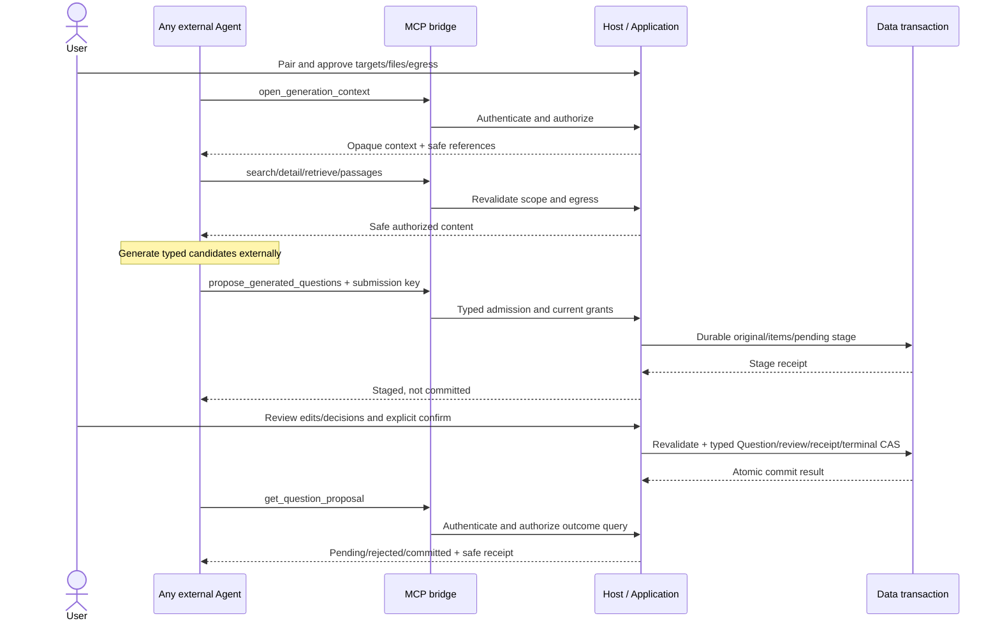

# MCP vNext Local Generation Profile

Status: **FROZEN target capability surface; not implemented by AR-R0.**

Authority/activation: [index](README.md). Owns MCP projections/protocol and
reference-package boundary, not business identity, authorization or commit.
Full wire schemas/version identifiers are frozen in AR-R6B before exposure.

## 1. Local Tools-only profile

External Client -> stdio MCP bridge -> authenticated local IPC -> App Host ->
Application. Identity/context/egress rules are owned by
[external-agent-boundary.md](external-agent-boundary.md). Bridge has no database,
repository, migrations or alternate App writer.

| Tool | Minimum input intent | Safe output / permission |
|---|---|---|
| open_generation_context | Optional server-minted target reference | Without target: bounded/paged authorized target metadata; with target: opaque handle and approved evidence references; READ |
| search_questions | context handle, bounded search/cursor | Context-scoped question projection; READ |
| get_question_detail | context handle, server-returned question reference | Authorized typed question projection; READ |
| retrieve_file_content | context handle, bounded lexical query | Verified current RAG snippets/evidence; READ with permitted derived cache |
| get_file_passage | context handle, returned evidence reference/cursor | Bounded verified parsed passages and coverage/exclusion metadata; READ |
| propose_generated_questions | context handle, submission key, typed candidates | Durable Proposal identity/count/receipt, explicitly staged not committed; STAGE |
| get_question_proposal | Proposal reference or submission key | Currently authorized lifecycle/count/safe receipt, without needing old handle; READ |

Generation targets are selected in Shiroha pairing; no extra list_learning_spaces
is needed. get_question_draft/list_pending_proposals are excluded from MVP;
external clients do not edit the local review copy and can reconcile by key.
No W0/SPL external staging, commit, delete, OCR activation or arbitrary file path.

P4 is accepted in merged PR #251; P5's accepted unpublished Application-only
Question READ foundation under external-agent-boundary §3. Future search/detail
projections must carry its Context-bound QuestionRefs/cursors, current READ +
questionContent + exact Scope and final release checks, never raw storage ids or
MCP v0's unscoped entry. P5 (merged PR #253) publishes no tools or wire schema;
its original File/Evidence snapshots remain empty. P6's unpublished Application
candidate creates separate explicit File Contexts and bounded lexical/passage
reads using current READ + fileContent + exact File/Project scope, current F1
generation and final release checks. Future projections must carry its random
File selection/Passage/cursor references, safe coverage/exclusion metadata and
real derived-cache execution evidence; no raw IDs or request-supplied scope.
No new tool or wire schema is published. That focused external contract §3 owns
the candidate interfaces, budgets and lifecycle semantics.

P8 adds only an offline trusted Host dispatch/startup/drain seam under that
external contract. It creates no MCP projection, stdio bridge, protocol JSON
decoder, transport or public tool. Future adapters must obtain authenticated
Sessions from the trusted credential authority, never from request metadata.

P9 freezes only an unpublished internal IPC envelope v1 under external boundary
§7. It is independent of MCP protocol and Submission schema versions, and does
not parse Tool Schema, publish a client protocol, register tools or establish
authentication. Its opaque text must pass future adapter schema and independent
trusted authentication/authorization before any P8 call.

P10's unpublished offline business schema v1 is owned by external boundary §8.
It is independent of this MCP profile and P9/Submission versions. Trusted test
composition supplies authentication and P8 execution Contexts, with ten explicit
typed mappings and safe response whitelists. It registers no MCP tool, stdio
bridge or production Host/transport; AR-R6B remains inactive.

Both retrieval and passage read current verified SourceDocument through
Application. No raw managed originals, URLs, binaries, diagnostics or unsafe
fallback content. source_not_ready instructs parsing in App rather than invoking
OCR. Page/cursor output distinguishes remaining content and excluded structure;
search hits are not evidence of complete document reading.

Projections perform shape/schema parsing and encoding. Application validates
typed semantics, authorization, scope and egress. Validate structured result
against its declared schema; output encoding failure preserves known receipt.
Object-shaped structured output with safe compatible text supports legacy
clients; never pass repository maps. Business/tool failure and JSON-RPC protocol
error remain distinct. Safe errors include unavailable/busy/unauthorized/stale,
invalid submission/idempotency conflict and known or unknown execution outcome.
No raw exception/body or existence leak.

## 2. v0 coexistence and protocol versions

[MCP v0](../../architecture/mcp-v0-contract.md) retains exactly six READ_ONLY
tools, existing envelopes and independent entrypoint. vNext is a separate
profile/entrypoint; it is not a seventh v0 tool, v0 authentication retrofit or
authority to mutate. `mcp_dart` stays under `lib/mcp/**`; no SDK/dependency change
is authorized by this checkpoint.

Version MCP wire, Shiroha profile, submission schema and IPC envelope separately.
Use the pinned SDK's compatibility support rather than implementing Provider/
MCP versions in the business layer. Unknown versions fail explicitly. AR-R6B
tests actual supported modern and legacy protocol behavior, not only direct
callback invocation.

Official protocol reference verified during design is 2026-07-28: stateless
per-request metadata/server discovery, explicit handles and Tasks extension.
This observation does not freeze SDK behavior forever or claim every installed
client supports that revision. Recheck official SDK/protocol at implementation;
any upgrade requires a separately reviewed compatibility change.

Tools list is deterministic for the same configured profile/modules, not changed
per open context. Definition visibility is not authorization. READ annotations
are hints; STAGE is not read-only and idempotent is asserted only when the
business contract supports it. Annotations never grant COMMIT.

## 3. Lifecycle, progress and cancellation

Map request cancellation/deadline through IPC to Application. READ cancellation
stops unreleased content where possible. STAGE past durable commit returns or
reconciles its receipt; disconnect/timeout cannot imply undo or zero effect.
Report fixed progress stage/counts only, without query/candidate/source content.

App absence/restart/restore/revoke follows external boundary; never open SQLite
as fallback. stdout is exclusively protocol framing; safe logs use stderr.
No MCP logging/raw-body export is introduced. Protocol request id is not durable
submission identity. Each in-flight unknown STAGE is reconciled by its key.

## 4. Complete workflow



Every MCP client that supports Tools can complete this flow; Resources/Prompts
are optional future projections with the same authorization. Prompts only guide
use; Resources only expose safe authorized snapshots. MCP Tasks, sampling,
external formal approval and hosted remote transport are excluded from MVP.

## 5. First-party reference integration

Codex is a reference client, not a business Module or a special Proposal origin.
A separate integration repository packages manifest/MCP/Skill/assets, not the
Flutter repository. Skill teaches open/read/check duplicates/generate/stage/
review/status and must never say staged means formally saved.

Preferred current portable layout is root plugin.json/mcp.json/skills/assets
with OpenAI-specific metadata in extensions.com.openai. Legacy .codex-plugin
overlay is compatibility, not a requirement to build Shiroha-specific business.
Use installed shiroha-mcp bridge; do not pub-get/build Flutter or auto-download/
install executables through lifecycle hooks. Bare command or contained plugin
relative executable is validated with supported Codex versions. Manifest,
bridge and capability-profile versions are distinct; paths/Windows env casing
must pass real launch fixtures.

Git/local marketplace distribution is the initial reference-package route.
Public-directory hosted/local eligibility and Windows executable installation/
discovery/minimum client version remain NEEDS IMPLEMENTATION-SPIKE in AR-R9B.
No public-hosted deployment or signing/release change is authorized here.
Claude/Gemini/Qwen/Cursor/Ollama/custom clients use the same generic profile;
future protocol adapters do not alter Proposal Domain. Plugin removal never
deletes App data. Reference package works without Resources/Prompts.

Official design sources (recheck at implementation):
[MCP revision](https://modelcontextprotocol.io/specification/2026-07-28/changelog),
[Tools](https://modelcontextprotocol.io/specification/2026-07-28/server/tools),
[Tasks extension](https://modelcontextprotocol.io/extensions/tasks/overview),
[Plugin packaging](https://developers.openai.com/plugins/build/plugins),
[public submission](https://developers.openai.com/plugins/deploy/submission).

## 6. Acceptance / rollback

AR-R6B proves Tools-only synthetic end-to-end over actual stdio protocol, input/
output schemas, pairing/context scopes, non-enumeration, passage coverage,
cancel/progress, unavailable/revoke/restart, duplicate/lost stage response and
authorized outcome lookup. v0 exactly-six and SDK-confinement regressions stay.
AR-R9 separately proves optional projections and installed reference package.
Disable vNext entrypoint/Host routes without changing v0, Proposal data or typed
Question compatibility. Runtime/Provider/UI rewrites are not MCP prerequisites.

## 7. Bounded STAGE stdio source composition

`MCP-vNext-STAGE-END-TO-END` supplies an independent stdio server and an explicit
inactive App composition. This is a synthetic functional/source slice of the
target above, not full AR-R6B acceptance or production activation. The pinned
`mcp_dart` 2.4.0 SDK owns modern `2026-07-28` discovery and legacy `2025-11-25`
initialization; actual SDK clients exercise both over subprocess stdio. No SDK
or dependency upgrade is introduced. The v0 entrypoint and six tools are unchanged.

The seven tool names above remain deterministic. This bounded projection uses
camelCase P4/P10 references and a separate candidate `profileVersion: 2` result
envelope, exactly `{profileVersion, data, error}`. A success has operation data
and null error; a failure has null data and a fixed safe code. Text content is
the JSON serialization of the same object as `structuredContent`. Every tool
declares input/output schemas; P10 additionally validates deep result whitelists.
Request metadata, protocol request IDs and clientInfo never enter authentication,
Profile selection, target approval or Submission identity.

Profile v2 supersedes the bounded v1 candidate, with server implementation version
0.2.0 and declared result profileVersion fixed to 2 for every tool/error. Clients
must validate that version/output schema; no profile-v1 response is silently
reinterpreted or negotiated. MCP modern/legacy protocol support is unchanged.
Only get_question_proposal's operation data changes; other tool data retains its
original P10 v1 semantics. This profile version is independent of IPC business,
P9 framing, Submission and persisted Proposal versions.

| Tool | Bounded projection input / behavior |
|---|---|
| open_generation_context | No target: optional pageSize/cursor -> P10 target page. targetRef alone -> P10 contextRef. contextRef alone -> authorized File choices. contextRef + fileRefs -> separate File contextRef; no implicit upgrade or evidence approval. Mixed selector modes reject. |
| search_questions | contextRef, query, optional pageSize/cursor -> P10 search page. |
| get_question_detail | contextRef, questionRef -> P10 safe structural detail. |
| retrieve_file_content | contextRef, query, optional limit -> P10 verified retrieval page. |
| get_file_passage | contextRef, passageRef, optional cursor -> P10 passage page. |
| propose_generated_questions | contextRef and content-only `submission` object in unchanged GeneratedQuestion Submission v1. P3 alone admits items/content/provenance/key/fingerprint. |
| get_question_proposal | Original submissionKey, fresh authentication, no old handle -> independent READ lifecycle query through P7/P8 and IPC schema v2; current READ/proposalMetadata and both original/current target Scope are mandatory. |

Optional fields have documented bounded projection defaults (pageSize 20, limit
8, cursor null); required/nullable P10 fields are still explicitly materialized.
P10's original business schema-v1 commands and P9 envelope v1 are unchanged;
external boundary §8 owns the separate lifecycle-only schema-v2 command.
No raw bank/Profile/
permission/Grant field is accepted from a client. There is no external COMMIT.

App composition receives existing services, an authentication port and a fixed
list of already App-approved StageContexts. It never calls `approveTarget`.
For STAGE, the READ handle resolves through the owning registry; its target bank,
nullable Project/Folder and revision must match a supplied approval bound to the
identical authenticated Session. P8/P3 validate the original approval, expiry,
current durable policy and final release. No second handle registry, completion
journal, writer, schema or transaction is created. Authentication is pinned to
that exact Session for the existing P10 invocation, preventing a fresh Session
from inheriting old approval. Missing approval fails closed; READ alone grants no
STAGE. File selection never approves GeneratedEvidence.

STAGE data remains exactly P10's proposalId/submissionKey/publication
`STAGED`/formalCommit `NOT_REPORTED`. This confirms historical publication only;
it does not claim pending/committed Review status, counts or a COMMIT Receipt.
get_question_proposal instead returns exactly submissionKey, lifecycleStatus,
requestedCount, actualCount, committedCount, rejectedCount. GeneratedQuestion §12
owns persisted-state validation, non-enumeration, counts and final release;
IPC v2 deeply validates this whitelist and the declared MCP result schema exposes
these six fields only. Pending review withholds intermediate decisions. No
content, internal IDs, edited data or formal Question mappings leave this path.
P3/P10 v1 reconciliation remains available to trusted composition under its
original STAGE-only authority; READ lifecycle never inherits it.
An uncertain/lost response is reconciled by original key, never automatically
restaged. Cancellation is forwarded to existing owning control; close/EOF stops
new work and drains the supplied composition. Encoding/connection failure cannot
claim rollback or erase the original durable Proposal.

Run the isolated functional fixture with:

```text
flutter test --concurrency=1 test/mcp/vnext_mcp_end_to_end_test.dart
```

Only the test App owns a temporary synthetic SQLite file and synthetic credential
port. The stdio subprocess has no persistence dependency. Its test-only reverse
RPC link shares those same stdio pipes; it opens no socket/listener and is not a
production transport, Windows proof or alternative trusted credential adapter.
Tests cover mixed valid question kinds, existing Review UI
and explicit UI COMMIT, unchanged formal bank before approval, same-key
reuse/conflict, lost-response reconciliation across real database close/reopen,
unauthorized/expired/revoked/unavailable rejection and exact-Session isolation.
The lifecycle extension additionally covers independent READ/metadata/scope
authority, local UI approval and rejection, mixed terminal counts, withheld
intermediate decisions and exact original-key status after database/stdio reopen
and fresh authentication. The existing standing PR contract shard includes this
real stdio fixture; no test enables production transport.

The standalone `lib/mcp/vnext_mcp_entrypoint.dart` defaults to `unavailable` for
every business call. No startup installs the App composition, and no flag/CLI
argument enables synthetic credentials or the test link in production.
HOST_STABILITY_HALT remains ACTIVE, TRANSPORT BLOCKED and AR-R6A NOT_ACCEPTED.
Actual STAGE use is blocked by admitted production authenticated App/Bridge
transport and first-party pairing/finite enablement/target-approval composition,
followed by AR-R6B production exposure acceptance. The minimal future scope is to
provide the admitted transport's `VnextMcpPort` binding and trusted approved
Session/target inputs, preserving P3/P7/P8/P10 and UI COMMIT. If choosing a less
restrictive production transport instead, the governing external boundary and
Windows readiness/AR-R6A activation contracts must first be explicitly amended;
this slice grants no such exception and adds no Windows security experiment.

## 8. Isolated installed Windows Codex compatibility

The separate [Windows Codex guide](../../architecture/mcp-vnext-windows-codex.md)
owns launch instructions and evidence classification. Opt-in tests use the actual
installed CLI/Desktop `codex.exe` app-server MCP client with a child-only isolated
home, Flutter SDK VM, explicit repository cwd and no model turn or user credentials.
They check seven-tool discovery, schemas/annotations, profile-v2 production refusal,
repeated sessions, EOF/reconnect and bad launch paths. A test-only PID wrapper
delegates to the unchanged production entry; it supplies no App/authentication.

Codex discovery and production refusal remain distinct from synthetic business
success. The opt-in installed-client STAGE suite now connects the unchanged
seven-tool server to the SAME SDK synthetic App through a test-only disposable
file mailbox, avoiding Codex's unsupported private App notifications. The App
alone supplies existing credential-proven Sessions, current grants, explicit
target approval and `VnextMcpAppComposition`; no test credential/transport option
enters production. Actual `mcpServer/tool/call` exercises STAGE, durable pending
Proposal, existing local Review UI approval/rejection, original-key lifecycle,
duplicate/conflict, authority/expiry failures and lost-reply recovery after
Codex disconnect plus SQLite reopen. Only executed installed-client tests prove
this path; SDK success and skipped opt-in cases are separate evidence.

The mailbox is neither an authorization source, durable key journal nor alternate
writer. It forwards cancellation/availability, dispatches each request once,
never retries a STAGE and is removed with the isolated home. It opens no socket.
Recorded MCP processes must exit on Codex EOF. This fixture's successful READ
scope covers questions, not authorized File READ success. Product App/Bridge
binding and first-party pairing/finite-enablement/target-approval composition
remain absent; their implementation and the independent production security
admission gates must not be conflated. The broader Windows functional checklist,
AR-R6B and production Host/Transport admission are not closed by this bounded
slice. The v0 six-tool entry and existing real-bank registration are unchanged.
