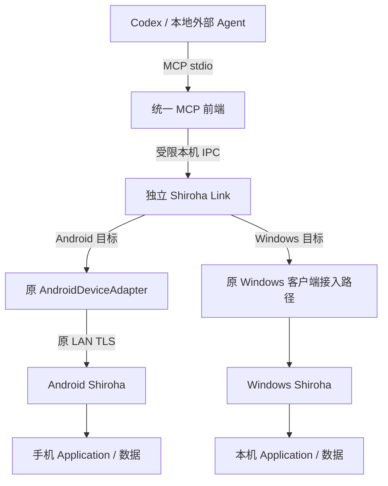
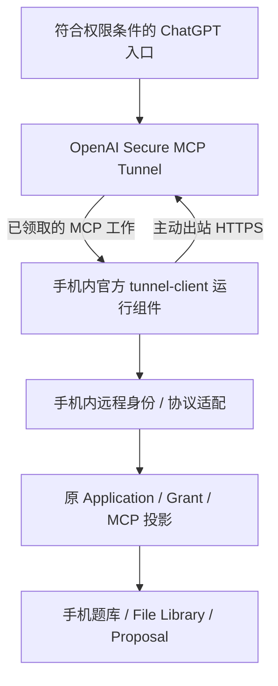
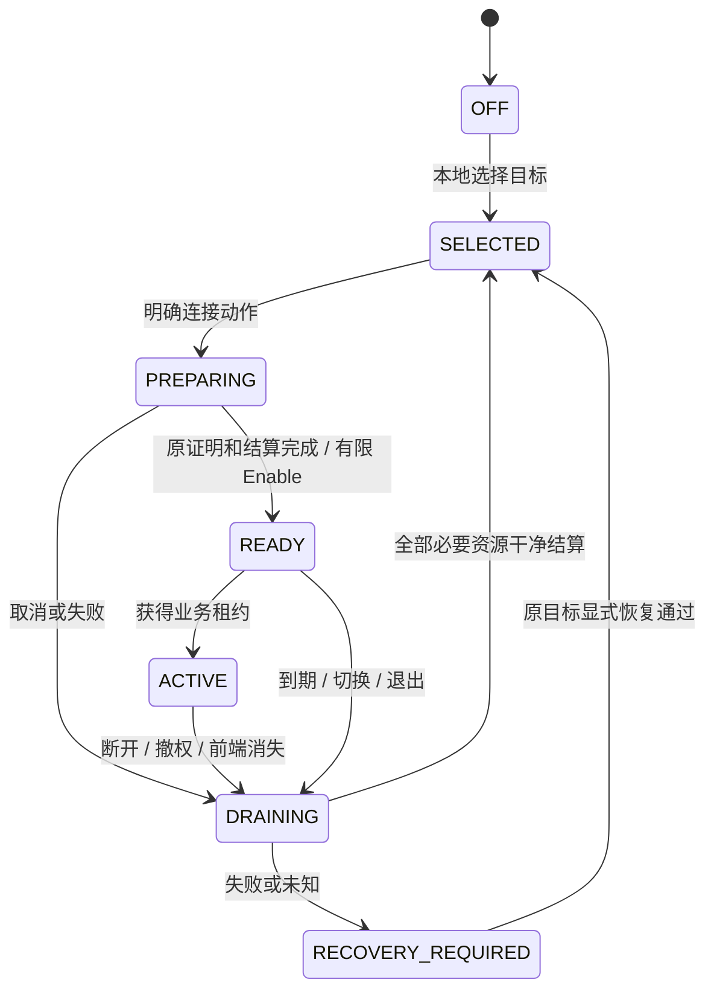
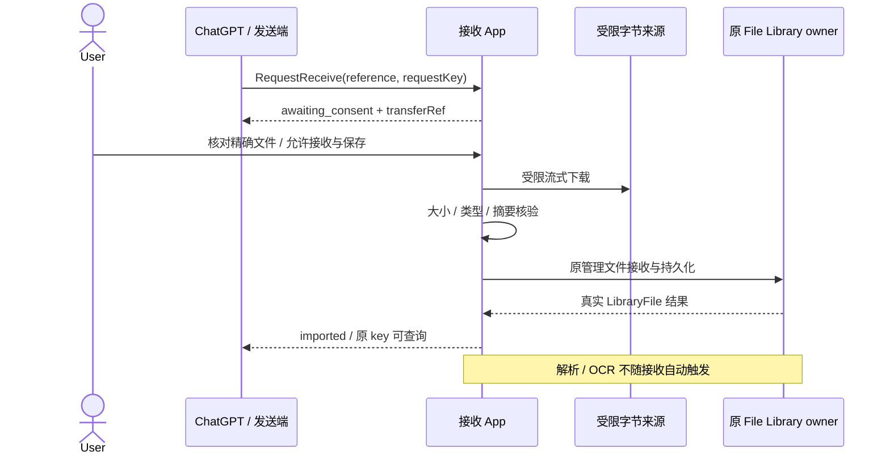
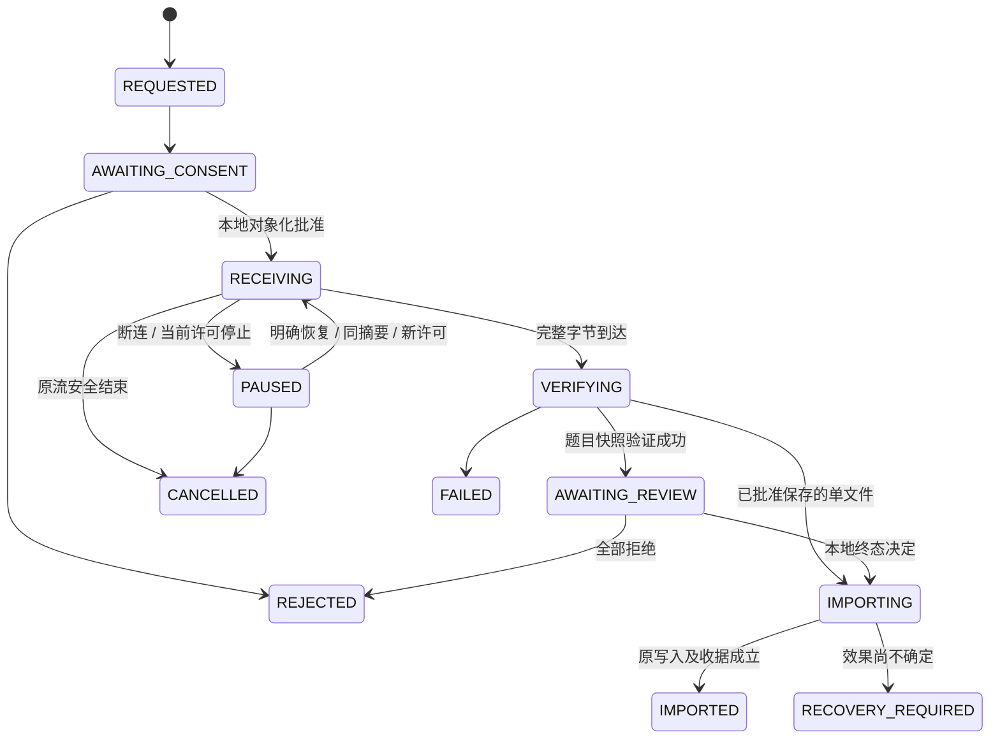

# Shiroha 统一接入、官方远程通道与内容交换契约 v1.4

> **状态：已采纳的目标设计契约（DESIGN ONLY）。不表示实现已交付、运行已准入或验收已通过。**
>
> 本文规范独立 Link、官方远程通道候选与内容交换的后续设计；相关权威文档同步声明其负责的增量。本文不修改现有运行行为，不授予凭据、网络、后台或写入权限。实施和实机验收仍须分别取得适用授权。

| 项目 | 定义 |
|---|---|
| 文档版本 | 1.4；采纳目标约束，平台待证明项仍保持候选 |
| 整理日期 | 2026-10-31 |
| 仓库位置 | `docs/product/agent-refactor/unified-access-and-content-exchange-v1.md` |
| 核心目标 | 统一业务能力；目标设备独立；连接托管不依赖无关业务 App；内容可受控交换 |
| 近期本地方案 | 统一 MCP 前端 + 独立 Shiroha Link + 原目标设备适配器 |
| 远程优先路线 | 核验并优先复用 OpenAI 官方 Secure MCP Tunnel；手机内运行是待证明的候选组合 |
| 内容交换首版 | 系统选择／分享一份资料或一批结构化题目；官方附件与设备直传分别验收；不是双向同步 |
| 远程首版产品入口 | 同一台 Android 手机上的 ChatGPT 网页；原生 ChatGPT App 不作为本版交付门槛 |
| 明确不承诺 | Android 官方隧道已受支持、当前账号可写、ChatGPT 手机原生端可用、后台常驻、完整生产准入 |

**一句话原则：访问谁的数据，由谁的 App 决定授权并执行；连接层只负责受控传输和资源结算。**

### 设计范围与运行边界

v1.4 明确区分正常初始化、#356 遗留槽位的一次性退役和已归 Link 所有的资源恢复。新配对先保留准备记录，完成原 P15/P0、凭据保存与结算后才建立所有权；#359 旧格式通过保留来源的适配继续恢复。槽位控制锁与 adapter 资源锁分离，退役按持久准入意图、原资源结算、fence、旧 App 事务和最终发布推进。本地验收覆盖 L01–L16；同手机网页与内容交换仍是独立范围。

这是目标设计修订，不表示实现或资源恢复已通过运行验收。正文中仍为候选、待证明的 SDK／平台／前后台能力不能随文档整体标为支持；本地可实施范围与远程组合验证分别收口。

## 阅读导航

- [1. 契约地位与来源](#s01)
- [2. 产品范围和硬性不变量](#s02)
- [3. 目标拓扑与职责](#s03)
- [4. 独立本地连接器](#s04)
- [5. 路由、租约和本机通信](#s05)
- [6. 生命周期、取消和结算](#s06)
- [7. 存储、正常初始化、遗留退役与 B0](#s07)
- [8. 统一业务能力与授权](#s08)
- [9. 官方远程通道](#s09)
- [10. Android 远程会话与前后台](#s10)
- [11. 平台文件引用](#s11)
- [12. 内容交换对象和独立权限](#s12)
- [13. 交换应用接口](#s13)
- [14. 字节传输和来源绑定](#s14)
- [15. 文件接收、导出与解析](#s15)
- [16. 题目快照包与导入](#s16)
- [17. 交换状态、幂等和恢复](#s17)
- [18. 预算、错误和可观测性](#s18)
- [19. UI 与实际使用流程](#s19)
- [20. 版本与兼容](#s20)
- [21. 代码责任与契约修订](#s21)
- [22. 验收矩阵](#s22)
- [23. 实施边界与完成定义](#s23)
- [24. 待证明事项和禁止的支持声明](#s24)
- [来源索引](#sources)

<a id="s01"></a>
## 1. 契约地位与来源

### 1.1 规范用语

“必须／不得”是本能力后续实现必须满足的要求；“建议”允许有证据的等价实现；“候选／待证明”表示不能据此开放运行入口或宣称已支持。

本文规范新增接入与内容交换边界，不重新定义 `AGENTS.md`、角色规则、Git／PR 流程、修复预算或通用架构。现有源契约对未被明确修订的行为继续有效。

### 1.2 三类内容分开

| 类别 | 含义 |
|---|---|
| 仓库事实 | 由当前仓库契约、源码或 PR 证据支持；不等于本轮重新执行过验证 |
| 外部平台事实 | 来自官方文档／官方实现，具有核对日期；不等于用户账号具备该权限 |
| 本文设计 | 已采纳的目标约束、类型、接口、预算和验收；不表示已实现或批准上线 |

目标设计与业务基础分别以已合并的 #357、#358 为前置；#356 的 Windows 全局宿主仅作为遗留来源，不作为正常初始化或日常连接的支持路径。#359 的独立 Link 候选已产生的持久格式须按 §7.2.1 兼容；其有限运行、dirty 状态和未完成恢复由原 PR 证据据实记录，本文不把设计采纳改写为运行通过。PR 的实际状态由 Git／PR 记录判断。[R1][R3][R9][R10][R11]

统一业务基础已实现显式 Profile 3、独立统计同意、受限查询、Origin payload v2／v1 兼容及 v36 迁移，准确协议与隔离验证范围由 MCP §19.1、External boundary §16 拥有。正常六／七工具入口仍保持原默认；本基础不激活独立 Link、正常 11 工具客户端、手机网页或内容交换。后续工作仍须核验实际 Git／准入范围，不能把隔离业务证据当作真机或宿主交接批准。

### 1.3 与既有权威的分工

| 权威 | 本文如何使用 |
|---|---|
| `ARCHITECTURE.md` | 保持 Adapter → Application → Domain，以及 Data／Infrastructure 端口方向 |
| `external-agent-boundary.md` | 保持身份、Grant、内容出站、当前权限和最终释放检查；增补远程及交换权限 |
| `mcp-vnext-contract.md` | 保留业务工具语义，替换 Windows 全局托管，登记新能力集 |
| `android-device-access-v0.md` | 保留原 LAN、设备身份、前台、有限 Enable、关闭责任；新增消费者需明确准入 |
| `generated-question-proposals.md` | 继续独占生成候选、review/direct、提交幂等与终态写入语义 |
| 现有 F1／导入／Review 契约 | 继续拥有文件、ParsedArtifact、结构化预览和正式导入写入 |
| B0 契约 | 继续拥有整库备份／恢复；不充当内容分享接口 |
| roadmap | 记录调度和里程碑，不替代实际验收事实 |

本文集中拥有新增拓扑、交接、远程与内容交换的设计增量；上表中的原契约继续拥有业务 Schema、授权、文件／导入／Review 和 B0 语义，其增量入口见 §21.3。不得复制并长期维护两份相同工具 Schema、两份权限状态或两份 Proposal 生命周期。

<a id="s02"></a>
## 2. 产品范围和硬性不变量

### 2.1 三个不同场景

| 场景 | 电脑是否运行 | Windows Shiroha 是否运行 | 数据权威 |
|---|---|---|---|
| 本地 Codex 使用 Android | 是，运行 Codex 和 Link | **不需要** | Android App |
| 本地 Codex 使用 Windows | 是 | **需要，因其是目标 App** | Windows App |
| 远程 ChatGPT 使用 Android | 最终目标不需要 | **不需要** | Android App |

远程路线以手机内官方隧道运行组件为优先验证候选；桌面运行隧道只能算过渡验证，不得宣称“无需电脑”。

三个完成层级必须独立记录：

| 完成层级 | 精确定义 | 不可替代的后续层级 |
|---|---|---|
| 本地独立 | 电脑运行正常 Codex 与 Link；Windows Shiroha 未运行、数据库未初始化 | 不表示电脑可关闭 |
| 服务端独立 | 隧道组件与业务均在手机，电脑不参与任何转发；另一设备可用于发起前置测试 | 不表示同一手机已能完成操作 |
| 同手机网页可用 | 同一 Android 手机先开启 Shiroha 有限远程会话，再进入指定浏览器中的 ChatGPT 网页，实际调用、切回本地确认、返回网页查询／恢复均成功；没有电脑中介 | 是远程首版最终使用门槛；不能由前两层替代 |

“同手机网页只读协作”与“同手机网页读写闭环”再分别标注。只有真实入口具备相应写权限且已验证 STAGE／本地 Review／原键查询，才可声称读写闭环完成。若账号或入口阻止写入，写入项为平台受限，不能改成通过或偷偷移出完整产品验收。

网页优先是本版产品选择，不是官方对所有 Android 浏览器的支持承诺。原生 ChatGPT App 属于独立平台兼容项，不要求等待其支持再开展网页验证。

### 2.2 不变量

- **I01 设备独立**：Android-only 启动和调用不得启动、隐藏运行或初始化 Windows Shiroha。
- **I02 数据库独立**：Android 路由不得读取 Windows SQLite、Windows App 设置或依赖其 B0；发送电脑内容时电脑是显式来源方，不属于隐式中转。
- **I03 唯一业务权威**：题目、资料、学习记录、Grant 和 Proposal 由目标 App 的原 Application／Data 拥有。
- **I04 传输不授予权限**：IPC 连接、TLS 握手、隧道可用、工具确认、内容 URL 都不能单独构成业务授权。
- **I05 目标固定**：一次业务租约固定设备、安装实例、Profile 和代次；不自动失败转移到另一设备。
- **I06 未知不等于失败**：超时、客户端消失和响应丢失不证明写入零效果；生成结果只按原 key 查询。
- **I07 资源有原 owner**：任务、输出、TLS、密钥和进程分别按原责任真实结算；不以 kill、超时或删除标记代替。
- **I08 交换不是同步**：首版分享是内容快照；不跨设备自动覆盖题目、学习进度或授权。
- **I09 原文件独立授权**：允许片段读取，不自动允许下载整份原文件或向另一接收者导出。
- **I10 不扩大历史权限**：升级、安装插件、启用隧道和普通重连不添加统计、文件、生成或交换权限。
- **I11 官方支持据实表述**：有入口、能编译、工具可见或隧道 ready，不代表真实手机业务已通过。
- **I12 无秘密分发**：插件包、可移植源码包、题目包和普通配置不得包含运行密钥、配对私钥、数据库或访问令牌。
- **I13 本地接收所有权**：原 File／Import／Review owner 已持久接受的内容，不再受发送方取消、会话断开或临时传输 TTL 支配；未正式入库不等于仍可被远端删除。
- **I14 持久交接**：旧宿主释放、槽位交接与新 Link 认领必须有互相绑定的持久记录；锁释放和临时密钥不存在均不能单独证明旧 dirty 已结算。

### 2.3 本文排除的首版范围

不做多租户 SaaS、公开插件上架、云端题库、自动设备同步、离线命令队列、自动写入重放、评分／学习历史合并、StudyPlan 新工具、OCR 优化和完整后台常驻。保留现有能力；不将这些项目变成本地解耦的完成门槛。

<a id="s03"></a>
## 3. 目标拓扑与职责

### 3.1 本地拓扑



### 3.2 官方远程候选拓扑



此图表达目标数据流，不声明 OpenAI 已承诺 Flutter／Android 嵌入支持。手机内组件必须先通过 §9 的组合验证。[O2][O3][O4]

### 3.3 组件责任表

| 组件 | 拥有 | 不得拥有 |
|---|---|---|
| MCP 前端 | 静态工具目录、协议参数、前端请求关联 | 手机私钥、题库、Scope 决策、后台重放 |
| Shiroha Link | 本地目标选择、独占租约、子进程和 I/O 结算、连接恢复 | 题库 SQL、Grant 决策、题目内容缓存、原文件授权 |
| AndroidDeviceAdapter | 原受保护桌面凭据、CNG／TLS、设备连接帧 | 题库副本、第二份 Proposal、模型级审批 |
| Windows 目标接入 | 连接既有 Windows App-owned 路径 | 冒充 Explorer、绕过固定 peer 校验、直开数据库 |
| 手机远程运行组件 | 官方隧道生命周期、受约束协议映射 | 自动把桌面身份映射成云端身份、自动续期 |
| 目标 App | 身份、Grant、Context、正式写入、Review、本地学习 | 接受模型自报的认证／设备／权限事实 |
| 内容交换 Application | 显式导出／接收、验证、导入关联、结果收据 | 直接暴露 SQLite、绕过既有 typed writer |

<a id="s04"></a>
## 4. 独立本地连接器

### 4.1 运行形式

选择独立、普通用户级的 Link 进程。优先采用独立 Dart AOT 入口复用可独立构建的纯 Dart 状态和进程逻辑；Android TLS 留在原 .NET 适配器。不为本次解耦重写密码学或业务协议。

Link 必须作为独立运行包安装，不依赖 Flutter 项目源码目录、`pubspec.yaml`、Windows App 可执行文件或 Windows 题库初始化。正式安装通过受信安装配置定位运行时，不向上扫描仓库或任意用户目录。

首版由用户显式启动 Link；允许小型托盘／本地控制程序，不默认安装系统服务、管理员组件、登录启动项或自建 Web 控制台。

### 4.2 与客户端进程隔离

Link 不得默认由 Codex 以同一终止范围的普通子进程方式托管。必须以实际进程／Job 归属和终止实验确认：结束客户端／MCP 前端后，Link 仍可完成原结算。无窗口、进程名不同和 detached 标志均不单独构成证明。[O7]

自动唤起仅是后续 UX 优化；没有独立进程存活证明时继续要求显式启动，不退回启动完整 Windows App。

### 4.3 正常首次使用、来源判定与初始化

**正常初始化不以旧宿主交接记录为前提；但必须以可验证的槽位来源和资源结算证据决定采用哪条路径。** 不得把“没有 handoff 文件”直接解释为新槽位，也不得要求正常新用户先运行 Windows Shiroha。

统一准入按以下四类判定，顺序优先匹配更具体的既有 owner 状态：

| 槽位类别 | 可接受的判定依据 | 唯一允许的路径 |
|---|---|---|
| **全新、未配对** | 受信 Link 安装配置首次创建槽位登记；通过槽位控制锁和唯一 operationId 确认无既有 owner 冲突 | 先创建 `UNCLAIMED/PREPARING`，完成原 P15/P0、凭据保存及资源结算后，才建立 `LINK_OWNED` |
| **已配对、从未由 #356 托管且资源 clean** | 原适配器受保护配对记录可被原凭据 owner 正常读取；设备／安装身份与原槽位绑定匹配；原 owner 提供明确的 clean release／无活动租约证明，或原适配器提供与当前槽位、安装、resource generation 绑定的 clean 结算证明；受信本机注册记录确认该槽位未被 #356 认领 | Link 在槽位独占条件下创建自己的初始 owner；不要求旧 App 释放，不创建 PREPARED／RELEASED／CLAIMED |
| **已知由 #356 托管** | 受信槽位登记、#356 原 owner 的持久记录、已知 CLAIMED／handoff 记录或旧 App 对该精确槽位的权威记录证明其曾由旧宿主管理 | 仅执行 §7.3 一次性遗留退役；不得按普通初始 owner 覆盖 |
| **已归独立 Link 所有** | 本 LinkStateStore 与槽位 owner 记录在 connectorInstanceId、targetRef、installation、profile、owner generation、lease/resource generation 上匹配 | 沿用原 Link owner；clean 时正常连接，dirty／unknown 时进入原 Link 资源恢复，不重新初始化、不再次退役 |

#### 可信来源记录

为使上述判定可执行，Link 使用**独立的槽位所有权记录**（`SlotOwnershipRecord`），由受信本机安装／配对流程创建和条件更新，不放入 Windows 题库数据库。它不是 Grant、设备认证或业务授权，只记录连接托管历史和当前资源 owner。

最小字段：

```text
formatVersion
slotRef
verifiedInstallationBinding
adapterCredentialSlotRef
ownershipState: UNCLAIMED | LINK_OWNED | LEGACY356_OWNED | LEGACY_RETIRED | UNKNOWN
ownerKind
ownerInstanceId
ownerGeneration
resourceGeneration
lastSettlementRef
lastSettlementState: CLEAN | DIRTY | UNKNOWN
revision
```

规则：

- 新配对先创建 `UNCLAIMED/PREPARING` 准备记录；原 P15/P0 配对、用户确认、凭据保存和资源结算完成后，才在同一槽位控制锁及 expected revision CAS 下转为 `LINK_OWNED`。
- 对历史上已存在、没有该记录的配对，**不能由缺失记录推断 `UNCLAIMED`**。只有原适配器／原 owner 能提供与设备、安装、槽位及 resource generation 绑定的 clean 结算证明，并且可信本机注册来源能证明未曾进入 #356 托管，才允许一次性建立初始 `LINK_OWNED` 记录。
- 由 #356 创建或更新过的记录必须保留 `LEGACY356_OWNED`／对应旧 owner 证据；不得由新 Link 单方面改写成 `UNCLAIMED`。
- 记录损坏、未知版本、槽位冲突、来源缺失或结算不明时设为／解释为 `UNKNOWN`，进入 `LEGACY_STATUS_UNKNOWN` 或 `RECOVERY_REQUIRED`，提供脱敏诊断信息和明确的人工处置出口；不得自动初始化、清空或重配对。
- 所有创建／转换使用槽位独占与 expected revision CAS；同一槽位不能并发建立两个 owner。
- `SlotOwnershipRecord` 只证明托管来源与资源状态，不认证设备、不授予 Grant、不恢复 Enable，也不能代替 P15/P0。

配对凭据只证明对应设备／安装的密码学身份，**不能证明托管历史**。PID 不存在、锁可获取、CNG marker 缺失、handoff 文件缺失均不能单独证明 clean 或从未由 #356 托管。

#### 初始化统一流程

1. 读取受信安装配置和 LinkStateStore；若 LinkStateStore 不存在，仅允许在受信安装首次初始化流程中创建，不能在已有槽位异常时静默重置。
2. 在原槽位互斥约束下读取／核验 `SlotOwnershipRecord`、原适配器凭据槽位引用及资源结算证据。
3. 按上表唯一分类；不明确时进入诊断，不尝试其他分支。
4. 全新槽位先持久创建 `UNCLAIMED/PREPARING`；完成原 P15/P0、凭据保存和资源结算后，才 CAS 建立 `LINK_OWNED`。合格历史配对仅在原身份、来源及 clean 证据匹配后建立 `LINK_OWNED`。
5. 回读核验 `LINK_OWNED` 后，手机用户独立开启访问，按原 PREPARING／Enable proof／有限 Enable 流程建立业务连接。
6. 只有原认证、Grant、Scope 和目标端准入均通过后，才建立业务租约。

**正常新安装和从未由 #356 托管的 clean 配对，不创建 PREPARED／RELEASED／CLAIMED 旧宿主记录，也不要求启动 Windows Shiroha。**

### 4.4 安装包分离

- 插件包：manifest、skills、图标和可移植说明。
- Link 运行包：Link、MCP 前端、Android adapter 及必要 runtime，不带题库和用户秘密。
- Windows App：原 Windows 业务 App／Bridge；Android-only 不需要其安装包或可执行文件。
- 可变本机状态：由受信安装配置明确定位，放在用户私有数据位置，不放进插件缓存或源码包。

更新插件说明不得覆盖在用运行时。更新 Link／adapter 先停止新调用并等待原租约、输出、TLS、进程、流和临时密钥结算，采用版本目录切换；旧目录在无活跃 owner 后才清理。更新不修改手机 Grant、不重配对。

### 4.5 Windows 目标接入

选择 Windows 时仍由 Windows App 持有其原业务 Bridge。Link 仅经已验证的 Windows 目标客户端接入；若原固定 peer 规则不能接受新角色，须做最小、明确的角色适配，不得普遍放开程序来源、绕过校验或伪造启动父进程。

Android 目标路径不得经过 Windows App 的 Named Pipe owner，也不得把 Windows App 的启动／可用性检查作为前置条件。

### 4.6 #356 旧宿主路线的产品状态

#356 的“Windows App 是所有设备唯一宿主”不再是目标架构，不作为新安装、正常连接、日常恢复或未来兼容的支持路径。不得继续扩展其 Windows 全局设备托管、Windows `app_settings` 作为 Android 路由状态、Windows B0 等待手机连接等设计。

确由 #356 旧宿主管理过的槽位，按 §7.3 做一次性退役。退役完成后旧宿主不再拥有该槽位；不建设永久双宿主兼容层。旧 PR／旧二进制的历史运行证据只作历史记录，不构成未来支持承诺。

<a id="s05"></a>
## 5. 路由、租约和本机通信

### 5.1 本地控制面

以下是建议的内部控制接口，不是模型工具，也不是任意 RPC：

| 操作 | 输入约束 | 效果 |
|---|---|---|
| `InspectLink` | 已认证本地控制连接 | 返回脱敏状态、所选目标和恢复条件 |
| `SelectTarget` | `targetRef`、`expectedSelectionRevision` | 原租约结算后选择已登记目标；代次增加 |
| `ConnectTarget` | 已选目标、一次性本地动作票据 | 发起原证明准备，不自动配对／授权 |
| `DisconnectTarget` | 精确当前租约／代次 | 同步停止接收新工作，进入原结算 |
| `RecoverTarget` | 原 dirty 快照、当前本地确认票据 | 仅对原目标核对恢复；不得任意删标记 |
| `ShutdownLink` | 当前本地动作 | 停止新操作，等待 owner；失败不能显示干净退出 |

MCP 前端不具有 `SelectTarget`、`RecoverTarget` 或设置权限。操作系统同用户并不意味着任何本地程序都可信；控制面与模型业务面使用分离的命令集合和 peer 角色。

### 5.2 租约身份

`BusinessLease` 至少绑定：

```text
connectorRunId
selectionRevision / routeGeneration
localTargetRef
verifiedDeviceIdentity / installationIdentity
targetProfileReference
frontendPeerIdentity / frontendConnectionId
negotiatedCapabilitySet
leaseId
```

所有引用由可信运行时产生。设备／安装身份必须来自原适配器的实际认证事件或其他已证明的可信端口，不能仅从业务回复中的 `source` 自报字段建立。显示名称、IP、端口、用户输入的 Profile 字符串不能制造租约。客户端请求不能包含数据库路径、凭据路径、可执行程序路径或任意目标地址。

首版一个活动目标、一个业务租约、一个实际业务调用；其他前端可发现工具，但业务占用返回 `busy`。不抢占、不自动 kill、不无界排队。

### 5.3 本机 IPC

新 Link IPC 使用独立 endpoint／角色，不冒充现有 Windows App 管道。需要校验同用户／会话、精确安装来源或已批准 peer、随机运行代次及有界消息。未知字段、未知版本、重复 in-flight 请求 ID 拒绝。

消息在任何分配和 JSON 解码前检查字节长度；控制与业务消息分别限流。进程退出不等于成功取消。IPC 认证证明本机 peer，不替代目标 App 认证。

协议应复用已存在的安全编解码与错误投影，而不是复制第二套业务 Schema。确需新增 IPC envelope 时独立版本化，并在代码／测试中绑定其确切字段；不得把它伪装成已接受的旧帧。

### 5.4 目标切换和旧引用

切换顺序固定为：撤回原租约新调用 → 原任务／输出／连接／密钥／进程结算 → 原 dirty 状态 CAS → 更新目标和代次 → 新会话。

切换失败保留原目标和失败信息，不偷偷选择新目标。不能在同一旧 MCP 业务会话中换设备后继续解释旧 `contextRef`。旧来源的 Proposal 查询必须显式回到原设备／Profile。

`source` 来自目标 App；Link 只核对它与实际验证的目标一致。Link 自己的未选目标错误可以使用原协议的 `unselected` 来源，不得伪装成目标 App 业务答复。

<a id="s06"></a>
## 6. 生命周期、取消和结算

### 6.1 两套状态不能混成一个开关

前端协议状态：`disconnected → discovered → attached → closed`。

Link 业务状态：



目标 App 的 P0／P15／foreground 状态保持原权威；Link 状态不反向强制目标进入 READY。

### 6.2 日常开启

手机明确开启 → 原 PREPARING → Link 运行原 `enable-proof` helper → 原证明通道和双方资源结算 → 手机有限 Enable → 新 business TLS／HELLO／READY → MCP 业务。

配对仅在明确首次连接操作中进行。工具目录发现不得读取配对密钥、开启手机访问或启动循环证明。过早业务请求直接拒绝，不占用证明所需资源。

### 6.3 正常关闭

关闭不是单一 bool：

1. 同步撤回新调用和尚未释放的输出。
2. 原控制 owner 处理真实取消／deadline；等待实际任务终结。
3. 完成原输出屏障和目标关闭确认。
4. TLS shutdown／EOF、原进程 exit、stdin/stdout/stderr 排空。
5. 原临时密钥清理／缺失核对。
6. 对同一目标、同一代次的 dirty 状态做条件更新。

只有相关环节具备实际成功证据才释放原租约。禁止用正常退出码单独推断业务结果，或用密钥缺失单独推断目标工作结算。

### 6.4 前端消失

真实 MCP cancellation 才进入原取消语义。stdio EOF、插件被结束、网络断开不伪造“用户明确取消”。

Link 停止接收新业务，按原 deadline 保留原工作和唯一输出消费者。前端已不可用时可以有界排空／丢弃无法交付的输出，但不得保存用于下次自动补发，也不能改变已有最终释放／关闭判断。

前端消失不等于目标关闭；Link 必须证明自己未被一并结束。Link 也崩溃时，重启读取原 dirty 记录进入恢复，不自动启动替代适配器。

### 6.5 三类结果分别记录

| 维度 | 示例值 | 权威 |
|---|---|---|
| 客户端交付 | delivered / undelivered / unknown | 原输出链路 |
| 业务结果 | not_started / pending / committed / rejected / unknown | 原 Application／持久化查询 |
| 资源结算 | clean / draining / failed / unknown | 原连接、TLS、密钥、进程 owner |

客户端未收到结果，但目标已经完成且所有资源干净，不应被误判为密钥损坏。反之，题目已提交也不能覆盖未知资源清理。新调用是否可进入只取决于真实准入与结算，业务未知通过原 key 查询。

### 6.6 恢复

恢复绑定原目标、旧代次、原资源身份和当前本地确认。先检查原 owner 是否仍活着，再核对独占锁及临时密钥；不能仅凭 PID 数字判断进程身份，也不能清理另一实例的资源。

允许原契约要求的重新证明／有限 Enable，但不允许自动重配对、替换 Pin、扩大 Scope 或重发 STAGE。恢复失败保留原记录。操作员重启与“原连接已经干净结束”是不同事实。

前端可以继续提供静态目录；后端失效时业务返回固定不可用状态。重新连接后获取新 Context，不自动重放旧工具参数。客户端自身是否自动重启 stdio，以实际客户端版本证据为准。

任何未知生成结果均不重发 STAGE，只查询原设备、原 Profile 与原 submissionKey。连接恢复不得自动创建新的提交键。

<a id="s07"></a>
## 7. 存储、正常初始化、遗留退役与 B0

### 7.1 独立 LinkStateStore

Link 不读 `app_settings` 或任何题库数据库。使用用户私有、版本化的小型状态文件保存：Link 实例身份、目标引用、选择 revision、运行代次、当前租约、原资源 owner 标识、dirty 阶段及固定诊断码。文件不得含业务正文、待执行请求、密码或私钥。

实现必须具备独占 owner、严格解析、有限长度、条件更新、原子替换、必要 flush 和崩溃保留。保存前建立原操作所有权；异步写入完成后不能绕过期间发生的取消。损坏、未知版本或冲突状态不得退回空配置继续连接。

新路径由受信安装配置明确给定；不扫描旧工作区、任意用户目录或所有 CNG 对象寻找“可用身份”。LinkStateStore 不进入题库 SQLite、Windows `app_settings` 或 `.shiroha` B0，不承载业务数据和授权事实。

### 7.2 槽位所有权记录与来源判定

`SlotOwnershipRecord` 是独立 Link Infrastructure 的托管历史／资源 owner 记录，不是设备认证、Grant 或业务 Session。其字段、来源和状态转换由 §4.3 定义；本节规定持久化和恢复要求。

- 记录必须与原受保护配对槽位、设备／安装身份和 adapter credential slot 一一绑定。
- 新配对在原 owner 流程内创建 `UNCLAIMED` 记录；只有原 P15/P0 与资源结算完成后才能转成 `LINK_OWNED`。
- 已有历史配对若无记录，必须取得原 owner／adapter 对该精确槽位和 resource generation 的 clean 结算证据，并取得可信本机来源登记证明未由 #356 托管，才允许一次性初始化。
- 缺记录不是 `UNCLAIMED` 证据；配对凭据不是托管历史证据；PID、锁、marker 的单独状态不是结算证明。
- 已由 #356 管理的记录必须保持 `LEGACY356_OWNED`，不得被 Link 的普通初始化覆盖。
- 已为 `LINK_OWNED` 的槽位沿用同一 owner；Link 崩溃后不得重新创建 owner 或再次执行旧宿主退役。

LinkStateStore 与 SlotOwnershipRecord 的跨文件更新必须使用同一槽位互斥、expected revision、operationId 和可恢复阶段。若一侧写入完成而另一侧未完成，重启时只允许按同一 operationId／owner generation 补齐或保持 `UNKNOWN`；不得新建第二个 owner。

#### 7.2.1 #359 旧格式适配与可恢复升级

#359 的已发布持久格式早于当前 `SlotOwnershipRecord`。不得假定旧安装已存在新记录，也不得因新文件缺失而判定为 UNCLAIMED。适配器必须对照 #359 实际 serializer／parser 和脱敏 fixture，读取原 `HostHandoffRecord`、`LinkStateStore` 与 adapter 资源回执；不得按本契约示例臆造旧字段。

旧格式映射：

| #359 旧状态 | 新规范投影 | 处理要求 |
|---|---|---|
| `RELEASED`，尚无 Link claim | `LEGACY_RETIRED` | 保留原 handoffId、releaseRecordRef 和 fence revision；不单独证明 Link 已拥有槽位 |
| `CLAIM_PENDING` | `LINK_CLAIM_PENDING` | 只由同一 handoffId、Link instance 和预期 revision 续接 |
| `CLAIMED` 且 owner 绑定完整 | `LINK_OWNED`，ownerKind=`legacy_link_claim` | 沿用原 Link owner／generation，不再次退役或创建第二 owner |
| `CLAIMED` 且资源 dirty／unknown | `LINK_OWNED` + 原 settlement 状态 | 原样保留 dirty／unknown、原 run/resource/process 和缺失回执 |
| `PREPARED`／旧释放未完成 | `LEGACY_RETIRE_PENDING` | 保留旧 owner 和 operationId，新 Link 不接管 |
| 缺失、损坏、冲突或未知版本 | `UNKNOWN` | 诊断，不推断全新、不生成 clean、不删除原文件 |

旧字段映射必须以源码事实为准。若旧格式没有 `ownerGeneration` 或 `resourceGeneration` 同名字段，应从旧 owner／resource 绑定或资源回执映射；确实不存在时记录 `UNAVAILABLE_IN_LEGACY_FORMAT`，不得伪造数值、默认 0 或合成 clean。

格式升级采用保留原件的单向适配：

1. 在槽位控制锁下读取旧记录，计算来源摘要并创建唯一 `migrationOperationId`。
2. 严格解码旧 `HostHandoffRecord`、`LinkStateStore` 和资源回执，核对 slot、handoff、owner、run/resource/process 关系；不匹配即 UNKNOWN。
3. 写入新格式临时记录，包含 `sourceFormat=#359`、来源摘要、migrationOperationId、映射后的 owner 与 settlement 状态；flush 后原子发布。原文件不删除、不覆盖。
4. 回读新记录并与旧来源逐项比对；只有完全一致才写入迁移完成标记。
5. 中断后按同一 migrationOperationId 重读并继续核验；不得创建第二 owner、改变 owner generation、把 dirty 改成 clean 或跳过原恢复。
6. 只有新格式持久化及来源核验完成后，才允许新代码以规范投影继续运行。旧文件保留到独立迁移验收完成，删除旧文件需要另行明确授权。

`SlotOwnershipRecord` 是规范投影，不意味着必须把所有旧记录改写成一份新文件后才可恢复。兼容读取可先提供只读 adapter；任何升级写入必须可重入、可核验、保留来源且不改变资源结算事实。

### 7.3 #356 遗留槽位的一次性退役

本节仅适用于**有可信证据表明由 #356 Windows 全局宿主管理过，且尚未完成退役的槽位**。它不是正常 Link 初始化流程，也不是未来长期支持的双宿主兼容系统。

目标是安全结束旧 owner、保留原配对和业务数据、持久阻止旧入口再次取得槽位，然后让独立 Link 建立新的 owner。新 Link 不读取 Windows SQLite；旧 App 是其旧数据库状态的唯一读取／结算 owner。

#### 7.3.1 识别与绑定

退役操作由本地受信控制面发起，绑定原配对槽位、设备／安装身份、原 Profile、旧宿主实例及选择代次、旧状态 revision／摘要、原 adapter owner／resource／process 身份、退役 operationId 和目标 Link 实例身份。

记录不含私钥、正文、数据库路径或新 Grant。摘要只核对状态，不证明清理成功。释放事实必须来自旧 App 对精确槽位和代次的真实事务提交，以及原 adapter 的真实资源结算证据。

#### 7.3.2 锁职责与退役顺序

退役涉及两种不同锁，禁止混用：

- `SlotOwnershipLock`：短时保护槽位来源、退役意图、fence、owner generation 和条件更新；不得跨越人工确认、TLS 关闭或 adapter 生命周期长期持有。
- `adapter.lock`：由原 adapter 在 TLS／CNG 资源生命周期内持有，保护实际适配器资源独占。退役流程不得在活跃 adapter 持有该锁时要求先取得同一锁写 fence，也不得强行抢占或提前释放。

旧宿主必须在资源结算前持久阻止新准入，但最终 `RETIRE_PREPARED` fence 必须在 adapter 真实结算并释放 `adapter.lock` 后、旧 App 数据库 `retired` 提交前发布。为避免“仅内存冻结”导致竞态，使用独立持久 `RETIRE_INTENT`：

1. 在 `SlotOwnershipLock` 下 CAS 持久写入 `RETIRE_INTENT`，绑定 slotRef、旧 owner instance／generation、旧 state revision、operationId、目标 Link instance 和单调 revision。所有受支持旧入口每次获取槽位前检查此状态；存在意图时拒绝新连接／重连／配置恢复／B0 恢复。该记录不是资源 clean，也不授予新 Link 所有权。
2. 旧 App 在原 owner 下撤回新业务准入并结算在途业务、输出、目标 CLOSE、TLS、adapter 进程、输入输出流和临时 CNG 对象。原 adapter 按自身协议持有并释放 `adapter.lock`；未 clean 时保留 `RETIRE_INTENT`，不继续。
3. adapter 真实结算后，在 `SlotOwnershipLock` 下核对原 owner／resource generation 与 clean receipt，CAS 将 `RETIRE_INTENT` 转为持久 `RETIRE_PREPARED` fence。此步骤必须早于旧 App 数据库 retired 事务。
4. 旧 App 在自己的数据库事务内，对精确槽位／旧代次 CAS 写入不可自动回退的 `retired` 记录，并关联同一 operationId、fence revision 和 releaseRecordRef。只有事务提交已确认后才继续。
5. 在 `SlotOwnershipLock` 下将 `RETIRE_PREPARED` 条件转换为 `RETIRED`，绑定旧状态摘要、releaseRecordRef、目标 Link instance 和单调 revision。
6. 新 Link 核对 `RETIRED`、旧 App 已提交的 release record、原 adapter 资源 clean、旧 owner 不再活动和 fence 匹配后，持久建立新 `LINK_OWNED` owner。
7. 重新执行原设备认证／手机本地访问开启。退役记录不恢复 Session、Context、Enable、Grant 或业务批准。

`RETIRE_INTENT` 是持久的“停止旧宿主新准入”状态；`RETIRE_PREPARED` 是资源 clean 后、旧数据库提交前的持久退役 fence；`RETIRED` 才表示旧 App 已提交 retired 且槽位退役记录已发布。数据库与槽位记录不是同一事务，任意中断均按同一 operationId 恢复。不得在持有 adapter.lock 等待槽位控制锁，也不得持有 SlotOwnershipLock 等待长时间 adapter 结算。

#### 7.3.3 崩溃恢复与旧入口复活

| 中断点 | 恢复原则 |
|---|---|
| `RETIRE_INTENT` 发布前 | 旧 owner 原规则；不得宣称已开始退役 |
| `RETIRE_INTENT` 已持久、adapter 尚未 clean | 旧入口拒绝新准入；原 owner 继续结算；不抢占 adapter.lock，不发布 RETIRE_PREPARED |
| `RETIRE_PREPARED` 已持久、旧 App retired 事务未提交 | 旧入口仍受 fence 阻止；由原旧 App owner 核对原状态，继续同一 operationId 或在证明事务未提交、无新 owner 后显式撤销同一 fence |
| 旧资源 dirty／unknown | 保留 fence 与原 owner；不提交 retired，不允许新 Link 认领 |
| retired 事务已提交、`RETIRED` 尚未发布 | 旧入口继续因 PREPARED fence 拒绝；旧 App 根据同一 operationId 和提交记录补齐 `RETIRED`，Link 不推断成功 |
| `RETIRED` 已发布、新 Link 尚未建立 owner | 旧宿主永久拒绝；指定 Link 可按同一 operationId 继续认领 |
| 新 Link 已持久建立 owner、最终确认中断 | 进入 §7.4 的 CLAIMED／LINK_OWNED 恢复，不再要求旧 App 退役或创建第二 owner |
| 旧入口重启、旧配置或 B0 恢复 | 必须先检查持久 fence／retired 记录；已退役槽位拒绝旧 owner，不得自动恢复 |

所有受支持旧入口在每次获取槽位前都必须检查 fence。若某个旧二进制不识别 fence，它必须在退役前被明确停用并从支持运行集合排除；只关闭当前进程不够。记录 ACL／peer 校验必须说明实际保护边界，不宣称抵抗同用户任意恶意改写。

#### 7.3.4 Dirty／unknown 遗留状态

若旧业务、目标关闭、TLS、进程、流或临时密钥任一项为 dirty／unknown：

- 不发布 `RETIRED`；
- 不删除 marker、锁、凭据、fence 或旧 owner 记录；
- 不重新配对、不替换 Pin、不递增代次洗白；
- 不通过重新安装或恢复空白 LinkStateStore 绕过；
- 保持 `LEGACY_STATUS_UNKNOWN`／`RECOVERY_REQUIRED`；
- 只对该遗留实例做有证据的诊断与恢复。

**放弃 #356 产品路线，不允许把它留下的真实资源状态当作不存在。** 遗留处理只服务实际旧实例，不扩展为每个新用户都必须执行的迁移系统。

### 7.4 已归 Link 所有的恢复与 B0

#### 7.4.1 `LINK_OWNED` 与 #359 已 CLAIMED 槽位

已由独立 Link 成功认领的槽位，包括 #359 已产生 `RELEASED → CLAIM_PENDING → CLAIMED` 记录的测试槽位，属于**现有 Link owner 的恢复**，不是 #356 遗留退役，也不是新初始化。新代码必须先通过 §7.2.1 的 #359 旧格式只读适配取得规范投影；不得因新 `SlotOwnershipRecord` 尚未存在而拒绝已 CLAIMED 槽位，也不得先写新 owner 覆盖旧记录。

必须按以下顺序处理：

1. 读取 LinkStateStore、SlotOwnershipRecord 和原资源 journal，核对相同 `connectorInstanceId`、`targetRef`、installation binding、Profile、owner generation、resource generation、lease/resource/process identity。
2. 若 owner 记录为 `LINK_OWNED`／`CLAIMED` 且所有 owner 绑定一致、无未结算资源，沿用同一个 owner generation；允许创建新的运行代次和新业务 lease，但不得创建第二个 owner、重做旧 App retired 或重新配对。
3. 若业务／资源为 dirty／unknown，保留原 CLAIMED／LINK_OWNED、原 owner 和 dirty snapshot，进入原 owner 的恢复流程。恢复必须针对原 run/resource/process，不能拿更早的 enable-proof 回执替代 business 资源回执。
4. 只有原 owner 的结算证据证明 clean，才允许对同一 owner generation 条件更新资源状态并建立新 lease。
5. 若 owner 记录与 LinkStateStore 冲突、owner generation 不匹配或来源未知，进入 `RECOVERY_REQUIRED`，不创建新 owner，不降级为“新安装”。

`CLAIM_PENDING` 只能由同一 `handoffId`、同一新 Link instance 和同一预期 revision 继续完成；不得重新发起退役或生成新 handoffId。`CLAIMED` 不因 Link 进程崩溃而失效；进程运行代次与持久 owner generation 是不同字段。

#### 7.4.2 B0

Windows B0 只协调 Windows 自己的业务 owner；Android B0 只协调手机自己的业务 owner。两端仍各自撤回访问、排空在途工作并失效 Session／Context。

Link 状态与运行凭据不进入任何 `.shiroha` 包。目标被 Restore／重装后，旧本地路由不能自动复活其 Profile；新身份需要明确重新绑定。仅因 #356 Windows 全局托管引入的跨 App B0 依赖应移除；真正属于 Windows 本地事务的屏障必须保留。

B0 是整库恢复，不是选择性题目合并接口。[R4]

<a id="s08"></a>
## 8. 统一业务能力与授权

### 8.1 保留统一 Profile 3 的业务语义

显式 Profile 3 已实现以下 11 工具的统一业务基础；现有入口默认目录不变，运行激活与对应平台验收另行完成：

| 工具 | 责任 |
|---|---|
| `open_context` | App 创建获准集合／题库／文件上下文 |
| `list_question_banks` | 获准题库发现；统计字段另受授权 |
| `get_study_overview` | 获准范围的学习汇总 |
| `get_due_review_summary` | 获准范围的复习窗口统计 |
| `get_weak_questions` | 薄弱题查询；预览还需正文权限 |
| `search_questions` | Context 内题目搜索 |
| `get_question_detail` | Context 与 QuestionRef 绑定的详情 |
| `retrieve_file_content` | 当前已验证产物的词法检索 |
| `get_file_passage` | 原片段和游标续读 |
| `propose_generated_questions` | 按目标 App 当前策略发布新候选 |
| `get_question_proposal` | 原设备／Profile／key 的权威结果查询 |

业务协议、准确 Schema、限制、引用和错误映射由 [MCP 契约 §19.1](mcp-vnext-contract.md#191-explicit-profile-3-business-foundation) 单独拥有；[R2] 仅保留候选来源意义。生产组合注入目标自己的数据与来源，不依赖 Windows 全局设备宿主。

### 8.2 保留的权限语义

`studyStatistics` 独立默认关闭；正文、文件、统计、proposalMetadata 互不自动授予。allContent 只代表当前设备实例中的相应获准内容，不代表其他设备、任意文件或未来新增权限类别。

旧 v0 全库只读入口不能成为权限不足时的回退。统计必须先限定获准集合，再计算并去重，不能先查询全库后在输出表面过滤。

read、review、direct、原 CAS／revision、当前存在性和最终释放检查均保留。review 发布后返回，不等待人工 Review；direct 只影响当前策略下的新批次；旧草稿不补提交；STAGED 不代表最终保存状态。

### 8.3 不借整合扩展业务

不新增外部 COMMIT、delete、grade、任意 SQL、OCR 激活或后台重试。内容交换有独立权限与结果类型，不复用 `propose_generated_questions` 传 PDF、整库或资产字节。

<a id="s09"></a>
## 9. 官方远程通道

### 9.1 已核对的平台事实与不确定性

截至整理日期：

| 观察 | 设计影响 | 来源 |
|---|---|---|
| 自定义 MCP 添加入口可选择 HTTPS 或 Tunnel | 优先使用官方入口，不默认自建公网中转 | [O1][O2] |
| Secure MCP Tunnel 由运行中的客户端主动出站 | 运行在电脑上就仍依赖电脑；手机内运行需要单独验证 | [O2] |
| 官方提供 Go SDK／内存 MCP 示例 | 允许评估嵌入式桥接，但不证明 Flutter／Android 可用 | [O3] |
| Android／Termux 排障不建立 Android 支持声明 | Linux ARM64、Termux 或编译成功不能直接进入支持集合 | [O4] |
| 自定义 MCP 的客户端和读写权限有账号／入口限制 | 分别验证实际账号、web／mobile 和 READ／write；截图不替代权限 | [O1] |
| 官方文件参数可传文件引用 | 优先传受限引用，不把大文件 Base64 塞进 MCP | [O5] |

这些平台事实仅放在适配与验收层，不把外部产品变化固化为 Domain 常量。当前账号所需权限、费用及移动端可用性均未由本文件验证。

### 9.2 选择和回退顺序

**主候选**：手机 App 内官方 tunnel-client 运行组件 → 窄的 Native／Dart 适配 → 原 MCP／Application。

**验证用过渡路径**：桌面独立 Link 附近运行官方隧道；不依赖 Windows App，但必须如实标为依赖电脑，不能计作手机独立验收。

**条件备选**：只有手机嵌入路线的具体阻塞已证明且用户另行接受部署、身份和出站代价后，才设计受认证的 HTTPS 入口／轻量中转。不得自动采购服务器、安装 VPN、开放端口或引入新的账号平台。

主候选失败时保持其他已工作的本地能力，不借口继续堆未启用框架。

### 9.3 手机嵌入边界

优先复用官方 SDK 的受支持嵌入接口，通过有界进程内通信桥接 Dart MCP。是否需要额外 Go MCP 投影应以 SDK 实际组合为准；它只投影已冻结 Schema，不复制题库业务。

不能把现有自定义 LAN TLS 端口当作标准 MCP HTTP 地址。若只能使用回环 HTTP，须明确绑定本机回环、进程级认证、请求限制和真实 owner；这是经选择的新适配，不是默认开放手机公网监听。

手机内组件的 DNS、证书信任、取消、线程、App 重建、日志、密钥存储和停止过程全部需要真实验证；不以 Termux 演示替代 App 集成。

### 9.4 远程身份

至少区分平台控制面凭据、隧道身份、可证明的调用主体、手机 RemoteBinding、手机 Profile／Grant 和当前 Session。

新的远程入口使用独立、显式批准的绑定，不继承桌面配对身份。运行密钥不能证明发起人是谁；模型参数、普通 HTTP 头中的用户字符串、聊天名称都不属于可信身份。

首版只允许一个经过核实的私有主体。只有以下之一被证明确实成立，才开放业务：

1. 有验证签名、issuer、audience、有效期及主体的用户认证链；或
2. 平台提供可核实的专属单用户通道隔离，手机明确授权的是该通道主体，且没有其他工作空间成员可共享访问。

无法证明时仅允许无数据的静态目录／固定拒绝，不开启“先无认证跑通”。有多人可用的工作空间隧道不能被叫作单用户身份。

需要 OAuth 时，必须明确授权服务器的可达性；官方隧道不会自动把任意私有 OAuth 浏览器流程也变为可达。[O4] 不把未来 OAuth 写成已经存在。

### 9.5 排队、freshness 和期限

官方通道存在平台队列和整体 deadline，这不授权 Shiroha 的持久待执行队列。[O2]

远程 Session 必须绑定当前 `remoteRunId / enableEpoch / bindingRevision`。平台领取到工作时重新检查当前授权、期限和会话，旧 Context／旧 Session 不得跨启用代次复活。

若选定 SDK／产品无法可靠区分关闭前积压的业务请求和新授权请求，必须在重新启用前显式重建、废弃或排空旧通道，并证明旧请求不会落入新 epoch；无法做到则远程业务保持关闭。不得仅靠“重新联网”推断旧队列已消失。

配置单业务执行槽与有界预取；不修改原 App 的更短业务 deadline 来迎合平台。控制面轮询重试可按 SDK 执行，但不能自动重发已进入 App 的 STAGE。超时后只查询原 key。

#### SDK 适配必须显式核对

核对时的官方 Go SDK 源码默认队列上限为 20、MCP 并发为 10，`Run()` 使用 5 秒 Stop context；这是外部实现快照，不是 Shiroha 的冻结资源数值。[O9] `MaxInFlightRequests` 控制待分派队列，不等于包含全部活跃请求的总数；还应计入正在分派的请求。所核对 SDK 的公开 Config 提供队列设置，但不能由 CLI 参数推断嵌入 SDK 也有同名并发配置字段。

必须在实际 SDK 版本上证明：业务仍只有一个有效执行槽；所有预取／等待／活跃槽有明确总预算；超量请求安全拒绝而不积成跨 epoch 工作。配置值为 0 如果代表使用默认值，就不能把 0 当“禁用队列”。SDK 无法配置的部分由有界接入／业务准入实现并验证；确需上游补丁时明确其最小范围，不臆造不存在的选项。

分别处理控制面 polling 重试、同一原响应的上传／POST 重试、重复收到的业务命令和真正的新调用。传输重试不能再次 dispatch 原写入；控制请求关联与 submissionKey 的持久幂等仍不同。任何短期响应去重不保存业务重放队列，也不能绕过最终释放检查。

停止远程会话时，先关闭本地业务准入并失效本 epoch，再取消轮询／传输并保留原调用 owner 的结算责任。`Run()`／`Stop()` 返回或 5 秒到期不证明 Application 已退出；接入必须分别等待原 Application／Data／I/O 的实际完成。可按所选 SDK 的真实 Start/Stop 接口管理生命周期，但不能仅延长 Stop 超时就宣布问题解决。未结算保持 DRAINING／RECOVERY_REQUIRED，不释放槽位、不自动重启旧 Client。

### 9.6 支持判定

必须分别证明：账号可用、隧道运行、静态发现、真实 READ、允许的写入、关闭与恢复，以及 §2.1 的三个完成层级。API／Codex 调用成功不替代 ChatGPT 实际入口；一台设备打开网页、另一台手机提供数据只算服务端独立验证。

首版优先验证同一手机浏览器中的 ChatGPT 网页，记录 Android／浏览器版本、普通网页或“桌面版网站”显示模式、所选个人／工作空间入口以及实际可用 READ／write。web-only 文档没有单独保证每个手机浏览器及其自定义连接界面；浏览器请求桌面显示也不改变账号权限。公开插件、ChatGPT Sites app 与自定义 MCP 是不同入口，不能互相代证。[O1]

所核对的自定义 MCP 帮助页将 Pro 的 read/fetch 与 Business／Enterprise／Edu 的 full MCP 分开；这是该入口的当前文档范围，不推导为所有插件都不允许写，也不凭订阅价位或添加入口截图推导本私有连接可写。实际账号／工作空间资格必须单独核验；无权写入时保留只读、显式手动分享等已允许能力，不能把 STAGE 或 receive 标为 read-only 绕过。

私有隧道不自动满足公开分发要求。[O6] 第一版不做公开上架，不把平台临时 URL 当成长期产品承诺。

<a id="s10"></a>
## 10. Android 远程会话与前后台

### 10.1 本地模式不变

局域网模式继续执行原 Flutter／Activity、焦点、锁屏、网络、有限期限和失败关闭规则。接入官方隧道不自动解除这些条件。

### 10.2 手机内远程模式分阶段

**前置技术验证／服务端独立**：手机保持 Shiroha 前台，另一设备上的已支持 ChatGPT 入口发起请求；电脑可以仅作观察／开发设备，不得运行业务隧道／Link。这不是同手机产品完成。

**首版产品目标／同手机网页**：同一手机在 Shiroha 中明确开启限时远程协作会话，切到指定浏览器中的 ChatGPT 网页，进行真实查询；需要本地决定时切回 Shiroha，完成后再回原网页查询结果。此目标不能依赖另一个设备操作、长期分屏、画中画、假焦点或电脑转发才能成立；这些只能单独标为前置／兼容测试。

切到手机浏览器仍会使 Shiroha 的 Activity 离开前台。“网页优先”不解除这一生命周期问题。只有用户从可见界面主动开启、有持续可见的运行指示与停止入口、有限期限、符合所选 Android 服务机制并有真实机型证据的独立 remote 模式，才可在该期限内继续工作；LAN 模式的失焦／后台规则保持不变。

不得伪造焦点、循环唤醒、滥用前台服务类型或把长期收题队列包装成短时结算。Android 服务类型、启动限制、通知、超时和真实 target SDK 必须核验。[O8][O10] 其他项目的 specialUse 声明不是本项目已符合要求或已通过发行审查的证明。

同手机能力没有通过时可以交付本地独立或服务端独立的阶段结果，但远程首版最终产品状态保持未完成／平台受限，不能以“技术已跑通”替代。

### 10.3 远程模式目标状态

| 事件 | 目标规则 |
|---|---|
| App 首次启动／重启 | remote OFF；不恢复运行权限 |
| 用户明确开始 | 验证绑定、平台与本地策略，建立新 epoch |
| 未验证的后台运行条件 | 拒绝／停止，不能假装会话持续 |
| 已通过独立验收的有限远程模式离开页面 | 仅在原期限内按新增模式继续；不适用于 LAN 模式 |
| 关闭访问／撤权／期限到达 | 同步阻止新工作和未释放正文，结算旧任务 |
| 进程被系统终止 | 无退出回调保证；新运行不继承权限 |
| 回到前台 | 不自动续期、不补执行积压业务 |

远程初始期限建议 30 分钟且不自动续期；这是新模式的候选默认，不改变已有本地期限。锁屏默认撤回远程访问，除非后续明确新增并验收另一项产品承诺。

### 10.4 客户端支持与手机服务端支持分开

能在 Android 提供 MCP 服务，不等于 ChatGPT Android 原生端或手机浏览器能消费当前私有连接。首版选择手机网页；原生 App 不作为本版门槛，也不得宣称随网页自动受支持。当前自定义 MCP 文档的 web-only／read-only 等边界应标为具体入口的条件；手机网页仍须真实验证，不能用“网页端”三个字替代客户端支持证据。[O1]

<a id="s11"></a>
## 11. 平台文件引用

### 11.1 官方引用只存在于接入层

ChatGPT 文件工具参数优先使用 `_meta["openai/fileParams"]`；官方当前要求声明四个属性，其中 `download_url`、`file_id` 必填，`mime_type`、`file_name` 声明为可选。[O5]

示例是**候选交换工具的接入字段**，不属于现有 11 工具：

```json
{
  "file": {
    "download_url": "https://example.invalid/temporary-file-reference",
    "file_id": "example-file-reference",
    "mime_type": "application/pdf",
    "file_name": "测试讲义.pdf"
  },
  "requestKey": "receive-note-example-01"
}
```

示例 URL 和 ID 不是可用资源。接入层把经核验的引用转换成私有构造的 `TrustedTransferSource`；Application／Domain 不持有 OpenAI DTO，不把临时 URL 写进永久来源身份。

### 11.2 下载防护

文件引用仍是输入，不是“可信 URL”免检证。必须验证真实平台来源／已验证业务通道、HTTPS、允许的目的地策略、实际解析地址及每次重定向；阻止任意内网、回环、链路本地、元数据服务、非 HTTP scheme 和跨主体访问。重定向后的连接不能继承对另一主机的授权头。

平台 URL 目的地主机策略必须来自实际官方文件通路，不能凭模型给的域名自动加入。若无法验证引用来源或目的地范围，则拒绝下载，不扩大为通用网页抓取接口。

流式下载按实际字节计数，不仅相信 Content-Length／扩展名／声明 MIME。校验大小、魔数／类型、摘要和包结构。已授权下载不授权执行内容、宏、脚本或自动打开外部 URL。

### 11.3 file_id、摘要与新鲜度

`file_id` 只在原平台／主体／连接范围内解释，不是全局文件身份。平台未给出可信摘要时，接收端计算摘要用于已接收内容一致性，不宣称它证明作者或原始内容真实性。

链接过期时可通过宿主实际支持的机制取得同一文件的新短期引用；不得猜测 URL、修改签名或使用另一文件悄悄替换。恢复必须核对同一平台文件、传输对象和已确认摘要。

### 11.4 输出能力必须单独证明

`getFileDownloadUrl` 等宿主接口通常作用于宿主已知的文件；不能据此推导“手机可以直接上传任意文件到 OpenAI”。[O5]

定义内部 `HostFileOutputPort`，仅在实际宿主提供且已授权的输出／上传机制上实现。没有该实现时：

- 不伪造 `file_id` 或公网 URL；
- 可以由用户在本机导出文件后手动上传，但必须说明不是自动回传；
- 不能算作手机 → ChatGPT 文件交换验收通过。

平台原文件上传／回传与 MCP 小型结构化结果不同。大字节不经过模型重述，不塞成 Base64 长字符串；工具返回文件引用或安全状态，非整个 PDF 正文。

<a id="s12"></a>
## 12. 内容交换对象和独立权限

### 12.1 三种行为严格区分

| 行为 | 首版处理 |
|---|---|
| 模型读片段、生成候选 | 原 11 工具及原业务契约 |
| 明确传输一份文件或一批题目 | 本文 Content Exchange v1 |
| 多设备持续同步题目／学习状态 | 不包含；后续独立能力 |

连接器独立不意味着数据不可共享。电脑作为显式发送方可以运行 Windows App 导出内容；它不是手机接受所有外部请求的常驻前置节点。

### 12.2 首版对象

**`library_file`**：一份 TXT、Markdown、PDF、PNG 或 JPEG，保存到接收端 File Library。其他类型拒绝或按后续明确扩展处理。不包含可执行程序、脚本包或任意归档。

**`question_snapshot`**：1–50 道题目的快照包。首版只允许既有安全 typed 单选、填空、简答，以及 Text／InlineMath／BlockMath 与可选解析；不增加图片／表格候选格式。带不支持结构的题必须明确排除并重新确认清单，或拒绝整批；不能静默丢节点。

资料图片作为文件传输，不等于题目内图片资产已经支持。

### 12.3 明确排除的内容

默认不导出／导入学习历史、AnswerAttempt、ReviewState／ReviewLog、StudyActivity、设备身份、Profile、Grant、配对记录、API Key、模型对话、原 Provider／OCR 诊断或 SQLite 数据库。

“题目答案”属于题目内容；“用户历史作答答案”属于个人学习历史，不能混淆。

### 12.4 首版权限采用每次对象化 Permit

不默认增加永久 all-content 导出开关。目标 App 的原授权 owner 增加**对象绑定、动作绑定、接收者绑定、限时**的 `ExchangePermit`：

```text
permitId (internal, unforgeable)
issuerInstallation / currentLocalOwner
verifiedRequesterOrLocalUser
operation: file_receive | file_export | question_receive | question_export
exactObjectSet / manifestDigest / maximumBytes
intendedRecipientBinding
expectedTargetBinding (receive only)
policyRevision / lifetimeEpoch / expiresAt
```

这是拟新增的权限对象，不是当前已实现的 Grant 字段。Permit 由本地用户明确决定后经 Application 创建；模型参数不能构造它。

- 片段 `fileContent` 不能代替 `file_export`。
- `questionContent` 不能代替向另一接收者的批量导出。
- 生成 `direct` 不能代替题目包导入批准。
- 发送端同意不代替接收端同意。
- 接收端同意不扩大发送端可导出的范围。
- 目标或内容清单变化，旧 Permit 不再有效。

用户明确选择“接收这份资料并保存到文件库”时，可由同一次本地决定同时批准**该精确文件的下载和保存**，不制造重复弹窗；它仍不授权解析／OCR。

题目包默认先预览，正式接受集合由本地 Review 决定。原 saved direct 仅适用于原生成业务，不扩展到内容分享。

### 12.5 接收者语义

受认证设备直传绑定明确安装身份；ChatGPT 输出绑定核验的宿主／主体；用户手动导出的可移植包绑定“用户选择的输出介质”，不能声称技术上保证其不会再次分享。

已释放的文件或已导入副本不能被远程撤回。撤销只阻止尚未释放的内容与后续调用，不删除别人已经接收的内容。

<a id="s13"></a>
## 13. 交换应用接口

以下是**新能力的候选 Application 接口**。它们不是既有函数名承诺，也不是允许调用任意 URL／文件路径的接口。具体语言实现遵循现有 typed port 风格。

### 13.1 核心操作

| 操作 | 可信输入／主要字段 | 输出与限制 |
|---|---|---|
| `PrepareExport` | `requestKey`、App 创建的对象选择、内容类型、接收者绑定、本地 Permit | `exportRef`、精确 Manifest、安全摘要；没有批准时只可返回待确认状态 |
| `RequestReceive` | `requestKey`、TrustedTransferSource、拟接收类型、App 创建的目标引用 | `transferRef`、`awaiting_consent`；不自动下载或导入 |
| `AuthorizeReceive` | 精确传输、Manifest／来源、目标、本地确认和 expectedRevision | 内部接收 Permit；不暴露给模型 |
| `OpenByteStream` | 内部 Permit、精确 `objectRef`、预期内容身份 | 有界流或严格 offset 接缝；非模型工具 |
| `SealReceivedContent` | 原 owner 的总字节数／摘要、expectedRevision | verified 或 typed failure；不是已导入 |
| `PrepareImportReview` | 已验证内容、精确目标、来源种类 | 原导入／Review 体系中的真实候选关联 |
| `ApproveImport` | 本地 Review 决定、实际 working revision、接受集合 | 正式持久结果；无远程调用入口 |
| `GetTransfer` | 已认证请求者、transferRef 或原 requestKey | 安全状态、计数、终态；不返回文件字节或临时下载凭据 |
| `CancelTransfer` | 原请求者或本地用户、原引用和当前 revision；还须检查当前 owning phase | 未移交本地 owner 时可取消原传输；移交后最多结束剩余网络 I/O，返回 local_ownership 或已终态，不撤回接收、不删除 Review／File |

`requestKey` 沿用严格非空、长度有界的客户端幂等键理念，但与生成 `submissionKey` 不同命名空间，不可相互替代。

### 13.2 标识规则

- 外部 `transferRef / exportRef / objectRef` 为 App 生成的随机 opaque reference，不暴露数据库主键或路径。
- 引用校验绑定当前主体、接收端／来源、对象集合、授权 revision 和期限。
- `packageId` 是内容包身份，不是授权证据；自报相同 ID 不允许覆盖既有内容。
- 控制请求 ID 仅关联本次响应，不承担跨重启幂等。
- 不把 receiver 作为模型可填的 IP、原始设备身份或目录；使用本地已确认的目标绑定。

### 13.3 安全状态投影

建议新增交换结果包，与既有业务输出分开：

```json
{
  "exchangeVersion": 1,
  "transferRef": "example-opaque-transfer-ref",
  "state": "awaiting_review",
  "kind": "question_snapshot",
  "receivedBytes": 18432,
  "expectedBytes": 18432,
  "integrity": "verified",
  "declaredItemCount": 3,
  "importedItemCount": 0,
  "rejectedItemCount": 0,
  "commitState": "not_committed",
  "error": null
}
```

这些是示例值，不是运行事实。状态响应必须使用输出白名单；字段不适用时按 Schema 返回 null，不拿 0 冒充“没权限查看”。文件名、目标显示名称和内容摘要仅在相应元数据出站获准时返回。

### 13.4 可选 MCP 投影

不向目标基础 Profile 3 静默添加工具。先实现 Application 和 App 使用路径；需要由 ChatGPT 发起时，明确登记一个新的组合能力集：

| 能力集标识（候选） | 工具目录 |
|---|---|
| `business.v3` | 原 Profile 3 的 11 工具 |
| `business.v3+exchange.v1` | 上述 11 工具 + 以下 4 个交换工具 |

拟新增：`prepare_content_export`、`receive_content`、`get_content_transfer`、`cancel_content_transfer`。没有 `approve_import`、`commit_transfer` 或任意文件工具。

组合能力集在受信配置中显式选择，工具目录在同一配置中确定；标准 MCP 协商和平台目录刷新按实际 SDK 支持执行，不虚构平台专用握手。既有请求只选择 profile 3 时保持原目录和输出。组合能力集必须在 MCP canonical 中单独登记，不能将 15 工具声称成“未变化的 11 工具”。

交换工具用 `exchangeVersion: 1`；旧业务工具仍复用其已冻结业务输出。数据格式、业务 profile、工具目录组合、内部 IPC、隧道和数据库版本相互独立。

调用者对接收任务的创建／查询权不意味着它永久持有本地候选的取消权。持久交给 File／Import／Review owner 后，外部 cancel 只能处理尚存的传输句柄；本地丢弃草稿需要该 owner 支持的、单独命名的本地决定。不能把它通过 cancel_content_transfer 间接暴露。

`receive_content` 的文件参数采用 §11 的官方字段；请求只创建当前在线实例可审阅的接收意图，不为离线设备排队。接收和导出会改变派生／接收状态，应如实声明非只读效果；查询为只读。取消仅处理未完成传输，不具有删除正式内容能力。

工具确认只在平台层生效，不替代本地 Permit／Review。平台限制 write 时，接收／取消等有状态动作保持不开放，不能改成 read-only 注解绕过。

<a id="s14"></a>
## 14. 字节传输和来源绑定

### 14.1 控制面和数据面分离

MCP 控制面返回对象引用、清单、状态和收据。文件字节通过被选定的字节端口流动，不由模型逐段重述，也不通过修改原题目 Submission 容量传输。

首版可用的绑定按以下次序实施：

1. **系统文件选择／分享**：App 显式导出包，接收 App 经用户选择接收；优先交付真实文件与题目包 Review。这是快照交换，不称为自动同步，也不依赖 ChatGPT write 权限。
2. **官方宿主文件引用输入**：实际平台文件输入和 write 权限已验证后，接通 ChatGPT → 当前在线接收 App；下载由 App 的受限源适配器完成，不能以系统分享成功代证。
3. **受认证设备直传**：可复用已有原生字节／TLS 基础，但必须登记独立的交换消息版本和 Permit 映射后才能开放；不得把任意二进制塞入原 LAN v1 MCP 帧。缺少这一绑定时，前两种仍可独立交付。
4. **App → ChatGPT 文件输出**：仅使用 §11.4 已证明的 HostFileOutputPort；没有实现就明确未支持。

这使“内容交换能力”不被某一种公网服务绑定，也不为一次导出默认新开一个 HTTP 服务器。LocalSend 等可作为用户自行选择的外部字节运输工具，不是强制依赖，也不要求将其网络发现和服务器嵌入 Shiroha。接收方仍独立验证包和 Permit；第三方传输完成不授予本地导入权。其协议中的摘要字段可以为空，不能当成 Shiroha 所需摘要一定存在；其 HTTP 选项也不能照搬为 Shiroha 的默认安全策略。[T1]

### 14.2 设备直传的固定边界

未来启用直传时，必须满足：相互验证的设备身份、来源端导出 Permit、接收端接收 Permit、同一对象摘要／版本、受限大小和当前有效期。名称、地址或二维码里的自报设备 ID 不能替代证明。

字节读取为 `ReadRange(objectRef, offset, count)`；接收写入为 `WriteChunk(transferRef, offset, bytes, chunkDigest)` 的内部端口。

首版直传只允许顺序 offset；同一 offset、同一摘要的已确认块可被幂等确认，不重复追加。不同字节冲突拒绝，禁止任意文件 seek、目录或路径指定。每块检查剩余 Permit；撤权后不继续释放新块。

其物理帧、消息编码及认证绑定必须在该直传实现中补入原传输契约并有测试，未登记前此能力保持关闭。这里冻结的是业务字节端口，不声称旧 LAN 通道已具备它。

### 14.3 不可变导出快照

导出必须绑定已验证的源内容版本。若来源变化，选择以下之一并在准备结果中固定：

- 使用在授权下生成、受预算约束的不可变临时导出快照；或
- 每次读取核对同一源版本，发生变化即终止。

首版优先使用不可变快照，用户确认的是该清单和内容摘要。不能让前半段来自旧版本、后半段来自新版本。源文件的当前正文读取与原始文件导出分别校验，不混用 ParsedArtifact 身份。

### 14.4 传输重试不是业务重放

相同已批准快照的字节补读可以在明确仍有效的传输会话内有界重试；它不得触发第二次导入或重新生成。

断网／授权失效后，任务转 PAUSED；新会话需要原对象／摘要／offset 和新的有效 Permit。首版不做无人值守恢复，不让旧 URL 或旧临时 capability 在新会话继续授权。

文件下载成功不表明对应导入成功，双端收到相同摘要也不表明双方数据库达成同步。

<a id="s15"></a>
## 15. 文件接收、导出与解析

### 15.1 接收过程



已在同一有效本地动作中明确批准“接收并保存”的文件，不需重复询问同一决定。模型一句“处理这个文件”本身不扩大既有 Permit。

### 15.2 文件系统与数据库非原子边界

文件字节先进入原受管理临时区，验证后由原 File Library／Managed File 生命周期发布。复用其日志／占位和清理能力，不直接先改数据库路径再猜测文件是否存在。

数据库提交、文件移动和任务状态不天然原子。必须记录可恢复的发布阶段，先保证被正式记录引用的内容存在，再公开成功；失败时只清理本次拥有、尚未被正式对象引用的临时资产。不能为“回滚”删除先前已有的文件。

结果未知时查询原 LibraryFile／Import owner 的证据，不重新下载并创建第二个对象冒充恢复。

### 15.3 解析独立

收到 TXT／Markdown 也不能由外部工具自行更改解析策略。用户可单独选择已有确定性解析；PDF／图片的 OCR 仍受原启用和 Provider 许可。文件接收完成不承诺可被 `retrieve_file_content` 读取。

外部读取继续只消费当前已验证的 ParsedArtifact，`source_not_ready` 不回退原文件。手机导出原文件需要独立 Permit，不可拿派生缓存当原件。

<a id="s16"></a>
## 16. 题目快照包与导入

### 16.1 语义

首版是快照复制，不是共享同一个题目对象。接收端分配自己的正式身份，并保留安全的来源关联；来源端之后修改／删除不覆盖接收端副本。

首版只复制题目内容，不携带原题目本地数据库 ID、用户作答、FSRS／复习状态、统计、目标权限或原 Proposal 审批状态。

### 16.2 容器和清单

建议扩展名 `.shiroha-content`，与 B0 `.shiroha` 严格区分。首版容器为 ZIP，恰好两个普通文件：`manifest.json`、`questions.json`，不允许嵌套归档、目录、符号链接、重复路径、加密条目或额外资产。

Manifest v1 字段：

| 字段 | 约束 |
|---|---|
| `format` | 固定 `shiroha.question-snapshot` |
| `formatVersion` | 固定 1 |
| `packageId` | 发送端生成的 opaque UUID；非认证依据 |
| `createdAt` | UTC RFC 3339；仅记录信息，非权限时间 |
| `producerVersion` | 有界非秘密版本信息 |
| `itemCount` | 1–50，必须等于 payload 实际条目数 |
| `payload.path` | 固定 `questions.json` |
| `payload.bytes` | 实际未压缩字节数，最大 1 MiB |
| `payload.sha256` | 未压缩 payload 的 SHA-256，小写十六进制 |
| `includesLearningHistory` | 固定 false |
| `includesCredentials` | 固定 false |

除明确定义字段外拒绝未知字段；解析严格 UTF-8、拒绝重复 JSON key。Manifest 摘要和 ZIP CRC 不能替代源身份，来源真实性根据原受认证通道或用户选择的本地文件分别描述。

### 16.3 题目 payload

`questions.json` 为版本化对象 `{schemaVersion: 1, items: [...]}`。每项具有包内唯一 `itemKey` 和既有 typed 题型／题干／选项／答案／解析投影；选项和答案引用仅在同一项内有效。

typed 内容节点和空值语义复用当前安全 DTO；不得直接导出数据库 sidecar 字符串、RawFallback、未知节点、资产路径或 Provider 原始字段。不能把来源端内部 questionId 当接收端 ID。

若既有导出 DTO 与候选格式并不一致，新增最小的安全 mapper 并以实际类型为准，不通过字段猜测 salvage。整个 payload 有损、超限或不支持时拒绝，不悄悄截断公式或删选项。

### 16.4 接收与审核归属

内容分享不是模型生成，也不一定是 OCR 导入。应在现有导入／Review Application 增加真实的 `contentTransfer` 来源适配，绑定已验证包和接收任务。

若现有来源枚举或 ImportTask 类型封闭，必须显式扩展其合法来源和回归；不能伪造 PDF/OCR 尝试、旧 ImportTask ID 或“由模型生成”的 Origin 来借用流程。

复用安全 typed 预览、Review 编辑／决定和 transaction-local writer，不创建第二套题库或平行 Proposal 生命周期。传输收据引用真实导入／Review owner；它不是又一份可独立更改的审批终态。

所有候选必须有明确的接受／拒绝决定；未审核或暂缓阻止正式提交。一次终态提交写入接受集合，保持明确计数和映射。不得边传输边往正式题库插入。

### 16.5 目标、重复与 provenance

目标只能是本地明确选择且当前存在的题库。重命名、删除、关系变化需要重新确认，不自动新建同名题库或换目标。

精确 typed 内容重复按既有检查处理；默认阻止重复正式写入，支持保留重复时也须明确本地决定。近似重复不承诺自动识别。

来源记录至少区分：已核验的来源通道、用户选择的外部文件、包内自报元数据、接收端实际导入映射。历史 provenance 不赋予当前权限。不能把原文件名、`passageRef` 或自造 ID 当成 GeneratedEvidence。

### 16.6 多人分享与重分享

首版技术上可处理用户手动选择的内容包，但不提供账号社交、公开题库平台或自动版权许可。向另一人释放资料前仍需用户确认其有权分享。已经导出的离线包不可技术性远程撤回；UI 不能声称它具有设备绑定 DRM。

<a id="s17"></a>
## 17. 交换状态、幂等和恢复

### 17.1 接收状态机



图未列出的取消／错误也必须通过原 owner 结算，不允许跳过 `IMPORTING` 的未知结果而直接标 CANCELLED。`RECEIVING` 的百分比是字节进度，不是入库进度。

`AWAITING_REVIEW` 必须在原本地 Review owner 已持久接管并建立真实关联后发布；该迁移不是纯 UI 状态。进入本地 `IMPORTING` 同样受原 owner 保护。取消权限边界以持久接管事实为准，不以是否打开过页面、是否已经编辑或是否正式入库为准。

导出使用独立的 `awaiting_consent → preparing_snapshot → ready → released/expired/cancelled` 状态；准备完成不证明接收端已经导入。

### 17.2 幂等键和指纹

接收唯一性至少绑定：`receiverInstallation + authenticatedActorNamespace + requestKey`。

指纹包括：内容类型、来源绑定、已确认 Manifest／实际内容摘要、精确接收目标、选定导入语义。临时 URL、网络 request ID 和连接代次不属于语义内容，不能导致同一已确认文件变成新导入。

相同键／相同语义返回同一任务和原结果；相同键／不同语义冲突。绑定摘要之前，任务只能针对同一已确认源引用推进；摘要一旦封存不可修改。

不能承诺跨设备“恰好一次”。另一设备可能有自己的合法副本；同包换新 key 需要正常重复检查，不绕过检查增加内容。

### 17.3 持久化和收据

`TransferReceipt` 只保存恢复所需的安全事实：原 actor 命名空间、key、内容指纹、接收目标、真实导入 owner 引用、计数和终态。它不保存访问令牌、临时 URL、密钥、整份正文或虚构审批结果。

实际题目写入与其正式导入结果应使用原 Data owning transaction；传输模块通过同事务的关系／收据映射或已有可证明的原 owner 查询恢复。禁止先插题、再另写“成功”标记而没有崩溃恢复证据。

需要新增持久记录时，在实际实施包中明确最小 schema/B0 增量；本文件不假定现有表足够，也不预占未来数据库版本。

### 17.4 断线与终态查询

- 传输中断：查询原任务，明确恢复同一对象或取消，不自动变成新任务。
- 正式提交响应丢失：只查原 `requestKey / transferRef`；不重新导入。
- 进程重启：不恢复临时 Permit，正在传字节的任务进入 PAUSED；导入中任务由原持久化 owner 核验。
- 重装／B0：保留真实已导入内容；旧身份与票据不复活。新 actor 不自动继承旧远程任务查询权。
- 来源撤权：阻止新字节；已持久移交本地 File／Import／Review 的内容和工作副本不删除，包括尚未正式入库的草稿；对外查询／释放仍按当前权限检查。

### 17.5 取消、持久接管和保留

**远端取消权在原 File／Import／Review owner 持久接管时结束，而不是在正式题目入库时才结束。** 请求者发起了一次传输，不意味着它可以撤销接收方之后的本地审核。原 ImportTask 契约对 pendingReview／readyForReview 与 ReviewDraft 的保护继续有效。[R8]

| 所处阶段 | 远端 CancelTransfer 可做什么 | 不能做什么 |
|---|---|---|
| 尚无本地接管的 REQUESTED／AWAITING_CONSENT／RECEIVING／PAUSED／VERIFYING | 原调用者可请求停止其传输；真实流结算后条件更新 CANCELLED，只清理该任务拥有的未引用临时对象 | 不扩大为删除来源端或接收端既有对象 |
| 交给本地 owner 的边界正在进行 | 与同一 durable revision／接管决定竞争；无法判定时保留资源并查询原 owner | 不能看到传输表尚未更新就推断没有草稿并删除字节 |
| 已接管的 AWAITING_REVIEW，包含已编辑草稿 | 结束剩余传输 I/O；在有查询权限时返回 local_ownership 与真实状态 | 不撤销接收、不取消本地审核、不丢弃原稿或工作副本、不改变审核 revision |
| 本地 IMPORTING 或实际效果未知 | 不介入本地取消／提交；仅结束尚存网络交付并查询原结果 | 不替本地用户回滚，不把未知状态写成 CANCELLED |
| IMPORTED／REJECTED 等终态 | 返回实际终态；无权时安全拒绝 | 不删除已接受内容、历史映射或幂等收据 |

接管必须绑定 `transferRef / contentDigest / localOwnerRef / adoptedRevision` 的真实持久记录，复用现有 Data 事务或已有可证明的发布日志。若创建 ReviewDraft／LibraryFile 与传输记录不在同一事务，先建立可重查的接管意图和精确 owner 关联，恢复期间保护资源；只有证明本地 owner 从未接收且不会再迟到接收，取消方才可清理临时内容。不能另造第二个审批或提交权威。

并发规则：取消先赢且本地接管尚未成立，后续接管必须拒绝旧 revision；接管先赢，远端取消不得改变本地内容。双方结果未确认时保持待核验，而不是删掉一方的数据来“修复状态”。用户本地编辑不是这一保护生效的前置条件。

本地需要丢弃草稿时，仅能调用既有契约允许、单独命名的本地 discard 操作；若该 owner 当前没有此操作，本包不从 CancelTransfer 推导出新增删除能力。本地 Review 的拒绝也不等同于删除其持久历史。

未转交到 File／Import／Review owner 的临时字节默认最多保留 24 小时；清理只作用于该任务自有、无活跃 I/O、无持久 owner 引用的文件。已接管资产不得继续按传输临时 TTL 清理。到期但无法证明可删时隔离并报告，不删除未知资源。

已有本地 Review 工作副本和最小终态收据按原保留规则继续保存；远端撤权、聊天结束、隧道停止、传输取消或下载临时文件到期，都不授权清除它们。首版不新增自动历史 GC。

这类当前在线、经用户批准的有限传输任务，不等于允许平台为离线设备持久排队业务命令。App 离线时不能由 Link／云层代理创建一个将来自动执行的接收任务。

<a id="s18"></a>
## 18. 预算、错误和可观测性

### 18.1 预算来源

既有入口的 LAN 帧、Context、请求并发和 deadline 保持其当前 canonical；目标 11 工具采用经独立审查的业务预算，不因新传输或内容交换而放大。

以下是**内容交换 v1 的候选初始预算**，不是平台承诺；实际实现可更严格，放大须有明确增量：

| 资源 | 上限／规则 |
|---|---|
| 活跃字节传输 | 每接收实例 1 个；最多 2 个未完成接收对象 |
| 一次原始资料 | 1 个文件，最多 64 MiB |
| 临时接收占用 | 合计 128 MiB；磁盘空间不足则拒绝，不删除已有资料腾空间 |
| 题目快照 | 1–50 题；`questions.json` 未压缩最多 1 MiB |
| Manifest | 64 KiB；ZIP 总解包量不得超过批准的精确大小及上述上限 |
| 内存字节块 | 建议 256 KiB；不得整文件读入内存 |
| 首版来源重定向 | 最多 3 次，每跳重新校验目的地；越权为 0 次 |
| 无有效字节进展 | 30 秒后暂停／失败；不重置整体期限 |
| 单次已批准传输期限 | 最多 5 分钟，受更早的 Permit／来源 URL／App 期限限制 |
| 传输引用 | 至少 128 bit 随机强度；不把可预测序号作为授权 |
| 来源确认窗口 | 120 秒；过期需新确认，不复用旧页面决定 |

MCP 调用不等待整个大文件或人工审核：返回当前任务引用和状态。只有在线目标 App 上**已经明确批准**的有限传输 owner 才可在该控制调用返回后继续；它仍受当前平台生命周期和取消约束，不引入通用后台队列或 MCP Tasks。

交换 owner 占用独立的有界传输槽，不伪装成已经结束的 MCP 调用；B0、撤权和 App 关闭必须等待它的原 I/O。正常控制调用返回不等于取消。所属远程会话消失、Permit 撤回或运行准入失效时，暂停／终止尚未接管的传输与未释放输出；已接管的 File／Import／Review 改由原本地 owner 决定生命周期，不能被这一网络撤权顺带取消。重新启用不自动续传；用户可明确恢复同一对象。状态查询不得使任务重新开始。

官方隧道当前文档给出的默认完整 envelope 上限为 10 MiB、整体请求期限为 120 秒；大文件必须走字节引用通路，原 App 的更短 deadline 不因此延长。[O2]

### 18.2 错误分层

连接控制层、原业务错误和交换错误分开，不复用一个全能 `unavailable` 掩盖根因。新增交换固定码：

```text
not_authorized
consent_required
source_unavailable
source_reference_expired
source_changed
recipient_mismatch
target_changed
unsupported_kind
unsupported_host
size_limit
integrity_failed
malformed_package
idempotency_conflict
duplicate_content
storage_unavailable
paused
cancelled
already_terminal
local_ownership
outcome_unknown
recovery_required
```

对无权请求不得区分“对象不存在”与“存在但无权”，不泄漏文件存在性。只有原 owning layer 提供效果证据才能返回安全计数／正式结果。

`retryable` 若提供，只描述同类操作是否可能在条件修复后重做；不得被解释成自动重发写入。未知写入默认只查原 key。

### 18.3 日志与秘密

默认只记录固定阶段、结果类别、duration、字节／项数和本地诊断 ID。不记录正文、答案、下载 URL、完整 file ID、完整提交 key、证书、凭据、认证头或原异常消息。

Link 可以有界读取并丢弃不能交付的 MCP 输出；这不允许持久化它。调试导出也不能包含业务正文或受保护对象。

运行密钥必须经明确配置保存在对应平台的受保护存储；不硬编码进 APK、插件包、命令参数、普通日志或题目包。个人运行密钥不用于公共分发；为公众使用必须重新设计凭据签发边界。

<a id="s19"></a>
## 19. UI 与实际使用流程

### 19.1 连接器界面

最小 UI 只展示当前目标、连接／占用／清理状态、剩余访问时间（由目标权威产生）和连接／断开／恢复入口。目标切换属于本地控制，不给模型一个切设备按钮。

目标手机尚未开启时提示“请在手机开启访问”，不是“请打开 Windows Shiroha”。未运行 Link 时提示启动 Link；目标 Windows 未运行时才提示打开 Windows App。

### 19.2 目标 App 页面

保留已有访问、生成、独立 direct、资料正文、统计和待审核入口。远程通道与内容交换只增加必要说明／本地决定，不重做全应用 UI。

必须区分“通道已连接”“本次访问已启用”“允许资料正文”“允许导出完整原件”“已接收”“待审核”“已正式入库”。

### 19.3 参考流程

**电脑 Agent → 手机**：用户启动 Link、选手机；手机开启访问；Link 完成原证明；Codex 调统一业务。Windows App 不启动。

**同手机网页协作**：手机 Shiroha 可见时明确开启限时 remote 模式 → 切到同一手机浏览器的 ChatGPT 网页 → 实际 READ → 需本地决定时切回 Shiroha → 返回原网页查询／恢复。无电脑转发；旧 LAN 行为不变。

**ChatGPT 资料 → 手机**：实际平台支持并授权文件接收 → 用户选附件 → receive 请求 → 手机核对并允许保存 → File Library 接管 → 用户另选已有解析 → 原文件 READ／生成。账号缺少 write／附件能力时先用系统分享路径，不将其报告成 MCP 自动接收。

**电脑题目 → 手机**：电脑作为来源 App 明确导出选定快照包 → 用户通过系统分享或已批准直传交付 → 手机选择目标、核验并 Review → 原 typed writer 正式导入。两端后续修改互不自动覆盖。

### 19.4 用户确认不重复也不合并越权

同一精确动作已获批准则沿用；改变目标、接收者、内容清单、权限类别或正式写入方式才需要新决定。连接认证、原文件出站和正式题目导入不能为了减少弹窗合并成不明确的“允许全部”。

<a id="s20"></a>
## 20. 版本与兼容

| 层 | 规则 |
|---|---|
| MCP 标准协议 | 依据所选受支持 SDK；不为接入自行实现另类 MCP |
| 基础业务 Profile 3 | 保留 11 工具和来源／授权语义 |
| 组合工具能力集 | 显式选择；基础 11 与含交换扩展的目录不能混称 |
| Content Exchange | 独立 `exchangeVersion: 1` |
| 题目快照包 | 独立 `formatVersion / schemaVersion: 1` |
| 原 Android Link | 不把新二进制或远程控制塞进旧协议冒充兼容 |
| 连接器状态 | 独立本机文件版本；#359 旧格式按 §7.2.1 适配并保留来源／dirty；不依赖题库数据库版本 |
| Proposal／Submission／Receipt | 未改变的保持原版本及权威 |
| 数据库 | 业务基础当前为 v36；保留合法旧库、Origin 与 B0 兼容。新增交换持久化另做准确最小迁移，不预占号码 |
| 插件与运行包 | 独立版本；显式兼容矩阵，不在启动钩子自动下载替代运行时 |

旧 v0 六工具、Profile 2 七工具不自动退役。统一入口完成真实兼容后才能按用户明确选择停用旧注册；保留恢复配置，不保留同时竞争同一配对槽位的 active owner。

回滚先关闭新入口并结算资源，不降版已升级数据库、不删除 Proposal 或学习记录。新共享文件不因为停用插件被删除。

<a id="s21"></a>
## 21. 代码责任与契约修订

### 21.1 #356 中保留与移出的责任

| 区域 | 处理 |
|---|---|
| Profile 3、独立统计授权、范围查询、Origin 兼容 | 复用已合并 #358 的业务基础；新接入另补对应验收 |
| `external_device_connection.dart` | 尽量复用纯状态／租约逻辑，独立 Link 组装 |
| `external_device_selection_store.dart` | 不再作为 Android 日常路由存储；仅识别／退役确由 #356 托管的旧记录 |
| `mcp_vnext_app_owned_relay.dart` | Windows App 只保留自身 Windows 业务托管，移出 Android 分支 |
| `windows_android_adapter_layout.dart` | 受信安装配置，不依赖 Windows App 路径或仓库向上扫描 |
| `external_device_settings.dart` | Windows 页面不再是手机必经控制入口 |
| `tool/android_device_adapter` | 原身份／TLS／关闭实现保留，hosted owner 不再专指 Windows App |
| 统一 MCP 前端 | 连接独立 Link；不掌握设备凭据 |
| `tool/plugin/build_local_runtime.ps1` | Android-only 运行包不构建／附带完整 Windows App |
| 独立插件仓库 | 更新入口和使用说明，不复制题库或业务逻辑 |
| B0 新耦合 | 删除仅由 Windows 全局托管引入的依赖；保留真正本机事务屏障 |

本表定位原 PR #356 候选及相关职责，不保证每个路径已存在于当前主线，不构成无关重命名／大范围格式化要求，也不是执行清单。后续实施先核验实际代码与已合并前置能力。

### 21.2 新增能力的最小归属

- LinkStateStore／SlotOwnershipRecord：Infrastructure 的独立本机状态；正常初始化、遗留退役和现有 owner 恢复分别准入，不进入题库 Data。
- 远程可信绑定：现有 External identity 的新适配，不在工具 handler 构造 Session。
- Content Exchange Application：单独的应用能力，通过现有 File／typed import ports 执行。
- 平台 File DTO：仅在平台适配层；不进入 Domain。
- ContentTransfer Origin：需要时准确扩展现有导入来源，不伪造任务。
- TransferReceipt：只建立可恢复关联和幂等，不复制 Review／Proposal 的终态权威。

### 21.3 权威文档的增量入口

| 文档 | 负责的增量 |
|---|---|
| [MCP §19](mcp-vnext-contract.md#unified-access-successor) | 保留 Profile 3；同步独立 Link 初始化、旧格式适配、遗留退役及原 owner 恢复 |
| [External boundary](external-agent-boundary.md#unified-access-successor) | 独立远程主体与 ExchangePermit；不扩张旧 Grant |
| [Android](android-device-access-v0.md#unified-access-successor) | 本地 Link、远程前台／同手机后台的分别准入 |
| [GeneratedQuestion](generated-question-proposals.md#content-exchange-successor) | 生成与内容交换的来源、策略、收据分界 |
| [F1](../../architecture/f1-parsed-artifact-lifecycle.md#content-exchange-successor) | 接收原件不自动解析，产物 READ 与原件导出分离 |
| [ImportTask／Review](../../architecture/dm-d4-importtask-reviewdraft-lifecycle.md#content-exchange-successor) | 真实来源、持久接管、取消与原清理权威 |
| [Typed writer](../../architecture/r7c1-attempt-aware-typed-commit-finalization.md#content-exchange-successor) | 最小来源适配与原 owning transaction |
| [B0](../../architecture/b0-shiroha-backup-restore.md#unified-access-successor) | 排除连接状态与秘密，区分正式内容、Review 和传输控制历史 |
| [Architecture](../../../ARCHITECTURE.md#unified-access-successor)／[roadmap](../../architecture/shiroha-project-roadmap.md#unified-access-design)／[索引](README.md#unified-access-design) | 责任归属、依赖与设计边界；不复制执行历史 |

各增量均标明设计与运行的区别。旧路径继续按原契约运行，待对应实现和验收完成后再准确更新运行状态；本地解耦、远程和交换不能互相代验。

<a id="s22"></a>
## 22. 验收矩阵

证据分为 D（确定性合成／临时库）、N（真实原生／进程）、A（真实目标 App）、C（正常客户端／模型回合）。来源不同不得互相替代。下表是**未来验收要求，不是 PASS 记录**。

### 22.1 本地独立连接

| 编号 | 场景 | 必须证明 | 证据 |
|---|---|---|---|
| L01 | Windows App 从未启动 | 手机统一工具真实 READ 成功，无 Windows App／DB 初始化 | N+A+C |
| L02 | 独立包不含 Windows App | Android 连接和 helper 正常，不扫描仓库 | N+A |
| L03 | Windows App 启停／维护 | 不干扰手机路径，无无关 B0 阻塞 | D+N+A |
| L04 | Windows 目标未启动 | 正确拒绝，不直接读其数据库 | D+N |
| L05 | 第二聊天占用 | busy，原 lease 未被抢占 | D+N+C |
| L06 | 目标切换 | 原结算后才变代次；旧引用不能访问新设备 | D+A+C |
| L07 | 客户端／前端结束 | Link 存活、原输出／密钥／进程据实结算 | N+C |
| L08 | Link 自身崩溃 | 重启保留 dirty，不重放、不自动删标记 | D+N |
| L09 | 新建 Link／新配对 | 受信初始化创建 UNCLAIMED/PREPARING；完成原 P15/P0、凭据保存及资源结算后 CAS 建立 LINK_OWNED；不依赖旧宿主、不伪造交接 | D+N+A |
| L10 | 已有配对、从未由 #356 托管 | 受信来源记录与原 owner clean 结算证据匹配后直接建立 LINK_OWNED；缺证据进入诊断 | D+N+A |
| L11 | #356 遗留退役 | RETIRE_INTENT 先持久阻断新准入；原 adapter 结算并释放 adapter.lock；RETIRE_PREPARED 先于旧 App retired 事务；RETIRED 后 Link 接管 | D+N+A |
| L12 | #359 已 CLAIMED 的 Link owner 崩溃 | 同一 owner generation 恢复；不再次退役、不新建 owner；dirty 仍按原 business run/resource/process 证据结算 | D+N |
| L13 | 初始化／旧格式升级／退役／认领各持久写入点中断 | UNCLAIMED/PREPARING、LINK_OWNED、RETIRE_INTENT、RETIRE_PREPARED、RETIRED、#359 RELEASED、CLAIM_PENDING、CLAIMED 均按 operationId／revision 恢复；无双 owner、无自动清 dirty、旧文件不丢失 | D+N+A |
| L14 | 统计／文件／生成 | 原权限和正式数据结果一致，无旧 v0 回退 | D+A+C |
| L15 | 插件／运行包更新 | 未覆盖在用程序，不改变手机 Grant | D+N |
| L16 | 关闭全部外部入口 | 本地题库、Review、练习仍可用 | A |

### 22.2 官方远程通道

| 编号 | 场景 | 必须证明 | 证据 |
|---|---|---|---|
| R01 | 账号和实际入口 | 可用角色、范围、READ／write 和客户端种类明确 | C |
| R02 | 手机内组件 | 实际 DNS／TLS／SDK／Dart 组合运行，无桌面替代 | N+A |
| R03 | 服务端独立 | 手机有真实 READ 成功；电脑没有 tunnel-client／Link 转发；另一设备发起时只算本层 | A+C |
| R04 | 未认证／其他主体 | 内容和新写入拒绝，不能自报用户字符串 | D+A |
| R05 | 关闭后平台积压请求 | 不进入新 enable epoch，不补执行 | D+A+C |
| R06 | 真实文件和生成 | 只在权限已证明时验证相应路径，不把 API 代替 ChatGPT | A+C |
| R07 | 超时／响应丢失 | 原 key 查询，不重发候选 | D+A+C |
| R08 | 停止远程模式 | 停止领取新工作、原任务结算、权限不续期 | N+A+C |
| R09 | 同手机网页完成操作 | 手机明确开启 remote → 同机浏览器真实 READ → 本地确认 → 回网页查询／恢复；电脑不参与；是远程最终产品门槛 | A+C |
| R11 | 手机网页账号／浏览器兼容 | 记录实际账号入口、Android／浏览器版本和显示模式；工具可见、真实 READ、write 分别验证 | C |
| R12 | SDK 队列／停止／epoch | 单业务槽、所有预取有界；SDK stop 不冒充业务 idle；旧队列与响应上传重试不重新 dispatch 写入 | D+N+A |
| R13 | 同机停止／锁屏／新 epoch | 浏览器前台期间仍受限时可见会话管理；手动停止和默认锁屏阻止新工作，旧请求不在重新开启后补执行 | D+A+C |
| R10 | 私有与公开分发 | 私有 Tunnel 成功不报告公开发布成功 | 文档+实际入口 |

### 22.3 内容交换

| 编号 | 场景 | 必须证明 | 证据 |
|---|---|---|---|
| X01 | ChatGPT 附件接收 | 实际引用下载、完整性和 LibraryFile 一致，无 OCR 激活 | D+A+C |
| X02 | 片段权限请求原文件 | 独立导出确认缺失时拒绝 | D+A |
| X03 | 任意 URL／内网／重定向 | 受限下载器拒绝，不泄露认证头 | D |
| X04 | MIME／大小／摘要不符 | 拒绝，不能显示已导入或执行文件 | D+A |
| X05 | 链接过期／同 file_id 换内容 | 不偷偷换对象；新引用须核对原任务与摘要 | D |
| X06 | ZIP 路径穿越／重复条目／超量解包 | 在发布前拒绝，无正式数据变化 | D |
| X07 | 题目快照 | 包内 typed 内容与源选择一致；目标新身份，不带学习历史 | D+A |
| X08 | 未审核／拒绝／接受 | 未审核不入库；拒绝不增加；接受集合一次提交 | D+A |
| X09 | 相同 key、不同摘要／目标 | 冲突；不覆盖或追加 | D |
| X10 | 已收到字节但未导入 | 状态准确，不把下载完成叫导入成功 | D+A+C |
| X11 | 导入后响应丢失 | 原 key 恢复唯一结果，不重复导入 | D+A |
| X12 | 文件与 SQLite 部分故障 | 原生命周期恢复，无缺失文件正式引用或误删旧资产 | D+N |
| X13 | 传输中撤权／终止 | 新字节停止，原工作结算，临时资源仅按所有权清理；不取消已移交本地内容 | D+A |
| X17 | Review 已接管且用户已编辑，再远端 cancel | working revision、内容、决定和资产不变；返回 local_ownership／安全真实状态，只有剩余传输可结束 | D+A |
| X18 | cancel 与持久接管竞态／崩溃 | 同一 revision 决定先后；接管先赢不被删，取消先赢无迟到接管；未知保持保护 | D+N |
| X19 | 原 File 已接收、TTL 到期／会话结束 | File／未入库 Review 依原 owner 保留，传输清理不得删除其资产 | D+A |
| X20 | 系统分享首版 | 一份资料和一批题目包经选择／校验／本地接收与审核正常；与官方附件自动路径分开记证据 | D+A |
| X14 | source 修改／删除 | 不混合快照，不远程删除已导入副本 | D+A |
| X15 | 手机 → ChatGPT 文件输出 | 真正宿主文件可访问，不伪造 file_id／私网 URL | A+C |
| X16 | B0／重启／重装 | 内容可恢复而权限不复活；无无人值守自动续传 | D+A |

对未变化的已合并业务保持证据复用；只为新宿主、新身份和新内容交换路径补缺项。仅工具发现、纯 RPC 或断线截图不能替代正常使用及真实结果。

<a id="s23"></a>
## 23. 实施边界与完成定义

### 23.1 本地解耦

目标先是“Windows App 未运行时 Android 的统一 READ 成功”，再覆盖 owner／异常恢复，最后核对原统计、文件和生成。不为解耦重写全部业务。

完成条件是 L01–L16 的全部适用项具有对应证据；其中 L09–L13 的初始化、旧格式升级、一次性退役和现有 Link owner 恢复必须分别覆盖，不得互相代替。旧候选的 Windows 全局宿主条款不得与实现冲突。它不以远程或内容交换全部完成为前提。

### 23.2 官方远程能力证明与最终产品门槛

先核对实际账号和手机浏览器入口，再做手机内 SDK 的有界组合验证。阶段顺序为：静态发现与身份隔离 → 实际 READ → 停止／积压隔离／一次恢复 → 服务端独立 → 同手机网页使用。前面阶段可以独立交付，但不得替代最后的产品门槛。

**远程首版最终验收必须在同一手机上完成**：开启 Shiroha 限时远程模式 → 切入已记录的浏览器 ChatGPT 网页 → 真正调用获准内容 → 切回 Shiroha 执行所需本地确认 → 返回同一网页查询／恢复 → 停止模式并验证无新请求进入。电脑断开或关机，不运行 Link／隧道／适配器，也不由另一台设备代操作。只需要单机使用，不要求此阶段同时开发公开分发或长期后台收题。

首先可验收“同手机网页只读协作”。完整“同手机网页读写闭环”还必须具备实际 write 权限、原 STAGE／本地 Review 与原 key 恢复证据。缺少 write 时明确记录平台受限并保留只读；不能改注解、换 API／Codex 代测、用手动分享冒充自动写入。文件附件输入／输出分别适用独立矩阵。

出现账号限制不代表架构失败，也不授权绕过产品限制。手机嵌入／后台组合未证明时，保留本地功能并记录具体阻塞；桌面过渡或“手机服务端 + 另一设备网页”只算阶段结果。原生 ChatGPT App 支持不属于本版最终门槛，后续独立验证。

本段定义产品目标，不把未验证的 Android FGS 类型／平台入口提前冻结成可发布支持。

### 23.3 内容交换 v1

先实现 Application 端口，并优先通过系统选择／分享完成一份资料接收和一批题目快照的真实 Review／导入；不要求先搭直传服务器。官方附件输入、官方文件输出和设备直传各有独立准入与完成状态。

资料接收、内容导入和持续同步不能绑成一个大任务。要实现新持久化／来源枚举时，范围只包含本次恢复和审核所需的增量。

### 23.4 不制造多套工作流

本节是依赖和产品结束条件，不是新增 PR 审批、修复预算或固定任务阶段。具体实施沿用仓库原规则；不指定 Git 基线、固定分支或提交。不要为了文件数量拆分彼此必须一致的责任，也不要把独立权限范围塞进同一不可审查交付。

<a id="s24"></a>
## 24. 待证明事项和禁止的支持声明

| 待证明事项 | 没有证据时的结论 |
|---|---|
| 官方 tunnel-client 在目标 Android App 中运行 | 候选未证明，不可宣称 Android 官方支持 |
| 当前用户／工作空间的 Tunnel、READ 和 write 权限 | 未核实，不由订阅价位或入口截图推断 |
| 可靠远程调用者身份与独占范围 | 不开放业务，目录可静态展示 |
| 旧平台排队请求在新 epoch 中的处理 | 不自动恢复；无法隔离则不启用远程业务 |
| 指定 Android 浏览器的 ChatGPT 网页 | 首版主入口，需实际目录／READ／write 与切换验证；web-only 不自动证明手机浏览器通过 |
| ChatGPT 原生移动端消费本私有连接 | 不列入首版交付；当前自定义 MCP 文档不支持移动端，待平台明确支持后另验，不能用公开插件案例替代 |
| 手机后台远程会话的合法平台机制 | 可继续前置前台验证，但同手机网页最终里程碑未完成；不自动保活 |
| 官方文件输出／回传 | 未实现则不提供伪 URL，手动导出不能冒充自动回传 |
| 新 Link 在客户端被结束后仍存活 | 未通过则不能声称宿主隔离完成 |
| 题目快照的真实导入来源与原 writer 适配 | 明确做最小来源增量，不伪造已支持 |

**不得使用以下表述作为验收结论：**

- “用了官方通道，所以不需要身份和授权。”
- “上传插件包后，手机会自动运行里面的本地程序。”
- “Linux ARM64 能编译，所以 Android 已支持。”
- “下载完成，所以资料已解析／题目已入库。”
- “同一个 MCP，所以所有设备共享一份数据库。”
- “客户端超时，所以写入没有发生。”
- “进程和密钥都没了，所以目标业务一定已结算。”
- “以后 ChatGPT 手机端可用，所以本次可以提前删掉前台检查。”

**本文件结束条件是设计可审查、边界明确；它不创造任何运行 PASS。**

<a id="sources"></a>
## 来源索引

### 仓库来源

这些链接定位已核对的原权威或候选来源。PR 链接是设计来源，不是执行基线；实施任务仍按仓库规则核验最新状态。PR #356 的标题／正文和分支文档可能继续变化，不能以本文件反推未来合并状态。

- **[R1]** PR #356：已废弃 Windows 全局宿主路线的历史来源；不作为当前正常接入依据。
- **[R2]** PR #356：历史候选来源，不是当前业务 Schema 或独立 Link 实现权威。
- **[R3]** 主线 `android-device-access-v0.md`：原桌面适配器 → 手机的独立 LAN 路径及有限使用边界。
- **[R4]** B0 focused contract：整库备份／恢复、事务、清理和兼容权威。
- **[R5]** External boundary：原身份、授权、数据释放和 saved-policy 权威。
- **[R6]** GeneratedQuestion contract：原候选、Review、幂等、正式事务和结果查询。
- **[R7]** Architecture：原依赖方向与数据／应用／适配责任。
- **[R8]** ImportTask／ReviewDraft lifecycle §8：待审核草稿保护、清理资格与原持久化权威。
- **[R9]** 已合并 #358：Profile 3、独立统计授权、v36／Origin 兼容的业务基础。
- **[R10]** #359：独立 Link 候选的实际格式、有限运行与未完成恢复证据；不等于整包通过。
- **[R11]** 已合并 #357：独立 Link、官方远程候选和内容交换的目标设计前置。

### 官方外部来源

核对日期：2026-10-30。以下事实仅支持相应适配判断，不是用户账号授权或本项目运行证据。

- **[O1]** OpenAI Help：自定义 MCP 连接入口、workspace／plan、读写和 web／mobile 的当前限制。实现前按用户实际入口复核，不把文档入口与用户个体资格混同。
- **[O2]** OpenAI Secure MCP Tunnel：主动出站、运行客户端、workspace 关联、私用范围及请求限制。
- **[O3]** 官方 tunnel-client README：Go SDK／内存 transport 的嵌入例子。
- **[O4]** 官方 tunnel-client 排障：Android／Termux 诊断不是 Android 支持声明；OAuth 可达性与私有 MCP 可达性分开。
- **[O5]** OpenAI Plugins Reference：fileParams 的文件字段、宿主文件引用与可选 UI API。
- **[O6]** OpenAI Build an MCP server：私有 Tunnel 与公开 HTTPS 发布要求的区分。
- **[O7]** Microsoft Job Objects：进程组归属、继承和终止；独立 owner 需实证。
- **[O8]** Android 前台服务启动约束：有限后台模式必须符合真实平台机制。
- **[O9]** 官方 tunnel-client `client.go`：嵌入 Config、默认队列／并发、Start／Stop／Run 的实际边界。
- **[O10]** Android foreground service types：类型、权限、specialUse 的声明与说明要求。
- **[T1]** LocalSend Protocol：作为可选外部字节工具的参考；摘要可选，HTTP／HTTPS 边界不替代 Shiroha 许可与校验。

---

[R1]: https://github.com/duanzhijian200443/shiroha_quiz/pull/356
[R2]: https://github.com/duanzhijian200443/shiroha_quiz/pull/356
[R3]: android-device-access-v0.md
[R4]: ../../architecture/b0-shiroha-backup-restore.md
[R5]: external-agent-boundary.md
[R6]: generated-question-proposals.md
[R7]: ../../../ARCHITECTURE.md
[O1]: https://help.openai.com/en/articles/12584461-connecting-custom-mcp-servers-in-chatgpt
[O2]: https://developers.openai.com/api/docs/guides/secure-mcp-tunnels
[O3]: https://github.com/openai/tunnel-client
[O4]: https://github.com/openai/tunnel-client/blob/master/docs/troubleshooting.md
[O5]: https://developers.openai.com/plugins/reference
[O6]: https://developers.openai.com/plugins/build/mcp-server
[O7]: https://learn.microsoft.com/en-us/windows/win32/procthread/job-objects
[O8]: https://developer.android.com/develop/background-work/services/fgs/restrictions-bg-start

[R8]: ../../architecture/dm-d4-importtask-reviewdraft-lifecycle.md
[O9]: https://github.com/openai/tunnel-client/blob/master/client.go
[O10]: https://developer.android.com/develop/background-work/services/fgs/service-types
[T1]: https://github.com/localsend/protocol
[R9]: https://github.com/duanzhijian200443/shiroha_quiz/pull/358
[R10]: https://github.com/duanzhijian200443/shiroha_quiz/pull/359
[R11]: https://github.com/duanzhijian200443/shiroha_quiz/pull/357
