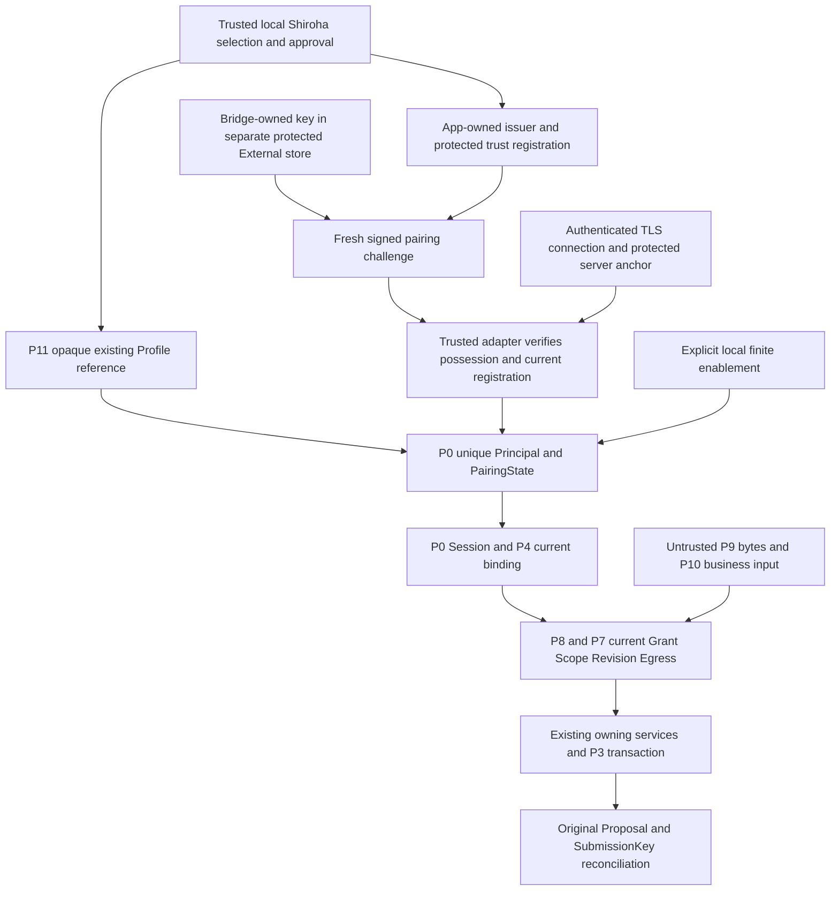

# P13 Windows Host Security Readiness

Status: **Accepted static readiness checkpoint (merged PR #264); P16 freezes the
production primitive candidates and formats in section 9 (merged PR #267).
P17 amends G0 experiment tiers and X.509 signature encoding only. P18 supplies
the first production Native Helper/FFI source slice under section 10. Real Windows security
acceptance is BLOCKED; no production Credential/Pairing/Transport/Host is
activated.**

Authority: [external boundary](external-agent-boundary.md) sections 2, 3, 5–10
own identity, B-class isolation, authorization and offline behavior.
[S0](../../architecture/s0-secure-credential-storage.md) owns Provider credentials;
[MCP vNext](mcp-vnext-contract.md) owns the later client projection, not identity.
This document owns the prerequisite assessment and future acceptance criteria;
its section 9 owns the frozen production candidate decisions, which select
candidates and close no WINDOWS_PENDING item.
The P13 checkpoint changes no business code, credential port, dependency, schema, protocol,
system configuration or production composition.

P14 standing offline coverage is accepted through merged PR #265. P15's offline
implementation candidate is owned by [external boundary §12](external-agent-boundary.md#12-p15-external-credential-boundary-offline-implementation-candidate).
It implements association/verification seams only; M1–M4 real credentials,
protected storage and authentication remain WINDOWS_PENDING. Formal G0-I and
real batch grants are unmet, and
X0–X12 have not been authorized or run. Its private runtime-binding object is
an offline event boundary, not a selected cryptographic nonce/wire format. No
Codex or other upstream process/brand authenticity is claimed.

P16 (section 9) converts the section 4 gap matrix and P15's offline boundary
into frozen production candidates: the certificate and identity model, the
secure credential storage backend and formats, the cryptographic possession
proof and exchange protocol, and the Windows Discovery/local-isolation rules,
plus the minimal implementation packages and their required experiment
authority. It implements nothing, generates no key or certificate, starts no
listener, changes no P0–P15 permission semantic and clears no WINDOWS_PENDING
item. P17 supersedes the single isolated-environment experiment gate with
section 6's tiers: normal implementation/offline work is G0-L0; real experiments
remain BLOCKED_ON_G0 without their exact batch grant (section 9.F).

**HOST_STABILITY_HALT = ACTIVE; TRANSPORT = BLOCKED; AR-R6A = NOT_ACCEPTED.**

## 1. Decision and evidence classification

Retain IPv4 Loopback TCP + mTLS as the preferred candidate and Named Pipe as
the sole fallback. Standard Dart APIs support relevant TLS primitives; that
does not prove protected Discovery, credential issuance/storage, handshake
resource bounds, Windows lifecycle safety or packaged interoperability.
No reviewed static evidence conclusively disqualifies TCP against the existing
hard properties. The gaps below prevent implementation activation and real
acceptance; they are not permission to weaken a hard property.

No experiment device/environment or batch authorization has been approved by
this document. Future dynamic admission is **BLOCKED** until the applicable
G0-L1, G0-L2 or G0-I prerequisites and exact batch grant are met. This does not
assert that no suitable device exists.
The static document can be delivered while that gate remains closed.

| Classification | Meaning |
|---|---|
| OFFLINE_CODE | Current repository implements the bounded property; cited P12/preceding tests and historical review support it. It is not a real credential/transport result, and P13 does not rerun those tests. |
| STATIC_API | Official API/platform documentation and inspected SDK/dependency source support a primitive. Integration, failure behavior and Windows release execution remain unproved. |
| WINDOWS_PENDING | Full acceptance needs separately authorized G0-I experiments on independent Windows; approved L1/L2 subsets yield local evidence only (§6). No PASS is recorded here. |
| UNSUPPORTED | A promise excluded by the frozen threat model or an operation outside this candidate; an implementation cannot claim it as a passed condition. |

Experiment evidence uses the following separate labels. OFFLINE_CODE maps to
OFFLINE and STATIC_API to STATIC; neither is a Windows result. WINDOWS_PENDING
remains pending for complete acceptance despite a successful local subset.

| Evidence | Can prove | Cannot prove |
|---|---|---|
| STATIC | API, format and design feasibility | Actual Windows security behavior |
| OFFLINE | Pure algorithms and Application contracts | OS permissions or real connections |
| LOCAL-L1 | Security-primitive functions on the specified device/version/objects | Cross-device stability or complete production security |
| LOCAL-L2 | The specified bounded Loopback/TLS behavior | Formal Host release safety |
| INDEPENDENT-WINDOWS | Actual security results in the specified independent experiment environment | Unexecuted cases or other environments |

P12 is accepted only within its offline scope through merged
[PR #263](https://github.com/duanzhijian200443/shiroha_quiz/pull/263).
Its [contract CI](https://github.com/duanzhijian200443/shiroha_quiz/actions/runs/38233209424)
completed 7/7 successfully, and its
[final Reviewer closure](https://github.com/duanzhijian200443/shiroha_quiz/pull/263#issuecomment-6122245804)
recorded zero P0/P1/P2 and REVIEW APPROVAL. That same review session performed
the user-authorized fixed-target Windows offline checks: External 387 twice,
IPC 112, widget/Origin/B0 46, totaling 932 successful executions. It explicitly
disclosed the departure from a separate Verifier session. This document neither
claims independent-session verification nor invents a VERIFICATION APPROVAL.
Exact merge/head/base identities and execution evidence remain in Git/PR.

### Repository evidence anchors

| ID | Current source/contract and historical test evidence |
|---|---|
| E1 | [P0 TrustCore](../../../lib/application/external/external_trust_core.dart), [P12 coordinator](../../../lib/application/external/external_trust_coordinator.dart), [P12 tests](../../../test/application/external/external_trust_coordinator_test.dart), [memory tests](../../../test/application/external/tcp_core_memory_test.dart): one Principal per selected Profile, synthetic proof, finite enablement and generation invalidation. |
| E2 | [P4 Admission](../../../lib/application/external/external_runtime_admission.dart), [P8 Host](../../../lib/application/external/local_host_dispatch.dart), [P8 tests](../../../test/application/external/local_host_dispatch_test.dart): current management binding, exact execution Session, readiness and real owning drain. |
| E3 | [P11 management](../../../lib/application/external/local_authorization_service.dart), [P1 authorization](../../../lib/application/external/external_authorization.dart), [P11 tests](../../../test/application/external/local_authorization_service_test.dart): non-secret policy only, current revision/Scope/Egress, no pairing activation. |
| E4 | [P9 codec](../../../lib/data/external/ipc_envelope_codec.dart), [P9 tests](../../../test/data/external/ipc_envelope_codec_test.dart), external boundary section 7: exact framing and header-before-body allocation; no authentication. |
| E5 | [P10 projection](../../../lib/data/external/ipc_command_projection.dart), [P10 tests](../../../test/data/external/ipc_command_projection_test.dart), external boundary section 8: authentication/P8 binding before business parsing; preserved effect evidence. |
| E6 | [P3 STAGE](../../../lib/application/external/external_generated_stage.dart), [Proposal repository](../../../lib/data/repositories/generated_proposal_repository.dart), [P12 B0 tests](../../../test/application/external/external_trust_backup_test.dart), [P8 B0 tests](../../../test/application/external/local_host_backup_test.dart): sole writer/key reconciliation and restore/restart boundaries. |
| E7 | [S0 port](../../../lib/data/persistence/engine_credential_store.dart), [S0 adapter](../../../lib/data/credentials/secure_engine_credential_store.dart), [dependency lock](../../../pubspec.lock): Provider-only namespace and typed failures; not an External credential implementation. |
| E8 | [main composition](../../../lib/main.dart), [MCP v0 contract](../../architecture/mcp-v0-contract.md), [P11 source guards](../../../test/application/external/local_authorization_architecture_test.dart), [CI configuration](../../../.github/workflows/pr-contract-checks.yml): no production external activation; P14's standing shards cover the External offline Application/IPC regression matrix, which is not Windows credential/transport acceptance. |
| E9 | [P15 association port](../../../lib/application/external/external_credential_association.dart), [P15 boundary](../../../lib/application/external/external_credential_boundary.dart), [standing P12/P15 tests](../../../test/application/external/external_trust_coordinator_test.dart), [B0 tests](../../../test/application/external/external_trust_backup_test.dart): offline CAS/failures, exact runtime/event binding and private P0 windows; test-only memory authority, no Windows storage/crypto proof. |

## 2. Candidate primitives and static screening

Public references were read for this checkpoint. Current Dart API pages reflect
Dart 3.13.5 and current Flutter platform pages reflect Flutter 3.47; they are not
the repository's pinned toolchain. Repository CI pins Flutter 3.41.9, and the
inspected local SDK reports Dart 3.11.5/windows_x64. Its `dart:io` source also
contains the relevant TLS, DER and minimum-version APIs. Versions are evidence
context, not an authorized upgrade. Future experiments must freeze their exact
SDK, lockfile, architecture and release artifacts and recheck these references.

| Question | Static result and smallest candidate | Remaining real proof / rejection threshold |
|---|---|---|
| Standard TLS | [SecureServerSocket.bind](https://api.dart.dev/dart-io/SecureServerSocket/bind.html) exposes required client certificates; [SecureSocket.connect](https://api.dart.dev/dart-io/SecureSocket/connect.html) takes a trust context. Use an explicitly provisioned context, require client certificates, verify the exact admitted leaf and prohibit accepting bad certificates or TLS key logging. STATIC_API. | Valid, missing, forged, wrong-anchor, expired and wrong-role certificates must be tested. A handshake completing is not business authorization. |
| Handshake admission | Direct secure-server binding has no documented handshake-deadline parameter. [ServerSocket.bind](https://api.dart.dev/dart-io/ServerSocket/bind.html) plus [SecureSocket.secureServer](https://api.dart.dev/dart-io/SecureSocket/secureServer.html) is a candidate way to count accepted TCP sockets before TLS. The raw socket carries no business protocol and is destroyed on failed/late TLS. This is the same TCP/mTLS candidate. STATIC_API plus design inference. | A Future timeout alone does not cancel native work. Prove actual socket destruction, late-completion disposal, bounded native/TLS buffers and slot retention through settlement. If that cannot be demonstrated with the approved SDK, TCP remains blocked. |
| Numeric loopback | Bind an `InternetAddress.loopbackIPv4` object, require the actual local address to equal 127.0.0.1 and use `shared: false`. No hostname resolution, wildcard or IPv6 listener. API support is static only. | Inspect actual bound address and reject publication if it differs; test no LAN/wildcard listening and unauthorized local connection denial before business parsing. |
| Certificate/key loading | [SecurityContext](https://api.dart.dev/dart-io/SecurityContext-class.html) imports PEM/PKCS12 and private-key bytes. Use app-specific anchors without ambient roots, role-separated leaves, explicit validity and a frozen minimum TLS policy. The API does not provide CA/CSR generation or a Windows non-exportable-key signing-handle interface. | Windows release/AOT must load the chosen bounded formats, enforce server/client identity and certificate validity, and deny old rotated credentials. Do not infer CRL/OCSP or live revocation guarantees from a TLS API. |
| Identity mapping | [X509Certificate](https://api.dart.dev/dart-io/X509Certificate-class.html) exposes DER and validity. Candidate identity is a SHA-256 digest of the verified leaf DER, registered to one existing opaque Profile reference by trusted local management; subject/CN, a supplied fingerprint or the SDK's SHA-1 accessor is not authority. | Verify collision/conflict rejection, active local credential registration, exact installation/role and replay/rotation invalidation. The cryptographic suite, certificate profile and registry format need their own bounded approval before implementation. |
| Key generation/issuance | Dart's TLS context loads material; it does not issue it. Windows [BCryptGenerateKeyPair](https://learn.microsoft.com/en-us/windows/win32/api/bcrypt/nf-bcrypt-bcryptgeneratekeypair) and [CryptSignAndEncodeCertificate](https://learn.microsoft.com/en-us/windows/win32/api/wincrypt/nf-wincrypt-cryptsignandencodecertificate) support primitives for a minimal native crypto helper. STATIC_API, not a selected implementation. | Prove key ownership, CSR/challenge signature checks, intended SAN/EKU/validity and issuer protection. No certificate algorithm, third-party crypto dependency or native package is selected by P13. |
| Storage and native boundary | Reuse S0's authority separation, typed missing/corrupt/unavailable failures and explicit compensation principles. Do not reuse `engine.<providerId>`, its 4096-rune API-key limit, Provider migration or bulk deletion. A separately approved External namespace/storage boundary is required. | The lock resolves flutter_secure_storage 10.3.1 / Windows 4.1.0. [The versioned Windows package](https://pub.dev/packages/flutter_secure_storage_windows/versions/4.1.0) stores by default one DPAPI-wrapped JSON map file and keeps an AES-GCM/Credential Manager-key legacy path; neither satisfies the External contract (§9.B.1). Prove missing/corrupt-key behavior without silent rekey, ACLs and owner-only operations. No Provider entry may change. |
| Discovery/Windows integration | A minimal Windows adapter is justified for security-descriptor creation/inspection and object-identity-safe publication/cleanup, which current external code does not implement. Flutter documents [Win32/FFI integration](https://docs.flutter.dev/platform-integration/windows/building); transitive ffi/win32 dependencies are not authority to add a new adapter. | Prove exact DACL/owner, reparse/parent substitution resistance and replacement/cleanup by object identity. Failure must close the candidate. A directory name or profile-local path alone is insufficient. |
| Packaging | [Dart AOT executables](https://dart.dev/tools/dart-compile) and [Flutter Windows distribution](https://docs.flutter.dev/platform-integration/windows/building) are supported building blocks. S0's Flutter MethodChannel plugin is not evidence that a standalone Dart AOT Bridge can use that backend without a Flutter engine. | Freeze native dependency loading and a minimal standalone Bridge storage/crypto solution. Test packaged release, not just JIT or the developer machine. TLS credentials are separate from code-signing certificates; no OS root installation or release change follows from this plan. |

### Storage and Discovery constraints

[Windows DPAPI](https://learn.microsoft.com/en-us/windows/win32/api/dpapi/nf-dpapi-cryptprotectdata)
provides user-associated protection; using its machine-wide flag would not
provide the required user boundary. It does not isolate programs sharing that
user identity. It is one possible dedicated External backend, not a property
automatically inherited from S0. [Credential Manager reads](https://learn.microsoft.com/en-us/windows/win32/api/wincred/nf-wincred-credreadw)
use the current token's logon credential set. The plugin's
[CRED_PERSIST_LOCAL_MACHINE](https://learn.microsoft.com/en-us/windows/win32/api/wincred/ns-wincred-credentialw)
means persistence across this user's logons on this computer; it must not be
confused with DPAPI's machine-wide decryptability flag.

Discovery, public trust anchors and credential association metadata need
integrity even when they contain no private key. Proposed objects are inside a
separate experiment-owned local NTFS root, protected at creation with explicit
owner-SID rights and only separately justified system rights. No null DACL or
permissive inherited Everyone/Users/anonymous rights are accepted.
[DACL semantics](https://learn.microsoft.com/en-us/windows/win32/secauthz/access-control-lists)
distinguish an absent DACL from an empty one. Both directory and child-object
rights must be checked: [file security](https://learn.microsoft.com/en-us/windows/win32/fileio/file-security-and-access-rights)
does not make a parent's descriptor an access check for every child.

The later adapter must create or securely open and validate the actual object,
parents and volume before use; reject unexpected owners, reparse traversal and
unsafe pre-existing objects. [CreateFileW](https://learn.microsoft.com/en-us/windows/win32/api/fileapi/nf-fileapi-createfilew)
supports security attributes and reparse-related flags, but a final-component
flag alone is not a proven defense for substituted parents. Atomic publication
and cleanup must retain verified handle/file identity and this runtime's random
ownership identifier, not just a pathname, PID or stale descriptor. An uncertain
object is left untouched and the Host remains closed; no broad stale-file sweep.
No AF_UNIX lease/unlink experiment is implied by these Windows requirements.

## 3. Credential, pairing and Host trust boundary

The following is a future candidate composition, not a production route.



The smallest candidate responsibility split is:

1. App owns the installation issuer/server credential, approved trust anchor,
   credential-to-Profile association and revocation decision. Bridge generates
   and holds its own client key; only public enrollment material reaches App.
   Never bundle a reusable private key or install a general OS trust root.
2. App locally selects an existing unrevoked opaque Profile reference and
   registers its P0 Principal using the accepted P12 seam. CSR names, JSON ids
   and historical Origin cannot choose or reconstruct that Principal.
3. Local request/approval binds the expected credential identity to one pairing
   request. A fresh challenge must bind request, selected Profile, installation,
   runtime generation, intended key/certificate and finite expiry. Trusted
   verification must reject reused, expired, mismatched or replaced challenges.
   Approval alone cannot produce `PairingProof` or a paired state.
4. Bootstrap public enrollment/challenge delivery is a separate locally approved
   control-plane design still to be frozen. P9/P10 have no pairing route. Do not
   add one to their fixed business schema or use an unauthenticated business
   listener. A lab may use explicitly authorized local public-material exchange;
   it is not acceptance of a real client enrollment UX/protocol.
5. Perform asynchronous TLS/secure-store/crypto work in infrastructure. The
   existing synchronous `ExternalCredentialPort` only accepts adapter-owned,
   channel-bound verified attempt objects and checks current generation,
   registration, validity and liveness; missing/stale evidence returns null or
   a fixed failure. It must reject externally constructed `PairingProof`,
   `AuthenticatedPeerEvidence`, Profile strings and claimed fingerprints.
   Adapter evidence expires or is invalidated on disconnect/rotation/replacement.
   It is not a second Principal system or a durable Session table.
6. `provePossession` supplies only the existing P0 request/credential result
   after that verification. `authenticate` supplies only the verified credential
   identity; P0 maps it to its already registered Principal. Explicit finite
   enablement remains a separate local action. P4 then admits the current Session;
   P8/P7 still check current business authority and final release.

The credential association must be integrity-protected outside the non-secret
Profile/Grant tables and refer only to their existing App identity. Its format,
creation/rotation commit points and failure reconciliation require separate
approval. On restart, validate it and bind existing Profiles afresh with business
access disabled. On Restore, surviving credential material does not resurrect
the old association, pairing or enablement; fresh local recovery/proof is required.
B0 does not create/copy/delete secure credentials. No auto-healing corrupt trust
record, issuer/key regeneration, Provider-key reuse or schema change is approved.

The current P12 coordinator is named `.offline` and cannot be relabeled as a
production entrypoint. Any future production wiring requires its own bounded
contract/acceptance review without changing P0/P4 authorization semantics.

### B-class and cross-user cases

Other SIDs may TCP-connect; the contract does not promise OS-level rejection at
connect. Their unauthorized credentials and protected-object accesses must fail.
A separately approved legitimate client under another SID, with its own provisioned
key, approved trust material and current Profile/Grant/enablement, may obtain
business access. For that positive lab case, supply approved public endpoint/trust
information into that client's own protected root; do not make the App owner's
protected Discovery or secrets readable to other SIDs. Multi-user provisioning
and distribution are unresolved production details, not an inferred feature.

Same-SID Bridge proxying is the accepted residual risk. User-wide account takeover,
administrator/kernel attackers, brand/process attestation from a certificate,
absolute local denial-of-service prevention, and guaranteed non-exportable TLS
keys never present in process memory are UNSUPPORTED promises. Loopback is not
authentication; mTLS is not Windows ACL isolation. None of these exclusions
relaxes current Grant/Scope/Egress or explicit local COMMIT.

## 4. Production security gap and dependency matrix

All production implementation/experiment rows require new authority; P13 authorizes only
this static assessment. P15 separately authorizes OS-independent offline seams,
not protected Windows objects or experiments. Dependencies refer to row numbers and G0
(approved environment and exact experiment grant, section 6).

| ID / boundary | Current status and evidence | Missing proof / minimal next step | Failure closure | New authority / prerequisite |
|---|---|---|---|---|
| M1 Credential Authority | OFFLINE_CODE E1/E9 association rules; production issuer/client key ownership absent. STATIC_API native crypto primitives. | Freeze Bridge key ownership, App issuer/leaf roles and protected one-credential/one-Profile registration; implement only a reviewed bounded helper. Prove possession, conflict and rotation. | Reject unknown/duplicate/wrong-role credentials; do not mint a Principal from claims or regenerate trust automatically. | Implementation + key-generation grant; G0, M2. |
| M2 Secure Storage | OFFLINE_CODE E7 for Provider rules and E9 for separate association/failure port; STATIC_API Windows stores. Production External store absent. | Dedicated namespace, bounded certificate/key material, current-user protection, exact read/write/delete scope, corrupt/missing/unavailable distinction and compensation; standalone Bridge backend proof. | Missing denies connection; corrupt hard-denies; unavailable closes admission with fixed transient classification. No plaintext or Provider fallback, bulk deletion or silent rekey. | Dedicated storage/crypto resources; G0. |
| M3 Pairing Proof | OFFLINE_CODE E1/E9 state/proof gate and private request/runtime-bound windows; cryptographic freshness/bootstrap absent. | Bind local approval to fresh request/key/install/generation challenge and independently verify a possession signature. Freeze control-plane delivery separately. | Failure remains pending proof; no paired state, credential acceptance or permission expansion. | Enrollment/crypto grant; G0, M1, M2. |
| M4 Client Authentication | OFFLINE_CODE E1/E2/E5/E9 map/admission and one-use verifier adapter; real cryptographic/TLS events absent. | Authenticate TLS leaf and protected registration before business input; async proof -> adapter-owned live attempt -> existing P0/P4. | Reject wrong owner/Profile/credential/generation/role and all payload-derived identity; no Session fallback. | TLS/adapter grant; M1–M3, M6, M8. |
| M5 Windows Isolation | STATIC_API DACL/current-user primitives; no External cross-SID experiment. | Negative SID cannot read/modify owner's protected objects; positive separately provisioned SID obeys B-class business admission. Same-SID proxy risk remains documented. | Reject unauthorized object/business access; do not claim all TCP connect calls are refused. | Two lab principals and explicit account/ACL authority; G0, M2, M6, M8. |
| M6 Protected Discovery | No production discovery publisher/consumer. STATIC_API file/handle security. | Secure root/child creation, owner/DACL/volume/reparse checks, authenticated anchor, atomic publication and object-identity cleanup; independently validate both ends. | Missing/stale/tampered/uncertain discovery is unavailable; leave foreign objects untouched; no temporary unprotected replacement. | Object-creation/ACL grant; G0, M2, M1 for server trust. |
| M7 Loopback Transport | No external listener. STATIC_API explicit IPv4 binding. | Require actual 127.0.0.1, no sharing/wildcard/resolution, bounded raw accept -> required TLS, and cleanup of owned sockets only. | Reject startup/address mismatch; destroy candidate sockets; publish no usable endpoint. | G0-L2 batch for local subsets; G0-I for formal acceptance; M6, M9. |
| M8 mTLS | Standard primitives STATIC_API; all real validation WINDOWS_PENDING. | Server/client trust, exact leaf registration, SAN/EKU/validity, protocol floor, key access, anchor replacement, rotation/revocation and resumption policy. | Never accept bad certificates, unknown roots, expired/wrong-role/retired identities or TLS key logging; invalidate connections on credential/anchor change. | Certificate/TLS grant; M1, M2, M3, M6. |
| M9 Resource Limits | OFFLINE_CODE E2/E4/E5 for per-frame/business bounds; no connection/native TLS budget. | Numeric lab limits, pre-TLS slots, global decode reservations, one bounded request/response pipeline, real deadline destruction and measured native/heap/backpressure behavior. | Reject before unbudgeted allocation/handler entry; keep owning slots until settlement; close slow/over-budget channels. | Bounded load grant; G0, M7, M8. |
| M10 Lifecycle | OFFLINE_CODE E1/E2/E5/E6 for controlled drain/restart/B0. OS crash/socket/Discovery recovery absent. | Block accepts and new calls, drain owning work, invalidate evidence and generation, then swap/cleanup; cold start disabled; test crashes and stale endpoint impostors. | No late-ready publication or permission revival; uncertain cleanup leaves Host closed, without forced data rollback. | Controlled termination/restart/B0 grant; M4, M6–M9. |
| M11 Effect Recovery | OFFLINE_CODE E5/E6 original key/Proposal and commit-vs-revoke authority. Real disconnected client absent. | Cut response after commit, reconnect with fresh admitted Session, reconcile original key; absent result stays unknown. | No automatic STAGE retry, second writer/journal/Receipt table or inferred zero effect. Bridge absence never opens SQLite. | Synthetic-data effect/failure grant; M4, M9, M10. |
| M12 Packaging | Existing Flutter Windows project/locks; standalone Bridge/native deployment absent. STATIC_API E7/E8 and AOT docs. | Exact x64 release artifacts, native ABI/dependency loading, space/Unicode paths, restricted launch environment, upgrade/cold start and trusted endpoint handoff. | Missing/invalid native/backend/anchor artifact keeps Host disabled; no build/download/elevation fallback. | Build/package/launch grant; G0, M1–M11. |

M2/issuance format and M6 can be designed in parallel, but their runtime
publication waits for G0. M7/M8/M9 must be assessed together before any business
payload crosses a live connection. All security and stability gates are separate;
security success cannot clear HOST_STABILITY_HALT. P16's section 9 freezes the
selected production candidates for M1/M2/M3/M6/M8 inputs; the rows below keep
their acceptance, failure-closure and closure authority.

## 5. Framing compatibility and resource acceptance

Existing E4/E5 limits stay fixed: header 16 bytes, ID at most 64 bytes, request
6,324,224 bytes, response 229,376 bytes, protocol error 32 bytes, decoder/frame
byte ceiling 6,324,304. P10 retains its separate exact schema/version and the
1 MiB original Submission limit; P4/P5 output is 32 KiB, P6 output 24,000 bytes.
The decoder admits header and ID before body allocation. These are OFFLINE_CODE
properties, not aggregate connection/TLS memory guarantees.

For two concurrently admitted maximum request frames, explicit decoder bytes
plus worst-case decoded UTF-16 storage alone can reach
`2 × (6,324,304 + 2 × 6,324,224) = 37,945,504` bytes, before parser copies,
caller buffers, outputs, TLS/native allocations or business objects. P9's byte
ceiling therefore cannot be used as a process resident-memory ceiling.

The following is a **proposed first-lab budget**, not production capacity or a
measured PASS. The future grant must explicitly freeze it or approve a reviewed
replacement before running load; an absent numeric budget is BLOCKED.

| Resource | Proposed experiment ceiling / required observation |
|---|---|
| Accepted live TCP sockets / TLS handshakes | 8 total / 2 pending handshakes, counting pre-authentication work; overflow destroyed without business parsing. |
| Active frame pipelines | 2 globally; one request per connection; reservation retained through real decode/business/output settlement, not merely caller timeout. No unbounded envelope queue. |
| Explicit protocol byte / decoded-string reservations | 16 MiB / 32 MiB globally, separately measured; includes retained ingress/egress copies within those categories. Reserve conservatively before allowing payload allocation. |
| Write queues | At most one response per connection and 512 KiB globally; enforce the unchanged per-frame response limit before enqueue. |
| Handshake / incomplete-frame deadlines | 5 seconds handshake; 2 seconds no-progress; 10 seconds total frame assembly. Timeout must dispose the real socket and any late TLS result. |
| Business calls | Preserve each existing service guard: READ at most 16 global / 4 per Profile; STAGE at most 16 global / 4 per exact Session. The proposed shared transport pipeline ceiling is stricter. READ retains its complete two-second bound; STAGE keeps owning work until true settlement. |
| Measured memory / handle recovery | For the isolated minimal candidate harness, predeclare a warmed baseline; proposed peak process private-memory delta <=128 MiB and settled handle/slot counts return to baseline after each bounded trial. Measure native/TLS/OS buffers too; no unlimited logging or queue can be excluded. |

Stream pause and an OS listen backlog are not substitutes for a measured bound.
Limit parser admission and copies as well as P9 buffers; abort the trial at its
approved ceiling rather than escalating load. If these provisional bounds are
insufficient, report measurements and request a new reviewed scope/budget instead
of silently increasing them. P13 implements or tests none of these limits.

## 6. Future experiment authorization and environment

### G0 tiers (P17 amendment)

This amendment permits applications for controlled primary-host experiments;
it grants no experiment execution authority. Each real batch needs separate,
explicit user approval. An implementation task, a merged contract, or another
batch's success never supplies that approval or clears HOST_STABILITY_HALT.

| Tier | Permitted scope / gate |
|---|---|
| G0-L0 — normal development | On the primary computer, write C++/Win32 Native Helper, Dart FFI Adapter, Credential Store, Discovery and Host source under normal scoped task authority; compile, analyze, format and run offline pure-algorithm/Mock tests that touch no real Windows security objects. No real-experiment grant is needed. Code authority still does not authorize Host activation or later Git actions. |
| G0-L1 — controlled host security primitives | Only after individual user approval: DPAPI Protect/Unprotect on separate test objects; NTFS DACL/Owner inspection in the approved test directory; experiment-only locks/handles and normal release; finite atomic file replacement; temporary test keys/certificates. Exact operations and quantities must be granted. No sockets/listeners. |
| G0-L2 — controlled host Loopback | May be requested only after necessary L1 prerequisite evidence passes and the current implementation has independent review. One bounded 127.0.0.1 TCP/mTLS candidate, real TLS 1.3 handshake, authentication/connection behavior with no business routes, exact resource counting and closure. No LAN/wildcard, production Host activation, unauthenticated business route, STAGE or unapproved stress test. |
| G0-I — independent Windows formal acceptance | A separately controlled physical Windows machine or remote Windows host with a kernel independent of the primary computer. Complete the original A0–A12 matrix and corresponding X0–X12 trials under their exact grants. A normal primary-host VM does not automatically qualify. Security acceptance and system-stability acceptance close separately. |

Every L1 application must freeze the user-selected device, empty test root,
objects, operations and quantities. The root must be completely separate from
formal Shiroha data, credentials, databases and personal files. Freeze backup
and recovery responsibility, a maximum run time, memory/handle/resource budgets,
STOP conditions and cleanup rights. The Native Helper must pass source review
and necessary memory, handle and error-path checks before its real calls.
Ordinary experiment processes stay non-elevated. No global certificate trust
store, system account or formal ACL change is allowed. Creating a second SID
or performing aggressive negative cases needs separate explicit authority;
L1 grants neither by default and cannot substitute for G0-I cross-SID acceptance.

**Batch 3 Host A amendment candidate (not approved):** only this batch may
request reuse of the primary Windows host's existing experiment root instead
of an empty root. No cloud computer/VM is required for this LOCAL-L1 candidate;
G0-I is unchanged. Admission would require exactly the approved existing
directories/locks and two named inert Batch 2 temporaries, with associations.bin
absent. A separately approved read-only metadata capture precedes any runtime
application. Names/sizes from historical records are expectations, never current
File ID/volume/Owner/DACL evidence. Unknown objects, missing objects or drift
deny; no creation/cleanup/ACL repair is a way to meet the prerequisite. Until
the exception and runtime identity handoff receive independent review and new
explicit grants, real preflight and Batch 3 remain BLOCKED. The diagnostic
[Host A contract](../../../windows/external_native/diagnostics/README.md#host-a-preparation-candidate)
defines the bounded candidate and remaining implementation gap.

Every L2 application must additionally freeze port/bind method, socket and
handshake counts, time/memory/handle ceilings, source SHA and artifact hashes,
wrong-certificate rejection cases, STOP and recovery plans. L1 approval does
not authorize L2; each L2 batch needs its own user approval. Section 5's proposed
lab budget is not an implicit L2 grant or permission to escalate load.

For every real batch, freeze source/head/base, artifacts, OS edition/build/patch,
architecture, toolchain/lockfile, scope and budget; name an independent
fixed-target Verifier and independent Reviewer. Drift invalidates affected
evidence. Each approval applies only to its named tier, objects, operations,
trial counts and time window; no inheritance to another experiment.

**This P17 PR only revises the contract for requesting L1/L2. No L1, L2 or
G0-I experiment is authorized or executed by it.**

### G0-I formal acceptance prerequisites (original G0 retained)

Full formal acceptance remains unmet. Every G0-I batch needs a new explicit
user grant identifying:

- A separately controlled physical Windows machine or remote Windows host whose
  kernel does not depend on the primary computer. A normal VM running on the
  primary host does not qualify automatically. Identify owner, device, recovery
  responsibility and isolation boundaries; no suitable device is assumed.
- Exact serviced Windows edition/build/patch level, architecture, local NTFS
  test volume, SDK/Flutter/native toolchain/lockfile and artifact hashes. The
  proposed first batch is Windows 11 x64; VS C++/ATL requirements must be met.
  [Current Flutter platform documentation](https://docs.flutter.dev/reference/supported-platforms)
  lists Windows 10/11 x64/Arm64, but is newer than this repository's CI SDK.
  Windows 10 requires explicitly verified ongoing servicing and SDK support;
  Arm64 or another packaging model needs a separately named batch, not inferred
  acceptance from an x64 run.
- Two named disposable local principals with different SIDs. Privileged account
  preparation is a separately authorized setup action; ordinary App/Bridge runs
  remain non-elevated. Do not alter the primary user's accounts, ACLs or stores.
- An empty dedicated experiment root, separate secure namespaces and synthetic
  SQLite/B0 assets only. No official App profile, saved Provider key, user document
  or private corpus; no sharing of the primary machine's data directories.
- Exact allowed sockets/ports, credentials/objects/permissions, process termination,
  trials/time/load ceilings, evidence output and cleanup rights for each X row.
  No LAN/wildcard exposure, global trust-root installation, firewall/driver/kernel
  changes, AF_UNIX or production Host/MCP activation is included.
- An inventory of original lab configuration and owned artifacts; a restorable
  device image/approved recovery procedure before mutations. Record only fixed
  failure categories, counts, generation/test IDs, public digest references and
  sanitized timestamps. No keys, PEM/private blobs, TLS key logs, prompts, full
  payloads, secret environment variables or unrestricted memory dumps.
- Named stop/recovery operator and independent fixed-target Verifier/Reviewer.
  Freeze head/base, build artifacts, OS and budget per run. Environment or target
  drift invalidates the affected evidence; do not resume by guessing state.

The original X0–X12 request below is an approval checklist, not runnable
instructions. Each complete row retains its G0-I formal acceptance goal and
prerequisites; local subsets are classified separately below. Storage/object and credential
primitive trials precede TLS setup; socket-bearing rows also require explicitly
approved X0 resources. Permission to one row does not
grant another, or authorize production activation.

| Experiment | Unique primary goal / criterion | Resources to explicitly authorize | Dependencies |
|---|---|---|---|
| X0 | A0: exact loopback-only candidate startup | Named ephemeral loopback sockets, protected server material/descriptor and primitive processes; numeric resource preflight; no business routes. | X1, X3; static budget/storage/crypto/Discovery contracts approved. |
| X1 | A1: unique credential-to-Profile mapping using real possession proof | Disposable client/issuer keys and public certificates; protected association entries; local approval surface only. | X3; M2 format/storage design. |
| X2 | A2: deny absent/forged/wrong-anchor credentials | Bounded positive-control and negative TLS/proof attempts and disposable alternate anchors; exact loopback sockets. | X0, X1, X3. |
| X3 | A3: protected-object cross-SID secrecy/integrity | Named lab accounts; explicitly owned NTFS objects/DACLs and credential namespaces; bounded read/write/replace attempts. | Approved object/security design. |
| X4 | A4: B-class positive/negative business admission | Two disposable principals; independent client keys and approved public endpoint/anchor copies in each owned root; synthetic Grant. | X0–X3, X6, X7. |
| X5 | A5: no authority resurrection | Explicit disable/revoke/expiry, candidate restart and synthetic B0 Restore/raw rollback; no Provider-store mutation. | X4, X7 resource preflight. |
| X6 | A6: reject bad lengths before body allocation | Synthetic bounded P9 header/ID variations over the candidate channel; allocation counters, exact time/trial caps; no business routes. | X0–X3. |
| X7 | A7: bounded connections/backpressure/settlement | Approved 8/2/2 ceilings or approved replacement; slow peers, cancellation, bounded connection cuts and numeric measurements; primitive phase before route-bearing trials. | X0–X3, X6; then X4 for business settlement cases. |
| X8 | A8: committed/lost STAGE reconciliation | Synthetic Proposal/key/SQLite, controlled response cut after commit and fresh reconnection; exact owning checkpoints. | X4–X7. |
| X9 | A9: Bridge has no alternate business writer | Bounded App absence/not-ready/closed runs and file-open/access audit for the synthetic DB. | Packaged candidate Bridge; no real DB. |
| X10 | A10: retain external allowlist and MCP v0 | Existing offline compatibility fixtures and, only if separately named, synthetic retained-v0 stdio runs. No vNext registration or protocol expansion. | Candidate artifacts; standing regression target. |
| X11 | A11: owner-safe endpoint cleanup | Two candidate runtime processes (the superseded/second one must fail closed under the 9.D supersession/single-writer lock while the holder keeps serving — including concurrent initialization and store-commit attempts, which must never interleave read–CAS–commit transactions), disposed sockets and experiment-only descriptors; bounded termination/replacement races and foreign-object sentinels. | X3, X7; object-identity cleanup design. |
| X12 | A12: release launch/recovery compatibility | Named release/AOT artifacts, native DLL dependencies, space/Unicode install roots, disposable cold-start/upgrade/crash scenarios. | X1–X11; packaging model frozen. |

Address/TLS/storage/Discovery validity is a common preflight for every socket
trial, not a business success inferred from X6/X7. Abort admission if the actual
listener is not exactly 127.0.0.1, the peer/anchor is invalid, or protected-object
security/ownership cannot be proven. Initial primitive trials expose no business
routes; route-bearing trials require those preflights plus the applicable gates.
X7's primitive resource phase must pass before X4 exposes business routes; its
owning-business settlement cases then reuse the admitted X4 composition. This
phase distinction does not grant more resources or require a circular dependency.

### X0–X12 local subset mapping (P17)

Each local entry below is eligible for a separate application only, not an
approved run. Local evidence must identify the exact subset and retains the
row's dependency checks for that subset; missing prerequisites block it. Every
complete X/A goal still requires G0-I, the original section 7 standard and
independent Verifier/Reviewer evidence. No LOCAL-L1/LOCAL-L2 result automatically
marks an A row PASS or closes security/system-stability acceptance.

| Original row | Possible local evidence under an exact batch grant | Still required under G0-I |
|---|---|---|
| X0 / A0 | L2: single bounded numeric Loopback bind, actual address and normal close; L1 supplies test credential/descriptor primitives first. | Complete startup/publication and configuration-substitution rejection matrix. |
| X1 / A1 | L1: temporary key/certificate encoding, possession-signature verification and test association operations on synthetic identities only. | Complete fresh proof/selected-Profile mapping, uniqueness, substitution, rotation and authenticated-peer correlation. |
| X2 / A2 | L2: bounded valid/missing/forged/wrong-anchor/expired/wrong-role test-certificate rejection cases explicitly listed in the grant, with no business routes. L1 may supply pure primitive checks. | Full proof/TLS replay, retired-identity and no-Session/handler/content matrix. |
| X3 / A3 | L1: owner/DACL inspection, DPAPI round trip, test locks and finite atomic replacement on owned test objects; no second SID or aggressive negative cases inferred. | Complete unauthorized cross-SID secrecy/integrity, reparse/parent substitution, corruption and no-silent-rekey matrix. |
| X4 / A4 | None under L1/L2: real B-class business admission exceeds their scope. Existing OFFLINE checks remain useful. | Two-principal positive/negative admission with current synthetic policy after original dependencies pass. |
| X5 / A5 | L1: explicitly scoped test-object credential invalidation/reload functions; L2: normal connection closure only. These prove no business-authority lifecycle. | Complete disable/revoke/expiry/rotation/restart/B0 Restore/raw rollback and no-resurrection matrix. |
| X6 / A6 | No live framing trial under the authentication/connection-only L2 scope; existing P9 OFFLINE length/allocation checks remain useful. | Full real-channel malformed-header/ID allocation and safe-close matrix at unchanged limits. |
| X7 / A7 | L2: exact socket/handshake/handle counts, deadlines and normal closure inside its approved budget, including only explicitly approved bounded slow/cut cases. No stress or business settlement inferred. | Full frozen frame/queue/memory/backpressure/cancellation/owning-business-settlement matrix. |
| X8 / A8 | None: STAGE and committed response-loss trials are forbidden in L1/L2. OFFLINE reconciliation tests remain useful. | Real-channel durable commit/lost response, revoke ordering and original-key reconciliation. |
| X9 / A9 | STATIC/source guards and OFFLINE unavailable-path checks under L0; no local real App/Bridge business run implied. | Packaged Bridge absence/readiness/close/recovery and synthetic-DB access audit. |
| X10 / A10 | L0 STATIC/OFFLINE compatibility regressions; L1/L2 add no tool/publication authority. | Complete current compatibility/allowlist criterion; any named runtime stdio trial needs its own G0-I grant. |
| X11 / A11 | L1: owned test-lock contention and normal handle release; L2: its one candidate's normal socket close. No crash, competing Host or foreign-object attack trial inferred. | Full two-runtime/store-writer exclusion, termination/replacement races and foreign-object-safe cleanup. |
| X12 / A12 | L0: compile/inspect release artifacts; L1: separately approved primitive-only helper loading in space/Unicode test paths. | Complete packaged App/Bridge cold-start/upgrade/abnormal-close, endpoint supersession and invalid-artifact matrix. |

### Immediate stop and recovery

**HOST_STABILITY_HALT = ACTIVE.** Primary-host old AF_UNIX ROOT-ACL,
Endpoint Lease and Close/Unlink dynamic experiments remain permanently halted
and must never rerun automatically. High-risk crash, driver or kernel anomaly
reproduction remains forbidden on that host. New TCP/DPAPI/CNG/NTFS experiments
there may run only through their exact G0-L1/L2 exception grants; those grants
do not lift the halt or carry authority to another experiment.

Stop on a blue screen, hard hang, kernel/driver anomaly, unexpected elevated
process/system mutation, wrong bind address, secret exposure, unauthorized object
or business access, ownership uncertainty, budget excess, unexplained data
change or data corruption, unknown handle ownership, target/environment drift or
failure requiring an unapproved primitive. Do not reproduce a blue screen to
prove causality or automatically retry on the primary host. The reported
AF_UNIX-associated event remains a reported instability with no proven complete
kernel-failure causal chain; it establishes neither inevitable TCP/mTLS failure
nor TCP/mTLS safety.

Block new candidate work first. On a responsive approved test device, close/drain
owning services before authorized teardown; interrupted callers do not prove
settlement. For an unresponsive device, use only the preapproved recovery operator
and image procedure; mark in-flight STAGE unknown. Preserve sanitized evidence
and the original submission keys. Cleanup is limited to positively owned lab
objects; do not delete foreign endpoints/credentials, wipe Provider stores,
terminate unrelated processes or destroy Proposal/user data. No automatic retry.

## 7. Real acceptance and fallback thresholds

All A rows currently remain WINDOWS_PENDING. The offline column describes
existing evidence, not tests run in P13. Each real result must cite one fixed
target/environment/trial record and the measured counters; missing or ambiguous
evidence is INCONCLUSIVE/BLOCKED, never PASS. No item is waived because the
candidate is loopback-only or a lower-level primitive trial succeeded.
P17 changes only experiment eligibility: complete A0–A12 acceptance still needs
G0-I evidence for the original criteria below; LOCAL-L1/LOCAL-L2 is subset
evidence only. Windows security and system-stability acceptance remain separate.

| ID | Offline boundary already covered | Required real PASS / corresponding FAIL |
|---|---|---|
| A0 | Standard numeric IPv4 API support only. | Candidate listener's actual local address is exactly 127.0.0.1; wildcard, LAN, IPv6 and shared publication are rejected, including configuration substitution. Any other reachable listener/address or unprotected descriptor publication is FAIL. |
| A1 | E1/E2 unique Principal/opaque binding. | Valid fresh cryptographic possession proof and current registration resolve exactly one selected existing Profile; duplicate identity, substituted Profile or another generation never resolves. X2/X4 must then confirm the authenticated TLS peer uses that same registered identity. Wrong binding or claim-derived identity is FAIL. |
| A2 | E1/E5 synthetic rejection and auth-before-business parsing. | Missing/forged key, unknown/retired leaf, wrong anchor/role, invalid validity or replayed/expired pairing challenge yields no usable Session, handler or content. Bad-certificate bypass, trust-on-first-use from Discovery or fallback is FAIL. |
| A3 | No real Windows object proof. | Other unauthorized SID cannot read, alter, replace, delete or redirect protected credentials/association/Discovery/anchor objects, including unsafe inheritance, reparse/parent replacement and corrupt-key cases. Any successful protected access or silent rekey is FAIL. |
| A4 | E1/E2 separate Profiles and current Grant checks. | Unauthorized SID may connect but receives no business access. A separately provisioned cross-SID credential with current approved Profile/Grant/enablement behaves according to B-class; no read of the owner's protected Discovery is required. All-cross-SID-connect rejection and brand/process attestation are UNSUPPORTED promises, not pass substitutes. |
| A5 | E1/E2/E6 disable/expiry/revoke/generation/B0. | Revoke, finite enablement expiry, restart, credential/anchor rotation and Restore deny old Session/Context and unreleased egress. Fresh authentication cannot renew old execution authority; raw rollback may retain policy/history but starts disabled and requires fresh proof/rebinding. Revival is FAIL. |
| A6 | E4 complete-header/ID validation precedes payload allocation. | Zero/high-bit/over-limit/unsupported header or invalid ID allocates no declared body, enters no handler and closes the decoder/channel safely. Exact ceilings remain unchanged. Late allocation/reuse/resynchronization or weakened limits is FAIL. |
| A7 | E2/E4/E5 per-frame/business limits and owning drain. | All frozen connection/handshake/frame/queue/memory/time counters remain within the authorized numeric budget; slow/fragmented/coalesced input, cuts, cancellation, deadline and shutdown release real resources only at settlement. Budget excess, unlimited buffering or premature slot reuse is FAIL. |
| A8 | E5/E6 both STAGE transaction orderings and original-key recovery. | Cut output after durable commit; fresh admitted reconnection/current policy reconciles the same original key/Proposal with no auto-retry/duplicate or formal Question commit. Revoke-first publishes none; publication-first retains history while withholding unauthorized output. Unknown/absent is not invented zero effect. Contradiction is FAIL. |
| A9 | E8 contract/compiled composition boundary. | App absent, not-ready, closed or recovering gives bounded unavailable/denied behavior. Bridge neither opens the business SQLite DB nor loads repositories/migrations or starts a replacement writer. Any such fallback is FAIL. |
| A10 | E2/E8 exact ten internal external routes and six MCP v0 READ tools. | Current compatibility checks retain those surfaces and deny every external COMMIT/DESTRUCTIVE/Built-in route. P13/candidate trials register no vNext tools. Changed v0 or expanded authority is FAIL. |
| A11 | E2 controlled owning shutdown; no real endpoint ownership proof. | Normal close, abort/startup race, crashed prior runtime and competing replacement leave another process's sockets/descriptors/credential objects and sentinel data untouched. Cleanup uses proven ownership/object identity; ambiguous state fails closed without deleting it. Wrong deletion or shared/wildcard listener is FAIL. |
| A12 | Static AOT/platform support only. | Exact packaged release/native backend works non-elevated from space/Unicode paths and a sanitized launch environment, after abnormal close, upgrade and cold start. Old endpoint/anchor cannot impersonate the new App — a second live External runtime must fail closed (9.D supersession single-liveness and store single-writer exclusion: it neither serves, publishes, binds nor writes store objects while the holder lives), a stale signed descriptor (including one paired with the retired still-valid leaf, or below the pinned epoch) is refused or can reach only a dead endpoint, and a successor is accepted on first sighting without re-enrollment after a same-generation restart; invalid native/store artifacts keep it disabled. JIT-only success, developer-only dependencies or authorization revival is FAIL. |

Disconnected channels must stop accepting new calls and drop their adapter-owned
attempts; no disposed connection can recreate its Session. P0 has no standalone
per-Session close API, so do not claim it revokes one Session merely because a
socket closes. Runtime disable/generation invalidation remains P0-owned, P7/P8
execution stays exact-Session-bound, and another current legitimate Session of
the same Principal retains P4–P6's existing READ-reference semantics. Already
started work settles in its owning service; disconnect never proves rollback.

### Named Pipe fallback

TCP/mTLS stays blocked if required crypto/storage, Discovery integrity, bounded
TLS admission, credential validation or release/AOT behavior cannot be proved
within the frozen model. Report the specific failing A/M property and static or
isolated evidence before proposing the fallback; no automatic switch or third IPC.

[Windows Named Pipe security](https://learn.microsoft.com/en-us/windows/win32/ipc/named-pipe-security-and-access-rights)
supports explicit descriptors, but defaults include broad read access and generic
write rights can also permit instance creation. A separately authorized fallback
must freeze narrowly scoped rights, local-only operation, server impersonation
defense, authenticated peer/credential mapping, resources, cleanup and packaging.
Pipe ACLs alone do not grant a Profile/Grant, establish a trusted App server or
pass Application authorization. It must pass all applicable A criteria, retain
the B-class business rules and support the explicitly approved cross-SID case;
if this requires changing frozen semantics, STOP for user direction.

If neither candidate satisfies every hard security and stability property, keep
production Host and AR-R6B closed. Do not lower trust, add plaintext keys or an
unauthenticated business fallback to make the connection work.

## 8. Smallest subsequent responsibilities and activation gate

These are bounded future responsibility packages, not task state or automatic
authorization. Each needs its own explicit scope/ownership, fixed acceptance and
independent review; none is started by P13 or a merged readiness document.

| Package | Smallest responsibility | Exit condition |
|---|---|---|
| Experiment batch authorization | Apply for the appropriate G0-L1/L2 or G0-I batch at the real-call boundary; section 9 already freezes certificate/challenge/storage/Discovery formats. This is not another general offline design stage or a prerequisite to G0-L0 code. | Complete exact batch grant and prerequisites before real calls. |
| Credential and protected objects | Implement only approved issuance/Bridge custody, separate External storage, association and owner-safe Discovery primitives. No business listener/Host publication. | X1/X3 primitive proof plus corruption/rotation/failure closure on isolated Windows. |
| TLS and bounded adapter | One TCP/mTLS candidate, verified attempt mapping, pre-auth admission/timeout/destruction and bounded P9/P10 consumption. Existing business owners remain unchanged. | X2/X4/X6/X7 isolated proof; no unauthenticated business path. |
| Lifecycle/effect/release evidence | Actual disconnect/crash/drain/Restore/reconciliation, foreign-object cleanup and packaged App/Bridge acceptance over synthetic data. | X5/X8–X12 at the exact target; required Windows Verifier and Independent Reviewer approval. |
| Separate production activation decision | Evaluate all security evidence and independently close system-stability acceptance in an approved environment; explicitly authorize any production wiring. AR-R6B remains a separate stage. | No missing A property, no open blocking findings, final-target CI/review/required Verifier, explicit activation authority and an explicit decision concerning HOST_STABILITY_HALT. |

No package may silently expand schema v34, B0 v2, P9/P10 schemas, formal COMMIT,
Provider storage or the accepted identity model. A required change to a frozen
contract, unapproved native primitive, inadequate independent environment or a
test possible only through high-risk primary-host experiments is BLOCKED. Static
design can record that blocker; implementation and experiment stop at that boundary.

## 9. P16 production primitive freeze

Status: **Accepted static freeze (merged PR #267), with P17's bounded encoding
and experiment-gate amendments in 9.A.2, section 6 and 9.F. No production credential, certificate, key,
secure store, Discovery object, TLS context, listener or Host is implemented,
generated, activated or measured by P16. Every real Windows behavior below
remains WINDOWS_PENDING; real experiments remain BLOCKED_ON_G0 without the
applicable environment and exact batch grant. G0-L0 implementation/offline work
requires normal scoped task authority, not L1 approval (sections 6 and 9.F).**
This section closes the design half of the
section 4 gaps (M1–M3, M5–M6 and the M8/M9 inputs) with concrete, versioned,
reviewable decisions, so the next stage is real implementation and isolated
Windows acceptance, not another offline design round. P15 remains the owner of
the offline association/evidence contract this production layer must satisfy;
P0/P4/P7/P8 authorization semantics, S0 Provider authority, the B-class
isolation model and the frozen P9/P10 schemas are unchanged and are not
duplicated.

Decision markers used below: **FROZEN** (selected candidate; implementation and
review follow it), **WINDOWS_PENDING** (real acceptance requires an authorized
experiment; no PASS is recorded) and **UNSUPPORTED** (excluded promise). Static
evidence keeps the section 1 classes (OFFLINE_CODE / STATIC_API).

Toolchain context actually inspected for this decision: repository CI pins
Flutter 3.41.9; the local SDK reports Flutter 3.41.9 / Dart 3.11.5 windows_x64.
`pubspec.lock` pins flutter_secure_storage 10.3.1 /
flutter_secure_storage_windows 4.1.0 / ffi 2.2.0 / win32 5.15.0 (transitive).
Version claims below hold for those exact artifacts; a version change
invalidates the affected evidence until rechecked.

### 9.A Certificate and identity model (P16-A)

#### 9.A.1 Roles and responsibility split (FROZEN)

One local installation trust domain with three roles, all ECDSA P-256:

| Role | Owner / custody | Signs / performs | Never does |
|---|---|---|---|
| Installation issuer | App; private key in the App protected store (9.B) | Client and server leaf issuance, `SHIROHA-EXTERNAL-ENDPOINT-V1` descriptor signatures, anchor-rotation records; its self-signed certificate is the single trust anchor | TLS itself; authentication; any Bridge custody |
| Server credential (leaf) | App; private key in the App protected store | The TLS server side on 127.0.0.1 only | Issuing anything |
| Client credential (leaf) | Bridge; private key generated by the Bridge and kept in the Bridge store | The pairing possession proof (9.C) and the TLS client side | Receiving or exporting private material |

The issuer key never leaves the App process/store and is used only during
explicit initialization, enrollment and rotation actions. The Bridge generates
its own key pair; only public enrollment material ever reaches the App. No
reusable private key is bundled and no OS trust root is installed or touched:
the anchor is pinned per installation inside the two protected roots (9.D).

Basis: CNG `BCryptGenerateKeyPair` / `BCryptSignHash` / `BCryptVerifySignature`
(bcrypt.dll; CNG has provided ECDSA P-256 since the Vista-era Windows; the
frozen first target is Windows 11 x64 per section 6) and crypt32 certificate
encode/inspect APIs (`CryptSignAndEncodeCertificate`,
`CertCreateCertificateContext` / `CertGetCertificateContextProperty`). Both
build directions are `dart:io` plus one minimal Win32 helper over SDK-built-in
`dart:ffi`; nothing in this model needs the Flutter engine, so the Flutter
Windows build and the standalone Dart AOT Bridge share the identical code path
(real packaged AOT run remains WINDOWS_PENDING, A12).

#### 9.A.2 Algorithms and sizes (FROZEN)

- Key algorithm: ECDSA on NIST P-256 (secp256r1 / prime256v1), 256-bit keys.
- Signature algorithm remains ECDSA P-256 with SHA-256. Encoding depends on
  the record; the table below supersedes the universal raw-64-byte rule.
- Private-key blobs in the protected stores: PKCS#8 DER (id-ecPublicKey +
  prime256v1); certificates: DER (X.509 v3), converted to PEM text only when
  handed to a Dart TLS context.

| Use | Signature encoding |
|---|---|
| X.509 issuer/server/client certificate | Standard ASN.1 DER ECDSA-Sig-Value: `SEQUENCE { r INTEGER, s INTEGER }`, carried by the certificate's signatureValue BIT STRING (zero unused bits); variable length, never arbitrary raw 64 bytes. |
| Pairing Proof (9.C.2) | Fixed 64-byte raw r‖s, unchanged. |
| Endpoint Descriptor (9.D) | Fixed 64-byte raw r‖s, unchanged. |
| Other custom signed records | Preserve their own frozen format. If none is defined (including the 9.A.6 anchor-rotation record's byte format), mark encoding UNDEFINED; a separate bounded contract is required before implementation/use. Neither certificate DER nor raw r‖s is inferred. |

Normative basis: [RFC 3279 §2.2.3](https://www.rfc-editor.org/rfc/rfc3279.html#section-2.2.3)
defines the ECDSA integer sequence; [RFC 5758 §3.2](https://www.rfc-editor.org/rfc/rfc5758.html#section-3.2)
applies it to SHA-256 and requires `ecdsa-with-SHA256`
(1.2.840.10045.4.3.2) with absent AlgorithmIdentifier parameters, not NULL.
[RFC 5280 §4.1.1.3](https://www.rfc-editor.org/rfc/rfc5280.html#section-4.1.1.3)
defines the certificate signatureValue container;
[ITU-T X.690 (2021), §§8.3 and 10.1](https://www.itu.int/rec/T-REC-X.690-202102-I/en)
governs integer/shortest DER length encoding.

Raw r and s each represent an unsigned big-endian integer, left-zero-padded to
exactly 32 bytes. For DER, validate `1 ≤ r,s < n` (P-256 group order), remove
unnecessary leading zeros, then add exactly one `0x00` sign octet only if the
first remaining octet's high bit is set. ASN.1 INTEGER is signed: omission of
that octet would encode a negative value. Use primitive INTEGERs in order r,s,
the shortest definite lengths and no extra padding, fields or trailing bytes.
When decoding DER to raw, reject noncanonical, negative, zero or out-of-range
values; remove only the necessary sign octet and left-pad each to 32 bytes.

CNG raw ECDSA signing output and X.509 DER signature encoding are distinct
formats. The reviewed certificate-encoding path owns conversion, the signed
TBSCertificate bytes and validation of the resulting DER certificate against
the profile. Never copy raw 64 bytes directly into signatureValue or assume
that a Native API will repair arbitrary supplied encoding. API-specific input
contracts must be reviewed; certificate parsing alone is not signature proof.

Package 1 must freeze public, fixed offline vectors with message/TBSCertificate
bytes, SHA-256 digest, P-256 public key, original raw signature, expected DER
signature/certificate and expected verification/rejection result. Include
leading-zero removal and high-bit sign padding for either/both integers,
shortest lengths and raw↔DER round trips. Negative vectors cover raw-in-X.509,
missing/redundant sign zeros, negative/zero/out-of-range integers, swapped r/s,
truncation, extra fields/trailing bytes, nonminimal/indefinite lengths and
wrong algorithm parameters. Correct fixtures must verify; malformed fixtures
must fail closed. Use published/fixed synthetic fixtures: P17 generates no
real key/certificate and performs no CNG experiment. This changes no P9/P10
schema, Pairing Proof transcript/wire format or credentialIdentity definition.

Rationale: P-256 is the one modern ECC curve with first-class CNG support
(`BCRYPT_ECDSA_P256_ALGORITHM`) and first-class BoringSSL support
(`ecdsa_secp256r1_sha256`), so one key profile serves both the TLS and the
possession-proof roles with no third-party crypto dependency. RSA-2048 is
rejected as larger and slower with no benefit for a loopback installation CA.
Ed25519 is rejected because Windows CNG does not provide it; using it would
force an unapproved third-party crypto library into the trust path.

Fail-closed: any stored or peer key whose size, curve or OID differs from the
frozen profile is `dataCorrupt` (stored) or `verificationRejected` (peer).

#### 9.A.3 Certificate profile (FROZEN)

All objects are X.509 v3 signed with ecdsa-with-SHA256, serial = 16 random
bytes, `notBefore = generation time − 5 minutes` (skew allowance). No CRL, OCSP
or AIA extensions exist or are consulted.

| Field | Installation issuer | Server leaf | Client leaf |
|---|---|---|---|
| Basic Constraints | critical, CA:TRUE, pathLen:0 | critical, CA:FALSE | critical, CA:FALSE |
| Key Usage | critical, keyCertSign | critical, digitalSignature | critical, digitalSignature |
| Extended Key Usage | absent | serverAuth (1.3.6.1.5.5.7.3.1), non-critical | clientAuth (1.3.6.1.5.5.7.3.2), non-critical |
| SAN | absent | critical, exactly one GENERAL_NAME iPAddress = 127.0.0.1 | absent |
| Validity | 3650 days | 730 days | 730 days |
| Subject CN | "Shiroha External Installation Issuer" (display only) | "Shiroha External Host" (display only) | "Shiroha External Bridge" (display only) |

Subject/CN/SAN text is display metadata only — never identity, never
authorization, never a Profile selector. A wrong-role leaf (EKU/KU/BC
mismatch), a missing or duplicated server SAN, or a non-P-256 SPKI is a fixed
role rejection (9.A.7). Expiry is a hard rejection with no grace period and no
renewal API: a re-issued leaf has a new DER, therefore a new credential
identity, and requires a fresh pairing (9.A.5/9.A.6).

#### 9.A.4 TLS protocol and validation rules (FROZEN; real handshake WINDOWS_PENDING)

- Both peers are the repository's own Dart stacks; both `SecurityContext`s set
  `minimumTlsProtocolVersion = TlsProtocolVersion.tls1_3` (verified local SDK
  3.11.5 `dart:io` API; default is tls1_2). TLS 1.2 and below are refused with
  no silent fallback. Renegotiation must remain disabled
  (`allowLegacyUnsafeRenegotiation` stays false).
- `dart:io` exposes no cipher-suite selection API (inspected local SDK
  `security_context.dart`: only ALPN, minimum version and the renegotiation
  flag). The cipher policy is therefore the BoringSSL default set under
  TLS 1.3 — an accepted engine-policy dependency, not a claim. A hard cipher
  requirement would leave TCP blocked; no custom cipher list is promised.
- Contexts are created with `SecurityContext(withTrustedRoots: false)` only.
  `defaultContext`, ambient Mozilla roots, OS stores and any `onBadCertificate`
  acceptance handler are prohibited in External code paths (source-guard test
  in Package 1). The App server context loads the chain (leaf first, issuer
  last: the first PEM block is the served identity certificate — the pinned
  SDK 3.11.5 dartdoc's root-first wording for `useCertificateChain` is
  contradicted by its runtime behavior, where issuer-first bytes fail
  `usePrivateKeyBytes` with `KEY_VALUES_MISMATCH`; the frozen byte order is
  therefore first block = leaf and the dartdoc wording must not be followed)
  via `useCertificateChainBytes`, the server key via `usePrivateKeyBytes`
  (PKCS#8 PEM text), trusts exactly the
  issuer via `setTrustedCertificatesBytes`, advertises it via
  `setClientAuthoritiesBytes`, and binds with `requestClientCertificate: true`
  and `requireClientCertificate: true` (signatures verified in local SDK
  `secure_server_socket.dart`). The Bridge client context trusts exactly the
  pinned anchor and loads its own chain/key.
- Endpoint binding: the listener binds an `InternetAddress.loopbackIPv4` object
  with `shared: false`, and the runtime fails closed unless the actual bound
  address is exactly 127.0.0.1 (A0). The Bridge connects only to
  `InternetAddress.loopbackIPv4` on the descriptor's port; no hostname
  resolution, wildcard or IPv6.
- Verification is three explicit layers, all mandatory:
  1. BoringSSL handshake: chain to the pinned anchor, certificate signatures,
     validity windows, TLS 1.3 `CertificateVerify` (channel possession). A
     failed handshake destroys the socket before any business byte.
  2. Native policy re-check on the peer leaf DER (`SecureSocket.peerCertificate.der`,
     verified accessor in the local SDK): EKU contains the required role
     OID, KU is exactly `digitalSignature`, BasicConstraints present and
     CA:FALSE, SPKI is id-ecPublicKey + prime256v1, certificate signature
     algorithm is ecdsa-with-SHA256, validity window re-checked. Extension
     inspection uses crypt32 context properties, not hand-rolled DER parsing.
  3. Identity binding: SHA-256 of the exact leaf DER must equal the registered
     `credentialIdentity` for the selected Profile (9.A.5), and the server leaf
     digest must equal the digest published in the runtime's signed descriptor
     (9.D).
- `peerCertificate.sha1`, subject strings and any client-claimed fingerprint
  are never used. No TLS key-logging support is added. Real handshake,
  extension and rejection behavior remains WINDOWS_PENDING under A0/A2
  (X0/X2): valid, missing, forged, wrong-anchor, expired and wrong-role
  certificates must be exercised on the approved environment.

#### 9.A.5 credentialIdentity mapping (FROZEN)

`credentialIdentity` is the lowercase hex SHA-256 of the leaf DER exactly as
the registering side held it at pairing time and exactly as
`X509Certificate.der` returns it at TLS time; both byte strings must be
identical. The P15 association record stores it (bounded to 256 text
characters; 64 hex characters in practice) and keeps the P15 uniqueness rules
unchanged: one active identity per Profile, one active Profile per identity,
tombstones retain revisions.

**A leaf digest is only a correlation identifier; it never proves that the
client holds the private key.** Possession is proven only by the pairing
signature over the 9.C.2 transcript (enrollment) and by the TLS 1.3
`CertificateVerify` (channel). Subject, CN, SAN, serial, PEM text, `sha1` and
any supplied fingerprint are not identity and cannot select, reconstruct or
reactivate a Profile or Principal.

#### 9.A.6 Rotation, revocation and anchor replacement (FROZEN; lifecycle WINDOWS_PENDING)

- Client credential rotation: only explicit. The association is revoked
  through the P15 CAS/revoke path (tombstone retained, evidence closed,
  generation invalidated); the Bridge then enrolls a fresh key/leaf and
  completes fresh approval and possession proof. There is no renewal API, no
  duplicate active credential and no automatic re-issue.
- Expiry behaves like revocation for access: an expired leaf fails layers 1–3
  and its identity opens nothing. Re-enrollment is the only recovery.
- Server credential rotation: a new leaf from the same issuer. Because the
  server context loads once per listener lifetime, rotation is a controlled
  shutdown → re-issue → restart → republish descriptor (Package 3 acceptance);
  the 9.D supersession single-liveness rule forbids an old and a new listener
  from coexisting.
  The republished descriptor carries the new runtimeInstanceId, the new leaf
  digest and a strictly higher durable `publicationEpoch`; the Bridge's 9.D
  epoch high-water refuses any descriptor whose epoch is below its pinned
  value — including a coherent stale descriptor paired with the retired
  still-valid leaf, which the descriptor's self-consistent digest binding
  alone cannot order — while mixed descriptor/leaf pairs fail the digest
  binding. The in-memory P0/P12 generation may restart at the same numeric
  value in a new process; it is informational here and never used for
  ordering, so routine restarts need no re-enrollment.
- Issuer/anchor replacement: a new issuer key/cert is accepted only with an
  anchor-rotation record signed by the previous issuer key and carrying the
  new anchor; the Bridge verifies it against its pinned anchor before
  replacing its copy. Without a valid old-key signature — including after
  old-key loss — the only path is explicit re-enrollment of every client
  (fresh pairing). There is no trust-on-first-use, no silent anchor swap and
  no automatic cross-Profile rebinding. App-side replacement follows the same
  rule and is a deliberate local action.
- Live revocation infrastructure (CRL/OCSP) is UNSUPPORTED: none exists and
  none is claimed as a substitute for the explicit association revoke.

#### 9.A.7 Fixed rejection semantics (FROZEN)

| Condition | Fixed behavior | P15 failure mapping |
|---|---|---|
| Expired / not-yet-valid beyond the skew allowance | Reject; no grace, no retry-with-old-cert | handshake failure or `verificationRejected` |
| Wrong role (EKU/KU/BC/SAN/SPKI mismatch) | Deterministic layer-2 rejection | `verificationRejected` |
| Wrong anchor / foreign or missing chain | Layer-1 rejection; socket destroyed before business bytes | handshake failure; no business path |
| Retired, revoked or unregistered identity (digest mismatch) | Reject before any P0 window | `unauthorized` |
| Torn or unparsable stored object | Hard deny; object left untouched | `dataCorrupt` |
| Missing certificate where TLS requires one | Handshake fails; connection destroyed | pre-business failure |

All rejections map onto the existing P15/`ExternalFailure` vocabularies; no new
failure kind, retry or fallback path is introduced.

#### 9.A.8 Required real acceptance (WINDOWS_PENDING)

The valid / missing / forged / wrong-anchor / expired / wrong-role / retired
leaf matrix over a real TLS 1.3 handshake (A2, X2); exact leaf authentication
and digest binding (A1, X4); TLS 1.3 floor enforcement and absence of TLS 1.2
negotiation; PKCS#8 and chain loading in the Flutter Windows AOT build and in
the standalone Dart AOT Bridge; certificate encoding output validated against
the frozen profile. None of these may be claimed from static inspection alone.

### 9.B Secure credential storage (P16-B)

#### 9.B.1 Investigated backend evidence (REJECTED: flutter_secure_storage_windows)

The locked `flutter_secure_storage_windows` 4.1.0 was inspected at source
level for this decision (Dart `lib/src/flutter_secure_storage_windows_ffi.dart`
and `windows/flutter_secure_storage_windows_plugin.cpp`):

- The default path stores every key of the app in ONE JSON map file
  (`flutter_secure_storage.dat` in Roaming `%APPDATA%`) encrypted as a single
  DPAPI blob (`CryptProtectData`, flags 0, user scope).
- A corrupt, undecryptable or mis-parsed map is DELETED and rethrown — all
  entries are destroyed as a side effect of one bad read.
- An unreadable file (`FileSystemException`) is silently treated as an empty
  map — a read error becomes "missing".
- There is no revision, CAS, uniqueness or tombstone concept; writes are
  read-modify-write of the whole map.
- The legacy `.secure` path keeps its AES-GCM key in Credential Manager; a
  wrong-size key triggers silent delete-and-rekey, permanently losing prior
  data.
- The package imports `package:flutter/*` and `path_provider`, so a standalone
  Dart AOT Bridge cannot use it at all; directories are created with inherited
  ACLs and writes are plain `ofstream` without atomicity.

Verdict: this backend cannot satisfy the P15 association contract (corrupt must
hard-deny without bulk deletion; missing and unavailable must stay distinct;
CAS/uniqueness/tombstone semantics; snapshot monotonicity) and cannot serve the
Bridge. It must not be used for External objects — not for the App store, not
for the Bridge store, and not with prefixed keys inside the same shared map.
S0's Provider secure store is likewise not reused and cannot serve the Bridge;
`engine.*` keys, Provider migration and Provider deletion semantics never
change.

#### 9.B.2 Selected backend (FROZEN; exactly one backend, no fallback backend)

A single dedicated External object store: versioned binary object files in the
owner-only NTFS root of section 9.D, each wrapped with user-scope DPAPI
(`CryptProtectData` / `CryptUnprotectData`, flags 0 — no machine-wide flag, no
plugin, no Flutter dependency). The Flutter App process and the standalone Dart
AOT Bridge call it through the same minimal native helper over SDK-built-in
`dart:ffi` (no new pub dependency; the helper is loaded by absolute path from
the process directory and is part of the release artifact — Package 3). The
helper resolves the root via `SHGetKnownFolderPath(FOLDERID_LocalAppData)` —
never from environment strings and never from version-info company/product
names (the investigated plugin's mechanism).

Why this is the minimal compliant candidate: DPAPI user scope protects the
objects at rest and binds them to the user's logon; the 9.D ACLs block
cross-SID access; and the format plus commit rules are fully owned by us,
which is exactly what the P15 CAS/tombstone/monotonic-snapshot contract needs.
Rejected alternatives:

- CNG/NCrypt non-exportable keys: `dart:io` TLS requires key bytes in a
  `SecurityContext` (verified local SDK API), so a non-exportable signing
  oracle cannot serve the TLS role; non-exportability is UNSUPPORTED and not
  claimed.
- Credential Manager records: 2,560-byte blob ceiling, no CAS/atomicity,
  target-name collisions and the plugin-recorded silent-rekey hazard.
- SQLite (including the business database): credential and association
  material is explicitly integrity-protected outside the non-secret
  Profile/Grant tables (section 3), S0's E7 boundary marks the Provider seam
  as Provider-only, and the Bridge never opens SQLite.
- flutter_secure_storage(_windows): rejected per 9.B.1.

There is exactly one backend. No second store may be implemented as a fallback
and no runtime switch between backends exists. If X1/X3 disprove a required
behavior (DPAPI semantics, rename atomicity, ACL enforcement), the affected
package STOPS and returns for review; TCP/mTLS stays blocked meanwhile.

Access/update/revoke boundaries: the App process is the sole reader/writer of
the App trust store and the association store; a Bridge process is the sole
reader/writer of its own client store; no component copies objects across
roots, exports them, or includes them in backups, exports or logs. Revocation
follows P15: evidence and admission close and owning drain completes before
the revoke CAS commits; a failed revoke leaves the runtime closed and reports
failure, never durable success.

#### 9.B.3 Object formats (FROZEN, version 1)

Object version is `u8` (currently `0x01`); object kind is `u8` (`0x01`–`0x04`,
corresponding to the kinds below). Kind 3 record version is `u8` (`0x01`).
The common header is ASCII `SHREXOBJ` at offsets 0–7, version at 8, kind at 9.
Kind 3 record count is `u32le` at offsets 10–13; when nonempty, its first record
version is at offset 14. The empty kind 3 plaintext vector, before DPAPI, is
`53 48 52 45 58 4F 42 4A 01 03 00 00 00 00`. This amendment changes no other
field, bound, order, CAS, tombstone, permission or failure semantic.

All objects are DPAPI blobs whose plaintext payload is strictly decoded;
unknown magic, version, kind, length or reserved content is `dataCorrupt` —
no best-effort parsing, no migration, no auto-upgrade. Every write replaces
whole objects atomically (9.B.4). Field bounds mirror P15 (`profileId` UUID v4,
`installationId` ≤128 UTF-8 canonical lowercase UUID text, `credentialIdentity`
64 hex characters, revisions 1–2147483647, matching `ExternalAuthLimits`).

| Object kind | Payload (plaintext, before DPAPI) |
|---|---|
| 1 issuerKeyPair | magic `SHREXOBJ`, version 1, kind 1, installationId (u16le length + UTF-8), publicationEpoch (u64le; 0 at creation, +1 committed per descriptor publication), issuer PKCS#8 DER (≤ 256 B), issuer cert DER (≤ 1 KiB) |
| 2 serverKeyChain | magic, version 1, kind 2, server PKCS#8 DER, server leaf DER, issuer cert DER |
| 3 associationStore | magic, version 1, kind 3, `u32le recordCount ≤ 64`, then per record: record version 1, profileId (16 raw UUID v4 bytes), installationId (u16le length + UTF-8), credentialIdentity (32 raw SHA-256 bytes), revision (u64le), revoked (1 byte, 0/1), updatedAtUtcMs (u64le, backend bookkeeping only, 0–9007199254740991 like P15 times; not part of the P15 port record) |
| 4 bridgeClient | magic, version 1, kind 4, client PKCS#8 DER, client leaf DER, issuer cert DER, pinned installationId, pinned discovery epoch high-water (u64le) |

Caps: one object file ≤ 64 KiB; association records ≤ 64 (exceeding the bound
fails registration `resourceLimit`); temp/leftover files ≤ 32 per directory
(9.B.4). The association payload IS the P15 store: one record per Profile
including tombstones, validated at the commit boundary exactly as the P15 port
requires.

#### 9.B.4 Write, CAS and recovery rules (FROZEN; OS behavior WINDOWS_PENDING)

- Single writer, OS-enforced (store objects): each root has exactly one
  writing process for its store objects — the App root's kinds 1–3 and the
  Bridge root's kind 4 — and every read–validate–CAS–commit transaction on
  them runs while that process holds the root's exclusive no-sharing writer
  lock (App: `runtime.lock`, Bridge: `bridge\client.lock`; 9.D). The lock is
  taken non-blocking before the process's first store operation (only the root
  directory and the lock object itself precede it) and held for that process's
  store-owning lifetime (9.D), so no transaction ever runs outside it; the
  in-process bounded commit queue serializes only within that exclusive
  holder. The 9.C.5 exchange files are single-consumption atomic `CREATE_NEW`
  writes with no read–modify–write transaction; they are not store objects and
  do not use these locks. Lock contention is a fixed fail-closed result
  (`temporarilyUnavailable`-class: zero mutation, no open or write), never a
  wait, a retry loop or a per-process queue that downgrades the exclusion.
  Atomic file replace provides durability, not cross-process mutual exclusion;
  cross-process writers are excluded, not merely "unsupported".
- Commit protocol: read current object → validate → apply the mutation in
  memory (expected-revision CAS, uniqueness scan, tombstone retention) →
  serialize → DPAPI-protect → create temp `~tmp-<runtimeId16>-<rand8>` in the
  same directory with the explicit owner DACL (`CREATE_NEW`) → write + flush
  (`FlushFileBuffers`) → atomic replace by handle
  (`SetFileInformationByHandle`/`FileRenameInfo` with replace;
  `MoveFileExW` + `MOVEFILE_REPLACE_EXISTING | MOVEFILE_WRITE_THROUGH` is the
  documented alternative). For the P20 Association Store only, the G0-L0
  candidate uses `NtSetInformationFile(FileRenameInformation, class 10)` with
  the verified state-directory handle and fixed relative `associations.bin`;
  there is no path-based fallback. This exception changes no other object's
  implementation or acceptance. Success requires a settled successful API and
  completion result plus section 12's post-publication checks. Section 12 also
  owns the P20-only verified-target close before class 10 replacement; the App
  owner, writer lock and all parent pins remain held throughout.
  The whole read-through-replace sequence runs only while the
  root's writer lock is held (single writer above); the atomic replace is its
  final durability step, not its mutual-exclusion mechanism. A crash before
  the replace leaves the previous valid state; after it, the new valid state.
- P15 contract mapping (unchanged semantics, backend realization only):

| P15 requirement | Backend realization |
|---|---|
| Read returns a snapshot with monotonic validity | Whole-object read yields a validated snapshot; validity dies permanently on any later commit, read error, or store close/re-init; a cached record never substitutes for a read |
| Register/revoke CAS on expected revision | Compare at the commit boundary; mismatch = `staleRevision`, no write |
| Identical active tuple with exact revision | Unchanged success (idempotent); never a second write |
| Revoke retains a monotonic tombstone | Revoked record kept in place with its revision preserved |
| One active credential per Profile; one Profile per credential | Uniqueness scan inside the serialized commit |
| `validateManagement` at the commit boundary | Caller-provided validation runs at the commit boundary before the replace |
| Missing / corrupt / unavailable distinctions | Failure table below |

- Failure mapping (all typed; uncertain commit is never success):

| Condition | Result | Recovery |
|---|---|---|
| Object absent (never written / legitimately missing) | Missing — current null record semantics | Register starts from revision 0; connections stay unauthorized until paired |
| Decrypt/decode/invariant failure | `dataCorrupt` hard deny; object untouched | Explicit local re-initialization only; no auto-delete, no rekey, no regeneration |
| Writer-lock contention, I/O, sharing, volume or ACL-verification failure | `temporarilyUnavailable`; zero mutation; snapshots invalidated | New explicit operation only; no retry loop |
| Replace outcome ambiguous (temp written, replace uncertain) | `commitUnknown`; never reported as success | Fresh read; idempotent same-tuple/exact-revision registration; stale requests fail CAS |
| Crash mid-write | Old-or-new valid state; `~tmp-` leftovers inert | Leftovers are ignored by the loader, never read; bounded count fails new writes closed beyond the cap until explicit local cleanup |

Batch 3 Host A candidate only: the two frozen historical temporaries remain
inert and count toward the unchanged 32-leftover/4096-entry production limits.
Metadata-only inspection is a separately granted observation, not a store
transaction, association read, lock-liveness proof or authorization to read
ciphertext. No delete/rename/move/overwrite/ACL change or collision retry is
permitted for those files. The exclusive writer lock still precedes every
store operation; any observer lock handles must be closed once before native
no-sharing acquisition, followed by in-owner identity verification. A preflight
report cannot bridge that gap by itself. Failure/commitUnknown still stops the
batch with only one owner-close attempt and no follow-up diagnostic read.

#### 9.B.5 Integrity and anti-replacement (FROZEN)

- At-rest tamper detection: DPAPI integrity plus strict decode plus full
  record validation; any of these failing is `dataCorrupt`.
- Cross-SID replacement and redirect: blocked by the 9.D DACL and reparse
  rules; a cross-SID write, substitution or parent-redirect must fail at the
  OS boundary (A3).
- Same-SID whole-object replacement, including replay of an older valid blob
  (rollback), is NOT detectable by DPAPI or ACLs and is explicitly accepted
  inside the already accepted same-SID risk. Impact is bounded: runtime
  authority is in-memory only; a restart always starts unpaired/disabled; a
  binding is usable only with current management, explicit enablement and
  fresh possession proof; revisions never decrease within a runtime. No
  anti-rollback (TPM/monotonic-counter) promise is made.

#### 9.B.6 Explicit exclusions (FROZEN)

No automatic repair of a corrupt trust anchor or association; no silent
generation of replacement keys; no plaintext or Provider (`engine.*`) fallback
or reuse; no cross-Profile or cross-Installation rebinding; no bulk deletion
and no "delete corrupt file" behavior; no B0/rollback read or write of these
objects; no cleanup of orphaned associations (they stay non-authorizing until
a separately approved recovery contract). S0's Provider namespace, migration
and deletion semantics remain unchanged and untouched.

### 9.C Pairing and possession proof (P16-C)

This section freezes the production cryptographic realization of the P15
private one-use verification window. The P15 boundary, its state machine, its
failure vocabulary and its one-use/approval-order rules remain the contract;
the synthetic verifier remains test-only. **Without the real cryptographic
proof specified here, the P15 synthetic verifier is not production pairing and
may never be wired as one.**

#### 9.C.1 Challenge nonce (FROZEN)

- 32 bytes from the platform CSPRNG (Dart `Random.secure()`, backed by the OS
  entropy source on Windows — STATIC_API) generated by the App per
  registration request.
- One nonce per request; a duplicate among live requests (bounded at the P15
  pending limit of 16) is rejected. Single use: any completion attempt —
  success or failure — consumes the challenge and its nonce, per the P15 rule.
- Deadline: `expiresAtUtcMs` with `0 < deadline − issuance ≤ 600 s`. The
  production binding supplies the concrete value within this ceiling; P15's
  offline 30-second constant is its offline candidate and its evidence-window
  value. The evidence window (verification → P0 consumption) stays at the
  P15 30 seconds, enforced by the adapter's monotonic `isLive`, independent of
  the challenge deadline. A production deadline longer than the offline
  30-second constant requires the matching P15 binding and test update in the
  same package; the current offline expiry must not be assumed to accept it.

#### 9.C.2 Signed transcript and proof format (FROZEN)

The possession proof is the ECDSA-P256-SHA256 signature (raw r‖s, 64 bytes) by
the client leaf key over `SHA-256(transcript)`, where the transcript is the
following exact byte layout (no text encoding, no newlines, no optional
fields):

| Field | Bytes | Content |
|---|---|---|
| Domain | 26 | ASCII `SHIROHA-EXTERNAL-PROOF-V1` followed by one NUL byte |
| Kind | 1 | `0x01` pairing possession (channel proof is TLS `CertificateVerify`, never this message) |
| Nonce | 32 | The 9.C.1 nonce, raw |
| RequestId | 16 | Raw random request identifier |
| ProfileId | 16 | Raw UUID v4 bytes |
| InstallationId | 2 + n | `u16le` length n ≤ 128 + UTF-8 canonical lowercase UUID text |
| Generation | 8 | `u64le` P0/P12 runtime generation |
| RuntimeInstanceId | 16 | Raw per-App-runtime random identifier |
| CredentialIdentity | 32 | Raw SHA-256 leaf digest |
| ExpectedRevision | 8 | `u64le` expected association revision |
| ExpiresAtUtcMs | 8 | `u64le` challenge deadline |

The App reconstructs this transcript exclusively from its own pending-request
state; wire fields are never trusted as transcript inputs. The proof file
(`exchange/proof-<submissionId32hex>.bin`, 9.C.5) carries only magic
`SHREXPRF`, version 1, submissionId, requestId and the 64-byte signature — the
App correlates requestId/submissionId with its local request and verifies with
the public key recorded at leaf issuance.

#### 9.C.3 Replay and substitution resistance (FROZEN)

- Proof replay: the nonce and challenge are single-use and consumed on any
  attempt; a replayed proof finds no pending request (or a consumed one) and
  is rejected; an expired challenge is rejected regardless of signature
  validity.
- Cross-installation substitution: the transcript binds installationId,
  runtimeInstanceId and generation; verification compares them against the
  live runtime, so a proof minted for another installation or generation never
  authorizes.
- Cross-session misuse: pairing possession and channel authentication are
  distinct events with distinct P15 methods and kind-tagged attempts; a
  pairing proof can never open a Session and a TLS channel can never complete
  a pairing.
- TLS replay: each connection performs a fresh TLS 1.3 handshake (ephemeral
  ECDHE plus `CertificateVerify` over that handshake); no resumption API is
  configured or relied upon, so a captured handshake cannot authenticate a new
  connection.

#### 9.C.4 Approval ordering (FROZEN)

Strict order, owned by the unchanged P0/P15 state machine: `requestPairing` →
trusted local user `approvePairing` → `completePairing(proof)`. Approval alone
never produces a `PairingProof` or a paired state; completion without approval
is rejected; a failed proof consumes the P15 request and leaves P0 in
`approvedPendingProof` — never paired, with recovery only per 9.C.8; runtime
enablement remains a separate explicit action and is never part of pairing.

#### 9.C.5 Bootstrap submission and exchange (FROZEN)

There is no pairing listener, no new P9/P10 command and no P9/P10 schema
change: pairing uses a file-mediated control plane inside the protected root
and is processed only on explicit trusted local actions (management UI
refresh/act). No unauthenticated business or pairing listener exists at any
stage.

Flow:

1. The Bridge generates its P-256 key pair in-process (helper) and writes the
   enrollment submission atomically into `exchange/` (`submission-<32hex>.pub`,
   `CREATE_NEW`): magic `SHREXSUB`, version 1, submissionId (16 B), client
   public key (65 B uncompressed point), display label (≤ 64 UTF-8, display
   metadata only), client build string (≤ 32 UTF-8). Cap 1 KiB.
2. The App validates the file (exact name, owner/DACL/reparse per 9.D, size,
   strict decode), issues the client leaf with the issuer key, computes the
   credentialIdentity, creates the pairing request (P15/P0 `requestPending`),
   writes the challenge file `pairing-<32hex>.chal` atomically — magic
   `SHREXCHA`, version 1, submissionId, requestId, nonce, profileId,
   installationId, generation, runtimeInstanceId, publicationEpoch,
   credentialIdentity, expectedRevision, expiresAtUtcMs and the issued client
   leaf DER (≤ 2 KiB) —
   and removes the submission (its content is now represented by the leaf and
   the request). Cap 4 KiB.
3. The user approves locally (P11 management surface; UI copy is not frozen
   here).
4. The Bridge reads the challenge file, self-checks (leaf chains to the pinned
   anchor, leaf public key equals its own, digest matches the field), signs
   the 9.C.2 transcript and writes the proof file atomically (≤ 256 B).
5. The App processes the proof only on an explicit trusted local action:
   correlates it with the local request, rebuilds the transcript, verifies the
   signature and all P15 checks, then runs the P15 completion path (association
   register CAS, P0 completion).

File rules: exact names only; strict versioned decode; single consumption;
foreign or unexpected files are left untouched; population bounded at 32 files
per directory; exceeding bounds fails new pairing work closed
(`temporarilyUnavailable`) without any sweep. Interrupted flows leave only
inert public-material files; nothing durable exists before the association
commit (9.B.4), and no automatic retry exists.

#### 9.C.6 Private-key non-leakage (FROZEN design; A1 evidence WINDOWS_PENDING)

- Protocol messages carry only: the 65-byte public key (submission), the
  issued public leaf, and the 64-byte signature (proof). No message type
  carries private key material.
- The Bridge key is created, used and stored only inside the Bridge (own root,
  9.D); the App never receives it in any form.
- At the TLS layer the client key is used through the standard TLS 1.3
  `CertificateVerify`; no exported key material is transmitted.
- Scoped statement: "does not leave the Bridge" means not transmitted by the
  protocol and not placed in App-owned or published objects. It is not a claim
  of same-SID OS-level isolation (accepted risk, 9.D) and not of
  non-exportability (UNSUPPORTED, 9.B.2). X1/A1 verify that exchange,
  discovery and evidence artifacts contain no private material.

#### 9.C.7 Post-verification evidence consumption (FROZEN; maps to P15 unchanged)

Real verification means: signature valid, leaf/chain/role/validity passed,
challenge live, store and management current. Only then does the adapter mint
its private attempt object (immutable; holding the verified fields and the
live correlation) and hand it to the P15 verification port; `verifyPairing`
returns true exactly once for that success, and `isLive` is monotonic — false
after close, generation change, snapshot invalidation or the 30-second
evidence window, and once false never true again. `provePossession` remains
the only producer of `PairingProof`, inside the P15 private call window;
externally constructed evidence, strings, fingerprints and decoded files never
satisfy the port. No second pairing state machine, Session table or Principal
system is introduced anywhere in this design; pairing state stays P0-owned and
durable policy stays P1/P11-owned.

#### 9.C.8 Failure and unknown-result recovery (FROZEN)

- Invalid, expired, replayed or duplicate proof → `verificationRejected`; the
  challenge is consumed; trust state is unchanged (no paired state, no partial
  Grant or Enablement). The normal flow cannot continue inside that runtime:
  the consumed P15 registration can never be completed again (`unauthorized`),
  a different request is `pairingConflict` while P0 retains
  `approvedPendingProof` (only `unpaired` or `recoveryRequired` admits one),
  and re-approval outside `requestPending` is impossible. There is no
  cancel/reset pairing interface and this document does not assume one;
  adding one would change the frozen P0 state machine and requires separate
  authorization. Frozen recovery: an explicit trusted local action closes and
  rebuilds the External runtime (a fresh composition — pairing state is
  in-memory and is discarded, not merely disabled), then re-registers the
  existing Profile and runs a standard fresh pairing through 9.C.4/9.C.5: a
  new request, a new challenge and nonce, with the 9.A.6 revoke-first rule
  when a different credential replaces an active association. No automatic
  retry loop, no silent re-issue.
- Association commit unknown → the 9.B.4 recovery rule (fresh read; idempotent
  same-tuple/exact-revision registration; stale requests fail CAS).
- P0 completion acknowledgement lost → the durable fact remains only the
  association record; runtime pairing state is in-memory and absent after
  restart; recovery is a fresh explicit pairing flow (registration is
  idempotent for the same active tuple). Never a silent resurrection.
- Repeated failures never expand permission: no state advances without
  cryptographic success, current management and explicit local approval.

### 9.D Windows Discovery and local isolation (P16-D)

Frozen root candidate: `%LOCALAPPDATA%\Shiroha\external\`, resolved via
`SHGetKnownFolderPath(FOLDERID_LocalAppData)` inside the helper (non-roaming by
construction). Layout:

| Path | Writer | Intended reader | Content |
|---|---|---|---|
| `app\trust\issuer.bin`, `app\trust\server.bin` | App | App only | 9.B.3 kinds 1–2 |
| `app\state\associations.bin` | App | App only | 9.B.3 kind 3 |
| `bridge\client.bin` | Bridge | Bridge only | 9.B.3 kind 4 |
| `bridge\client.lock` | Bridge | Bridge only | 9.B.4 Bridge-root single-writer lock object (exclusive no-sharing handle, same recipe as `runtime.lock`) |
| `runtime.lock` | App | App only | 9.B.4/9.D single-writer + supersession lock object (exclusive no-sharing handle held from before the first store operation through full runtime dispose; lock liveness is OS handle state, never a PID/age heuristic) |
| `discovery\endpoint.bin`, `discovery\anchor.der`, `discovery\installation.id` | App | any same-user process | 9.D published objects |
| `exchange\submission-*.pub`, `exchange\pairing-*.chal`, `exchange\proof-*.bin` | Bridge/App per 9.C.5 | the counterpart process | 9.C.5 files |

The App creates the root, `app\`, `discovery\` and `exchange\`; the Bridge
creates `bridge\` on first enrollment with the same security recipe
(create-if-absent). Each process takes its root's writer lock
(`runtime.lock` / `bridge\client.lock`, 9.B.4) exclusively before its first
store operation and holds it for its store-owning lifetime.
`installation.id` is minted once at External
initialization (UUID v4) and persisted in the App trust store as the kind 1
`issuerKeyPair` field (9.B.3) — the authoritative copy the published
`discovery\installation.id` is cross-checked against; its loss, an absent or
corrupt store field or a mismatch with the published copy fails closed (all
associations and descriptors bind it) and is recovered only by an explicit
local reset — never by silent re-mint.

DACL and owner rules (FROZEN):

- Creation uses explicit security attributes with a protected DACL containing
  exactly one allow ACE — the current user SID with full access (container and
  object inherit for directories). No inheritance from parents, no deny ACEs,
  no Everyone/Users/Authenticated Users/ANONYMOUS rights, no null DACL.
- Verification on every open (helper): open with `READ_CONTROL` (identity
  checks use `FILE_FLAG_OPEN_REPARSE_POINT`); verify the owner SID equals the
  current SID; verify the DACL is present, protected, with only the expected
  ACEs; reject reparse points at every level we created (root, subdirectories,
  objects); verify the volume via the handle (local fixed NTFS via
  `GetVolumeInformationByHandleW`); reject UNC, removable and network volumes.
  Any mismatch fails closed and keeps the Host closed.
- Parent chain: the only accepted ancestors are the OS-provided
  `%LOCALAPPDATA%` (accepted as-is) and the App-created `Shiroha` level
  (validated: directory, no reparse, current-SID owner) — checked on every
  open, not only at creation.

Integrity of published objects: `endpoint.bin` is signed (magic `SHREXEPD`,
version 1, runtimeInstanceId, publicationEpoch (u64le), generation
(informational; never used for ordering), `u16le` port, server leaf SHA-256,
installation UUID, publishedAtUtcMs, then the 64-byte issuer-key signature
over `SHA-256("SHIROHA-EXTERNAL-ENDPOINT-V1" || 0x00 || preceding bytes)`);
`anchor.der` is the issuer certificate DER and is cross-checked byte-wise
against the App store at publish time; `installation.id` is canonical UUID
text and cross-checked against the store. Mixed or stale combinations fail
closed on the consumer side because the signature, the installationId match,
the epoch high-water ordering below and the server-leaf digest binding must
all hold.

Publication and cleanup (FROZEN): the App is the sole publisher. Supersession
single-liveness and store single-writer (FROZEN): the runtime acquires an
exclusive no-sharing handle on the root `runtime.lock` object before its
first External store operation — necessarily before creating any endpoint
listener — and holds it until the runtime is fully disposed, including any
post-close revocation commit; every 9.B.4 read–CAS–commit transaction on the
App-root store objects runs under this held handle. A second External runtime
fails closed instead of serving, publishing, binding or writing store objects,
so an old listener can never coexist with its successor and
two processes can never interleave store transactions on one root (an
in-process runtime swap disposes the old runtime first and the successor
re-acquires the lock before its own store work; a crashed process releases
the lock with its handles). Each publication first commits
`publicationEpoch + 1` to the kind 1
object under the 9.B.4 CAS rules, then writes the descriptor carrying that
committed epoch; a crash between the two steps leaves the descriptor file at
its previous self-consistent publication and the skipped epoch is harmless.
Publish = temp `~tmp-<runtimeId16>-<rand8>` (explicit DACL) → write → flush →
rename-replace; the writer revalidates owner/DACL/reparse after publication.
Cleanup may delete only (a) objects this runtime created and still tracks by
handle-verified identity (volume serial + file index re-checked on reopen) and
(b) `~tmp-` files whose name carries this runtime's random ownership id.
Everything else — leftovers of crashed runtimes, foreign sentinels, unknown
names — is left untouched; ambiguous state leaves the Host closed and never
triggers a sweep or a temporary unprotected replacement.

Object identity over paths (FROZEN): all security-relevant decisions (read,
replace, delete) use verified handles and captured identities, never path
strings alone. **A plain Flutter directory path or application-support path
string proves nothing about Windows object isolation; only the reviewed
owner/DACL/volume/reparse/handle-identity checks above enter security
acceptance.** Directory names, profile-local locations and ACL-less
conventions are not evidence.

Cross-SID test boundary (FROZEN; real runs WINDOWS_PENDING, M5/A3):

- Negative: a second disposable principal must fail to read, modify, replace,
  delete or redirect any protected object (App store, the first user's Bridge
  store, discovery, exchange) and must fail to cause owner-side deletions;
  reparse/parent-substitution attempts from that SID fail at the ACL boundary.
- Positive (B-class): a separately provisioned client under another SID, with
  its own protected root, its own keys and an owner-provided copy of the
  PUBLIC material (operator-mediated in the lab), may connect and receive
  business access only through the existing P0/P4/P7/P8 checks. Production
  multi-user provisioning and distribution remain unresolved and unfrozen: v1
  supports same-user Bridge only, and cross-user enrollment write paths are
  not part of v1.

Bridge use of public trust (FROZEN): at enrollment the Bridge pins into its
own store the anchor DER, the installation id and the enrollment-time
`publicationEpoch` it validated from the 9.C.5 challenge; afterwards it never
trusts discovery objects blindly — it verifies the endpoint signature against
the pinned anchor, matches installationId, requires the served descriptor's
`publicationEpoch` to be at least the pinned epoch (below is refused before
any TLS; every publication commits a unique strictly increasing epoch, so an
equal epoch can only repeat the publication the pin was set from or an
acceptance came from, never a different one), matches the server-leaf digest,
connects only to the descriptor's 127.0.0.1 port, and advances the stored
epoch only after the signature and installationId checks pass. Freshness
never rests on the descriptor alone: the 9.D supersession single-liveness
rule guarantees at most one live runtime and listener per installation, so a
cached old descriptor whose epoch is already reached
can only point at an endpoint that no longer exists and the connection fails
closed, while an unseen successor is accepted on its first sighting through
its strictly higher epoch — no re-enrollment is needed when a restarted
runtime reuses the same numeric generation, and the kind 4 epoch survives
Bridge restarts. A signature authenticates the issuer, never currentness;
the residual — a same-SID process replaying a descriptor together with copied
key material — remains inside the accepted same-SID boundary (9.B.5, section
3), and no unsigned freshness signal is accepted (A12 negative cases; X11
supersession trials). Anchor updates are accepted only via the 9.A.6
old-key-signed rotation record.

Same-SID proxy risk: unchanged and re-affirmed in the exact section 3 terms —
another program under the same user may call a paired Bridge and proxy its
credential; cross-process isolation among same-SID processes is not promised
and none of the above claims it. Loopback is not authentication; these ACLs
protect cross-SID and at-rest boundaries only. Administrator/kernel attackers
remain UNSUPPORTED.

### 9.E Minimal implementation packages (P16-E)

Rules for every package: no additional simulated Principal, Session,
Credential Store or Transport may be introduced to stand in for the real
implementation — the P15 offline candidate remains test coverage only; the
frozen primitives are real code (one native helper plus Dart adapters) or they
are not delivered. Each package requires its own explicit scope/ownership and
grant; G0 (section 6) is a precondition for every real experiment; the X rows
below are the section 6 experiment table. `dart:ffi` is SDK-built-in and needs
no new pub dependency; any other new dependency requires separate explicit
authority. No package may activate a production Host or business listener, and
no package touches AR-R6B.

The table's X-row grants cover full G0-I acceptance; section 6 separately maps
local L1/L2 subsets. Its required-real-authorization column does not gate L0
code/compile/offline work.

| Package | Smallest responsibility | Offline-testable portion | Required real authorization | Targets (M → A) | STOP boundary |
|---|---|---|---|---|---|
| 1. Credential / Protected Object primitives | The native helper (known-folder resolution, DACL create/verify, DPAPI wrap/unwrap, atomic replace, the exclusive no-sharing handle locks (liveness/supersession and single-writer), BCrypt keygen/sign/verify, certificate encode, extension inspection) built into release artifacts; Dart adapters: the 9.B store (CAS/uniqueness/tombstones/snapshots), discovery publisher/validators, leaf issuance from submissions, the 9.C exchange protocol, and the P15 port/backend implementations in composition-side wiring only | Format codecs, CAS/state machines with fakes, transcript/signature test vectors, source guards (no `defaultContext`, no `onBadCertificate`, no `engine.*`), CI-runnable | G0; X1 (issuance/possession), X3 (protected-object cross-SID) | M1, M2, M5, M6 → A1, A3 | No listener, no business Host, no production composition activation; if X1/X3 disprove DPAPI/ACL/rename behavior → STOP (no fallback backend) |
| 2. TCP/mTLS secure adapter | Exact `127.0.0.1` bind, TLS 1.3 contexts loaded from the store, bounded pre-TLS admission (section 5 budget: slots, deadlines, real socket destruction), the three-layer peer verification, adapter-owned attempt mapping into the P15 boundary, unchanged P9/P10 consumption | Only limit/format logic with fakes; every handshake behavior is real-environment | G0; X0, X2, X4, X6, X7 (X3 for object behavior) | M4, M7, M8, M9 → A0, A2, A4, A6, A7 | Any accept-bad-certificate, cipher or admission/resource excess → STOP; TCP stays blocked; no protocol weakening and no automatic Named Pipe switch |
| 3. Windows lifecycle and release acceptance | Disconnect/timeout/revoke and generation invalidation, B0/restart behavior, real-channel STAGE response loss (X8), Bridge-no-alternate-writer audit (X9), crash/foreign-object cleanup (X11), AOT packaging/native loading/Unicode and spaced launch (X12), standing v0/MCP compatibility (X10) | X10 standing regression only | G0; X5, X8–X12 | M10, M11, M12 → A5, A8–A12 | Any stability anomaly triggers the section 6 stop/recovery rules; no activation decision exists inside this package |

Ordering: 1 → 2 → 3, serial. Package 1 can be written, compiled and
offline-tested under normal G0-L0 task authority without an L1 experiment
grant. Split implementation by dependency into bounded, independently reviewed
PRs; one PR need not deliver all of Package 1. Start with the minimal Windows
Native Helper, controlled Win32 memory/handle release, Dart FFI Adapter,
frozen versioned object codecs, dedicated DPAPI Credential Store Adapter and
runtime.lock/client.lock single-writer protection, with offline tests and source
guards against the actual implementation. Do not introduce a second Profile,
Principal, PairingState or CredentialStore business authority. Necessary real
DPAPI/ACL/key/certificate calls stop at G0-L1; local communication stops at
G0-L2. Local subsets prove only their exact functions; full protected-object
acceptance still requires X1/X3 under G0-I. Packages are responsibility slices,
not automatic authority; each starts with its own scoped implementation grant.

Not delegated to any package: production Host activation, AR-R6B, schema/B0/
P9/P10 changes, Provider-store changes, or any change to frozen authorization
semantics. The final production activation remains the separate decision gate
of section 8 (last row) and requires the complete A-row evidence, a required
Windows Verifier, independent review and explicit user authority.

### 9.F G0 boundary, remaining blockers and completion meaning

P17 supersedes P16's single environment gate, without re-freezing the full P16
design. Section 6 owns tier prerequisites, per-batch approval and X-row subset
mapping:

| Class | Examples | Authority required |
|---|---|---|
| G0-L0 | Native-helper/adapters/Host source, compile/analyze/format, versioned codecs, pure algorithms/Mocks/fixed public vectors and source guards; no real Windows security object or communication | Normal scoped task authority on a dedicated branch; no L1 experiment grant required |
| G0-L1 | Exact test-only DPAPI/NTFS/lock/atomic-replace/key/certificate primitive batch | Individual user grant, reviewed helper and section 6 preconditions; LOCAL-L1 only |
| G0-L2 | One bounded 127.0.0.1 TCP/mTLS candidate, TLS 1.3 authentication/connection and resource closure, no business routes | Necessary passing L1 evidence, independent implementation review and a separate exact L2 user grant; LOCAL-L2 only |
| G0-I | Original X0–X12 / A0–A12, including cross-SID, business lifecycle/effect and packaged acceptance | Independent-kernel Windows environment and exact row grants, fixed-target Verifier and independent Reviewer; complete formal criteria unchanged |

Explicit non-inference: the user continuing development does NOT authorize
actual system credential modification, generation or installation of formal
certificates, SID/ACL/Discovery object changes, starting a real TCP/mTLS
listener, or high-risk stability reproduction on the primary host. The
permanent stop on primary-host AF_UNIX experiments
([external boundary section 6](external-agent-boundary.md)) is unchanged.
HOST_STABILITY_HALT remains ACTIVE: high-risk crash/driver/kernel reproduction
is forbidden, while new TCP/DPAPI/CNG/NTFS local experiments require their
individual L1/L2 exception grants. The primary computer may be named in such a
future application; P17 itself authorizes no real calls, listener or test run.

**BLOCKED_ON_G0** now describes real experiments lacking their applicable
environment/prerequisites and exact batch grants, not G0-L0 code development.
Formal Windows acceptance remains blocked until G0-I and complete A evidence;
production activation additionally retains section 8's separate security and
system-stability decisions, Verifier/Reviewer and explicit user authority.
Previously unfrozen details (multi-user provisioning, enrollment UX, release
packaging specifics, undefined custom signed-record formats) need bounded
decisions only when their implementation requires them; they do not create
another general offline authentication design stage or a second business owner.

Host A Batch 3 preparation stays G0-L0: a compiled existing-only diagnostic
variant, metadata-reader source, pure identity comparison and bounded-wait
fakes prove no real permissions or settled native-call timeout. They grant no
inspection of historical objects. The current Runner rejects Execute before
any object inspection or DLL load because runtime identity binding is pending.
The native candidate entry independently rejects every real mode before its
sampler or DLL loader, so bypassing the Runner supplies no admitted probe path.
Approval of the non-empty-directory exception, metadata capture, and the later
primitive run are distinct decisions; none is inherited from Batch 1/2 or G0-L0.

P16 completion means: production credential, certificate, possession-proof,
Windows secure storage and Discovery candidates have concrete minimal
specifications, and the next real implementation's authorization and
verification needs are stated. It does NOT mean any real Windows security
acceptance passed.

P17 completion means the X.509 encoding conflict is corrected, controlled
primary-host L1/L2 applications have explicit gates, the AF_UNIX halt is
preserved, full Windows acceptance still needs complete evidence, and the next
authorized work package can directly implement Package 1. No real experiment
or production Credential/Host activation is granted; no automatic P18 or AR-R6B.
Any local success leaves the following statuses unchanged until a separately
authorized full acceptance/activation decision:

HOST_STABILITY_HALT = ACTIVE; TRANSPORT = BLOCKED; AR-R6A = NOT_ACCEPTED.

## 10. P18 Native Helper and FFI foundation

This first Package 1 slice supplies production source in
`windows/external_native` and `lib/data/external/native`. It is a primitive
boundary, not a Credential Store or an authentication implementation. P0/P12
still own Principal, PairingState and Session; P15 still owns association and
verification authority. No Application port or existing failure vocabulary is
redefined, and neither P12 nor P15 is wired to this adapter.

### Native ABI and ownership

P18 originally supplied six explicit C exports in the independent Windows x64
C++17 DLL `shiroha_external_native.dll`, with `__cdecl`, fixed-width integers
and ABI version 1. Section 11 extends this same DLL to ABI 2, retaining these
six signatures and their ABI-1 memory-operation compatibility:

| Export | Parameters / result |
|---|---|
| `shiroha_native_abi_version` | No arguments; `uint32_t` version |
| `shiroha_native_buffer_alloc` | `uint64_t capacity`; zero-initialized `uint8_t*`, or null on invalid size/allocation failure |
| `shiroha_native_buffer_free` | Original live `uint8_t*` from this DLL, exactly once; null is a no-op |
| `shiroha_native_local_app_data` | `uint32_t version`, output pointer, `uint64_t capacity`, aligned `uint64_t* written`; `int32_t` status |
| `shiroha_native_dpapi_protect` | Version, borrowed input pointer, `uint64_t length`, output pointer/capacity/written; `int32_t` status |
| `shiroha_native_dpapi_unprotect` | Same memory/length protocol as Protect; `int32_t` status |

Memory bounds are 1–65536 bytes, with checks before arithmetic, narrowing or
OS calls. This is a primitive memory bound, not an object codec or file-size
admission check: DPAPI expansion beyond the output capacity fails `resourceLimit`
without a partial result. Zero-length inputs are rejected. Caller pointers
must designate live, disjoint storage of the stated extent; arbitrary foreign,
interior or freed allocation pointers are outside the C memory contract.
Invalid null, overflow, extent, alignment and alias arguments fail before the
OS operation; invalid address/alias results are unusable and may remain
untouched. For valid disjoint output/count memory, failures clear the output
and set written to zero. Success copies only initialized result bytes.

The helper owns the allocation header and recorded capacity. Free wipes the
whole payload and header before releasing them with the same C allocator.
No C++ container or exception crosses the ABI. OS-produced DPAPI buffers are
helper-owned: all returned bytes, including decrypted plaintext, are wiped
before `LocalFree` on success and failure. Known-folder allocations are
released by `CoTaskMemFree`, also on failure. Output is copied only after
success and length validation; RAII retains cleanup on every return path.
The Dart adapter borrows no returned native storage: it copies into caller-owned
Dart bytes, then releases all native allocations in nested `finally` paths.
The caller is responsible for bounded use/disposal of sensitive Dart copies;
native zeroization does not promise removal of Dart GC copies.

| Native status | Infrastructure failure |
|---|---|
| 0 | Success, still subject to Dart result/length validation |
| 1 | `invalidInput` |
| 2 | `abiMismatch` |
| 3 | `resourceLimit` |
| 4 | `temporarilyUnavailable` |
| 5 | `dataCorrupt` |
| Unknown status / invalid successful result | `invalidNativeResult`, hard rejection |

Wrap failure is unavailable; unwrap failure is corrupt. Neither maps to
Missing or starts deletion, rekey, regeneration, trust reconstruction or an
alternate backend. No Windows error code, unsafe exception text, path or
secret is included in the exception. These are local Infrastructure categories,
not new P15 failures or external MCP output.

### Implemented scope and activation boundary

The real wrappers call `CryptProtectData` / `CryptUnprotectData` with flags 0,
null description/output-description, entropy, reserved and prompt arguments.
There is no machine-scope, Provider/plugin backend or persistence. The real
known-folder wrapper calls `SHGetKnownFolderPath(FOLDERID_LocalAppData)` through
Windows Unicode APIs and returns UTF-16LE without a terminator. Dart strictly
validates length, NUL and surrogate pairs and returns a redacted path value.
That value establishes no owner, DACL, volume, reparse or handle validation;
no External directory is created and no arbitrary caller root is accepted.

`WindowsExternalNative.open()` is explicit. Production uses only the absolute
directory of `Platform.resolvedExecutable` for the DLL, with no PATH/current-
directory/environment search or alternate candidate. Non-Windows, missing DLL,
symbol failure and incompatible ABI deny operations. ABI is checked on open
and before every operation/allocation. Import and startup perform no native
operation; no Runner startup logic or Agent/MCP route invokes the helper.
The P18 CMake target linked only Windows system libraries (crypt32, shell32,
ole32, uuid); section 11 adds advapi32 for object security. It depends on neither Flutter nor Runner. The Windows
bundle includes the DLL as packaging only. Standalone AOT Bridge packaging,
native load and runtime acceptance remain Package 3 work.

### Evidence boundary and remaining work

Local G0-L0 evidence includes actual MSVC Windows x64 compilation/linking of
the independent target and inspection of all six exported names and required
system imports. The opt-in C++ offline executable links the core with fake
operations only; its import table contains neither DPAPI nor known-folder
calls. It covers invalid versions/pointers/lengths/overflow/aliases, output
bounds, fixed failures, fake partial failures, zeroization before local release,
Unicode and task-allocation cleanup. These tests prove core memory/call contracts,
not real OS security behavior.

Bounded local check commands (from an MSVC/CMake-capable developer shell) are:

```powershell
cmake -S windows/external_native -B build/p18-native -G "Visual Studio 17 2022" -A x64 -DSHIROHA_NATIVE_OFFLINE_TESTS=ON
cmake --build build/p18-native --config Debug
ctest --test-dir build/p18-native -C Debug --output-on-failure
dumpbin /exports build/p18-native/Debug/shiroha_external_native.dll
dumpbin /imports build/p18-native/Debug/shiroha_external_native.dll
dumpbin /imports build/p18-native/Debug/shiroha_native_offline_test.exe
```

These commands do not configure the Flutter/plugin tree, install artifacts,
load the production helper or execute its security functions. Full Windows
tree configuration can trigger existing plugin dependency downloads and is
outside this bounded native check recipe.

Standing PR shards now also cover the Dart fake-call adapter and source guards:
platform/loader/version rejection, result copy/release on all exits, strict
UTF-16, native failure classification, exact frozen wrapper parameters, absent
production composition, no Provider/plaintext fallback and no ambient TLS-root
or accept-bad-certificate shortcut. P18 CI was Linux/offline; section 11 adds
Windows compile and fake-only coverage. Exact compile,
toolchain and command outcomes belong to PR evidence. No full Flutter bundle
or AOT Bridge build/run acceptance is claimed by this slice.

Actual known-folder resolution, DPAPI behavior and Windows protected-object
validation were **LOCAL-L1 PENDING** at P18 delivery, with no L1/L2 grant or
security function execution at that point; the dated Batch 1 record below now
covers a bounded subset for the frozen artifact. At P18 delivery, Credential
Store persistence/CAS/tombstones, protected directory/file objects, NTFS
identity checks, runtime.lock/client.lock,
key/certificate issuance, pairing crypto, discovery, Listener and Bridge
integration were absent. Section 11 supplies the protected-object and writer-lock
source slice; the remaining store/crypto/publication/runtime work is still absent.
Anchor-rotation record encoding remains UNDEFINED and is not implemented.

**G0-L1 Batch 1 record (2026-10-13, frozen P19-merge artifact).** A separate,
explicitly user-approved L1 batch executed the frozen x64 artifact built from
the reviewed `d4e67ee` native tree (merge `40c1236`; `shiroha_external_native.dll`
SHA-256 `dae757a4f53ff2cf60ce1353277b2e1c0ef1a6c6131a251bd90db6b2b8169010`,
ABI 2, nine exports; frozen host probe SHA-256
`4c904fa48fa8ae691f720fdba147b0d8542ad5a0bb629be4c68410b4838a2758`) on the
primary host (Windows 11 25H2 x64, build 26200.9168, non-elevated, current
user only). It recorded, for this artifact and host: user-scope DPAPI
protect/unprotect round trips (nine round trips at 16/256/4096 bytes, all
byte-identical; one cross-process decrypt of a single synthetic blob),
expansion-over-capacity refusal reported as `resourceLimit` with no partial
result, and known-folder resolution equal to the process `LOCALAPPDATA`. The
batch's first run reported its ACL check as a false negative caused by a
path-construction defect in the throwaway batch runner (not the helper); the
failed read-only check was re-run after repair without repeating any helper
call. The batch stayed within its frozen operation counts and budgets, and the
experiment window shows no system events. An Independent Reviewer (separate
session on the frozen evidence, no drift) recorded APPROVE with zero P0/P1/P2
and four P3 items: the runner script's hash was not frozen before execution
(closed by an anchored byte-exact reconstruction); no pre-run harness source
review was dispatched; the host's same-day prior power-event context was absent
from the report; and single-source-evidence residual risk. Sanitized logs
remain in the local, git-ignored build evidence area and are not part of this
repository. This record is LOCAL-L1 functional evidence only: it changes no
G0-I criterion, A row or X row, and cross-boot persistence, other
operating-system builds and adversarial/negative DPAPI cases remain pending.

HOST_STABILITY_HALT = ACTIVE; TRANSPORT = BLOCKED; AR-R6A = NOT_ACCEPTED.

## 11. P19 protected objects and single-writer ownership

This Package 1 source slice extends the existing helper and explicit Dart
adapter only. It creates/verifies the frozen directory layout and holds
`runtime.lock` or `bridge\client.lock`; it implements no Credential Store,
CAS, certificate, publication, communication or P12/P15 composition.

### Parent binding and documented user-mode API

Section 9.D freezes security properties, not an exclusive list of native API
names. It requires verified object identity and resistance to parent redirection;
P19 additionally requires that inspection and actual access cannot be separated
by an unconstrained path reopen. Neither condition requires a new design stage.
No path-only Win32 alternative was established to satisfy both conditions:
final-component reparse flags alone do not bind a checked parent, and deny-delete
sharing alone does not freeze attributes/security. This is a limitation of that
proposed proof, not a claim that every Win32 construction is impossible.

The selected documented user-mode
[NtCreateFile](https://learn.microsoft.com/en-us/windows/win32/api/winternl/nf-winternl-ntcreatefile)
accepts a held directory through `OBJECT_ATTRIBUTES.RootDirectory`, resolves a
relative name against it and returns the opened/new object handle. Its creation
security descriptor applies only to new objects; opening an existing object
does not repair its ACL. `FILE_CREATE` fails on an existing name, `FILE_OPEN`
opens only an existing object and `FILE_OPEN_IF` opens-or-creates without the
overwrite dispositions. The helper resolves the named export with
`GetModuleHandleW(L"ntdll.dll")`/`GetProcAddress`, as supported by the API
documentation, using the current SDK prototype/constants. No external package,
private syscall number, driver or hook is introduced. Missing support denies
the operation; there is no path-based fallback.

The official directory compatible-options list omits
`FILE_OPEN_REPARSE_POINT`. The implementation avoids assuming that combination:
a new directory uses `FILE_CREATE | FILE_DIRECTORY_FILE`; only name collision
branches once to `FILE_OPEN | FILE_OPEN_REPARSE_POINT` without the directory
option, followed by actual-handle type validation. This is bounded existence
handling, not a contention retry. Both use
[OBJ_DONT_REPARSE](https://learn.microsoft.com/en-us/windows/win32/api/ntdef/ns-ntdef-_object_attributes),
whose documented purpose is to stop name parsing on a reparse. Existing opens
also use the native equivalent of the 9.D final-component Win32 reparse flag.
Every successful returned handle is independently checked for reparse state.

The implementation maintains these additional invariants:

- Only the helper's P18 Known Folder result selects LocalAppData. It accepts
  ordinary local absolute DOS paths, preserves UTF-16/Unicode/spaces, rejects
  traversal, streams and injected namespaces, and converts internally to an NT
  name. UNC, unsupported paths, reparse traversal and non-fixed/non-NTFS volumes
  deny; no caller chooses a root. The Known Folder security descriptor is not
  modified or subjected to the child owner-only DACL recipe.
- Every subsequent lookup has one fixed component and a still-held verified
  parent handle. There are no multi-component child paths, separators, dot
  traversal, streams, wildcard or object-namespace injections. Parent identities
  are rechecked before child opens; all pins are checked before token release to
  the caller and on each explicit owner validation. Volume serial and file index
  are captured from returned handles and compared without reopening by path.
- Creation supplies explicit current-process-user owner and one protected
  full-access allow ACE, with object/container inheritance flags only on
  directories. Existing `Shiroha` follows 9.D's directory/no-reparse/current-owner
  ancestor rule; controlled descendants additionally require the exact DACL.
  Unexpected owner, DACL, ACE/flags, object type, reparse state or volume denies
  with `temporarilyUnavailable`, per 9.B.4. Files with multiple hard links deny.
  App creates the shared `Shiroha`/`external` ancestors; Bridge opens them only
  and refuses an absent App root before creating its own `bridge` directory.
- Volume checks use `GetVolumeInformationByHandleW`, actual-handle volume GUID
  and `GetDriveTypeW`; drive letters or path strings are not identity evidence.
  Directory handles share read/write but never delete; the lock shares nothing.
  All handles remain owned until explicit close, even after validation denial.
- Relative opens bind the actual parent, so parent path renames/redirection do
  not select a different parent for later child work. Checks are not a promise
  that a same-SID program cannot mutate ACLs/attributes or proxy/copy keys: the
  accepted 9.B.5/9.D same-SID boundary is unchanged. Uncontrolled parent traversal
  cannot simply be relabeled an accepted same-SID risk, especially for a
  pre-existing ancestor; the relative-handle scheme removes that reliance.
- No delete, replace, ACL repair or rollback sweep exists in this slice. Partial
  failure closes acquired handles and may leave compliant empty directories.
  A new explicit attempt revalidates them. Future destructive operations still
  require the original strict identity/ownership rechecks; no risk acceptance
  or cleanup authority is expanded.

### ABI, writer locks and release

ABI 2 retains the original six exports and adds these `__cdecl` fixed-width
calls, with no path or raw HANDLE parameter/result:

| Export | Parameters / result |
|---|---|
| `shiroha_native_owner_acquire` | `uint32_t version`, role (1 App / 2 Bridge), aligned live `uint64_t* token`; `int32_t` status |
| `shiroha_native_owner_validate` | Version, `uint64_t token`; status |
| `shiroha_native_owner_close` | Version, token; status |

The six P18 signatures, DPAPI user scope, zeroization, memory release and failure
classes are unchanged. P18 memory operations accept version 1 or 2; new owner
calls accept only version 2. `abi_version` reports 2. The updated Dart adapter
requires exactly 2 and all nine symbols; older Dart adapters reject the new DLL
conservatively rather than adopting unrecognized capabilities.

Acquire returns a positive, never-reused process-local token only after all
checks succeed. It binds a maximum of twelve parent/child handles, including
the OS lock, in one of 32 bounded registry slots. Exhaustion denies before object
access. C callers must provide live aligned token output; failure writes zero.
The registry mutex protects only native ownership bookkeeping: exclusion of
App/Bridge writers comes from the real OS file handle with sharing mode zero.
Files use `FILE_OPEN_IF`, without truncate/write/delete-on-close. Contention
returns `temporarilyUnavailable` immediately with no retry and no store work.
Only root/lock preparation precedes lock acquisition; App store directories
are prepared after its successful lock. App and Bridge locks are independent.

`acquireAppObjects`/`acquireBridgeObjects` are explicit Dart operations returning
`ExternalProtectedObjects`; no public token constructor, path or HANDLE escapes.
`ensureOpen` checks held identities; any denial permanently disallows use of that
owner. The OS lock remains held across ordinary Future completion and must be
closed explicitly after the owning caller drains its work. There is no automatic
startup, finalizer, Future-scoped unlock or store integration. This slice provides
the exclusion primitive, not an already integrated Credential Store writer.

Successful native close closes every actual OS handle once and retires the token;
stale/unknown/duplicate native tokens are `invalidInput`. Dart close is idempotent
and permanently denies subsequent use. An OS close failure reports unavailable,
quarantines the registry slot and forbids automatic retries of potentially stale
HANDLE values; the slot remains unavailable until process teardown. A failed
acquisition publishes no token; its acquired handles are closed or quarantined.
Dart closes an acquired-but-untransferred token if result handling fails and
releases its native token-output buffer. It still attempts close after a later
ABI validation failure; no validation failure silently releases the writer lock.

### Evidence and remaining acceptance

`windows/external_native/check_offline.ps1` independently configures/builds the
x64 helper, checks the exact nine exports and system imports, checks that both
offline executables lack production security/file-operation imports, then runs
the P18 memory core and P19 protected-object core with fakes only. It never loads
the production DLL. `/W4 /WX`, `/GS`, ASLR/DEP and CFG remain enabled. The standing
`Windows native offline contracts` job runs this helper and is required by the
aggregate PR check; existing Linux Dart shards retain the adapter/source guards.
Exact toolchain, test counts and command results belong to PR evidence.

Official API guarantees above and deterministic core/source tests support a
reviewable user-mode implementation without weakening 9.D. They do not prove
real filesystem behavior: actual Windows 11 x64 object creation, descriptor
round trips, NT option/disposition behavior, volume/reparse refusal, cross-process
contention and normal handle release were **LOCAL-L1 PENDING** at P19 delivery;
the dated Batch 1 record below covers the observed success subset (object
creation, descriptor round trips, single-contender exclusion, normal release),
while volume/reparse refusal scenarios, multiple-contender races and
abnormal-path behavior remain unverified. Cross-SID
attacks, hostile replacement, crash/abnormal recovery and complete independent
security/system-stability acceptance remain G0-I. No L1/L2/I calls, destructive
experiments or production runtime activation are included.

**G0-L1 Batch 1 record (2026-10-13; same frozen artifact and host as section
10).** Under the approved L1 batch, the protected-object chain was created on
the primary host for the first time: `%LOCALAPPDATA%\Shiroha` with `external\`,
`runtime.lock`, `app\{trust,state}`, `discovery`, `exchange`, `bridge\` and
`bridge\client.lock` — eight directories plus two empty lock files, and no
other objects. An external `Get-Acl` inspection independent of the helper's own
checks found every object matching the 9.D/9.B recipe (current-user owner, one
protected full-access allow ACE, directory container/object inheritance flags,
no inherited ACEs, no reparse). The absolute-format `SECURITY_DESCRIPTOR`
passed to user-mode `NtCreateFile` was accepted on this build, so the P19
review's fail-closed format hypothesis did not materialize here. OS-exclusive
locks denied a same-user second process (`temporarilyUnavailable`, single
attempt, no retry), App and Bridge locks were independent, and normal release
allowed re-acquisition. As in section 10, the batch's first ACL observation was
a false negative from a throwaway batch-runner path defect and was re-run
read-only after repair (10/10 objects re-verified); the Independent Reviewer's
APPROVE, zero P0/P1/P2 and four P3 items are recorded in section 10. This
record is LOCAL-L1 functional evidence only and changes no G0-I criterion, A
row or X row; cross-SID secrecy/integrity, hostile replacement, crash/abnormal
recovery and system-stability acceptance remain outside it.

HOST_STABILITY_HALT = ACTIVE; TRANSPORT = BLOCKED; AR-R6A = NOT_ACCEPTED.

## 12. P20 protected App association store

### Diagnostic-only isolated test ancestor

The opt-in `SHIROHA_P20_MINIMAL_TEST_BUILD` target may compile an explicit
absolute local `SHIROHA_P20_TEST_ROOT` into a separate diagnostic executable.
An internal source seam replaces the owner ancestor only for that target.
Production does not receive/read the override: its 9.D Known Folder root,
fixed layout, ABI 3/twelve exports, access/sharing, DACL, DPAPI, transaction and
publication behavior remain unchanged. No public ABI root argument is added.
The seam rejects invalid roots without falling back to production; all existing
handle-bound volume/reparse/security checks still apply to the diagnostic tree.

The minimal real driver is compile-only at G0-L0, never a CTest entry. An exact
G0-L1 grant may authorize one new ancestor creation, normal App initialization,
synthetic A create/readback, existing-target B replace/readback and normal owner
close, wholly beneath that ancestor. It refuses an already existing ancestor;
no historical tree scan, contents, deletion or reuse is needed. There is no
A0/Supervisor/Host/network/recovery implementation, no retry and no inferred
runtime permission. Offline separation tests and one fixed-target source review
precede a separately authorized real call; native functional success is neither
the complete Dart Store acceptance nor G0-I/security/stability closure.

This Package 1 source slice supplies a real, unactivated Data implementation of
the existing `ExternalCredentialAssociationStore`. `WindowsCredentialAssociationStore`
uses `AssociationObjectCodec`, P18 user-scope DPAPI and the P19 App owner. It is
not present in App startup, P12/P15 runtime composition, Agent or MCP. Construction
and Dart import do not load a DLL, acquire a lock or access an object. The caller
explicitly acquires an App owner, drains/closes the store, then closes that owner.
Bridge owners cannot operate on the association file. No kind 1/2/4 backend,
credential/certificate issuance, Discovery, TLS, Listener, Principal, Session or
PairingState is added.

### Codec and P15 semantics

Kind 3 implements §9.B.3's full plaintext format, including the three `u8`
fields fixed there. UUID raw bytes follow the canonical UUID text's byte order
(not a Windows GUID struct's mixed-endian memory representation). Strict UTF-8,
canonical lowercase UUID installation text, raw SHA-256 identity, revision/time
bounds, 0/1 revocation, Profile uniqueness, active-identity uniqueness, the
64-record limit and full input consumption are mandatory. Unknown kinds/versions,
truncation, extra bytes and invalid records reject the entire object as
`dataCorrupt`. Backend timestamps stay out of the P15 port record.

Every operation reads the actual encrypted object; only true native name absence
is Missing. Decode/decrypt errors are `dataCorrupt`; security/volume/identity/I/O
errors are unavailable. Neither error deletes or resets the object. All records,
including tombstones, are retained. Revision CAS precedes unchanged active-tuple
idempotency; a different active tuple or duplicate active credential conflicts.
New records beyond 64 fail `resourceLimit`. Revoke increments the revision and
retains the tuple. Already missing/revoked exact-revision revoke is unchanged.
The caller's management validator runs after serialization/protection and before
native commit (also before unchanged success). The existing P15 protocol and
authorization remain unchanged; there is no SQLite transaction or second
credential authority.

Each Store admits at most sixteen pending operations and serializes reads and
writes. One native transaction per App owner prevents other Store instances on
that owner from interleaving the read/CAS/commit. This never substitutes for
P19's lifetime-held, no-sharing OS writer lock. Snapshot epochs are shared at
the owner and Store lifecycle boundaries: subsequent commits, read errors,
owner denial/close and Store close permanently invalidate prior snapshots.
Rejection-only revision high-water marks persist across Store re-initialization
on the same owner; they supply no cached read result. Restart creates no runtime
authority and does not promise cross-restart anti-rollback beyond §9.B.5.

### File transaction and ABI

ABI 3 retains the six P18 memory signatures (accepting ABI 1/2/3) and three P19
owner signatures (accepting ABI 2/3). The Dart adapter requires exactly ABI 3.
Three new `__cdecl` fixed-width exports accept ABI 3 only:

| Export | Contract |
|---|---|
| `shiroha_native_association_begin` | version, App owner token, borrowed output/capacity, aligned disjoint written/ticket outputs; OK or Missing transfers one positive transaction ticket |
| `shiroha_native_association_commit` | version, same owner/ticket, borrowed ciphertext/length; a well-formed commit consumes the ticket on success or failure |
| `shiroha_native_association_abort` | version, same owner/ticket; releases an uncommitted transaction without releasing the writer lock |

These calls accept no path, raw HANDLE, plaintext record or externally supplied
object access token. Tokens remain trusted Infrastructure details; none reach
MCP. Bytes are bounded to 65536; native buffers are released by their allocating
DLL, and Dart copies/plaintext are cleared after bounded use (with P18's unchanged
GC-copy limitation). Closing an owner also settles its retained transaction.
Unknown handle-close results quarantine the owner and never retry stale handles.

The fixed `associations.bin` component is opened relative to the verified
`app/state` pin using P19's documented `NtCreateFile` mechanism. Read handles
allow read/delete sharing, but deny write sharing; delete sharing does not permit
class 10 replacement of an open destination. P19 directory and writer-lock handles
retain their existing deny-delete/no-sharing policies. The original file
identity is retained during the transaction. Before and after child opens, and
again before replacement, the core checks the App owner/lock/pins, exact DACL,
SID, NTFS/fixed volume, reparse/type/link rules and target identity/existence.
Missing never skips parent validation. An observed replacement or invalid owner
denies; no path-only reopen or arbitrary-directory fallback exists.

For an existing target, begin retains its read handle and captured identity.
Commit's final pre-publication checks validate the current fixed name against
that identity, including SID/DACL, fixed NTFS volume, reparse/type/link rules
and file ID, while the App owner, OS-exclusive writer lock and every parent pin
remain held. After the final necessary target/temp validation, commit detaches
the old target handle and attempts close exactly once before class 10 rename.
An unsuccessful close quarantines the owner, consumes the transaction and
returns unavailable without entering rename; no uncertain handle is retried.
No target reopen is added between that successful close and rename. Original
identity/existence remain captured values for the decision, not a continuously
held destination HANDLE. Missing has no old target handle to release.

This leaves a check/close-to-rename TOCTOU window. The lifetime-held writer lock
excludes cooperating writers that follow this store protocol; it does not
exclude an arbitrary same-SID program or Administrator. Such an actor may
mutate/remove/replace the destination after the final check, causing rename
failure or replacement of a different intervening object. A post-publication
check of our new temp identity cannot prove the replaced object was still the
original snapshot at the rename instant. These are the existing accepted
same-SID mutation/replay risks in §9.B.5/9.D, not newly claimed protection or
complete TOCTOU elimination. Parent binding, access/sharing, cross-SID DACL
requirements and real acceptance gates are unchanged.

Commit follows read → validate/CAS → encode → DPAPI → create same-directory
`~tmp-<runtimeId16>-<rand8>` → complete write → Flush → handle-relative rename.
The name parts are lowercase hexadecimal random bytes (8 and 4 bytes), with
the runtime part retained for the owner lifetime. `FILE_CREATE` supplies
CREATE_NEW exclusion and the explicit P16 DACL. There is no collision retry.
Before creating another temp the directory scan bounds leftovers at 32 and
enumeration work at 4096 entries; resource exhaustion denies. At most twelve
file/directory handles are used per App owner, including a transient identity
reopen. Failed temp writes/Flush leave the old target intact and the inert
leftover untouched; no cleanup sweep, target truncate, ACL repair or deletion
is performed. Unknown names and foreign objects are never read or removed.

The P20 Association Store G0-L0 publication candidate uses the user-mode
`ntdll.dll` export `NtSetInformationFile` with `NTAPI`, `IO_STATUS_BLOCK` and
`FileRenameInformation` (10), never extended rename semantics or NtosKrnl linkage.
Its x64 `FILE_RENAME_INFORMATION`-compatible fixed-name structure carries the
verified state pin in `RootDirectory`, relative `associations.bin` and replace
only when the original target existed and its identity was validated. The
[documented relative-name form](https://learn.microsoft.com/en-us/windows-hardware/drivers/ddi/ntifs/ns-ntifs-_file_rename_information)
uses a directory handle plus a simple name; no absolute-path fallback is allowed.
The x64 base layout is 24 bytes; the fixed filename is 32 bytes, excluding NUL.
The supplied request is 56 bytes, at least base size plus name bytes and no
larger than its 56-byte allocation. Offsets, sizes and capacity are statically
asserted; the fake rejects a 52-byte request.
Temp/parent/target access masks and sharing policies are unchanged. The temp
remains synchronous and DELETE-bearing. Both the direct NTSTATUS and the
IO_STATUS_BLOCK completion Status must be exactly STATUS_SUCCESS before
post-publication validation. Pending, warnings, missing export, untouched or
inconsistent completion and other failures are never success; no retry is added.
The core still closes the temp and revalidates the published identity/security
and owner pins before reporting success.

Batch 2's publication failure remains historical failure evidence; its final OS
error was not captured or identified. The repaired publication implementation
now has successful real Windows functional evidence under the isolated
diagnostic root described below. Formal LOCAL-L1 and G0-I acceptance remain
pending. It is not an accepted implementation for other store objects and
supplies no authority for Batch 3, cleanup or Host activation.

### P20 isolated-root real Windows functional validation (2026-10-14)

Under an explicit one-shot execution grant, a diagnostic build using the
unchanged production publication implementation and a diagnostic-only injected
test root was executed once on the primary Windows host under the current
non-elevated user. The isolated root did not exist before the run and was
separate from the historical Batch 2 root. No historical Batch 2 object was
accessed or cleaned, and no retry or additional mode was run.

The run completed with exit code `0`. First publication of synthetic value A
succeeded; a fresh read returned the exact ciphertext and user-scope DPAPI
decryption reproduced A byte-for-byte. Existing-target replacement with distinct
synthetic value B then succeeded; a fresh read returned the new ciphertext and
DPAPI decryption reproduced B byte-for-byte. The App owner closed normally.
A subsequent metadata-only inventory of the isolated tree found no temporary
publication files, unexpected objects or missing expected objects. The final B
target and expected directory/lock objects were retained; no cleanup was run.

This establishes real Windows functional evidence for the P20 new-target and
existing-target publication paths, including user-scope DPAPI protection and
unprotection, same-directory temporary publication, Flush, handle-relative
`FileRenameInformation` class-10 replacement and post-publication readback under
the isolated diagnostic root.

This evidence does not establish crash atomicity, hostile/same-SID replacement
resistance, cross-SID acceptance, production `%LOCALAPPDATA%\Shiroha` root
acceptance, full Dart Store semantics, G0-I or Host/transport acceptance. The
one-shot grant is consumed; this record grants no further experiment or runtime
activation. **HOST_STABILITY_HALT = ACTIVE; TRANSPORT = BLOCKED;
AR-R6A = NOT_ACCEPTED** remain unchanged.

Rename failure/exception, unknown response or post-rename close/validation failure
is `commitUnknown`, never success or automatic retry. A fresh read resolves
possible residue; stale CAS still fails and exact-revision idempotency remains.
The same-SID mutation/replay risk accepted in §9.B.5/9.D is unchanged; these
checks do not claim isolation from an arbitrary same-SID or Administrator writer.

The native core has an optional caller-owned internal commit diagnostic that
distinguishes admission/preparation, old-target close, rename, post-publication close/validation,
exceptions and final transaction-release failure. It is not a C ABI export and
contains no OS error, path, identity or content. It changes neither the above
primitive nor public failure semantics and proves no real Windows repair.
The separately compiled future harness in `windows/external_native/diagnostics`
stops on unexpected results (including the first `commitUnknown`), allows only
one owner-close attempt afterward, and prevents later probe modes. Its offline
tests and resource observations supply no L1 execution authority.

### Offline evidence and pending real acceptance

Standing Dart shards include fixed positive/malformed binary vectors and the
production Store with injected native calls. The Windows job compiles the real
DLL, inspects twelve exports/system file/crypto imports and ASLR/DEP/CFG, then
executes only production pure cores plus fake operations, after rejecting real
security/file imports in those executables. File-stage tests include new/existing
targets, partial-write/Flush/rename failure, ambiguous post-replace outcomes,
collision, limits, identity/lock loss, closure and resource quarantine.
No production DLL is loaded by these tests. The source guard now rejects bare
`CreateFile(` as well as A/W calls without matching `NtCreateFile`.
The Windows job also compiles the isolated-root P20 driver without running it,
runs separate production-default and diagnostic-override root Fake tests, and
checks that production, Batch 3 existing-only and P20 diagnostic target definitions
and include paths remain isolated. The real driver is excluded from CTest.

The Batch 3 Host A G0-L0 candidate additionally tests `existing_only` App/Bridge
acquisition with every controlled directory/lock absent, without a single
creation request. Production retains its default initialization behavior and
ABI 3. A compile-only diagnostic DLL selects existing-only mode; lock opens
retain no sharing, parent binding and all security checks. Pure Runner tests
cover metadata drift/unknown names and bounded timeout with unknown settlement;
the metadata reader is compiled without invocation. No running identity bridge
connects its report to the production DLL, so Execute remains denied. The
metadata report is only a capture, never continuous identity or runtime approval.
The reader preallocates its thirteen ownership slots before OS access and
registers each slot before opening its handle; post-open failures retain that
handle for one close attempt. Its shared full state machine and directory/stream
parsers run in fake-only managed tests with every Windows API import excluded.
Controlled handles query named-data-stream metadata twice at the unchanged file
attributes/READ_CONTROL/SYNCHRONIZE rights. Named/unknown streams, incomplete or
unsupported queries and access denial fail closed, with no READ_DATA or fallback.
Actual Windows stream-query permission/support remains PENDING; failure at the
existing rights requires STOP and a minimal contract ruling before any new attempt.
The diagnostic contract owns the exact candidate layout and query bounds. A0's
conservative terminal stream policy accepts exact end or at most seven explicitly
zero-checked bytes within the actual valid returned length, never capacity.
Nonterminal offset/alignment handling is unchanged. This policy is not proof of
compatibility with every legal Windows response; compatibility remains PENDING.

The separate unactivated Batch 3-A0 supervisor freezes one managed-reader Worker,
launches/observes it once and retains launch/return/completion/first-failure facts,
start-attempt vs actual-start-return vs ordered identity getters, locator-only
PID/start-time evidence and resource samples. An unconfirmed invocation has zero
side effects; an unconfirmed `-Observe` refuses before any freeze, launch or
lease action. Candidate bounds are 15s (maximum 30s), 256 MiB peak working-set
and pagefile/commit use per process, and 256 Worker/512 controller sampled
handles; a candidate two-phase receipt/acknowledgment handoff (candidate 60s
windows, total owner-lifetime ceiling 150s) is parameterized but unratified.
Script execution must already be permitted; no policy bypass is supplied.
Unknown settlement after timeout/query failure never means Worker termination or
resource release. No automatic kill, retry, restart, cleanup or Batch 3
continuation is permitted; the handoff phase never re-observes the worker and
performs no automatic action. Blocking OS operations may postpone deadline
detection; no hard watchdog or kernel-recovery guarantee is claimed. Both the
non-empty-root observation exception and exact Batch 3-A0 grant remain
independent review/user decisions. This supervisor does not implement the
Runtime Identity Bridge, unbind the native entry gate or authorize a real store
transaction. The original bounded waiter likewise rechecks time after exit-code
retrieval; neither late retrieval nor a clock anomaly reports success.
The standalone supervisor's start/identity conflation is repaired at G0-L0;
whether that closes the original P2-2 finding is an independent review decision,
and the finding remains OPEN until then. PID/time logs are locators, not a
durable process reference or completed operator handoff. The two-phase lifecycle
contract - receipt/holding windows, the at-expiry consequences for a possibly
alive Worker, and holding-period resource accounting - is a candidate requiring
an explicit ruling; absent that ruling, no observation, holding-period budget,
recovery option or new runtime authority is granted.

P19's absolute `SECURITY_DESCRIPTOR` creation recipe was exercised by the
isolated diagnostic run above; compatibility outside that observed subset is
not established by it or by offline checks. Production-root acceptance,
descriptor coverage beyond the isolated diagnostic run, cross-process/cross-SID
behavior, crash recovery and formal LOCAL-L1/G0-I acceptance remain pending.
Full crash/hostile replacement and system-stability acceptance remain G0-I.
The G0-L0 source/offline checks themselves execute no actual protected-object,
ACL, DPAPI, lock, key/certificate or listener operations; the separately granted
isolated run is the bounded real functional evidence described above.

HOST_STABILITY_HALT = ACTIVE; TRANSPORT = BLOCKED; AR-R6A = NOT_ACCEPTED.
