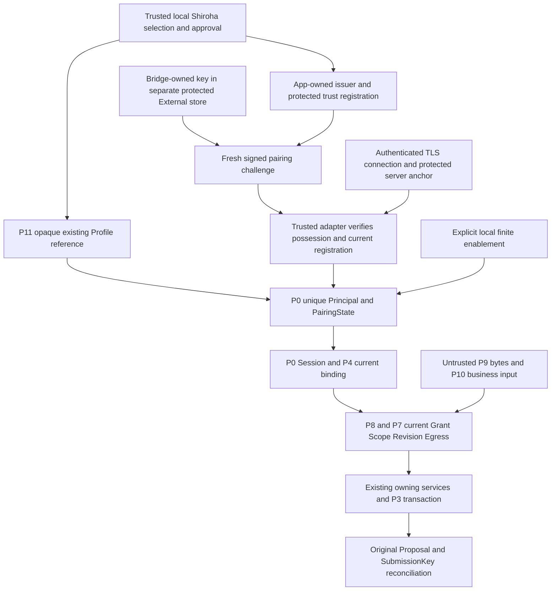

# P13 Windows Host Security Readiness

Status: **Accepted static readiness checkpoint (merged PR #264). Real Windows
security acceptance is BLOCKED; no production Credential/Pairing/Transport/Host
is activated.**

Authority: [external boundary](external-agent-boundary.md) sections 2, 3, 5–10
own identity, B-class isolation, authorization and offline behavior.
[S0](../../architecture/s0-secure-credential-storage.md) owns Provider credentials;
[MCP vNext](mcp-vnext-contract.md) owns the later client projection, not identity.
This document owns the prerequisite assessment and future acceptance criteria.
It changes no business code, credential port, dependency, schema, protocol,
system configuration or production composition.

**HOST_STABILITY_HALT = ACTIVE; TRANSPORT = BLOCKED; AR-R6A = NOT_ACCEPTED.**

## 1. Decision and evidence classification

Retain IPv4 Loopback TCP + mTLS as the preferred candidate and Named Pipe as
the sole fallback. Standard Dart APIs support relevant TLS primitives; that
does not prove protected Discovery, credential issuance/storage, handshake
resource bounds, Windows lifecycle safety or packaged interoperability.
No reviewed static evidence conclusively disqualifies TCP against the existing
hard properties. The gaps below prevent implementation activation and real
acceptance; they are not permission to weaken a hard property.

No independent test device/environment or experiment authorization has been
specified and approved for this task. Future dynamic admission is **BLOCKED**
on those prerequisites. This does not assert that no suitable device exists.
The static document can be delivered while that gate remains closed.

| Classification | Meaning |
|---|---|
| OFFLINE_CODE | Current repository implements the bounded property; cited P12/preceding tests and historical review support it. It is not a real credential/transport result, and P13 does not rerun those tests. |
| STATIC_API | Official API/platform documentation and inspected SDK/dependency source support a primitive. Integration, failure behavior and Windows release execution remain unproved. |
| WINDOWS_PENDING | A separately authorized experiment on an approved isolated Windows environment is required. No PASS is recorded here. |
| UNSUPPORTED | A promise excluded by the frozen threat model or an operation outside this candidate; an implementation cannot claim it as a passed condition. |

P12 is accepted only within its offline scope through merged
[PR #263](https://github.com/duanzhijian200443/shiroha_quiz/pull/263).
Its [contract CI](https://github.com/duanzhijian200443/shiroha_quiz/actions/runs/38233209424)
completed 7/7 successfully, and its
[final Reviewer closure](https://github.com/duanzhijian200443/shiroha_quiz/pull/263#issuecomment-6122245804)
recorded zero P0/P1/P2 and REVIEW APPROVAL. That same review session performed
the user-authorized fixed-target Windows offline checks: External 387 twice,
IPC 112, widget/Origin/B0 46, totaling 932 successful executions. It explicitly
disclosed the departure from a separate Verifier session. This document neither
claims independent-session verification nor invents a VERIFICATION APPROVAL.
Exact merge/head/base identities and execution evidence remain in Git/PR.

### Repository evidence anchors

| ID | Current source/contract and historical test evidence |
|---|---|
| E1 | [P0 TrustCore](../../../lib/application/external/external_trust_core.dart), [P12 coordinator](../../../lib/application/external/external_trust_coordinator.dart), [P12 tests](../../../test/application/external/external_trust_coordinator_test.dart), [memory tests](../../../test/application/external/tcp_core_memory_test.dart): one Principal per selected Profile, synthetic proof, finite enablement and generation invalidation. |
| E2 | [P4 Admission](../../../lib/application/external/external_runtime_admission.dart), [P8 Host](../../../lib/application/external/local_host_dispatch.dart), [P8 tests](../../../test/application/external/local_host_dispatch_test.dart): current management binding, exact execution Session, readiness and real owning drain. |
| E3 | [P11 management](../../../lib/application/external/local_authorization_service.dart), [P1 authorization](../../../lib/application/external/external_authorization.dart), [P11 tests](../../../test/application/external/local_authorization_service_test.dart): non-secret policy only, current revision/Scope/Egress, no pairing activation. |
| E4 | [P9 codec](../../../lib/data/external/ipc_envelope_codec.dart), [P9 tests](../../../test/data/external/ipc_envelope_codec_test.dart), external boundary section 7: exact framing and header-before-body allocation; no authentication. |
| E5 | [P10 projection](../../../lib/data/external/ipc_command_projection.dart), [P10 tests](../../../test/data/external/ipc_command_projection_test.dart), external boundary section 8: authentication/P8 binding before business parsing; preserved effect evidence. |
| E6 | [P3 STAGE](../../../lib/application/external/external_generated_stage.dart), [Proposal repository](../../../lib/data/repositories/generated_proposal_repository.dart), [P12 B0 tests](../../../test/application/external/external_trust_backup_test.dart), [P8 B0 tests](../../../test/application/external/local_host_backup_test.dart): sole writer/key reconciliation and restore/restart boundaries. |
| E7 | [S0 port](../../../lib/data/persistence/engine_credential_store.dart), [S0 adapter](../../../lib/data/credentials/secure_engine_credential_store.dart), [dependency lock](../../../pubspec.lock): Provider-only namespace and typed failures; not an External credential implementation. |
| E8 | [main composition](../../../lib/main.dart), [MCP v0 contract](../../architecture/mcp-v0-contract.md), [P11 source guards](../../../test/application/external/local_authorization_architecture_test.dart), [CI configuration](../../../.github/workflows/pr-contract-checks.yml): no production external activation; P14's standing shards cover the External offline Application/IPC regression matrix, which is not Windows credential/transport acceptance. |

## 2. Candidate primitives and static screening

Public references were read for this checkpoint. Current Dart API pages reflect
Dart 3.13.5 and current Flutter platform pages reflect Flutter 3.47; they are not
the repository's pinned toolchain. Repository CI pins Flutter 3.41.9, and the
inspected local SDK reports Dart 3.11.5/windows_x64. Its `dart:io` source also
contains the relevant TLS, DER and minimum-version APIs. Versions are evidence
context, not an authorized upgrade. Future experiments must freeze their exact
SDK, lockfile, architecture and release artifacts and recheck these references.

| Question | Static result and smallest candidate | Remaining real proof / rejection threshold |
|---|---|---|
| Standard TLS | [SecureServerSocket.bind](https://api.dart.dev/dart-io/SecureServerSocket/bind.html) exposes required client certificates; [SecureSocket.connect](https://api.dart.dev/dart-io/SecureSocket/connect.html) takes a trust context. Use an explicitly provisioned context, require client certificates, verify the exact admitted leaf and prohibit accepting bad certificates or TLS key logging. STATIC_API. | Valid, missing, forged, wrong-anchor, expired and wrong-role certificates must be tested. A handshake completing is not business authorization. |
| Handshake admission | Direct secure-server binding has no documented handshake-deadline parameter. [ServerSocket.bind](https://api.dart.dev/dart-io/ServerSocket/bind.html) plus [SecureSocket.secureServer](https://api.dart.dev/dart-io/SecureSocket/secureServer.html) is a candidate way to count accepted TCP sockets before TLS. The raw socket carries no business protocol and is destroyed on failed/late TLS. This is the same TCP/mTLS candidate. STATIC_API plus design inference. | A Future timeout alone does not cancel native work. Prove actual socket destruction, late-completion disposal, bounded native/TLS buffers and slot retention through settlement. If that cannot be demonstrated with the approved SDK, TCP remains blocked. |
| Numeric loopback | Bind an `InternetAddress.loopbackIPv4` object, require the actual local address to equal 127.0.0.1 and use `shared: false`. No hostname resolution, wildcard or IPv6 listener. API support is static only. | Inspect actual bound address and reject publication if it differs; test no LAN/wildcard listening and unauthorized local connection denial before business parsing. |
| Certificate/key loading | [SecurityContext](https://api.dart.dev/dart-io/SecurityContext-class.html) imports PEM/PKCS12 and private-key bytes. Use app-specific anchors without ambient roots, role-separated leaves, explicit validity and a frozen minimum TLS policy. The API does not provide CA/CSR generation or a Windows non-exportable-key signing-handle interface. | Windows release/AOT must load the chosen bounded formats, enforce server/client identity and certificate validity, and deny old rotated credentials. Do not infer CRL/OCSP or live revocation guarantees from a TLS API. |
| Identity mapping | [X509Certificate](https://api.dart.dev/dart-io/X509Certificate-class.html) exposes DER and validity. Candidate identity is a SHA-256 digest of the verified leaf DER, registered to one existing opaque Profile reference by trusted local management; subject/CN, a supplied fingerprint or the SDK's SHA-1 accessor is not authority. | Verify collision/conflict rejection, active local credential registration, exact installation/role and replay/rotation invalidation. The cryptographic suite, certificate profile and registry format need their own bounded approval before implementation. |
| Key generation/issuance | Dart's TLS context loads material; it does not issue it. Windows [BCryptGenerateKeyPair](https://learn.microsoft.com/en-us/windows/win32/api/bcrypt/nf-bcrypt-bcryptgeneratekeypair) and [CryptSignAndEncodeCertificate](https://learn.microsoft.com/en-us/windows/win32/api/wincrypt/nf-wincrypt-cryptsignandencodecertificate) support primitives for a minimal native crypto helper. STATIC_API, not a selected implementation. | Prove key ownership, CSR/challenge signature checks, intended SAN/EKU/validity and issuer protection. No certificate algorithm, third-party crypto dependency or native package is selected by P13. |
| Storage and native boundary | Reuse S0's authority separation, typed missing/corrupt/unavailable failures and explicit compensation principles. Do not reuse `engine.<providerId>`, its 4096-rune API-key limit, Provider migration or bulk deletion. A separately approved External namespace/storage boundary is required. | The lock resolves flutter_secure_storage 10.3.1 / Windows 4.1.0. [The versioned Windows package](https://pub.dev/packages/flutter_secure_storage_windows/versions/4.1.0) and inspected native source use AES-GCM files with a Credential Manager key, not a demonstrated direct DPAPI External store. Prove missing/corrupt-key behavior without silent rekey, ACLs and owner-only operations. No Provider entry may change. |
| Discovery/Windows integration | A minimal Windows adapter is justified for security-descriptor creation/inspection and object-identity-safe publication/cleanup, which current external code does not implement. Flutter documents [Win32/FFI integration](https://docs.flutter.dev/platform-integration/windows/building); transitive ffi/win32 dependencies are not authority to add a new adapter. | Prove exact DACL/owner, reparse/parent substitution resistance and replacement/cleanup by object identity. Failure must close the candidate. A directory name or profile-local path alone is insufficient. |
| Packaging | [Dart AOT executables](https://dart.dev/tools/dart-compile) and [Flutter Windows distribution](https://docs.flutter.dev/platform-integration/windows/building) are supported building blocks. S0's Flutter MethodChannel plugin is not evidence that a standalone Dart AOT Bridge can use that backend without a Flutter engine. | Freeze native dependency loading and a minimal standalone Bridge storage/crypto solution. Test packaged release, not just JIT or the developer machine. TLS credentials are separate from code-signing certificates; no OS root installation or release change follows from this plan. |

### Storage and Discovery constraints

[Windows DPAPI](https://learn.microsoft.com/en-us/windows/win32/api/dpapi/nf-dpapi-cryptprotectdata)
provides user-associated protection; using its machine-wide flag would not
provide the required user boundary. It does not isolate programs sharing that
user identity. It is one possible dedicated External backend, not a property
automatically inherited from S0. [Credential Manager reads](https://learn.microsoft.com/en-us/windows/win32/api/wincred/nf-wincred-credreadw)
use the current token's logon credential set. The plugin's
[CRED_PERSIST_LOCAL_MACHINE](https://learn.microsoft.com/en-us/windows/win32/api/wincred/ns-wincred-credentialw)
means persistence across this user's logons on this computer; it must not be
confused with DPAPI's machine-wide decryptability flag.

Discovery, public trust anchors and credential association metadata need
integrity even when they contain no private key. Proposed objects are inside a
separate experiment-owned local NTFS root, protected at creation with explicit
owner-SID rights and only separately justified system rights. No null DACL or
permissive inherited Everyone/Users/anonymous rights are accepted.
[DACL semantics](https://learn.microsoft.com/en-us/windows/win32/secauthz/access-control-lists)
distinguish an absent DACL from an empty one. Both directory and child-object
rights must be checked: [file security](https://learn.microsoft.com/en-us/windows/win32/fileio/file-security-and-access-rights)
does not make a parent's descriptor an access check for every child.

The later adapter must create or securely open and validate the actual object,
parents and volume before use; reject unexpected owners, reparse traversal and
unsafe pre-existing objects. [CreateFileW](https://learn.microsoft.com/en-us/windows/win32/api/fileapi/nf-fileapi-createfilew)
supports security attributes and reparse-related flags, but a final-component
flag alone is not a proven defense for substituted parents. Atomic publication
and cleanup must retain verified handle/file identity and this runtime's random
ownership identifier, not just a pathname, PID or stale descriptor. An uncertain
object is left untouched and the Host remains closed; no broad stale-file sweep.
No AF_UNIX lease/unlink experiment is implied by these Windows requirements.

## 3. Credential, pairing and Host trust boundary

The following is a future candidate composition, not a production route.

The smallest candidate responsibility split is:

1. App owns the installation issuer/server credential, approved trust anchor,
   credential-to-Profile association and revocation decision. Bridge generates
   and holds its own client key; only public enrollment material reaches App.
   Never bundle a reusable private key or install a general OS trust root.
2. App locally selects an existing unrevoked opaque Profile reference and
   registers its P0 Principal using the accepted P12 seam. CSR names, JSON ids
   and historical Origin cannot choose or reconstruct that Principal.
3. Local request/approval binds the expected credential identity to one pairing
   request. A fresh challenge must bind request, selected Profile, installation,
   runtime generation, intended key/certificate and finite expiry. Trusted
   verification must reject reused, expired, mismatched or replaced challenges.
   Approval alone cannot produce `PairingProof` or a paired state.
4. Bootstrap public enrollment/challenge delivery is a separate locally approved
   control-plane design still to be frozen. P9/P10 have no pairing route. Do not
   add one to their fixed business schema or use an unauthenticated business
   listener. A lab may use explicitly authorized local public-material exchange;
   it is not acceptance of a real client enrollment UX/protocol.
5. Perform asynchronous TLS/secure-store/crypto work in infrastructure. The
   existing synchronous `ExternalCredentialPort` only accepts adapter-owned,
   channel-bound verified attempt objects and checks current generation,
   registration, validity and liveness; missing/stale evidence returns null or
   a fixed failure. It must reject externally constructed `PairingProof`,
   `AuthenticatedPeerEvidence`, Profile strings and claimed fingerprints.
   Adapter evidence expires or is invalidated on disconnect/rotation/replacement.
   It is not a second Principal system or a durable Session table.
6. `provePossession` supplies only the existing P0 request/credential result
   after that verification. `authenticate` supplies only the verified credential
   identity; P0 maps it to its already registered Principal. Explicit finite
   enablement remains a separate local action. P4 then admits the current Session;
   P8/P7 still check current business authority and final release.

The credential association must be integrity-protected outside the non-secret
Profile/Grant tables and refer only to their existing App identity. Its format,
creation/rotation commit points and failure reconciliation require separate
approval. On restart, validate it and bind existing Profiles afresh with business
access disabled. On Restore, surviving credential material does not resurrect
the old association, pairing or enablement; fresh local recovery/proof is required.
B0 does not create/copy/delete secure credentials. No auto-healing corrupt trust
record, issuer/key regeneration, Provider-key reuse or schema change is approved.

The current P12 coordinator is named `.offline` and cannot be relabeled as a
production entrypoint. Any future production wiring requires its own bounded
contract/acceptance review without changing P0/P4 authorization semantics.

### B-class and cross-user cases

Other SIDs may TCP-connect; the contract does not promise OS-level rejection at
connect. Their unauthorized credentials and protected-object accesses must fail.
A separately approved legitimate client under another SID, with its own provisioned
key, approved trust material and current Profile/Grant/enablement, may obtain
business access. For that positive lab case, supply approved public endpoint/trust
information into that client's own protected root; do not make the App owner's
protected Discovery or secrets readable to other SIDs. Multi-user provisioning
and distribution are unresolved production details, not an inferred feature.

Same-SID Bridge proxying is the accepted residual risk. User-wide account takeover,
administrator/kernel attackers, brand/process attestation from a certificate,
absolute local denial-of-service prevention, and guaranteed non-exportable TLS
keys never present in process memory are UNSUPPORTED promises. Loopback is not
authentication; mTLS is not Windows ACL isolation. None of these exclusions
relaxes current Grant/Scope/Egress or explicit local COMMIT.

## 4. Production security gap and dependency matrix

All rows require new implementation/experiment authority; P13 authorizes only
this static assessment. Dependencies refer to prerequisite row numbers and G0
(approved environment and exact experiment grant, section 6).

| ID / boundary | Current status and evidence | Missing proof / minimal next step | Failure closure | New authority / prerequisite |
|---|---|---|---|---|
| M1 Credential Authority | OFFLINE_CODE E1; production issuer/client key ownership absent. STATIC_API native crypto primitives. | Freeze Bridge key ownership, App issuer/leaf roles and protected one-credential/one-Profile registration; implement only a reviewed bounded helper. Prove possession, conflict and rotation. | Reject unknown/duplicate/wrong-role credentials; do not mint a Principal from claims or regenerate trust automatically. | Implementation + key-generation grant; G0, M2. |
| M2 Secure Storage | OFFLINE_CODE E7 for Provider rules only; STATIC_API for Windows stores. External store absent. | Dedicated namespace, bounded certificate/key material, current-user protection, exact read/write/delete scope, corrupt/missing/unavailable distinction and compensation; standalone Bridge backend proof. | Missing denies connection; corrupt hard-denies; unavailable closes admission with fixed transient classification. No plaintext or Provider fallback, bulk deletion or silent rekey. | Dedicated storage/crypto resources; G0. |
| M3 Pairing Proof | OFFLINE_CODE E1 state/proof gate; cryptographic freshness/bootstrap absent. | Bind local approval to fresh request/key/install/generation challenge and independently verify a possession signature. Freeze control-plane delivery separately. | Failure remains pending proof; no paired state, credential acceptance or permission expansion. | Enrollment/crypto grant; G0, M1, M2. |
| M4 Client Authentication | OFFLINE_CODE E1/E2/E5 map and admission; production verified attempts absent. | Authenticate TLS leaf and protected registration before business input; async proof -> adapter-owned live attempt -> existing P0/P4. | Reject wrong owner/Profile/credential/generation/role and all payload-derived identity; no Session fallback. | TLS/adapter grant; M1–M3, M6, M8. |
| M5 Windows Isolation | STATIC_API DACL/current-user primitives; no External cross-SID experiment. | Negative SID cannot read/modify owner's protected objects; positive separately provisioned SID obeys B-class business admission. Same-SID proxy risk remains documented. | Reject unauthorized object/business access; do not claim all TCP connect calls are refused. | Two lab principals and explicit account/ACL authority; G0, M2, M6, M8. |
| M6 Protected Discovery | No production discovery publisher/consumer. STATIC_API file/handle security. | Secure root/child creation, owner/DACL/volume/reparse checks, authenticated anchor, atomic publication and object-identity cleanup; independently validate both ends. | Missing/stale/tampered/uncertain discovery is unavailable; leave foreign objects untouched; no temporary unprotected replacement. | Object-creation/ACL grant; G0, M2, M1 for server trust. |
| M7 Loopback Transport | No external listener. STATIC_API explicit IPv4 binding. | Require actual 127.0.0.1, no sharing/wildcard/resolution, bounded raw accept -> required TLS, and cleanup of owned sockets only. | Reject startup/address mismatch; destroy candidate sockets; publish no usable endpoint. | Listener/socket grant on isolated device; G0, M6, M9. |
| M8 mTLS | Standard primitives STATIC_API; all real validation WINDOWS_PENDING. | Server/client trust, exact leaf registration, SAN/EKU/validity, protocol floor, key access, anchor replacement, rotation/revocation and resumption policy. | Never accept bad certificates, unknown roots, expired/wrong-role/retired identities or TLS key logging; invalidate connections on credential/anchor change. | Certificate/TLS grant; M1, M2, M3, M6. |
| M9 Resource Limits | OFFLINE_CODE E2/E4/E5 for per-frame/business bounds; no connection/native TLS budget. | Numeric lab limits, pre-TLS slots, global decode reservations, one bounded request/response pipeline, real deadline destruction and measured native/heap/backpressure behavior. | Reject before unbudgeted allocation/handler entry; keep owning slots until settlement; close slow/over-budget channels. | Bounded load grant; G0, M7, M8. |
| M10 Lifecycle | OFFLINE_CODE E1/E2/E5/E6 for controlled drain/restart/B0. OS crash/socket/Discovery recovery absent. | Block accepts and new calls, drain owning work, invalidate evidence and generation, then swap/cleanup; cold start disabled; test crashes and stale endpoint impostors. | No late-ready publication or permission revival; uncertain cleanup leaves Host closed, without forced data rollback. | Controlled termination/restart/B0 grant; M4, M6–M9. |
| M11 Effect Recovery | OFFLINE_CODE E5/E6 original key/Proposal and commit-vs-revoke authority. Real disconnected client absent. | Cut response after commit, reconnect with fresh admitted Session, reconcile original key; absent result stays unknown. | No automatic STAGE retry, second writer/journal/Receipt table or inferred zero effect. Bridge absence never opens SQLite. | Synthetic-data effect/failure grant; M4, M9, M10. |
| M12 Packaging | Existing Flutter Windows project/locks; standalone Bridge/native deployment absent. STATIC_API E7/E8 and AOT docs. | Exact x64 release artifacts, native ABI/dependency loading, space/Unicode paths, restricted launch environment, upgrade/cold start and trusted endpoint handoff. | Missing/invalid native/backend/anchor artifact keeps Host disabled; no build/download/elevation fallback. | Build/package/launch grant; G0, M1–M11. |

M2/issuance format and M6 can be designed in parallel, but their runtime
publication waits for G0. M7/M8/M9 must be assessed together before any business
payload crosses a live connection. All security and stability gates are separate;
security success cannot clear HOST_STABILITY_HALT.

## 5. Framing compatibility and resource acceptance

Existing E4/E5 limits stay fixed: header 16 bytes, ID at most 64 bytes, request
6,324,224 bytes, response 229,376 bytes, protocol error 32 bytes, decoder/frame
byte ceiling 6,324,304. P10 retains its separate exact schema/version and the
1 MiB original Submission limit; P4/P5 output is 32 KiB, P6 output 24,000 bytes.
The decoder admits header and ID before body allocation. These are OFFLINE_CODE
properties, not aggregate connection/TLS memory guarantees.

For two concurrently admitted maximum request frames, explicit decoder bytes
plus worst-case decoded UTF-16 storage alone can reach
`2 × (6,324,304 + 2 × 6,324,224) = 37,945,504` bytes, before parser copies,
caller buffers, outputs, TLS/native allocations or business objects. P9's byte
ceiling therefore cannot be used as a process resident-memory ceiling.

The following is a **proposed first-lab budget**, not production capacity or a
measured PASS. The future grant must explicitly freeze it or approve a reviewed
replacement before running load; an absent numeric budget is BLOCKED.

| Resource | Proposed experiment ceiling / required observation |
|---|---|
| Accepted live TCP sockets / TLS handshakes | 8 total / 2 pending handshakes, counting pre-authentication work; overflow destroyed without business parsing. |
| Active frame pipelines | 2 globally; one request per connection; reservation retained through real decode/business/output settlement, not merely caller timeout. No unbounded envelope queue. |
| Explicit protocol byte / decoded-string reservations | 16 MiB / 32 MiB globally, separately measured; includes retained ingress/egress copies within those categories. Reserve conservatively before allowing payload allocation. |
| Write queues | At most one response per connection and 512 KiB globally; enforce the unchanged per-frame response limit before enqueue. |
| Handshake / incomplete-frame deadlines | 5 seconds handshake; 2 seconds no-progress; 10 seconds total frame assembly. Timeout must dispose the real socket and any late TLS result. |
| Business calls | Preserve each existing service guard: READ at most 16 global / 4 per Profile; STAGE at most 16 global / 4 per exact Session. The proposed shared transport pipeline ceiling is stricter. READ retains its complete two-second bound; STAGE keeps owning work until true settlement. |
| Measured memory / handle recovery | For the isolated minimal candidate harness, predeclare a warmed baseline; proposed peak process private-memory delta <=128 MiB and settled handle/slot counts return to baseline after each bounded trial. Measure native/TLS/OS buffers too; no unlimited logging or queue can be excluded. |

Stream pause and an OS listen backlog are not substitutes for a measured bound.
Limit parser admission and copies as well as P9 buffers; abort the trial at its
approved ceiling rather than escalating load. If these provisional bounds are
insufficient, report measurements and request a new reviewed scope/budget instead
of silently increasing them. P13 implements or tests none of these limits.

## 6. Future experiment authorization and environment

G0 is unmet. Every experiment needs a new explicit user grant identifying:

- A separately controlled physical Windows machine or remote Windows host whose
  kernel does not depend on the primary computer. A normal VM running on the
  primary host does not qualify automatically. Identify owner, device, recovery
  responsibility and isolation boundaries; no suitable device is assumed.
- Exact serviced Windows edition/build/patch level, architecture, local NTFS
  test volume, SDK/Flutter/native toolchain/lockfile and artifact hashes. The
  proposed first batch is Windows 11 x64; VS C++/ATL requirements must be met.
  [Current Flutter platform documentation](https://docs.flutter.dev/reference/supported-platforms)
  lists Windows 10/11 x64/Arm64, but is newer than this repository's CI SDK.
  Windows 10 requires explicitly verified ongoing servicing and SDK support;
  Arm64 or another packaging model needs a separately named batch, not inferred
  acceptance from an x64 run.
- Two named disposable local principals with different SIDs. Privileged account
  preparation is a separately authorized setup action; ordinary App/Bridge runs
  remain non-elevated. Do not alter the primary user's accounts, ACLs or stores.
- An empty dedicated experiment root, separate secure namespaces and synthetic
  SQLite/B0 assets only. No official App profile, saved Provider key, user document
  or private corpus; no sharing of the primary machine's data directories.
- Exact allowed sockets/ports, credentials/objects/permissions, process termination,
  trials/time/load ceilings, evidence output and cleanup rights for each X row.
  No LAN/wildcard exposure, global trust-root installation, firewall/driver/kernel
  changes, AF_UNIX or production Host/MCP activation is included.
- An inventory of original lab configuration and owned artifacts; a restorable
  device image/approved recovery procedure before mutations. Record only fixed
  failure categories, counts, generation/test IDs, public digest references and
  sanitized timestamps. No keys, PEM/private blobs, TLS key logs, prompts, full
  payloads, secret environment variables or unrestricted memory dumps.
- Named stop/recovery operator and independent fixed-target Verifier/Reviewer.
  Freeze head/base, build artifacts, OS and budget per run. Environment or target
  drift invalidates the affected evidence; do not resume by guessing state.

The request below is an approval checklist, not runnable instructions. Every row
has one primary acceptance goal and inherits G0. Storage/object and credential
primitive trials precede TLS setup; socket-bearing rows also require explicitly
approved X0 resources. Permission to one row does not
grant another, or authorize production activation.

| Experiment | Unique primary goal / criterion | Resources to explicitly authorize | Dependencies |
|---|---|---|---|
| X0 | A0: exact loopback-only candidate startup | Named ephemeral loopback sockets, protected server material/descriptor and primitive processes; numeric resource preflight; no business routes. | X1, X3; static budget/storage/crypto/Discovery contracts approved. |
| X1 | A1: unique credential-to-Profile mapping using real possession proof | Disposable client/issuer keys and public certificates; protected association entries; local approval surface only. | X3; M2 format/storage design. |
| X2 | A2: deny absent/forged/wrong-anchor credentials | Bounded positive-control and negative TLS/proof attempts and disposable alternate anchors; exact loopback sockets. | X0, X1, X3. |
| X3 | A3: protected-object cross-SID secrecy/integrity | Named lab accounts; explicitly owned NTFS objects/DACLs and credential namespaces; bounded read/write/replace attempts. | Approved object/security design. |
| X4 | A4: B-class positive/negative business admission | Two disposable principals; independent client keys and approved public endpoint/anchor copies in each owned root; synthetic Grant. | X0–X3, X6, X7. |
| X5 | A5: no authority resurrection | Explicit disable/revoke/expiry, candidate restart and synthetic B0 Restore/raw rollback; no Provider-store mutation. | X4, X7 resource preflight. |
| X6 | A6: reject bad lengths before body allocation | Synthetic bounded P9 header/ID variations over the candidate channel; allocation counters, exact time/trial caps; no business routes. | X0–X3. |
| X7 | A7: bounded connections/backpressure/settlement | Approved 8/2/2 ceilings or approved replacement; slow peers, cancellation, bounded connection cuts and numeric measurements; primitive phase before route-bearing trials. | X0–X3, X6; then X4 for business settlement cases. |
| X8 | A8: committed/lost STAGE reconciliation | Synthetic Proposal/key/SQLite, controlled response cut after commit and fresh reconnection; exact owning checkpoints. | X4–X7. |
| X9 | A9: Bridge has no alternate business writer | Bounded App absence/not-ready/closed runs and file-open/access audit for the synthetic DB. | Packaged candidate Bridge; no real DB. |
| X10 | A10: retain external allowlist and MCP v0 | Existing offline compatibility fixtures and, only if separately named, synthetic retained-v0 stdio runs. No vNext registration or protocol expansion. | Candidate artifacts; standing regression target. |
| X11 | A11: owner-safe endpoint cleanup | Two candidate runtime processes, disposed sockets and experiment-only descriptors; bounded termination/replacement races and foreign-object sentinels. | X3, X7; object-identity cleanup design. |
| X12 | A12: release launch/recovery compatibility | Named release/AOT artifacts, native DLL dependencies, space/Unicode install roots, disposable cold-start/upgrade/crash scenarios. | X1–X11; packaging model frozen. |

Address/TLS/storage/Discovery validity is a common preflight for every socket
trial, not a business success inferred from X6/X7. Abort admission if the actual
listener is not exactly 127.0.0.1, the peer/anchor is invalid, or protected-object
security/ownership cannot be proven. Initial primitive trials expose no business
routes; route-bearing trials require those preflights plus the applicable gates.
X7's primitive resource phase must pass before X4 exposes business routes; its
owning-business settlement cases then reuse the admitted X4 composition. This
phase distinction does not grant more resources or require a circular dependency.

### Immediate stop and recovery

Stop on a blue screen, hard hang, kernel/driver anomaly, unexpected elevated
process/system mutation, wrong bind address, secret exposure, unauthorized object
or business access, ownership uncertainty, budget excess, unexplained data
change, target/environment drift or failure requiring an unapproved primitive.
Do not reproduce a crash to manufacture causality or retry on the primary host.

Block new candidate work first. On a responsive isolated device, close/drain
owning services before authorized teardown; interrupted callers do not prove
settlement. For an unresponsive device, use only the preapproved recovery operator
and image procedure; mark in-flight STAGE unknown. Preserve sanitized evidence
and the original submission keys. Cleanup is limited to positively owned lab
objects; do not delete foreign endpoints/credentials, wipe Provider stores,
terminate unrelated processes or destroy Proposal/user data. No automatic retry.

## 7. Real acceptance and fallback thresholds

All A rows currently remain WINDOWS_PENDING. The offline column describes
existing evidence, not tests run in P13. Each real result must cite one fixed
target/environment/trial record and the measured counters; missing or ambiguous
evidence is INCONCLUSIVE/BLOCKED, never PASS. No item is waived because the
candidate is loopback-only or a lower-level primitive trial succeeded.

| ID | Offline boundary already covered | Required real PASS / corresponding FAIL |
|---|---|---|
| A0 | Standard numeric IPv4 API support only. | Candidate listener's actual local address is exactly 127.0.0.1; wildcard, LAN, IPv6 and shared publication are rejected, including configuration substitution. Any other reachable listener/address or unprotected descriptor publication is FAIL. |
| A1 | E1/E2 unique Principal/opaque binding. | Valid fresh cryptographic possession proof and current registration resolve exactly one selected existing Profile; duplicate identity, substituted Profile or another generation never resolves. X2/X4 must then confirm the authenticated TLS peer uses that same registered identity. Wrong binding or claim-derived identity is FAIL. |
| A2 | E1/E5 synthetic rejection and auth-before-business parsing. | Missing/forged key, unknown/retired leaf, wrong anchor/role, invalid validity or replayed/expired pairing challenge yields no usable Session, handler or content. Bad-certificate bypass, trust-on-first-use from Discovery or fallback is FAIL. |
| A3 | No real Windows object proof. | Other unauthorized SID cannot read, alter, replace, delete or redirect protected credentials/association/Discovery/anchor objects, including unsafe inheritance, reparse/parent replacement and corrupt-key cases. Any successful protected access or silent rekey is FAIL. |
| A4 | E1/E2 separate Profiles and current Grant checks. | Unauthorized SID may connect but receives no business access. A separately provisioned cross-SID credential with current approved Profile/Grant/enablement behaves according to B-class; no read of the owner's protected Discovery is required. All-cross-SID-connect rejection and brand/process attestation are UNSUPPORTED promises, not pass substitutes. |
| A5 | E1/E2/E6 disable/expiry/revoke/generation/B0. | Revoke, finite enablement expiry, restart, credential/anchor rotation and Restore deny old Session/Context and unreleased egress. Fresh authentication cannot renew old execution authority; raw rollback may retain policy/history but starts disabled and requires fresh proof/rebinding. Revival is FAIL. |
| A6 | E4 complete-header/ID validation precedes payload allocation. | Zero/high-bit/over-limit/unsupported header or invalid ID allocates no declared body, enters no handler and closes the decoder/channel safely. Exact ceilings remain unchanged. Late allocation/reuse/resynchronization or weakened limits is FAIL. |
| A7 | E2/E4/E5 per-frame/business limits and owning drain. | All frozen connection/handshake/frame/queue/memory/time counters remain within the authorized numeric budget; slow/fragmented/coalesced input, cuts, cancellation, deadline and shutdown release real resources only at settlement. Budget excess, unlimited buffering or premature slot reuse is FAIL. |
| A8 | E5/E6 both STAGE transaction orderings and original-key recovery. | Cut output after durable commit; fresh admitted reconnection/current policy reconciles the same original key/Proposal with no auto-retry/duplicate or formal Question commit. Revoke-first publishes none; publication-first retains history while withholding unauthorized output. Unknown/absent is not invented zero effect. Contradiction is FAIL. |
| A9 | E8 contract/compiled composition boundary. | App absent, not-ready, closed or recovering gives bounded unavailable/denied behavior. Bridge neither opens the business SQLite DB nor loads repositories/migrations or starts a replacement writer. Any such fallback is FAIL. |
| A10 | E2/E8 exact ten internal external routes and six MCP v0 READ tools. | Current compatibility checks retain those surfaces and deny every external COMMIT/DESTRUCTIVE/Built-in route. P13/candidate trials register no vNext tools. Changed v0 or expanded authority is FAIL. |
| A11 | E2 controlled owning shutdown; no real endpoint ownership proof. | Normal close, abort/startup race, crashed prior runtime and competing replacement leave another process's sockets/descriptors/credential objects and sentinel data untouched. Cleanup uses proven ownership/object identity; ambiguous state fails closed without deleting it. Wrong deletion or shared/wildcard listener is FAIL. |
| A12 | Static AOT/platform support only. | Exact packaged release/native backend works non-elevated from space/Unicode paths and a sanitized launch environment, after abnormal close, upgrade and cold start. Old endpoint/anchor cannot impersonate the new App; invalid native/store artifacts keep it disabled. JIT-only success, developer-only dependencies or authorization revival is FAIL. |

Disconnected channels must stop accepting new calls and drop their adapter-owned
attempts; no disposed connection can recreate its Session. P0 has no standalone
per-Session close API, so do not claim it revokes one Session merely because a
socket closes. Runtime disable/generation invalidation remains P0-owned, P7/P8
execution stays exact-Session-bound, and another current legitimate Session of
the same Principal retains P4–P6's existing READ-reference semantics. Already
started work settles in its owning service; disconnect never proves rollback.

### Named Pipe fallback

TCP/mTLS stays blocked if required crypto/storage, Discovery integrity, bounded
TLS admission, credential validation or release/AOT behavior cannot be proved
within the frozen model. Report the specific failing A/M property and static or
isolated evidence before proposing the fallback; no automatic switch or third IPC.

[Windows Named Pipe security](https://learn.microsoft.com/en-us/windows/win32/ipc/named-pipe-security-and-access-rights)
supports explicit descriptors, but defaults include broad read access and generic
write rights can also permit instance creation. A separately authorized fallback
must freeze narrowly scoped rights, local-only operation, server impersonation
defense, authenticated peer/credential mapping, resources, cleanup and packaging.
Pipe ACLs alone do not grant a Profile/Grant, establish a trusted App server or
pass Application authorization. It must pass all applicable A criteria, retain
the B-class business rules and support the explicitly approved cross-SID case;
if this requires changing frozen semantics, STOP for user direction.

If neither candidate satisfies every hard security and stability property, keep
production Host and AR-R6B closed. Do not lower trust, add plaintext keys or an
unauthenticated business fallback to make the connection work.

## 8. Smallest subsequent responsibilities and activation gate

These are bounded future responsibility packages, not task state or automatic
authorization. Each needs its own explicit scope/ownership, fixed acceptance and
independent review; none is started by P13 or a merged readiness document.

| Package | Smallest responsibility | Exit condition |
|---|---|---|
| Environment/primitive contract | Approve G0 and exact certificate/registry/challenge/storage/Discovery formats, native boundary, budget and release model; preserve P0/P4 and Provider contracts. | Complete explicit experiment grant; no unresolved hard semantic conflict. |
| Credential and protected objects | Implement only approved issuance/Bridge custody, separate External storage, association and owner-safe Discovery primitives. No business listener/Host publication. | X1/X3 primitive proof plus corruption/rotation/failure closure on isolated Windows. |
| TLS and bounded adapter | One TCP/mTLS candidate, verified attempt mapping, pre-auth admission/timeout/destruction and bounded P9/P10 consumption. Existing business owners remain unchanged. | X2/X4/X6/X7 isolated proof; no unauthenticated business path. |
| Lifecycle/effect/release evidence | Actual disconnect/crash/drain/Restore/reconciliation, foreign-object cleanup and packaged App/Bridge acceptance over synthetic data. | X5/X8–X12 at the exact target; required Windows Verifier and Independent Reviewer approval. |
| Separate production activation decision | Evaluate all security evidence and independently close system-stability acceptance in an approved environment; explicitly authorize any production wiring. AR-R6B remains a separate stage. | No missing A property, no open blocking findings, final-target CI/review/required Verifier, explicit activation authority and an explicit decision concerning HOST_STABILITY_HALT. |

No package may silently expand schema v34, B0 v2, P9/P10 schemas, formal COMMIT,
Provider storage or the accepted identity model. A required change to a frozen
contract, unapproved native primitive, inadequate independent environment or a
test possible only through high-risk primary-host experiments is BLOCKED. Static
design can record that blocker; implementation and experiment stop at that boundary.
