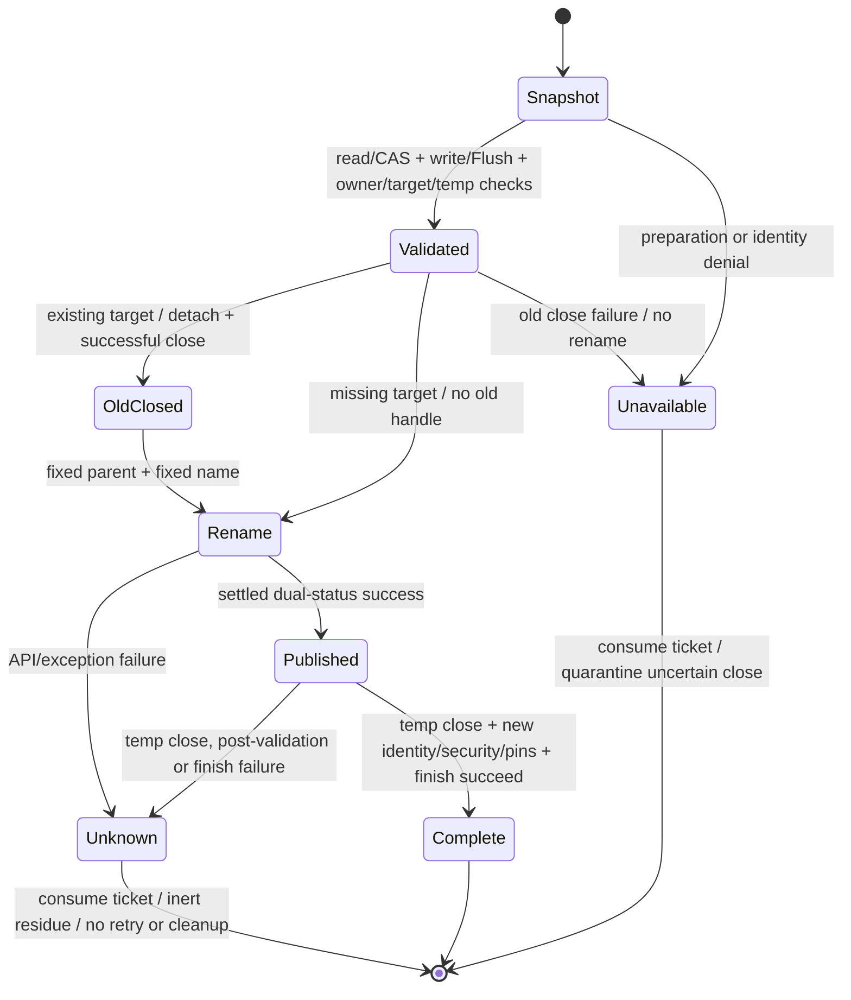

# Association publication diagnostic candidate

This directory contains a future L1 harness candidate, not an experiment grant.
It neither replaces nor modifies the untracked frozen Batch 2 harness/evidence.
The P20 publication candidate uses NtSetInformationFile. Native ABI 3 and the public
failure vocabulary remain unchanged. Isolated-root real publication/readback
succeeded on 2026-10-14; production-root and formal acceptance remain pending.

## Isolated P20 minimal-test root

`SHIROHA_P20_MINIMAL_TEST_BUILD=ON` builds the separate, statically linked
`shiroha_p20_minimal_test` diagnostic executable. It requires an explicit local
absolute `SHIROHA_P20_TEST_ROOT` at configure time. The root is compiled into
that executable; there is no environment-variable, command-line path, default
root or fallback. The internal object-root seam substitutes only the ancestor
used by Native owner acquisition. The production DLL gets neither the diagnostic
definition nor the generated root header/include path; its Known Folder resolver,
ABI 3, twelve exports, fixed children and all file/DPAPI semantics stay unchanged.
Both build modes share the same existing pure absolute-path validator and the
same protected-object/transaction implementation. Offline tests use a fake
production resolver, not real Known Folder or filesystem calls.

The real executable is never registered with CTest. Without `--run-once` it
performs no root access. That switch is not an experiment grant. A separately
approved call attempts one `CreateDirectoryW` for the compiled ancestor and
refuses an existing root without enumerating, reusing or cleaning it. Normal App
acquisition then creates only the unchanged fixed App layout and runtime lock.
The driver writes DPAPI-protected synthetic A, reads/decrypts/compares A, writes
B over the existing target, then reads/decrypts/compares B and closes the owner.
It performs two commits, no contention/stale-ticket/Bridge/negative experiment,
no retries, no cleanup and no other mode. First failure ends the functional
sequence with only one owner-close attempt; retained transactions are settled
by the unchanged owner-close implementation. Blocking OS calls are not forcibly
interrupted, and this driver introduces no Supervisor or recovery mechanism.
This proves only the native P20 file publication/readback slice when approved
and successful, not the Dart kind-3 codec/CAS layer, crash atomicity or G0-I.

The exact frozen source/artifact hashes, compiled test directory and one-shot
command belong to the review/run package. Build, Fake results and an approved
source review do not themselves authorize the real invocation.

On 2026-10-14, one explicitly authorized isolated-root run completed with exit
code 0: create/read/decrypt A, existing-target replace/read/decrypt B and normal
owner Close all succeeded. Metadata-only inventory found no residual temporary
files or unexpected objects; no cleanup or retry was performed. The authoritative
evidence scope and remaining acceptance boundaries are recorded in
[canonical readiness §12](../../../docs/product/agent-refactor/windows-host-security-readiness.md#p20-isolated-root-real-windows-functional-validation-2026-10-14).

## Isolated L1-CRYPTO harness candidate (AR-R6A-L1-CRYPTO-E0, G0-L0 only)

`SHIROHA_L1_CRYPTO_CANDIDATE_BUILD=ON` (default `OFF`) compiles the separate
`shiroha_l1_crypto_candidate` executable from `diagnostics/l1_crypto_probe.cpp`,
`diagnostics/l1_crypto_probe.h`, `native_core.cpp`, `native_crypto.cpp`,
`p256_key_codec.cpp`, `crypto_windows.cpp`, `peer_policy.cpp` and
`peer_policy_windows.cpp`, linking only `crypt32`, `bcrypt` and `psapi`.
It excludes `native_windows.cpp`, `protected_objects.cpp`,
`protected_windows.cpp`, `association_files.cpp`, `exchange_files.cpp` and
`discovery_files.cpp`, and links no `shell32`, `ole32`, `advapi32` or `ws2_32`.

`resolve_l1_crypto_api` enforces an explicit 7-symbol allowlist
(`shiroha_native_abi_version`, `shiroha_native_buffer_alloc`,
`shiroha_native_buffer_free`, `shiroha_native_ecdsa_generate_key`,
`shiroha_native_ecdsa_sign_digest`, `shiroha_native_ecdsa_verify_digest`,
`shiroha_native_peer_certificate_policy`) and rejects all 20 other ABI-3 exports
with `UNAUTHORIZED_ACCESS` before invoking any symbol lookup.

`L1CryptoLedger` reserves call budget before every primitive invocation:
at most 1 ABI check, 3 P-256 key generations, 3 X.509 DER certificate
encode/sign operations (ASN.1 DER `ECDSA-Sig-Value` over SHA-256 TBS while
underlying CNG signing emits 64-byte raw `r||s`), 6 signature verifications
(3 valid + 3 tampered negative cases expecting `SHIROHA_NATIVE_VERIFICATION_REJECTED`)
and 3 `crypt32` peer-certificate policy checks (Server role=1, Client role=2,
and 1 role-mismatch negative case), within a 30-second candidate ceiling.
Every allocated buffer and private key slot is wiped with `SecureZeroMemory`
and released at most once; duplicate release attempts fail closed with
`OWNERSHIP_UNKNOWN` and throwing/uncertain releases quarantine the slot with
`SETTLEMENT_UNKNOWN`. Resource observations (`GetProcessMemoryInfo` peak
working set/commit and sampled `GetProcessHandleCount`) run before work, after
each of the 16 primitive steps and after final release settlement (18 samples).

`l1_crypto_candidate_entry` unconditionally refuses real execution in E0 with
`STOP stage=l1_crypto_execution_not_authorized failure_code=ADMISSION_BLOCKED attempted_native=0`
(exit code 10; malformed arguments exit 64). No CLI flag, environment variable
or build switch bypasses that gate. `check_offline.ps1` audits PE headers,
hardening, DLL dependents and import tables without running the candidate, and
runs `shiroha_l1_crypto_probe_test` (`shiroha_l1_crypto_probe_offline`) in CTest
using pure Fakes only.

## R6A-B1 unified G0-L1 diagnostic infrastructure (G0-L0 only)

`l1_b1_unified.h` and `l1_b1_admission_worker.cpp` supply the unified G0-L0
offline diagnostic infrastructure for the five G0-L1 trials (`L1-ADMISSION`,
`L1-CRYPTO`, `L1-OBJECTS`, `L1-STORE`, `L1-RELEASE`), reusing the existing E2
`GrantTarget`/`OfflineSupervisor`/`L1CryptoLedger`/`NativeObservation`, E3
`WindowsOperations`, E4 `GrantFlow`/64-byte IPC and E5 `Controller` without
introducing a second Grant, Supervisor, Ledger, Store or permission service.
All three default runtime denials remain unconditionally closed: E0's
`l1_crypto_candidate_entry` refuses execution (exit 10), E3's integrated
`Win32AdmissionOperations` refuses approval/inspect/start and returns
`GrantState::kUnknown`, and E5's `WindowsPlatform::runtime_allowed()` returns
`false`. No real Windows experiment is registered with CTest. Highest eligible
description after passing checks: **R6A-B1 L1 UNIFIED SOURCE READY / OFFLINE TESTED**.

- **B1-A (`L1-ADMISSION`)**: `GrantTarget::is_admission_only()` admits
  `user_scope == "L1-ADMISSION"` with zero ABI budgets (`{0,0,0,0,0,0,0}`)
  through the SAME E4/E5 confirmation, write-ahead receipt/grant/journal,
  single suspended create, identity inspection, 64-byte IPC (HELLO -> ADMISSION
  -> 18 SAMPLEs -> 24-part zero-crypto SETTLEMENT -> ACK) and independent
  exit/handle-close sequence (`UnifiedAdmissionController` +
  `admission_only_worker_candidate`). `shiroha_l1_b1_admission_worker` compiles
  `l1_b1_admission_worker.cpp` as an unlinked `OBJECT` target under
  `SHIROHA_L1_WINDOWS_ADMISSION_SOURCE` with zero CNG/crypt32 or crypto ABI
  references; the Crypto Worker is never relabeled as the Admission-only Worker.
  `AdmissionPhaseLedger` records `started`/`succeeded`/`failed`/`unknown` per
  phase (`consume`, `create`, `resume`, `ipc`, `close`) and explicitly
  distinguishes `kUncreated`, `kCreatedSuspended`, `kResumed`, `kExited`,
  `kHandlesReleased` and `kCustodyRetainedUnknown`.
- **B1-B (`L1-CRYPTO` & E5 joint closure)**: Both Workers share the same target
  hash, dual-clock rules, 30,000 ms inclusive deadline, 64-byte IPC, pre-ADMISSION
  zero-work barrier, ACK-is-not-PASS rule, exit-does-not-settle-resources rule
  and unreturned-syscall `UNKNOWN` retention, while `L1-CRYPTO` retains its exact
  7 ABI-3 symbols, 106 ABI attempts, 5 live buffers, 47 direct Native owners and
  18 checkpoints.
- **B1-C (`L1-OBJECTS`)**: `B1ObjectsDiagnostic` requires an explicit
  `ApprovedRootPin` (approved absolute path + NTFS volume + File ID) and, before
  any protected object opens, probes the injected `ObjectOperations` seam with
  one `local_directory`/`inspect`/`close` sequence and rejects it unless the
  probed root identity equals the approved pin (`ISOLATION_ROOT_MISMATCH`). The
  probe handle is registered and closed exactly once even on identity mismatch;
  a failed close retains quarantined custody and an `UNKNOWN` verdict. The
  path blacklist is therefore only supplementary: a production or Host A seam is
  rejected even when the path text looks approved. Its publication/readback
  object kind is an explicit required parameter (`1` or `2`), never a silent
  default; association/Bridge objects belong to `L1-STORE`. Frozen candidate
  budgets (App acquire <=1, competing acquire <=1 expected rejected, Bridge
  acquire <=1, security/identity observations <=2 per object, new-target publish
  <=1, existing-target replace <=1, readbacks <=2, 60,000 ms ceiling) bound
  C: NTFS volume/File ID, Owner SID, protected single-ACE DACL, parent identity,
  no reparse, link count, `runtime.lock`/`client.lock` ownership and unknown
  custody retention without deleting unknown objects. DACL checks cannot be
  disabled. PASS requires a nonempty approved-object set, at least one successful
  security/identity/parent observation for every pin, and the complete lock,
  publication, replacement and readback sequence. Publication requires its own
  `register_approved_publication` binding (object ID, kind 1/2, parent Volume/File
  ID), not a borrowed observation of another object. The existing native
  transaction returns internal identity evidence only after its target/parent
  checks; B1-C compares the approved parent before writing, observes the actual
  published target after each successful create/replace, and binds each readback
  to that captured identity. These two publication observations consume the
  target's <=2 observation budget. Atomic replacement advances the File ID from
  the validated previous target to the validated temporary/published object;
  unrelated handles cannot supply either publication observation. The optional
  evidence remains internal C++, with no exported C ABI or runtime-gate change.
  Residual: the seam is
  probed once per trial at `begin`; a differential seam that changes roots
  between calls is out of G0-L0 scope and must be re-pinned at the real trial.
- **B1-D (`L1-STORE`)**: `B1StoreDiagnostic` and `StorePrimitiveLedger` wrap the
  existing P18/P20/P21/P23 DPAPI and Store/Association transactions under frozen
  single-kind candidate budgets (DPAPI Protect <=2, Unprotect <=2, plaintext
  <=65,024 B of the 65,536 B ABI buffer, Begin <=3, Commit <=2, Abort <=1,
  60,000 ms ceiling), requiring exactly one `StoreKindSelection` per batch (`1`,
  `2`, `3` or `4`, never bundling App 1/2/3 with Bridge 4), binding the same
  approved isolated-root identity, reusing the existing native CAS/
  create-if-missing transaction, and expanding upper Store operations into an
  auditable primitive ledger while zeroing transient buffers. `SHREXOBJ` v1
  object framing is NOT enforced here: it stays in the existing codec layer
  above the native store. Because the ABI-3 buffer ceiling is exactly 65,536 B,
  a maximum-size plaintext can never be protected; the realizable plaintext
  ceiling reserves DPAPI framing room instead of relying on the Fake transform.
  Budget ceilings alone never establish PASS: the candidate must successfully
  settle two Protect, two Unprotect, three Begin, two Commit and one Abort
  operations plus Owner release. Zero work or a partial sequence is non-PASS;
  unsettled custody remains `UNKNOWN`. Root-probe mismatch uses the same
  single-close/custody rule as B1-C.
- **B1-E (`L1-RELEASE`) & cross-Trial isolation**: `B1ReleaseLedger` enforces
  unique owner registration, at most one release attempt per owned resource,
  independent owner release after STOP, no retry on failed release, void-return
  non-equivalence to underlying cleanup, `CloseHandle` non-equivalence to process
  exit, timeout non-equivalence to synchronous call termination, and no deletion
  without proven ownership within a 30,000 ms non-forcing ceiling.
  `operation_allowed_for_trial` enforces strict per-Trial operation allowlists so
  `L1-CRYPTO` never authorizes `L1-OBJECTS` or `L1-STORE` operations.

HOST_STABILITY_HALT = ACTIVE; TRANSPORT = BLOCKED; AR-R6A = NOT_ACCEPTED;
REAL WINDOWS = PENDING; FORMAL ACCEPTANCE = PENDING.

## B2 fixed-target readiness and crash custody (G0-L0 only)

Reuse the E2–E5/B1 sources below; B2 adds no executable, new Native ABI or
alternative Grant/IPC/Supervisor. Five separate requests in the existing
[machine plan](../../../docs/product/agent-refactor/windows-host-acceptance-plan.json)
reference one `l1Preparation` template. The full artifact list, separate six
Controller/Worker resource inputs, read-only sampling application constraints,
1A/1B operation ledger and redacted evidence cover live in
[acceptance preparation B2](../../../docs/product/agent-refactor/windows-host-acceptance-preparation.md#b2-fixed-target-applications-and-stop-1-g0-l0).

No Controller or Admission Worker EXE/link closure exists. The Admission OBJECT
has no crypto resolver/calls; this is not a final-PE import proof. E5's device/OS
labels and toolchain hashes need measured provenance from a separately selected
device/build, plus approved pin acquisition. `handoff()` only sets an in-memory
flag. The 128B E4 journal has no created PID/creation-time identity and Evidence
is memory-only. A Controller crash can lose custody/evidence; an external
custodian and reviewed redacted output/acknowledgment interface are necessary
before launch. A bare PID, flag or closed HANDLE is not recovery proof.
Do not change E4 formats or add automatic kill, retry, cleanup or elevation.
New cleanup capabilities and any actual exact-process termination need separate
authority. OBJECTS/STORE cannot be routed through the unchanged 30s E5 target.

Until these source and fixed-target decision blockers close, report
**B2-L1-ADMISSION BLOCKED** and STOP before any real operation. Runtime gates
remain unconditionally denied; no STATIC manifest or passing Fake check grants
execution. Actual user authority, final source/build/dependency freeze, standing
CI and independent fixed-target review/OS verification remain prerequisites.

## E5 controlled diagnostic composition (G0-L0 only)

**B2-R1 amendment:** the historical absence of diagnostic entry/interface
sources below is superseded only by `l1_r1_wiring.h/.cpp` and two dedicated
entry candidates. These link a common pure injected composition; a final
ClosedWindowsBoundary supplies no actual identity/creator/evidence backend.
Neither EXE is registered with CTest. The new Fake test uses both actual entry
functions, independent in-memory creator lifetime and bidirectional Worker
messages, with no prefilled successful ACK. E4 launch_once/Grant/IPC and E5/B1
Controller/sequence remain authoritative. An optional R1 manifest digest is
included in the existing E5 Scope hash/human summary; old empty-field hashes
and all E4 record/wire bytes remain unchanged.

IdentityPort compares separately measured runtime/build/pins with immutable
approved data; hash binaries before supplying a target to avoid self-reference.
CustodyPort accepts before create, binds created identity and acknowledges
owner handles before Resume. Only the independent creator may create/Resume,
and Controller loss never resets its attempt. Fake ownership/retention is not
Windows custody proof. EvidenceSink uses bounded safe records, sequence/hash
integrity and explicit preserve acknowledgments; failure/unknown never PASS.
Runtime classification remains OFFLINE/FAKE and stability NOT_RUN.

Actual authenticated external creator/retention/OS adapters are absent. A new
per-batch custodian process would require specific process/channel/resource/
recovery authority and independent review; no service or recovery capability
is added here. Result: **B2 ADMISSION SOURCE BLOCKED**, with A/B/D source/Fake
interface closures and C's real boundary BLOCKED. Exact port limits, all legacy
OS API call sites and remaining budgets are in the SAME
[B2-R1 application](../../../docs/product/agent-refactor/windows-host-acceptance-preparation.md#b2-r1-diagnostic-wiring-amendment-g0-l0).
No real root, UI, process, SID/token query or evidence persistence is performed.

**B2-R2 amendment:** `l1_r2_adapters.h/.cpp`, `l1_r2_custodian_entry.cpp`,
`l1_r2_windows.h/.cpp` and `tests/l1_r2_adapters_test.cpp` complete the
reviewable source candidates for the three-process model (Controller +
per-batch Custodian + Admission-only Worker), Windows identity/pin measurement,
versioned 512B `CustodyJournal` (`<=16` records), 8192B `PersistentEvidence`
(`<=P+32` records) and nine-field three-process resource limits (`Limits`,
`kPolls=512`, `kUiEvents=128`, `kArtifactBytes=16 MiB` in exact `64 KiB` blocks,
`<=256` `ReadFile` calls/file with immediate short-read STOP). `shiroha_l1_r2_windows`
compiles as an unlinked OBJECT; `shiroha_l1_r2_custodian_candidate` links only
the pure adapter core and unconditionally denies live execution (`exit 10`).
Custodian applies explicit state allowlists (`dependencies` in
`identity`/`resumed`; `next`/`send` in `resumed`; `observe` only for pre-create
Controller/Custodian sampling or `resumed`; `close_owned_io` in `settled`),
records at most one `unknown` on a terminal failure or transport loss, and never
rewrites a legal `released`. `bounded_approval` requires all four controls plus
summary text/visibility before setting `displayed_hash`. Custodian peaks remain
in memory; the frozen 8192B record persists the Controller peak and Worker
samples only, so third-process peak persistence is a P3 versioned-format
decision.
See [B2-R2 preparation](../../../docs/product/agent-refactor/windows-host-acceptance-preparation.md#b2-r2-batch-custodian-windows-adapters-and-hard-os-ceilings-g0-l0)
and [readiness B2-R2](../../../docs/product/agent-refactor/windows-host-security-readiness.md#b2-r2-batch-custodian-and-windows-admission-adapters-g0-l0).
Highest status: **B2 WINDOWS ADMISSION SOURCE REVIEWABLE / OFFLINE TESTED**.

`l1_e5_controller.h`, `l1_e5_windows.h/.cpp` and `l1_e5_worker.cpp` compose the
existing E4 GrantFlow, Controller/protocol, E2 Supervisor/ledger, original
`run_l1_crypto_sequence` and NativeObservation. They add no Grant/journal/wire
format or production ABI. The Windows Controller and Worker are unlinked OBJECT
targets under the existing default-off source option, with no executable entry.
The E0 entry and E3 integrated backend still unconditionally deny. E5's concrete
`WindowsPlatform::runtime_allowed()` also unconditionally returns false, before
any UI, token, clock, file, pipe or close operation. No CLI/environment/JSON or
build option lifts that refusal. Highest eligible description after passing
checks: **E5 CONTROLLED ADMISSION SOURCE READY / OFFLINE TESTED**.

The serial Controller owns the immutable target, human prompt, GrantFlow and
E4 Controller. It performs: fixed-target inspection -> local-human summary and
typed suffix -> post-dialog identity/resource inspection -> issue receipt/grant
-> write-ahead request/burn/consumed/start -> one suspended-create attempt ->
actual Token/image checks and pinned dependency bytes -> single Resume ->
loader HELLO and actual module closure -> original HELLO parser -> ADMISSION
-> independent samples/STOP/deadline -> 24-part settlement -> ACK -> independently
observed exit -> one owned-handle close -> immutable Evidence. Pipe EOF after ACK
does not stand in for observed process exit. ACK is a protocol receipt, never PASS.

The additional E5 scope hash (`SHIROHA_L1_E5_SCOPE_V1`, existing canonical hash
builder) is stored in the existing E4 `evidence_scope_id`. It binds the exact
new C: directory, fixed object inventory, cleanup owner, approved manual recovery
record digest, Controller EXE digest, Controller/UI WS/Commit/handle ceilings and
fixed observation method. E4's existing target hash therefore binds these inputs
without changing E4 hashing, receipts or wire bytes. The expanded human summary
shows these fields under that SAME target hash/suffix. E5 reconstructs the exact
display and forwards the SAME human response to E4 confirmation; it does not
synthesize an approval. Missing reviews, recovery approval, numeric limits,
cancellation or measured drift denies. Cooperative accidental-operation/replay
prevention only: no malicious same-SID authentication claim.

The dependency manifest used by this composition has domain
`SHIROHA_L1_E5_DEPENDENCIES_V1`; each retained manifest entry contributes LE64
VolumeSerial, length-prefixed FileId16, original Owner/DACL security digest and
full artifact SHA256, in frozen order. It includes the Worker image and complete
expected loaded module set (maximum 128), with no duplicate identities; that
bound and uniqueness are enforced before create and again by the post-HELLO
module closure. Files are rehashed before create; the E4 actual module closure
is checked after HELLO before any work. Before Resume, dependencies mean retained/pinned artifact
closure; actual loader module enumeration is explicitly the post-HELLO step.
No arbitrary LoadLibrary, source discovery or Store access is added.

The Worker-side pipe adapter calls `worker_candidate`, which invokes the SAME
E4 `worker_session`, seven-symbol resolver, crypto sequence and original resource
owners. It performs no ABI/crypto work before target-bound ADMISSION. A future
fixed Worker image must compile the original crypto/peer wrappers with
`SHIROHA_L1_CRYPTO_OBSERVATION`, as the E0 candidate does; the unlinked Worker
OBJECT alone is not a runnable image or evidence of that complete link closure.
The six original 64-byte message types, 44/3 frame limits, 18 checkpoints,
106 ABI attempts, 5 live buffers and 47 direct Native owners remain unchanged.

Idle polls use a narrow E4 `Controller::poll` adapter to the SAME Supervisor.
At 30000ms (inclusive) it closes admission even if no frame arrives, and checks
again after identity inspection before sending ADMISSION. Each pump handles at
most one frame. Reads retain partial frames without inventing EOF or blocking
on absent bytes; bounded loader/Worker waits do not retry create/Resume/effects.
Synchronous Windows syscalls remain uncancellable. Resource checks cover both
Worker and Controller/UI OS peaks and sampled handles; no exact handle high-water
or hard kernel allocation cap is claimed. E5 final verdict is UNKNOWN when owned
I/O close is unknown even if the inner crypto ledger independently completed.

Created/creation-unknown children retain explicit process/thread custody.
Failed validation/Resume/HELLO does not close a live process handle or imply exit.
STOP/timeout never kills. Named Recovery owner receives a handoff-required flag,
PID and retained custody; the embedding operator must acknowledge that handoff
using the approved manual plan. This flag is not operator acknowledgment or OS
recovery. Missing plan/owner/acknowledgment means STOP; no safe real launch claim.
Owned receipt/grant/journal and pipe handles get one explicit close attempt;
borrowed directory/artifact/ancestor pins remain with the approved composition.
Sequential writes/Flush are not a multi-file atomic transaction or power-loss
proof. Unknown writes, crash, consumed grants and failed launch never restore
authority. Fake replay/race results remain OFFLINE, never NTFS proof.

The only concrete Windows runtime gate remains closed. Real use still needs
separate Git delivery/fixed-target review; measured device/OS/SID and newly-created
root/ancestor/artifact pins supplied by an approved fixed composition; frozen
source/build/toolchain/EXE/dependency bytes; a reviewed single-purpose entry and
approved process-custody/recovery/borrowed-pin/evidence closure. Caller-supplied
`observed_device_id`/`observed_os_id` values are comparisons, not independent OS
identity attestation. No such composition is inferred from ordinary data.
No real entry, process, root, approval or evidence file is created here.

Trial applications are separately owned by
[acceptance preparation E5](../../../docs/product/agent-refactor/windows-host-acceptance-preparation.md#e5-two-independent-single-trial-applications).
Trial 1 requires an admission-only image with no crypto linkage; the E5 crypto
Worker cannot be relabeled as that image. Trial 2 requires independently accepted
Trial 1 evidence and a NEW user grant. Exact parameters remain unselected.
Source/Fake checks belong to standing `check_offline.ps1` CI; real trials require
named independent fixed-target Verifier/Reviewer. No real executable is CTest.

HOST_STABILITY_HALT = ACTIVE; TRANSPORT = BLOCKED; AR-R6A = NOT_ACCEPTED;
REAL WINDOWS = PENDING; FORMAL ACCEPTANCE = PENDING.

## E4 local human admission candidate (G0-L0 only)

E4 supplements the historical E3 boundary. Highest eligible source description:
**E4 ADMISSION SOURCE IMPLEMENTED / OFFLINE TESTED**, subject to the actual
Executor checks recorded with delivery. It grants no real execution. The original
`l1_crypto_candidate_entry` still unconditionally refuses; all default integrated
`Win32AdmissionOperations` methods still STOP. The new Windows leaves compile
only in the same unlinked OBJECT library. No UI, Controller or Worker executable
is added or registered with CTest. No production Host/Bridge/Store/TLS/ABI changes.

`l1_e4_admission.h` and `l1_e4_protocol.h` are directly coupled diagnostic
modules, not a new production approval service. `Controller` composes the SAME
E2 OfflineSupervisor; GrantFlow supplies its conditional consume port. The
original E3 candidate, FakeGrantCell, immutable terminals, accepted-exit latch,
sole-owner releases and one-start regressions remain authoritative.

### Human approval, hashes and object binding

Pre-approval structural completeness, independent review readiness, human
confirmation and controller issuance are four separate facts. `user_approved`
is false before approval and is never an authority. The UI response is accepted
only against its original immutable prompt, matching target digest and suffix,
completed first-step acknowledgment, no cancellation/timeout, current UTC
window and fresh measured object pins. CLI/environment/JSON cannot issue it.
The UI leaf renders the fixed warning, target summary and second-step suffix
input; the controller alone owns issuance and file writes. Agent-supplied
candidate data remains untrusted. No fake/test key or repository flag is authority.

The threat model is cooperative-lab accidental-launch/replay prevention.
A normal desktop dialog, code entry, local ACL, hash or pipe is NOT proof
against malicious same-SID input simulation or file modification. Same-SID
malware, Admin/SYSTEM/kernel attackers, malicious disk rollback, kernel/hardware
failures and unverified power-loss guarantees are explicitly excluded.

Hash DAG (all hashes SHA-256):

1. Domain `SHIROHA_L1_TARGET_HASH_V1`, version u32=1; all GrantTarget fields in
   its declared identity order EXCEPT the derived `user_approved`, followed by
   exact internal SID encoded as printable ASCII. Strings have u32 byte lengths;
   integers are explicit LE32/LE64, booleans one byte, ABI limits seven LE32.
   This hash requires no filesystem objects and is displayed before confirmation.
2. After approval, the newly created directory/receipt/grant handles yield
   VolumeSerial/128-bit File IDs. Domain `SHIROHA_L1_OBJECT_HASH_V1`, version=1,
   target hash string, then each pin in directory/receipt/grant order
   (LE64 volume + length-prefixed 16 bytes), then account digest string.
   No reverse edge exists. Zero/missing/duplicate IDs or volume disagreement STOP.
3. Receipt stores target/account digests and the FULL safe Batch ID (up to 80
   bytes). Consumer re-inspects the pinned objects and rejects any identity drift.
   Hashes are integrity bindings, not signatures or independent issuance proof.

The 256-byte receipt is SAPR (LE32 0x52504153), LE16 version=1/flags=3;
LE64 UTC/mono/controller-session at offsets 8/16/24; binary target/account
hashes at 32/64; Batch ID byte length at 96 and up to 80 bytes at 97;
zero padding through 223; SHA256(bytes 0..223) at 224..255.

### Ordered persistence candidate; no cross-file atomicity claim

The caller provides a fresh approved C: NTFS batch root and retained parent
chain pins. No root discovery or historical-root fallback exists. Controlled
children have exact Owner, protected single-owner full-access ACE, no reparse,
no write/delete sharing and exact lengths. Artifacts/system dependencies instead
retain their original security descriptors: freeze and compare Owner/DACL SDDL
hashes, file identities and full byte hashes, without changing system ACLs.

UNISSUED -> human-confirmed -> CREATE_NEW receipt/grant -> APPROVED;
CREATE_NEW request -> CONSUMPTION_REQUESTED -> locked conditional 1-to-2 grant
burn -> flushed CONSUMED request -> GRANT_CONSUMED;
flushed START_ATTEMPTED request -> one suspended-create attempt -> RUNNING or
BLOCKED/SETTLEMENT_UNKNOWN -> owning settlement -> immutable terminal.

`FILE_CREATE` relative to the retained parent is CREATE_NEW: concurrent normal
consumers have at most one request creator. LockFileEx additionally excludes
concurrent marker access. Every WriteFile is exact-length, then FlushFileBuffers.
This is ordered write-ahead intent, NOT one atomic multi-file transaction and
NOT proven power-loss durability. Empty/partial/existing request, failed Flush,
lost reply, uncertain burn, start failure or crash permanently denies replay.
No file/lock is deleted, repaired or silently overwritten to recover authority.
The controller session does not resume after restart; a fresh GrantFlow cannot
consume an old receipt and CREATE_NEW prevents reissuing that Batch.

The 128-byte journal is SJNL (LE32 0x4c4e4a53), LE16 version=1; stage u8
at 6 (1=requested,2=consumed,3=start), zero at 7; LE64 session/UTC/start-mono
at 8/16/24; full binary target/object digests at 32/64; SHA256(first 96) at 96.
No claimed boot identifier is synthesized from a wall-clock estimate.

### Dual clocks and Worker custody

UTC Epoch ms alone validates the approval window (inclusive start, exclusive
end, at least 30000ms remaining before consume/start). GetTickCount64 ms alone
drives E2 last-time, launch origin and all subsequent poll/sample/settle events.
Dual-clock E2 overloads preserve the original single-clock tests. Relative UTC
and mono deltas may differ by at most 1000ms; any rollback, greater drift,
invalid source, session change or wrap closes admission. utc >> mono is normal.
The launch window is sampled again after the durable START intent and after
artifact inspection, before process creation. Journal start-mono records the
intent reservation; the Supervisor/Worker deadline uses the fresh launcher
entry origin. Slow persistence cannot admit a launch using an old UTC reading.
Approval is process-session bound: restart/OS reboot cannot resume it, even if
the wall clock remains within the old window. The session tag is not asserted
to be a Windows boot identity. Worker Ledger binds the SAME launch origin from
ADMISSION; late IPC cannot acquire a fresh 30 seconds. The NativeObservation
diagnostic callback checks this origin and the independently sequenced reverse
STOP channel before each new direct native call. Sole-owner release bypasses
that admission callback, preserving cleanup after STOP.

Suspended-create uses a pinned hashed EXE, parent-pinned working directory,
fixed numeric pipe-handle arguments, an explicit two-handle inheritance list,
and a newly constructed SystemRoot/WINDIR-only environment. No caller-supplied
command/environment is accepted. Before Resume, independently check actual
non-elevated primary Medium SID/token, actual image File ID and inheritance;
recheck the complete module/hash manifest after loader HELLO before any crypto.
The strict dependency leaf may reject unsupported targets; no fallback is allowed.

CreateProcess failure means no child; successful creation means custody exists,
not that crypto ran. Token/image/dependency/handle mismatch prevents Resume;
Resume failure/unknown is never retried. Missing HELLO prevents work admission.
All created-but-unsettled paths retain UNKNOWN and explicit process/thread custody.
CloseHandle is not termination. Controller crash can leave a suspended process;
pipe EOF only helps responsive resumed workers, not stuck syscalls or suspended
threads. Real L1 requires a named operator, explicit bounded custody/recovery and
handle-close policy, plus separately approved termination if that policy needs it.
Normal process/thread handle close has its own one-attempt, observed-exit-only leaf;
exit alone never marks those handles released. Unknown close keeps custody UNKNOWN.
No automatic terminate, Job kill, restart, crash injection or restoration exists.

### Exact diagnostic IPC version 1

Only inherited anonymous pipe handles connect the single frozen Worker and
Controller. This is diagnostic supervision, not the production TCP/mTLS transport
or a P9/P10 route. Handles/target/actual child identity establish the cooperative
session; the public digest is not a secret authenticator.

Each frame is exactly 64 bytes. Header: wire ASCII SHL1 (53 48 4c 31;
LE32 integer **0x314c4853**), LE16 version at 4, type at 6, independent
per-direction LE32 sequence at 8 (start 1, increment exactly 1), LE16 part/total
at 12/14, target digest first 16 binary bytes at 16; payload 32 bytes at 32.
Partial stream reads accumulate into one fixed 64-byte buffer; max 64 positive
chunks, caller deadline checked before/after every bounded read. Zero-progress,
oversized return, truncated EOF, error/timeout or malformed frame rejects. An OS
syscall itself is not claimed forcibly interruptible.

| Type/direction | Payload (offset relative to byte 32) | Bound/order |
|---|---|---|
| 1 HELLO Worker->Controller | PID u32 at 0, ABI=3 at 4, attempted=0 at 8, zero at 12, EXE digest prefix16 at 16 | First, exactly once; compare with independently created process |
| 2 ADMISSION Controller->Worker | origin u64 at 0, duration=30000 u32 at 8, handles u32 at 12, WS/Commit u64 at 16/24 | First, exactly once; all three ceilings positive and match target |
| 3 SAMPLE Worker->Controller | mono/peakWS/peakCommit u64 at 0/8/16, handles/completed u32 at 24/28 | Indices 0..17 in order, total=18; completed=index except last=16 |
| 4 STOP either way | StopReason u32 at 0, status i32 at 4, mono u64 at 8, zero16 at 16 | At most one per direction; no new work, owning releases remain legal |
| 5 SETTLEMENT Worker->Controller | Next 32 bytes of canonical settlement blob | Exactly 24 parts 0..23, total=24, no samples after start of settlement |
| 6 ACK Controller->Worker | status=1 u32 at 0, zero28 at 4 | Once after complete settlement; not PASS authority |

Worker max 44 frames/2816 bytes; Controller max 3/192 bytes; combined max
47/3008. STOP may interleave once; non-STOP messages retain strict order. No
arbitrary commands, resync, retries, business content or dynamic allocation from
untrusted lengths. Missing/duplicate/out-of-order/wrong-digest/illegal fields
poison the directional parser. Incomplete settlement can never PASS.

Settlement blob (768 bytes carried by 24 frames; all offsets fixed):

- 0..503: seven ABI then fourteen NativeOp CallCounts in source enum order;
  each has six LE32 values attempted/returned/accepted/settled/unknown/returned_failure.
- 504..631: thirty-two LE32 ledger fields in `e4::scalars` order: step bitsets3,
  attempted/returned/completed/successful/accepted5, reservation counters7,
  budget rejections, ABI total, allowed/forbidden symbols, buffer/release counters6,
  observation counters3, first/last/max handles3, handle ceiling. No u8 narrowing.
- 632..647: acquired/released/still_owned/quarantined LE32 Native counts.
- 648..711: eight LE64 ledger values peakWS/peakCommit/WS-limit/Commit-limit/
  max-elapsed/start/last/elapsed.
- 712..731: LE32 flags (bits clock-initialized, ledger STOP, ledger UNKNOWN,
  native STOP, native UNKNOWN, first-failure UNKNOWN), signed status32, failure-code
  ID, ledger-first-stage ID, native-first-stage ID. IDs use the fixed source tables;
  unknown arbitrary strings fail encoding, never serialize raw exception text.
- 732..735 zero; 736..767 SHA256(first 736 bytes). The fixed table preserves
  every declared typed counter and failure flag. Pointers/callbacks are not data.

Controller independently owns time, process identity, live resource samples and
exit observations. Worker ABI/native counters are instrumented self-report, not
independent OS resource-release proof. At each checkpoint Controller measures
its retained process handle and checks the stricter peaks/handle counts; missing
or zero independent measurement closes admission. Exit=0 alone never PASS. PASS
requires independently confirmed Worker process/thread-handle closure, the
complete 18 points and 24 records plus the unchanged E2 exact ABI,
Native and settlement conditions. Late events cannot rewrite terminal evidence.

### Evidence and remaining real gates

Offline tests are explicitly FAKE/OFFLINE, including 64 CREATE_NEW races,
per-field encode/decode comparisons, fragmented reads, UTC>>mono, injected crash/
write/receipt failures and suspended-start custody. They prove no OS permissions,
true cross-process persistence, reboot behavior or power-loss safety.
The evidence keeps target/object/approval digests, consume/start facts, custody,
E2 counters/18 samples/first STOP/verdict and no raw SID, paths, environment,
private key, full certificate, process logs or dump. Reviewer/Verifier judgments
remain independent delivery evidence.

Working Set/Commit/sampled handle ceilings for Worker AND Controller/UI,
observation methods, exact new root/ancestor pins, current device/SID/OS,
experiment UTC window, artifacts/full dependency closure, STOP/recovery/evidence
owners and recovery operations are **REQUIRES USER DECISION**. 64 MiB/128 handles
in synthetic fixtures are unverified examples, never real defaults. No numeric
limit or valid observation method means DENY. Do not reuse or inspect Host A.

After source delivery: current-head/current-base CI, necessary independent
Windows compile/static/Fake Verifier (if CI does not cover that fixed target),
independent Reviewer, and separately authorized Git delivery/merge. Even merger
leaves real entry denied. Before LOCAL-L1, separately authorize frozen builds,
root/objects/security/lock/flush/evidence I/O, actual UI, process creation/Resume,
IPC/observation/normal close and the exact crypto batch, after recovery policy is
ruled. Enabling a real entry would require its own explicit source/runtime scope;
no build option, JSON or command can unlock this E4 candidate automatically.

HOST_STABILITY_HALT = ACTIVE; TRANSPORT = BLOCKED; AR-R6A = NOT_ACCEPTED;
REAL WINDOWS = PENDING; FORMAL ACCEPTANCE = PENDING.

## Windows admission candidates (E3, SOURCE / COMPILE / FAKE ONLY)

Highest permitted description: **L1-CRYPTO WINDOWS ADMISSION SOURCE PREPARED /
OFFLINE TESTED**. This is not an executable L1 grant or Windows acceptance.
The E2 description below records its original boundary; this E3 section owns
the added diagnostic adapter and its remaining STOPs.

`l1_windows_admission.h` injects WindowsOperations into the SAME E2
OfflineSupervisor/GrantTarget. GrantState, ABI ledger and NativeObservation
remain the sole models; no production authorization service is added.
States are NOT_STARTED -> GRANT_CONSUMED (`kAdmitted` compatibility alias) ->
START_ATTEMPTED -> RUNNING -> STOP_REQUESTED / SETTLING -> COMPLETE or
SETTLEMENT_UNKNOWN; admission errors are BLOCKED. Adapter-detected
pre-consumption and pre-launch preflight rejections latch their first causal
StopReason (ADMISSION / LAUNCH) through a bounded Supervisor refusal transition
and freeze the same terminal BLOCKED result: a pre-consumption rejection
consumes no grant, while a post-consume pre-launch rejection retains the
already consumed grant without a second consumption; neither starts a Worker,
and a latched cause is never overwritten. The adapter records start request
BEFORE entering the Worker port, independently of Worker output.

The candidate is neither copyable nor movable: a consumed admission has one
controller owner. The shared Fake journal also reserves at most one start
request before a simulated launch, including failure, exception or lost receipt;
reconstructed clients cannot reset it. This remains a Fake model, not Windows
cross-process persistence. All candidate methods/observations run on one
serialized controller boundary; future IPC must dispatch EXIT/STOP/SAMPLE there.
Fake tests cover all event orders and producers using that explicit boundary.

COMPLETE, SETTLEMENT_UNKNOWN and BLOCKED are immutable terminals. Late polls,
samples, exits, settlement and STOP preserve the complete evidence snapshot and
original failure. STOP_REQUESTED, DEADLINE_EXCEEDED and SETTLING are not terminal:
already-owned cleanup and original settlement remain legal. Accepted Worker exit
is sticky and closes new work immediately. Normal exit enters SETTLING without
inventing a native error or release; abnormal exit latches STOP. Neither exit
proves Native settlement, and later exit/records cannot repair terminal UNKNOWN.

Consumption evidence distinguishes persisted issuance, request started,
confirmed consume and UNKNOWN. The port requires a durable external
request-start reservation before E2 conditional consume. One batch has at
most one winner; crash, write failure, lost reply, failed launch and UNKNOWN
never reset it. FakeDurableStore holds a mutex-protected E2 FakeGrantCell and
separate sticky request journal, shared by reconstructed clients. Repeated
thread races and reconstructed-client replay tests are OFFLINE evidence only:
they do NOT prove separate Windows processes, disk flush, reboot or power-loss
behavior. Copying fake file bytes cannot reproduce the separately pinned
object/authority/journal. No claim of protection against arbitrary malicious
same-SID processes or administrators is made.

`l1_windows_operations.h/.cpp` are real Windows API leaf source, compiled into
an opt-in OBJECT library (`SHIROHA_L1_WINDOWS_ADMISSION_SOURCE`, default OFF).
No executable links it. Leaves check exact process Token SID, primary/medium/
non-elevated status and enabled privileges (only traverse allowed); inspect
borrowed handle File ID/volume, C: NTFS, link count, reparse/delete state,
one-byte shape, exact Owner and a protected single owner-only full-access ACE;
and prepare exclusive nonblocking LockFileEx, conditional one-byte burn,
WriteFile/FlushFileBuffers and independent process peak/handle/exit sampling.
These functions are NEVER called by L0 tests. They create/delete no root or
unknown object. The narrow ACL is a candidate restriction, not permission to
change an existing DACL; parent chain, device, image/dependency pins still need
trusted construction. No root path is selected or probed.

The integrated Win32 backend unconditionally rejects trusted approval,
identity admission and process creation. Consume returns UNKNOWN before
security/file/lock access. Even the separate burn leaf NEVER returns a
confirmed permit: successful Flush is insufficient without an independently
durable request journal/issuance anchor. It supplies no trusted issuance,
cross-process restart-proof consumer, protected IPC or Worker launcher.
This deliberate STOP cannot be cleared by JSON, CLI, environment or a build
option. Existing crypto candidate entry still unconditionally rejects.

Future authority must independently bind the full GrantTarget, exact SID and
object pin, including device, Source/Base, EXE/dependency/toolchain digests,
window, exact 1/3/3/6/3/45/45 budgets, ceilings, user batch scope and final
Reviewer/Verifier records. `user_approved=true` is never a trusted source.
Signer, verification key, trust boundary and key custody are REQUIRES USER
DECISION if signed credentials are chosen; no signing key is minted here.
Worker port takes only immutable binding, no arbitrary arguments/environment.
Future start must pin the image/dependency closure, create suspended with a
sanitized explicit environment/handle list, independently verify actual Token
and image, authenticate same-batch IPC, then resume. Those operations remain
unimplemented STOPs and need separate exact process/IPC/Job/file-I/O authority.

The adapter cross-latches Supervisor STOP into NativeObservation and native
STOP into Supervisor; only original owners may release after STOP. Exact
30,000 ms closes admission from start attempt. It never cancels or terminates
an in-flight synchronous call, retries, restarts, injects crashes or kills on
timeout. Missing observer/exit/records or unsettled calls cannot PASS. E2 P3
cross-latch coverage is now prerequisite coverage; forced-Fake wrapper tests
also inject deadline STOP at every direct native operation occurrence and
verify legal sole-owner cleanup, without expanding production behavior.

WindowsAdmissionEvidence contains only OFFLINE/FAKE classification, E2 safe
IDs/digests/counters/18 checkpoint samples, consumption/start/exit/STOP state,
dependency/toolchain/account/object digests, recovery status and independent
verdict fields (NOT_RUN until independently assigned). No raw SID, path,
environment, secret, private key, PKCS#8/PEM, certificate, TLS key log or
process log is serialized. This is an in-memory schema, not approved evidence
I/O. Review/verification target record hashes are bindings, not self-approval.

Before real L1: select exact new C: root/object inventory, device, SID/Token,
window, Working Set/Commit/sampled-handle ceilings, STOP/recovery/evidence
owners, approval authority and fixed-target reviews; implement/review trusted
issuance, durable request journal, parent/image/dependency pins and IPC/launch;
separately authorize each security/file/lock/process/observe/evidence operation.
All undecided fields stay REQUIRES USER DECISION. No Host A reuse or inspection.
OS internals, transient unsampled handles, ACL/identity races, durable writes,
real scheduling/IPC and physical reboot are not proved by these Fake tests.

Build freezing uses the STATIC source/tool/EXE manifest produced by
`check_offline.ps1`, marked WORKING_TREE_NOT_FROZEN. Before a future request,
commit under separate authority, rebuild exact source/base, hash EXE and every
actual direct dependency plus toolchain, record SDK/OS/configuration and source
inventory, freeze loader closure and independent approvals, then reject any
drift. Dependency names alone are not hashes or a deployment closure.

`check_l1_windows_source.ps1 -SelfTest` guards compile-only isolation and STOPs;
native gate audits the Fake PE/imports BEFORE CTest. Real leaves/crypto entry
are never registered for execution. `executionAuthorized=false`,
L1-CRYPTO DRAFT_NOT_AUTHORIZED, all A0–A12 WINDOWS_PENDING;
HOST_STABILITY_HALT ACTIVE, TRANSPORT BLOCKED, AR-R6A NOT_ACCEPTED,
REAL WINDOWS PENDING, FORMAL ACCEPTANCE PENDING.

## L1-CRYPTO admission source hardening (E2, OFFLINE only)

The diagnostic ledger reserves all ABI attempts before calling: ABI 1,
Generate 3, Encode/Sign 3, Verify 6 (3 positive/3 negative), Policy 3,
Allocation 45 and Free 45: **106 maximum**, not 16 total native calls.
Null/throwing allocations consume an attempt; successful acquisitions are
counted separately. Released slots do not reset cumulative budgets. At most
5 buffers are live. Returned, accepted, settled and unknown are distinct.
Failure stops new work; only already-owned resources may settle once. This
includes deadline STOPs: cleanup releases of already-acquired buffers remain
legal and are the only calls permitted after the STOP; no new working
primitive, allocation or release retry follows.

`l1_native_observation.h` is a non-owning diagnostic seam. Only the isolated
candidate and forced-Fake wrapper test define `SHIROHA_L1_CRYPTO_OBSERVATION`;
production targets erase its macros to the original calls, with unchanged
ABI-3/status mapping. Original RAII objects remain sole owners. A failed or
throwing release leaves custody quarantined/UNKNOWN, never retried, while other
owners still get their legal single release. The first failure is sticky.
An observation build requires its installed observer:
`L1CryptoLedger::verdict()` refuses PASS (`FAIL`) when no `NativeObservation`
is installed, since the 47-resource custody proof would be absent. Pure Fake
builds keep the optional observer.

| Direct API operation | Maximum attempts in the fixed successful sequence |
|---|---:|
| Provider Open / Close | 12 / 12 |
| Key Generate / Finalize / Export / Import | 3 / 3 / 3 / 9 |
| Sign / Verify / Destroy | 3 / 6 / 12 |
| Certificate Context Create / Free | 3 / 3 |
| CryptDecodeObjectEx / LocalFree | 20 / 20 |
| CertVerifyTimeValidity | 3 |

This observes 47 acquired resources on the complete path. It is not a promise
to observe Windows-internal allocations. A returning void ABI buffer free only
settles the caller's known C allocation; it proves no CNG/crypt32 release.
Normal production calls do not expose this observation through ABI-3.
The wrapper test compiles the SAME wrappers with a forced include replacing
every security API by an in-memory Fake, links no bcrypt/crypt32 and must pass
the offline PE/import gate before execution. It injects failures/exceptions at
every occurrence, including cleanup, without creating Windows crypto objects.
A failed `BCryptOpenAlgorithmProvider` discards its undefined failure-path
output before custody is recorded in both production and observation
compilation, so no unconfirmed handle is ever observed as owned or closed and
the sequence never calls a later working primitive; the forced-Fake test
injects a failed open that still writes a non-null handle.

`l1_crypto_admission.h` supplies pure OFFLINE models, not a runnable permission:

- `GrantTarget` binds batch/device/account identity digest, Source/Base,
  EXE/dependency/toolchain hashes, compiler/OS, exact ABI budgets, nonzero
  working-set/commit/handle limits, execution window, STOP/recovery/evidence
  owners and scope, user approval, independent review and verification records.
- `FakeGrantCell` models UNISSUED -> ISSUED -> CONSUMED with terminal
  EXPIRED/MISMATCH/UNKNOWN/REJECTED. Consumption precedes a launch attempt;
  failed launch or lost receipt cannot restore ISSUED. Copying/restarting this
  Fake proves no durable/cross-process one-use guarantee.
- `OfflineSupervisor` models NOT_STARTED -> ADMITTED -> RUNNING -> SETTLING ->
  COMPLETE and STOP_REQUESTED/DEADLINE_EXCEEDED/SETTLEMENT_UNKNOWN/BLOCKED.
  Observer events, not worker exit=0, decide completion. Thirty seconds starts
  at process-start attempt; at the deadline new admission closes. The deadline
  is inclusive at exactly 30,000 ms (`>=`), the same boundary
  `L1CryptoLedger::check_clock` uses; the ledger's own ceiling counts from the
  sequence's first clock observation, so in a composed run the earlier
  supervisor cutoff stays authoritative. A blocked synchronous native call
  remains unsettled/UNKNOWN; there is no kill, cancel, worker restart, window
  extension, real clock, IPC or process launcher.
- Eighteen samples remain: before work, after each of 16 steps (before buffer
  release), after final settlement. Records retain process-start/end observation,
  completed steps, OS peak working-set/pagefile bytes and sampled handles.
  Byte/ms units do not prove effective measurement resolution; sampled handles
  miss transient native handles. No real ceiling is selected in this package.
- `OfflineEvidence` records safe IDs/digests, ABI/native counts, custody,
  samples, first fixed failure, deadline/STOP/UNKNOWN and review references.
  Evidence class is OFFLINE; it has no keys, blobs, certificate, raw path,
  environment, exception-text or memory-dump fields.

**L1-CRYPTO ADMISSION SOURCE HARDENED / OFFLINE TESTED** is the highest
permitted status. `kRealExecutionAuthorized = false`; E0's entry still refuses
unconditionally. Fake approval fields cannot issue a real grant. Before any
future run, separately authorize and review Windows identity binding, protected
durable grant storage and cross-process atomic consumption, process creation,
authenticated observer/worker IPC, independent time/STOP supervision, settled
release evidence, artifact/dependency closure and approved evidence I/O.
No CLI, environment variable, copyable configuration or Fake result supplies
those guarantees. Host A entrypoints and historical objects remain untouched.

The static gate emits `l1-crypto-static-manifest.json` only into its existing
tool-managed configuration build directory: source and tool SHA-256 inventory,
actual candidate hash, SDK/OS/MSVC and observed dependency names. It is marked
STATIC / WORKING_TREE_NOT_FROZEN / executionAuthorized=false; dependency closure
still requires a reviewed deployment plan. It neither freezes a future runnable
artifact nor overwrites a tracked input or an experiment's approval record.

HOST_STABILITY_HALT = ACTIVE; TRANSPORT = BLOCKED; AR-R6A = NOT_ACCEPTED;
REAL WINDOWS = PENDING; FORMAL ACCEPTANCE = PENDING.

## Stop and evidence contract

`association_probe.cpp` uses the original fixed synthetic association sequence.
Every unexpected status or shape stops that sequence immediately. Missing at
begin1, resourceLimit at begin2, invalidInput for the consumed ticket and the
Bridge denial are expected only in those named steps. A first commitUnknown
skips all later begin/protect/commit/abort calls. The only subsequent helper
call is one owner-close attempt through RAII; Native Core owns transaction
release and quarantines unknown closes without retry. No file cleanup occurs.
Failure, exception or budget observation failure returns nonzero. The ledger
retains the first failure, attempted-call counts and the unexecuted steps.

`runner_sequence.ps1` stops on any nonzero result or invocation exception and
records the modes not launched. `run_candidate.ps1` freezes runner, sequence,
DLL and executable hashes plus exact Git head. The additional SHA-256 source
manifest freezes every Native directory file and the exact file set, including
the authorized uncommitted harness overlay. Its own hash and the pure gate hash
are checked before parsing/dot-sourcing; unknown or missing files are rejected.
`-VerifyFreezeOnly` ends after artifact/HEAD/source checks, before any lab-object
inspection or probe launch; it is permitted in L0. Neither switch grants L1. It is dry-run by default and
does not admit any real mode in this Host A preparation. Host A (the primary
Windows computer) supersedes environment B as the Batch 3 candidate; no cloud
computer or VM is requested. Execute now fails before object inspection/DLL
loading with `host_a_runtime_binding_pending`. The native executable's shared
entry gate also rejects all four modes before any resource sampler, DLL loader
or export call, including direct invocation outside the PowerShell Runner.
There is no CLI opt-in around that gate. The non-empty-directory exception
below is a proposal, not permission to remove the gate or clean Batch 2 residue.
The separately reviewed device/SID/OS/local-fixed-NTFS/object/time/recovery
contract and new explicit grants are still required. This is not batch approval.

Successful sequence counts across four processes: ABI 3 (symbols resolves only),
App/Bridge acquire 1 each, Protect 2, App begin 5, Bridge begin 1, commit 3
(including consumed-ticket rejection), abort 2 and owner close 2: 20 exported
function calls. Failure reduces those counts; ceilings never override STOP.

Counters have separate meanings: `attempted` increments immediately before
calling an export (including a throwing fake and owner close); `returned` means
normal return; `completed` means the returned status/output checks finished,
including rejected results; `successful` means status 0 (or the ABI version
query returning the expected version), independently of shape checks; `accepted`
means expected status and valid shape. Expected Missing/resourceLimit/stale-ticket
and Bridge denials are accepted probes, not successful status-bearing calls.
Resource measurement success is separate; a measurement failure prevents PASS
without retroactively changing returned/completed Native counts. The first
failure is immutable; later close and sampling failures retain their own log
records. Unknown/throwing close consumes ownership before the one attempt.
The log also retains attempted-but-not-completed steps and every sampling
failure. stdout is unbuffered; abrupt interruption without final counters is
incomplete evidence, never an invented exact total or PASS.

First publication (`commit1` + exact ciphertext read-back at `begin3`) must pass
before Abort and the existing-target phase. `begin4` verifies that Abort left
the first ciphertext intact and transfers a positive ticket; only then may
`commit2` replace the existing target. `begin5` must return the second ciphertext
byte-for-byte with another positive ticket. Failure anywhere in first creation
makes replacement unreachable; no diagnostic read/retry follows commitUnknown.

The process samples its own OS peak working set and peak commit charge plus
current handle count before helper work, after every completed helper call and
after owner close. Memory peaks include between-sample work. Handle maximum is
explicitly **sampled**, not an exact OS high-water mark. The candidate ceilings
are 64 MiB for each memory peak and 128 sampled handles, requiring explicit
inclusion in any future grant. These observations are not an asynchronous
watchdog and cannot interrupt a stuck native call. A future batch needs its own
approved timeout/recovery policy; no force termination is supplied here.

## Internal failure classification

`ProtectedObjects::association_commit` accepts an optional caller-owned internal
`CommitDiagnostic`. It records admission, prepare, old-target close, rename, published-close,
published-validation or complete; independent flags distinguish exceptions and
final transaction-release failure. The exported wrapper supplies no diagnostic
pointer. No OS code, path, identity or payload is recorded or exported.

All original failure mappings are retained. In particular, rename returning
non-success, an exception after entering rename, post-rename close/validation
failure and final release failure after entering rename remain commitUnknown.
Old-target close failure before entering rename remains unavailable and
quarantines the owner without retrying its detached handle.
Stage classification is not evidence that an ambiguous rename did or did not
publish. Core fake tests cover new/existing targets and inert leftovers.

## Publication API assessment and approved G0-L0 candidate

Official references inspected for this candidate:

- [FILE_RENAME_INFO](https://learn.microsoft.com/en-us/windows/win32/api/winbase/ns-winbase-file_rename_info)
- [SetFileInformationByHandle](https://learn.microsoft.com/en-us/windows/win32/api/fileapi/nf-fileapi-setfileinformationbyhandle)
- [FILE_RENAME_INFORMATION](https://learn.microsoft.com/en-us/windows-hardware/drivers/ddi/ntifs/ns-ntifs-_file_rename_information)
- [NtSetInformationFile](https://learn.microsoft.com/en-us/windows-hardware/drivers/ddi/ntifs/nf-ntifs-ntsetinformationfile)

The current Win32 documentation allows a directory handle in RootDirectory for
a relative filename. FileNameLength counts bytes and need not include a NUL.
The frozen Batch 2 source supplies the fixed name with a terminating NUL and excludes
it from FileNameLength. Its SDK x64 layout is alignment 8, size
24, offsets 8/16/20, name bytes 32, supplied buffer bytes 54 and capacity 58.
There is no demonstrated alignment, truncation or NUL overrun defect here.

The parent is the verified state directory pin. It requests READ_CONTROL,
FILE_READ_ATTRIBUTES, SYNCHRONIZE, FILE_LIST_DIRECTORY and FILE_TRAVERSE, and
shares read/write but not delete. The native rename documentation describes
traverse/read-attribute access for the root handle and a separate target open
requesting write-data/synchronize. The temp requests DELETE, write-data,
read-attribute, READ_CONTROL and SYNCHRONIZE, with no sharing. The existing
target read allows read/delete sharing. No evidence yet justifies widening
access/sharing or dropping the parent pin.

New and existing publication differ only in ReplaceIfExists derived from the
validated snapshot. Success then closes the temp and rechecks owner, target
identity and security. Batch 2 exercised only the new-file branch; its status
7 and missing target do not identify the actual GetLastError or uniquely select
API failure versus post-publication failure. Its STOP violation and absent
memory measurements must remain attached to any archived observation.

The approved P20-only G0-L0 candidate resolves NtSetInformationFile in the
already-loaded user-mode ntdll module, with the NTAPI signature and class 10.
`association_rename.h` is the actual production seam also called by fake tests.
Its fixed-name structure has x64 alignment 8, offsets 8/16/20, storage size 56
and request length 56, meeting the 24-byte base plus 32 filename-byte documented
minimum without exceeding the 56-byte allocation. FileNameLength stays 32 and
excludes NUL; the fake rejects 52 and over-capacity lengths. It keeps
the validated parent, original existence flag and synchronous DELETE-bearing
temp. Direct NTSTATUS and IO_STATUS_BLOCK.Status must both be exactly zero;
pending, missing export, warning, mismatched or untouched completion fail unknown.
There is no retry, path fallback, access/share relaxation or raw OS-code output.
The native call cannot be used with an asynchronous handle; the existing open
path supplies FILE_SYNCHRONOUS_IO_NONALERT. No asynchronous wait is introduced.

Readiness sections 9.B.4 and 12 record the narrowly approved API candidate.
This is not proof of the Batch 2 root cause or of a successful real replacement.
Real behavior requires a separately approved L1 batch and remains untested.

## Target handle lifecycle and race boundary

Static reference analysis of the native core: `association_begin` assigns
`lease->target`, inspects it into `target_identity` and reads ciphertext from it.
`target_current` independently reopens the fixed name, compares its full policy
and volume/file identity with that captured value, then closes the transient
handle. Commit repeats that check after Flush and validates the temp immediately
before releasing the retained old target. `finish` closes any remaining target
on preparation failure, abort or owner release. After the new pre-rename close,
the retained field is null, so neither finish nor owner close retries it.

The contract retains original identity values, not a requirement for a destination
HANDLE to remain open throughout the transaction. Class 10 publication now closes
the verified old target once, while preserving owner/lock/all parent pins. Close
failure is unavailable with quarantine and no rename. After entering rename,
uncertain publication remains commitUnknown. New-target publication skips the
old-handle close; successful publication still closes the temp and reopens and
validates the published temp identity/security and all owner pins.

Writer-lock exclusion applies to cooperating processes following this protocol.
It supplies no exclusion against arbitrary same-SID or Administrator code. Such
code can replace/mutate/remove the target after the last check and successful
close, before rename. The candidate may fail unknown or overwrite an intervening
object; validation of the newly published temp cannot establish which object was
replaced at that instant. This is the existing accepted §9.B.5/9.D same-SID risk.
Closing the old handle does not eliminate TOCTOU, provide anti-rollback, or relax
cross-SID DACL requirements. Parent binding, access/sharing and the OS writer lock
remain unchanged. Real class 10 behavior and platform compatibility remain pending.

If a future approved diagnostic wrapper records GetLastError, it must capture
it immediately after the failed API call, before any other call; emit only the
numeric code and fixed stage through the separately approved test channel.
Never add it to the production C ABI, Dart failure or MCP response.

## Offline checks

`check_offline.ps1` builds the production DLL, checks ABI/hardening/imports, then
checks the four fake-only executables for forbidden imports before running
CTest. The probe test compiles the same sequence with the entire DLL loader,
process sampler and real entry point excluded. Runner tests inject a process-free
callback and reject invocation exceptions and malformed results at each mode.
Pure source-freeze tests reject hash/path drift, duplicates and traversal. The rename executable calls the production packing/status seam with synthetic
handles and a fake NTAPI function, including new/existing and inconsistent
completion cases. Core fakes reject an open destination and exercise successful
old-target close, close failure/quarantine, existing identity drift and uncertain
post-publication results. Probe fakes also inject exceptions at every post-acquire
call boundary and assert zero subsequent operations except one owner close.
These tests do not resolve or invoke a native export.

`SHIROHA_L1_CANDIDATE_BUILD=ON` compiles the real candidate separately; it is
never a CTest entry. Compilation and static inspection do not authorize loading
the DLL or executing any candidate mode, including symbols/abi.

HOST_STABILITY_HALT = ACTIVE; TRANSPORT = BLOCKED; AR-R6A = NOT_ACCEPTED.

## Host A preparation candidate

This is a bounded Batch 3 contract proposal. It changes no production store
authority, §9.D recipe, leftover cap, acceptance matrix or AF_UNIX halt.

### No accidental initialization

Creation audit: the Known Folder handle uses FILE_OPEN; normal App acquisition
may FILE_CREATE Shiroha/external/app/trust/state/discovery/exchange, Bridge may
FILE_CREATE bridge, and either lock may FILE_OPEN_IF. These branches are valid
only under the original initialization authority. `ProtectedObjects::OpenMode`
defaults to that unchanged production behavior. The separate compile-only
`shiroha_batch3_existing_only.dll` clamps every child acquisition to existing
only: directories use FILE_OPEN and existing files retain the no-sharing lock
recipe. Absence, contention and invalid metadata fail closed, without creating
a replacement object or requesting a security descriptor. Acquisition never
creates associations.bin; association temporary creation remains CREATE_NEW,
with no collision retry. The unactivated source variant is not a replacement
for the production DLL and does not supply the missing runtime identity bridge.

### Exact read-only preflight scope

`host_a_preflight.ps1` is dry-run by default. `-Inspect` is real Windows work and
requires separate user authority; a command-line switch/hash is not authority.
It verifies scope/reader-source/policy/compiled-reader SHA-256 before loading
the frozen standalone managed reader in a fresh separately approved worker;
it never compiles reader source implicitly at inspection time. The
example scope is intentionally invalid (History empty). Historical expectations
must come only from archived sanitized Batch 2 logs/metadata with their SHA-256;
those records never establish current IDs, sizes, timestamps, security or streams.
Unavailable fields stay PENDING. This preparation accesses no live lab objects.

The approved scope must name exactly two distinct lowercase
`~tmp-<16 hex>-<8 hex>` files and their recorded positive sizes, each <=65536.
Do not use synthetic test names or infer that historical sizes are current.
All names below are relative to the OS-resolved LocalAppData; no caller-supplied
root, environment path override or recursive scan of personal directories exists.

| Object | Quantity / allowed role |
|---|---|
| OS LocalAppData (`.`) | One accepted OS ancestor; metadata only, NEVER enumerate its unrelated children |
| Shiroha, Shiroha/external | Two existing directories |
| external/app, app/trust, app/state | Three existing directories under Shiroha |
| external/discovery, external/exchange, external/bridge | Three existing directories under Shiroha |
| external/runtime.lock, external/bridge/client.lock | Two existing zero-length files; metadata read is NOT lock acquisition/liveness evidence |
| external/app/state/<two exact historical names> | Two historical files; attributes/security only |

The eight controlled directories must have exactly the children implied by this
table. State must contain exactly the two named historical files, which proves
associations.bin absent for this observation. Unknown names (including an
unexpected associations.bin), missing names, duplicate identities, enumeration
failure and any mismatch deny immediately. No unknown object is opened.

Allowed fields: relative name, volume serial, 64-bit File ID, filesystem and
fixed-drive classification, object type/attributes, reparse tag, link count,
size, unnamed data-stream name/length/allocation, Owner SID, DACL including protection/ACE flags/mask/SID, creation time,
last-write time and change time. Last-access time is not compared or exported.
Current SID is queried with token-query rights only. OS ancestor is accepted
as-is; Shiroha requires directory/current owner/no reparse; the remaining
controlled objects retain §9.D's exact protected single-ACE recipe. The report
contains no absolute paths or file content, ciphertext hash, stream content,
DPAPI or secret. One bounded `NtQueryInformationFile(FileStreamInformation, 22)`
query uses each already pinned controlled handle, twice across the two snapshots.
The accepted NTFS directory result has no data streams; each file must have exactly
one `::$DATA` entry whose length equals its file length. Any named ADS, unknown
stream type/name, duplicate, malformed/truncated response, overflow, unsupported
query or access denial stops. No stream is opened. OS LocalAppData is an accepted
ancestor and is neither child-enumerated nor stream-enumerated. There is no content
hash or claim to inspect filesystem-internal attributes/streams.

The A0-specific conservative stream parser consumes the actual valid byte count
from a successful, completed `NtQueryInformationFile` response's
`IO_STATUS_BLOCK.Information`, bounded to 64 KiB; allocated capacity is not a
returned length. Unknown/unreliable counts, truncation and failed/incomplete
responses deny, without inferring a count or using a length-less stream-query
fallback. Nonterminal `NextEntryOffset` alignment/offset checks are unchanged;
inter-record alignment bytes are not reclassified as terminal padding. A final
record may end exactly or have at most seven trailing bytes, each explicitly
checked to be zero. Every nonzero terminal byte and eight or more terminal bytes
deny. This is an A0 admission policy, not a claim that Windows guarantees zero
terminal padding or that all legal Windows output shapes are compatible.
Compatibility remains **PENDING**; a denied real shape requires STOP, not a retry,
permission change or silent parser relaxation. This stream rule does not add an
actual-length claim to the separate unchanged directory-enumeration API.

The metadata-only access masks stay `0x120080` for files and `0x1200a1` for
directories. The [Microsoft query contract](https://learn.microsoft.com/en-us/windows-hardware/drivers/ddi/ntifs/nf-ntifs-ntqueryinformationfile)
describes file/directory stream metadata. L0 proves only this candidate's source,
parser and fake behavior; actual support at those masks is PENDING. If the approved
one-shot observation cannot obtain complete metadata at the existing rights, STOP
for the smallest contract ruling. Never add READ_DATA, a path-based stream scan,
permission fallback or a second real attempt.

The reader uses parent-bound FILE_OPEN, attributes/READ_CONTROL/SYNCHRONIZE
only for files, LIST_DIRECTORY/TRAVERSE additionally for directories. It never
requests file READ_DATA, WRITE, DELETE, WRITE_DAC or WRITE_OWNER. All pins deny
delete sharing; history pins additionally deny write sharing during capture.
It preallocates all 13 ownership slots and the close delegate before OS access,
then reserves a slot before every open. A post-open allocation/inspection failure
therefore leaves its handle owned by the reverse-order, single-attempt cleanup;
unknown/throwing closes retain the first failure and are never retried. The
fake-only C# executables compile the shared owner plus the complete reader state
machine and bounded directory/stream parsers. The concrete Windows API adapter and
every P/Invoke declaration are excluded. Failure emits only fixed first-stage
and counters; partial facts are cleared. Later close failure cannot replace the
first stage; an unknown close is never retried.
It pins at most 13 file/directory objects, enumerates each controlled directory
twice (<=3 calls per enumeration, <=16 entries per page), and checks pinned
metadata a second time. Every owned handle gets one close attempt, with no
retry after uncertainty. Failed capture yields only a fixed stage/non-PASS;
there is no complete report or invented exact count on interruption.

The 30-second in-reader elapsed checks cannot interrupt a stuck syscall. The
separate supervisor candidate observes one independent Worker with a bounded deadline. Even
that cannot guarantee recovery from a system hang. Capture closes all pins and
reports CAPTURED_NOT_RUNTIME_APPROVAL; it cannot attest state after release.
Metadata queries may have OS auditing/access-time side effects; no forensic
promise that every OS metadata bit is untouched is made, and no timestamps are
written back to conceal observation.

### Runtime identity handoff design — BLOCKED pending implementation

1. A separately approved capture establishes observed IDs/security, checked
   against historical name/size expectations. Freeze and review that report;
   it is not automatic admission. Any new source/artifact/report invalidates
   the corresponding freeze/review until rechecked.
2. The later diagnostic runtime must consume a reviewed immutable identity
   map, open every pre-existing object without create, obtain the real exclusive
   writer lock, then compare its actual pinned identities before any store
   operation. Metadata lock handles held by an observer must first close once;
   compare the lock File ID again after native acquisition to detect substitution.
   Missing/unverifiable information denies, without a fallback to initialization.
3. Recheck before first mutation, between commits and before success. Freeze
   identities/security for parents/locks/history and all historical sizes/times.
   Model only the new runtime's two CREATE_NEW temporaries and associations.bin
   publication as allowed transitions; never broadly ignore new files or all
   directory timestamp changes. A read-back concerns only newly published
   synthetic ciphertext, never either historical file. Historical files continue
   to count against unchanged leftover/enumeration budgets.
4. A continuously pinned historical guard would require two additional handles.
   They cannot silently exceed the existing twelve-handles-per-App-owner limit
   or be disguised as existing owner pins. No such guard/extra-process budget or
   new cross-process coordination is implemented/authorized here. If repeated
   checks plus the existing accepted same-SID threat boundary cannot meet the
   reviewed preservation criterion, remain BLOCKED and request bounded design
   work; do not widen history permissions or relax the budget.
5. The current ABI does not import a frozen object map. The new metadata report
   and pure `Assert-Batch3SameSnapshot` seam do NOT implement this bridge. No
   runnable Host A binding is claimed; the real Runner unconditionally refuses
   Execute. §9.B.5's same-SID/Admin risk and check/close/rename window remain
   explicit; no snapshot or guard claims immunity to those actors.

### Bounded time, failure evidence and manual recovery

The standalone supervisor's start/identity conflation is repaired at G0-L0:
prestart operator confirmation is enforced before any launch or lease action,
start attempt and the actual `Start()` result are recorded before any identity
getter, each identity getter runs separately with first-failure quarantine, and
observation facts stay distinct from identity facts. Whether that repair closes
the original P2-2 finding is an independent review decision. A foreground
operator-controlled Owner with a bounded two-phase handoff is implemented as a
candidate; the receipt/holding windows and the at-expiry recovery consequences
remain **contract candidates pending an explicit ruling**, so no retention
budget is approved and `-Observe` stays BLOCKED.

`host_a_supervisor.ps1` is dry-run by default; `-Observe` additionally requires
`-OperatorConfirmed` and refuses before any freeze, launch or lease action
without it. It is eligible only for separate Batch 3-A0 authorization after
those blockers close and independent review. It freezes its own source, the pure
supervisor, worker, scope, both reader sources, policy and compiled
assembly before launching one independent Windows PowerShell x64 Worker. Script
execution must already be permitted by host policy; no execution-policy override
or bypass is provided. The preflight Worker loads only the frozen managed reader,
never the Native DLL. It checks `ReadOutcome`, emits a bounded redacted record on
inherited stdout and exits nonzero on incomplete/denied capture. The supervisor
does not buffer or parse stdout and cannot turn exit zero into report approval.
After the observation is frozen it runs the bounded operator handoff below and
prints the observation plus handoff records together; it exits zero only for a
timely exit-zero observation whose receipt and holding acknowledgment both
completed inside their candidate windows.

`worker_supervision.ps1` implements the same callback-driven observation used by
process-free fakes. The consumed lease prevents a second launch/observation even
when startup fails; an unconfirmed invocation consumes nothing and returns
`prestart_unconfirmed`. Attempted counts the launch attempt; StartReturned counts
the actual `Start()` result return (never an identity getter); StartSucceeded
requires true. A false launch is never a no-worker conclusion. Handle, PID and
creation-time acquisition run as separate ordered getters inside the same window:
the first failure quarantines the identity (`identity_failed`), stops all later
getters, sampling and waits, and retains the original process reference; a late
identity result is recorded but never accepted as complete (`IdentityComplete`
requires all three getters inside the deadline). Returned counts normal
exit-code callback return; Completed requires a well-formed exit code received
inside the deadline. None of these counts implies capture/identity approval.
States distinguish prestart, start false/unknown, identity failure, normal and
abnormal exit, observation failure and timeout. Preserve first failure, last
attempted stage, sample counts and PID/start-UTC ticks when obtainable.

Candidate observation deadline is 15s (maximum 30s), <=100ms wait slices and
<=301 polls. Worker and controller each have 256 MiB OS peak working-set and peak
pagefile/commit-use ceilings; sampled handle ceilings are 256 and 512 respectively.
The controller samples both processes before each wait and checks monotonic time
before/after startup, resource query, waiting and exit-code retrieval. Invalid
samples, clock anomalies or budgets stop immediately; no further wait/getter or
mode follows a detected failure. These proposed numeric ceilings require the
exact later grant. Handle counts are sampled, not OS high-water marks. Short-lived
process/sample races deny rather than invent a last measurement.

The candidate two-phase handoff adds a receipt window and a holding
acknowledgment window after the observation (candidate defaults 60s each;
candidate total owner-lifetime ceiling 150s). These numbers are candidates
pending the lifecycle ruling and approve no retention or resource budget. The
handoff phase never observes the worker again - no second wait, getter or sample -
performs no automatic action on any path (no close, dispose, retry, restart,
cleanup or termination), rejects late receipts/acknowledgments with the
monotonic clock, and therefore makes no full-lifecycle resource-budget claim for
a continued hold. A receipt without acknowledgment is not holding; a failed
handoff stays SettlementUnknown and is never reported as released or ready.

The callbacks and OS calls themselves cannot be forcibly interrupted. A blocked
launch, resource query, wait or getter may delay detection; this is not a hard OS
watchdog or system-hang recovery guarantee. At deadline/failure it stops observing,
never kills/retries/restarts/cleans/resumes. Settlement stays unknown even if a
later exit occurs. WorkerResourcesReleased is false on all uncertain results;
only timely observed OS exit and accepted exit-code retrieval can set it true
for process-owned resources. The controller's retained Process reference remains
owned; that flag is no Owner Close, capture-success or OS-stability acceptance.
The CLI keeps its script-local Process reference through the bounded handoff and
exits only with the handoff outcome recorded; PID/start time and inherited
Worker output stay locators/evidence, never ownership, and the earlier claim
that they were an operator recovery reference is withdrawn. P2-2 remains OPEN
pending the ruled lifecycle contract and independent review: the handoff
mechanics are implemented, but no post-observation holding period, operator
responsibility model, at-expiry recovery option or holding resource accounting
is approved, and an operator acknowledgment is not a cross-process ownership
transfer, a settlement or any bound on the worker's lifetime.

`bounded_wait.ps1` remains the original bounded-wait seam for probe candidates;
its clock/deadline checks include exit-code retrieval. It grants no probe launch.
The old synchronous Batch 3 probe Runner remains behind its unconditional runtime
identity gate and is not certified bounded by the metadata supervisor.

Proposed later batch ceilings: one batch <=60s, each probe <=15s, four modes
once, <=20 exported calls (3 ABI, 2 acquire, 2 Protect, 6 Begin, 3 Commit,
2 Abort, 2 Close), two temp creates/writes/flushes/publications maximum. Every
unexpected result stops earlier. Each probe retains 64MiB OS peak working set,
64MiB peak commit, 128 sampled process handles and <=12 native owner handles.
Inspector/controller memory and handles need their own separately approved
numeric budgets; do not hide their cost in the probe's figures or claim sampled
handles are an absolute OS maximum. A metadata application covers no probe call.

The supervisor never auto-kills, retries, cleans or resumes on timeout. At most
one Owner Close is attempted by a responsive owner; a stuck call cannot be
concurrently closed or claimed released. Preserve the first failure and last
attempt; missing summaries mean unknown actual totals. Block admission, retain
the owned process reference and tell the named operator that settlement is
unknown. Explicit termination authority, if later granted, applies only to that
identified candidate; OS process exit is not commit-success or manual-recovery
acceptance. Severe OS/driver/kernel instability requires the operator's approved
backup/recovery procedure, no reproducer or automatic reboot.

Before even a read-only preflight grant, name the backup-confirmation person,
recovery operator, restorable local backup/procedure, exact one-shot time window,
inspector/controller budgets and reporting destination. The agent has no backup,
restore, ciphertext-copy, termination or cleanup authority. Batch 2 files remain
preserved on every failure. A separate, later Batch 3 grant is still mandatory.

### B2 F1 Custodian executable identity binding (G0-L0)

`Limits::custodian_sha256` is the sole approved Custodian digest. Its existing
`Limits::hash()` -> `Manifest::r2_sha256` -> manifest/Target binding is retained;
`custodianExeSha256` in Artifact Freeze must supply that same value, never a
second independently editable expected hash or a self-embedded executable hash.
Process indices remain Controller 0, Custodian 1, admission-only Worker 2.
The shared `match_images` gate requires independent process/HANDLE identity,
actual pinned image byte SHA-256, and matching approved Volume/File ID and
artifact inventory under the frozen source/build/Target manifest. Missing,
drifted, failed-read or UNKNOWN observations deny.

Before Batch custody, `Custodian::accept_intent` requires the Owner's two-host
measurement; `WindowsOwner::accept_intent` independently enforces the same gate
before acceptance, latching rejection against retry. These checks need only the
already existing Controller/Custodian. After Worker creation, the three-process
`WindowsIdentity::measure` requires all three executable comparisons without a
Custodian exception. No Worker is started to obtain pre-custody evidence.
The existing R1 three-process measurement API is not a complete phased startup
composition: S3's full staged Pin handoff remains a separate blocker.

This source amendment does not close S1/S2/S3/F2/F3/D1 or claim independent F1
review approval. E4 Receipt/Grant/Journal and IPC bytes are unchanged. No real
Controller/Custodian/Worker entry is enabled or added to CTest; all five trials
remain `DRAFT_NOT_AUTHORIZED`. B2-TRIAL1A BLOCKED.

HOST_STABILITY_HALT = ACTIVE; TRANSPORT = BLOCKED; AR-R6A = NOT_ACCEPTED;
REAL WINDOWS = PENDING; FORMAL ACCEPTANCE = PENDING.

### B2 S1 Trial 1A root preparation (G0-L0)

`l1_s1_root.h/.cpp` implements the one-shot injected preparation algorithm and
`l1_s1_windows.h/.cpp` is an unlinked `shiroha_l1_s1_windows` OBJECT. The Fake-only
`shiroha_l1_s1_root_offline` test exercises new-root identity capture, collisions,
parent/identity/security/type drift, failed evidence/budgets/Pin handoff and
exact-owner single-close behavior. R2 metadata/Token/artifact measurement and
the existing R1/R2 evidence encoding are reused; `l1_temporary_handle.h` supplies
the shared non-copyable temporary token close accounting.

No pre-create root File ID is accepted. Complete approved parent pins and the
create action are bound first; the root is created once relative to its pinned
parent with its approved Owner/DACL supplied atomically, then actually measured
and passed as a borrowed WindowsPinSpec whose metadata-only digest (`l1_s1_root`
`metadata_digest`, shared with the adapter) is derived from the observed
Volume/File ID. Approved directory Pins whose digest does not derive from their
own identity reject the request before any OS call. Any post-create uncertainty
retains UNKNOWN without deletion, repair or retry. Root/evidence handles have separate
named owners; parent/artifact/process pins are borrowed and never closed here.
Both real entry boundaries deny unconditionally; no new EXE or operational CTest
exists and CLI/environment/JSON/Fake approval cannot activate the OBJECT.

The operation/API envelopes and precise status/authorization distinctions live
in [canonical preparation S1](../../../docs/product/agent-refactor/windows-host-acceptance-preparation.md#b2-s1-trial-1a-root-preparation-source-g0-l0).
The existing machine plan's `s1RootPreparation` is an unapproved template. No
Worker is required or launched for 1A; no Grant/DPAPI/Crypto/Host A/production
root is touched. F1 remains intact; S2/S3/F2/F3 are outside this source slice.
**B2-TRIAL1A BLOCKED** until fixed user inputs, independent evidence and separate
explicit runtime permission exist. Source/Fake success never runs 1A or 1B.

### B2 Trial 1A fixed-target diagnostic entry (G0-L0)

`l1_trial1a_entry.h/.cpp` provides the single-use typed composition above S1.
`l1_trial1a_windows.h/.cpp` combines that entry with the S1 Windows leaves, R2
identity/Pin measurement and PersistentEvidence in an unlinked OBJECT. It never
starts Custodian/Worker. `shiroha_l1_trial1a_candidate` is a pure refusal EXE
whose `wmain` always returns 10 through `process_entry`; it is not in CTest and
does not link the Windows OBJECTs. The S1 “no new EXE” statement describes the
earlier S1 slice. Real Windows paths remain unconditionally denied.

The Fake entry test reuses the S1 fixture and actual R2 evidence encoder. It
checks input/budget rejection before I/O, initial/pre-create/pre-handoff process
proofs, independent S1 identity and once-only artifact hashes, actual root Pin
rechecks, two record/Flush ACKs, failure retention, no retry and named Owner
settlement. The image-open temporary now uses the same single-close Owner helper
as token validation. No retained HANDLE destructor close or cleanup is added.

The [canonical entry amendment](../../../docs/product/agent-refactor/windows-host-acceptance-preparation.md#b2-trial-1a-fixed-target-diagnostic-entry-g0-l0)
defines typed inputs, binding, the combined <=74402-call source envelope,
upstream borrowed-pin acquisition boundary and minimum pending user parameters.
The plan's `l1Preparation.trial1aEntry` remains unapproved. Compile/Fake readiness
does not establish `TRIAL1A READY FOR USER AUTHORIZATION`, independent fixed-target
evidence or a real-experiment grant. **B2-TRIAL1A BLOCKED** remains.
