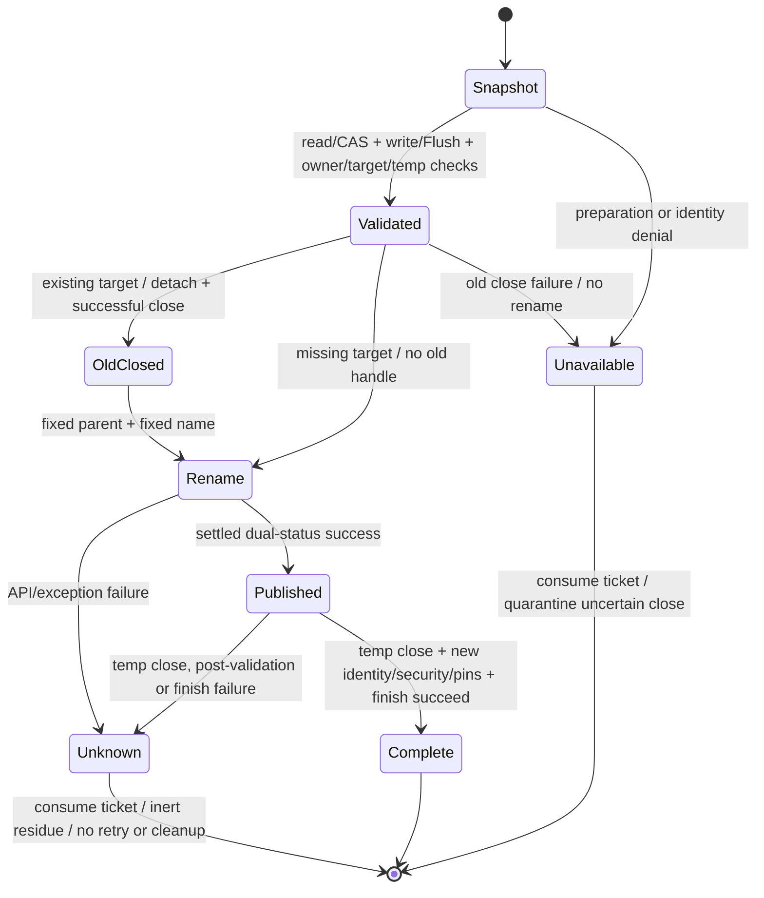

# Association publication diagnostic candidate

This directory contains a future L1 harness candidate, not an experiment grant.
It neither replaces nor modifies the untracked frozen Batch 2 harness/evidence.
The P20 publication candidate uses NtSetInformationFile. Native ABI 3 and the public
failure vocabulary remain unchanged. Real publication is not proven repaired.

## Stop and evidence contract

`association_probe.cpp` uses the original fixed synthetic association sequence.
Every unexpected status or shape stops that sequence immediately. Missing at
begin1, resourceLimit at begin2, invalidInput for the consumed ticket and the
Bridge denial are expected only in those named steps. A first commitUnknown
skips all later begin/protect/commit/abort calls. The only subsequent helper
call is one owner-close attempt through RAII; Native Core owns transaction
release and quarantines unknown closes without retry. No file cleanup occurs.
Failure, exception or budget observation failure returns nonzero. The ledger
retains the first failure, attempted-call counts and the unexecuted steps.

`runner_sequence.ps1` stops on any nonzero result or invocation exception and
records the modes not launched. `run_candidate.ps1` freezes runner, sequence,
DLL and executable hashes plus exact Git head. The additional SHA-256 source
manifest freezes every Native directory file and the exact file set, including
the authorized uncommitted harness overlay. Its own hash and the pure gate hash
are checked before parsing/dot-sourcing; unknown or missing files are rejected.
`-VerifyFreezeOnly` ends after artifact/HEAD/source checks, before any lab-object
inspection or probe launch; it is permitted in L0. Neither switch grants L1. It is dry-run by default and
requires an existing empty state directory before any probe mode. Preparation
selects environment B: an independently approved Windows test environment using
the unchanged Helper known-folder root. Batch 2's leftovers in the original
environment deliberately prevent execution; never remove them to satisfy it.
The operator must separately verify the frozen device/SID/OS/local-fixed-NTFS
and complete parent/lock/object inventory immediately before invocation. The
runner's empty-state check is only one gate, not a replacement for that preflight. A separately approved batch must also specify its full object,
event, time and recovery plan. This candidate is not a complete batch approval.

Successful sequence counts across four processes: ABI 3 (symbols resolves only),
App/Bridge acquire 1 each, Protect 2, App begin 5, Bridge begin 1, commit 3
(including consumed-ticket rejection), abort 2 and owner close 2: 20 exported
function calls. Failure reduces those counts; ceilings never override STOP.

Counters have separate meanings: `attempted` increments immediately before
calling an export (including a throwing fake and owner close); `returned` means
normal return; `completed` means the returned status/output checks finished,
including rejected results; `successful` means status 0 (or the ABI version
query returning the expected version), independently of shape checks; `accepted`
means expected status and valid shape. Expected Missing/resourceLimit/stale-ticket
and Bridge denials are accepted probes, not successful status-bearing calls.
Resource measurement success is separate; a measurement failure prevents PASS
without retroactively changing returned/completed Native counts. The first
failure is immutable; later close and sampling failures retain their own log
records. Unknown/throwing close consumes ownership before the one attempt.
The log also retains attempted-but-not-completed steps and every sampling
failure. stdout is unbuffered; abrupt interruption without final counters is
incomplete evidence, never an invented exact total or PASS.

First publication (`commit1` + exact ciphertext read-back at `begin3`) must pass
before Abort and the existing-target phase. `begin4` verifies that Abort left
the first ciphertext intact and transfers a positive ticket; only then may
`commit2` replace the existing target. `begin5` must return the second ciphertext
byte-for-byte with another positive ticket. Failure anywhere in first creation
makes replacement unreachable; no diagnostic read/retry follows commitUnknown.

The process samples its own OS peak working set and peak commit charge plus
current handle count before helper work, after every completed helper call and
after owner close. Memory peaks include between-sample work. Handle maximum is
explicitly **sampled**, not an exact OS high-water mark. The candidate ceilings
are 64 MiB for each memory peak and 128 sampled handles, requiring explicit
inclusion in any future grant. These observations are not an asynchronous
watchdog and cannot interrupt a stuck native call. A future batch needs its own
approved timeout/recovery policy; no force termination is supplied here.

## Internal failure classification

`ProtectedObjects::association_commit` accepts an optional caller-owned internal
`CommitDiagnostic`. It records admission, prepare, old-target close, rename, published-close,
published-validation or complete; independent flags distinguish exceptions and
final transaction-release failure. The exported wrapper supplies no diagnostic
pointer. No OS code, path, identity or payload is recorded or exported.

All original failure mappings are retained. In particular, rename returning
non-success, an exception after entering rename, post-rename close/validation
failure and final release failure after entering rename remain commitUnknown.
Old-target close failure before entering rename remains unavailable and
quarantines the owner without retrying its detached handle.
Stage classification is not evidence that an ambiguous rename did or did not
publish. Core fake tests cover new/existing targets and inert leftovers.

## Publication API assessment and approved G0-L0 candidate

Official references inspected for this candidate:

- [FILE_RENAME_INFO](https://learn.microsoft.com/en-us/windows/win32/api/winbase/ns-winbase-file_rename_info)
- [SetFileInformationByHandle](https://learn.microsoft.com/en-us/windows/win32/api/fileapi/nf-fileapi-setfileinformationbyhandle)
- [FILE_RENAME_INFORMATION](https://learn.microsoft.com/en-us/windows-hardware/drivers/ddi/ntifs/ns-ntifs-_file_rename_information)
- [NtSetInformationFile](https://learn.microsoft.com/en-us/windows-hardware/drivers/ddi/ntifs/nf-ntifs-ntsetinformationfile)

The current Win32 documentation allows a directory handle in RootDirectory for
a relative filename. FileNameLength counts bytes and need not include a NUL.
The frozen Batch 2 source supplies the fixed name with a terminating NUL and excludes
it from FileNameLength. Its SDK x64 layout is alignment 8, size
24, offsets 8/16/20, name bytes 32, supplied buffer bytes 54 and capacity 58.
There is no demonstrated alignment, truncation or NUL overrun defect here.

The parent is the verified state directory pin. It requests READ_CONTROL,
FILE_READ_ATTRIBUTES, SYNCHRONIZE, FILE_LIST_DIRECTORY and FILE_TRAVERSE, and
shares read/write but not delete. The native rename documentation describes
traverse/read-attribute access for the root handle and a separate target open
requesting write-data/synchronize. The temp requests DELETE, write-data,
read-attribute, READ_CONTROL and SYNCHRONIZE, with no sharing. The existing
target read allows read/delete sharing. No evidence yet justifies widening
access/sharing or dropping the parent pin.

New and existing publication differ only in ReplaceIfExists derived from the
validated snapshot. Success then closes the temp and rechecks owner, target
identity and security. Batch 2 exercised only the new-file branch; its status
7 and missing target do not identify the actual GetLastError or uniquely select
API failure versus post-publication failure. Its STOP violation and absent
memory measurements must remain attached to any archived observation.

The approved P20-only G0-L0 candidate resolves NtSetInformationFile in the
already-loaded user-mode ntdll module, with the NTAPI signature and class 10.
`association_rename.h` is the actual production seam also called by fake tests.
Its fixed-name structure has x64 alignment 8, offsets 8/16/20, storage size 56
and request length 56, meeting the 24-byte base plus 32 filename-byte documented
minimum without exceeding the 56-byte allocation. FileNameLength stays 32 and
excludes NUL; the fake rejects 52 and over-capacity lengths. It keeps
the validated parent, original existence flag and synchronous DELETE-bearing
temp. Direct NTSTATUS and IO_STATUS_BLOCK.Status must both be exactly zero;
pending, missing export, warning, mismatched or untouched completion fail unknown.
There is no retry, path fallback, access/share relaxation or raw OS-code output.
The native call cannot be used with an asynchronous handle; the existing open
path supplies FILE_SYNCHRONOUS_IO_NONALERT. No asynchronous wait is introduced.

Readiness sections 9.B.4 and 12 record the narrowly approved API candidate.
This is not proof of the Batch 2 root cause or of a successful real replacement.
Real behavior requires a separately approved L1 batch and remains untested.

## Target handle lifecycle and race boundary

Static reference analysis of the native core: `association_begin` assigns
`lease->target`, inspects it into `target_identity` and reads ciphertext from it.
`target_current` independently reopens the fixed name, compares its full policy
and volume/file identity with that captured value, then closes the transient
handle. Commit repeats that check after Flush and validates the temp immediately
before releasing the retained old target. `finish` closes any remaining target
on preparation failure, abort or owner release. After the new pre-rename close,
the retained field is null, so neither finish nor owner close retries it.

The contract retains original identity values, not a requirement for a destination
HANDLE to remain open throughout the transaction. Class 10 publication now closes
the verified old target once, while preserving owner/lock/all parent pins. Close
failure is unavailable with quarantine and no rename. After entering rename,
uncertain publication remains commitUnknown. New-target publication skips the
old-handle close; successful publication still closes the temp and reopens and
validates the published temp identity/security and all owner pins.

Writer-lock exclusion applies to cooperating processes following this protocol.
It supplies no exclusion against arbitrary same-SID or Administrator code. Such
code can replace/mutate/remove the target after the last check and successful
close, before rename. The candidate may fail unknown or overwrite an intervening
object; validation of the newly published temp cannot establish which object was
replaced at that instant. This is the existing accepted §9.B.5/9.D same-SID risk.
Closing the old handle does not eliminate TOCTOU, provide anti-rollback, or relax
cross-SID DACL requirements. Parent binding, access/sharing and the OS writer lock
remain unchanged. Real class 10 behavior and platform compatibility remain pending.

If a future approved diagnostic wrapper records GetLastError, it must capture
it immediately after the failed API call, before any other call; emit only the
numeric code and fixed stage through the separately approved test channel.
Never add it to the production C ABI, Dart failure or MCP response.

## Offline checks

`check_offline.ps1` builds the production DLL, checks ABI/hardening/imports, then
checks the four fake-only executables for forbidden imports before running
CTest. The probe test compiles the same sequence with the entire DLL loader,
process sampler and real entry point excluded. Runner tests inject a process-free
callback and reject invocation exceptions and malformed results at each mode.
Pure source-freeze tests reject hash/path drift, duplicates and traversal. The rename executable calls the production packing/status seam with synthetic
handles and a fake NTAPI function, including new/existing and inconsistent
completion cases. Core fakes reject an open destination and exercise successful
old-target close, close failure/quarantine, existing identity drift and uncertain
post-publication results. Probe fakes also inject exceptions at every post-acquire
call boundary and assert zero subsequent operations except one owner close.
These tests do not resolve or invoke a native export.

`SHIROHA_L1_CANDIDATE_BUILD=ON` compiles the real candidate separately; it is
never a CTest entry. Compilation and static inspection do not authorize loading
the DLL or executing any candidate mode, including symbols/abi.

HOST_STABILITY_HALT = ACTIVE; TRANSPORT = BLOCKED; AR-R6A = NOT_ACCEPTED.
